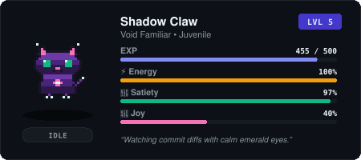

# GitHub Profile Pet

A customizable, virtual developer pet companion hosted natively in your GitHub repository and driven by autonomous GitHub Actions workflows.

The pet currently features **serverless care interactions** (Feed, Train, Rest, Pet via native GitHub Issue Forms), **deterministic passive vitals simulation** (hunger and happiness decay over elapsed time), and **automated SVG badge publishing** to your profile README. Automated progression rewards based on live GitHub contribution activity are architecturally specified and planned on the project roadmap.

<!-- START_SECTION:github-profile-pet -->
<p align="center">
  
</p>
<!-- END_SECTION:github-profile-pet -->

---

## Architecture at a Glance (GitHub-Native Runtime)

GitHub Profile Pet operates on a **100% GitHub-Native, serverless architecture**. Rather than depending on a central hosted service or database, the GitHub platform itself serves as the execution runtime, state store, and interaction interface.

```mermaid
graph LR
    subgraph User Repository & Profile
        A[GitHub Profile README] <-- Embeds -- B[public/pet.svg]
        C[pet/state/pet.json] <--> D[GitHub Actions Runtime]
        E[pet/ledger/actions.json] <--> D
        F[pet/ledger/contributions.json] <--> D
    end

    subgraph GitHub-Native Interactions
        G[User Opens Care Issue] --> H[pet-interaction.yml]
        H --> D
        I[Scheduled Hourly Cron] --> J[pet-publisher.yml]
        J --> D
        D --> B
    end
```

### Core Architecture Principles:
1. **GitHub is the Runtime:** Each user's repository is the self-contained home of their virtual pet.
2. **Repository as Database:** Pet state (`pet/state/pet.json`), care ledgers (`pet/ledger/actions.json`), and contribution tracking (`pet/ledger/contributions.json`) are stored as durable, version-controlled JSON documents validated by strict JSON schemas (`pet/schemas/`).
3. **Scheduled & Event Automation:** Autonomous workflows running on GitHub Actions handle passive vitals decay simulation, care action processing, and SVG badge generation.
4. **Native Interaction Model:** Users interact with their companion through standard GitHub Issue Forms (Feed, Train, Rest, Pet). Issues are processed, labeled, and closed automatically by Actions.
5. **Dynamic Visual Embed:** The pet renders as a self-contained SVG badge (`public/pet.svg`), embedded directly into the developer's profile README.
6. **Zero Operational Cost Target:** Designed to operate at **₹0/month recurring cost**, utilizing standard GitHub Actions compute and repository storage within GitHub's published usage limits and runner availability (no claims of unlimited or guaranteed capacity).
7. **Current Feature Scope vs. Planned Roadmap:**
   - **Currently Implemented & Active:** Native care actions via Issue Forms (Feed, Train, Rest, Pet), passive decay simulation over elapsed time, and automated SVG badge publication to README.
   - **Planned Contribution Synchronization (Not Yet Active):** Automated rewards based on genuine developer activity across four public categories (`commits`, `issues`, `pullRequests`, `pullRequestReviews`) are architecturally designed (Phase 3C2) and currently in development. The pet does **not** yet earn XP or satiety from live GitHub contributions.
   - **Deferred:** Support for private contribution synchronization remains deferred (Mode A: public contribution categories only).

> [!NOTE]
> **Legacy Architecture Notice:** Earlier development iterations (Sprint 1–2.6) prototyped a centralized Next.js and PostgreSQL multi-tenant architecture. Those 67 legacy files (`src/lib/db/`, `migrations/`, `docker-compose.yml`, and old server OAuth routes) are preserved in the repository strictly for historical engineering reference and selected component context. They are **not** dependencies of the active GitHub-native runtime. See [`docs/legacy-centralized-architecture.md`](docs/legacy-centralized-architecture.md) for full boundary details.

---

## Active GitHub Actions Workflows

The companion operates via three active workflows in [`.github/workflows/`](.github/workflows/):

| Workflow Name | File | Exact Triggers & Cadence | Least-Privilege Permissions | Description & Role |
| :--- | :--- | :--- | :--- | :--- |
| **Pet SVG Publication** | [`pet-publisher.yml`](.github/workflows/pet-publisher.yml) | 1. `schedule`: `47 * * * *` (Hourly)<br>2. `schedule`: `23 */6 * * *` (Every 6h)<br>3. `workflow_dispatch` (`force_render`: bool) | `contents: write` | Simulates passive hunger/happiness decay over elapsed time and commits updated vitals and `public/pet.svg`. |
| **Pet Care Action Inbox** | [`pet-interaction.yml`](.github/workflows/pet-interaction.yml) | 1. `issues`: `[opened]`<br>2. `schedule`: `47 * * * *` (Hourly recovery sweep)<br>3. `workflow_dispatch` | `contents: write`, `issues: write` | Drains pending care action issues (`pet-action:pending`), verifies trainer identity, executes state transitions, and closes issues with feedback labels. |
| **Diagnostics Contribution Probe** | [`diagnostics-contribution-probe.yml`](.github/workflows/diagnostics-contribution-probe.yml) | 1. `workflow_dispatch` only (`owner_login`: string) | `contents: read` | **Diagnostic Tool Only:** Verifies read-only GraphQL public contribution queries and numeric identity resolution using `GITHUB_TOKEN`. Does **not** award XP or synchronize production state. |

---

## Operating Your GitHub Profile Pet

### 1. Repository Setup & Workflow Permissions
To enable your repository to run the autonomous pet:
1. Fork or clone this repository to your GitHub account.
2. In your repository, navigate to **Settings > Actions > General**:
   - Under **Workflow permissions**, select **Read and write permissions**.
   - Check **Allow GitHub Actions to create and approve pull requests** (if applicable).
3. Ensure **Issues** are enabled under **Settings > General > Features > Issues**.
4. *(Optional)* If your GitHub username differs from the repository owner name, set a repository variable `PET_OWNER_LOGIN` in **Settings > Secrets and variables > Actions > Variables**.

### 2. First-Run Initialization (Required Initial Step)
In a newly forked repository, GitHub Actions scheduled workflows are initially inactive until repository activity occurs, and the initial badge is not yet generated:
1. Navigate to the **Actions** tab in your repository.
2. Under **All workflows** in the left sidebar, click **Pet SVG Publication**.
3. Click the **Run workflow** dropdown and click the green **Run workflow** button.
4. Once completed, your initial pet visual badge (`public/pet.svg`) and state will be committed to your repository.

### 3. Embed into Your GitHub Profile
Add the dynamic SVG badge to your special profile README (`<username>/<username>/README.md`):

```markdown
<!-- START_SECTION:github-profile-pet -->
<p align="center">
  /GitHub-Profile-Pet/main/public/pet.svg" alt="My GitHub Profile Pet" width="450" height="200" />
</p>
<!-- END_SECTION:github-profile-pet -->
```

### 4. Interacting with Your Pet
Care for your companion using native GitHub Issue Forms under **Issues > New issue**:
- **🍖 Feed Pet:** Restore satiety and earn base XP.
- **⚡ Train Pet:** Spend energy to increase happiness and earn progression XP.
- **💤 Rest Pet:** Put your companion to sleep to restore energy.
- **❤️ Pet Companion:** Offer affection to maintain positive mood.

---

## Contributor & Development Guide

For developers contributing to the GitHub Profile Pet codebase, all core logic, simulation engines, and test suites run locally using Node.js and TypeScript.

### 1. Prerequisites
- **Node.js**: v22.0.0 or higher
- **npm**: v10.0.0 or higher

### 2. Validation & Testing Commands

```bash
# Run unit test suite (121 tests)
npm test

# Run pet-engine test suite (218 tests: simulation, journal, care transitions, SVG)
npm run test:pet-engine

# Run all automated tests (339 tests)
npm run test:all

# Run static analysis (ESLint)
npm run lint

# Run TypeScript type check
npx tsc --noEmit

# Build production bundle (Turbopack)
npm run build
```

### 3. Local Runtime Scripts

```bash
# Render the pet SVG badge locally from current state
npm run render:svg

# Simulate passive vitals decay over elapsed time
npm run simulate:pet

# Run full simulation and update public/pet.svg
npm run publish:pet

# Process pending care actions locally
npm run process:inbox
```

### 4. Optional Local Dashboard Viewer
```bash
# Start local Next.js development server
npm run dev
```
> [!NOTE]
> `npm run dev` starts an optional local companion viewer and UI component playground at `http://localhost:3000`. This web server is strictly a development and inspection convenience; it is **not** required for the autonomous GitHub-native pet to run, nor is it a supported hosted cloud product.

---

## Documentation

- [Character Art & Sprite Specifications](docs/architecture/character-art-specification.md)
- [Phase 2 SVG Vector Rendering Engine](docs/architecture/phase-2-svg-rendering.md)
- [Phase 3 GitHub Actions Runtime Architecture](docs/architecture/phase-3-github-actions-runtime.md)
- [Phase 3B GitHub-Native Interaction Model](docs/architecture/phase-3b-github-native-interaction.md)
- [Legacy Centralized Architecture Reference](docs/legacy-centralized-architecture.md)
