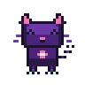
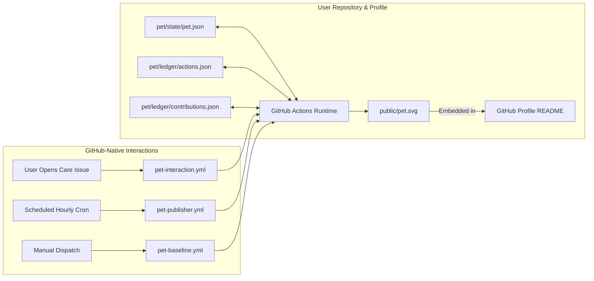

# GitHub Profile Pet

A playable virtual developer companion hosted natively in your GitHub repository, powered by autonomous GitHub Actions workflows and a live [GitHub Pages game interface](https://mnp210.github.io/GitHub-Profile-Pet/?repo=mnp210%2FGitHub-Profile-Pet).

<!-- START_SECTION:github-profile-pet-menu -->
<div align="center">

<h2><a href="https://mnp210.github.io/GitHub-Profile-Pet/?repo=mnp210%2FGitHub-Profile-Pet">&#9876;&#65039; Shadow Claw &mdash; Shadow Companion Hub</a></h2>
<p><strong>Void Familiar</strong> &middot; <code>Lv. 4</code> &middot; <code>Hatchling</code> &middot; <code>Gen #67</code></p>

<table>
  <thead>
    <tr>
      <th align="center">Companion</th>
      <th align="left">Status Panel</th>
    </tr>
  </thead>
  <tbody>
    <tr>
      <td align="center" width="180">
        <a href="https://mnp210.github.io/GitHub-Profile-Pet/?repo=mnp210%2FGitHub-Profile-Pet" title="Launch Shadow Claw in GitHub Profile Pet">
          
        </a>
        <br />
        <a href="https://mnp210.github.io/GitHub-Profile-Pet/?repo=mnp210%2FGitHub-Profile-Pet"><strong>&#9654; Launch Game</strong></a>
      </td>
      <td align="left">
        <strong>XP Progress:</strong> <code>██████████</code> <strong>390 / 400 XP</strong> (98%)<br />
        <strong>Mood:</strong> Happy &nbsp;&middot;&nbsp; <strong>Personality:</strong> Curious<br /><br />
        <strong>Energy:</strong> <code>██████████</code> 100%<br />
        <strong>Satiety:</strong> <code>████████░░</code> 75%<br />
        <strong>Happiness:</strong> <code>████░░░░░░</code> 40%
      </td>
    </tr>
  </tbody>
</table>

### Game Menu

| Menu Section | Destination | Purpose |
| :--- | :--- | :--- |
| <a href="https://mnp210.github.io/GitHub-Profile-Pet/?repo=mnp210%2FGitHub-Profile-Pet"><strong>CARE</strong></a> | [Open Care Hub](https://mnp210.github.io/GitHub-Profile-Pet/?repo=mnp210%2FGitHub-Profile-Pet) | Feed, train, rest, and pet Shadow Claw in real time |
| <a href="https://mnp210.github.io/GitHub-Profile-Pet/?repo=mnp210%2FGitHub-Profile-Pet"><strong>PLAY ZONE</strong></a> | [Open Game](https://mnp210.github.io/GitHub-Profile-Pet/?repo=mnp210%2FGitHub-Profile-Pet) | Launch interactive mini-games from the main interface |
| <a href="https://mnp210.github.io/GitHub-Profile-Pet/?repo=mnp210%2FGitHub-Profile-Pet"><strong>WARDROBE</strong></a> | [Open Game](https://mnp210.github.io/GitHub-Profile-Pet/?repo=mnp210%2FGitHub-Profile-Pet) | Equip unlocked cosmetics and shadow accessories |
| <a href="https://mnp210.github.io/GitHub-Profile-Pet/?repo=mnp210%2FGitHub-Profile-Pet"><strong>BOND</strong></a> | [Open Game](https://mnp210.github.io/GitHub-Profile-Pet/?repo=mnp210%2FGitHub-Profile-Pet) | Build daily companion affinity and milestones |
| <a href="https://mnp210.github.io/GitHub-Profile-Pet/?repo=mnp210%2FGitHub-Profile-Pet"><strong>ACHIEVEMENTS</strong></a> | [Open Game](https://mnp210.github.io/GitHub-Profile-Pet/?repo=mnp210%2FGitHub-Profile-Pet) | Track unlocked milestones and progression rewards |
| <a href="https://mnp210.github.io/GitHub-Profile-Pet/?repo=mnp210%2FGitHub-Profile-Pet&amp;action=stats"><strong>PET PROFILE</strong></a> | [View Pet Stats](https://mnp210.github.io/GitHub-Profile-Pet/?repo=mnp210%2FGitHub-Profile-Pet&action=stats) | Inspect full companion telemetry and ledger status |

**Quick Care Actions:** [Feed](https://mnp210.github.io/GitHub-Profile-Pet/?repo=mnp210%2FGitHub-Profile-Pet&action=feed) &middot; [Train](https://mnp210.github.io/GitHub-Profile-Pet/?repo=mnp210%2FGitHub-Profile-Pet&action=train) &middot; [Rest](https://mnp210.github.io/GitHub-Profile-Pet/?repo=mnp210%2FGitHub-Profile-Pet&action=rest) &middot; [Pet](https://mnp210.github.io/GitHub-Profile-Pet/?repo=mnp210%2FGitHub-Profile-Pet&action=pet)

<sub>Static snapshot synced from <code>pet/state/pet.json</code> (2026-11-26T14:45:27.622Z).<br />GitHub READMEs do not run JavaScript or iframes; clicking any menu item launches the live web game. <code>CARE</code> and <code>PET PROFILE</code> use supported query parameters (<code>?repo=</code>, <code>?action=stats</code>); <code>PLAY ZONE</code>, <code>WARDROBE</code>, <code>BOND</code>, and <code>ACHIEVEMENTS</code> open the main game view directly.</sub>

</div>
<!-- END_SECTION:github-profile-pet-menu -->

---

## Architecture at a Glance (GitHub-Native Runtime)

GitHub Profile Pet operates on a **100% GitHub-Native, serverless architecture**. Rather than depending on a centralized hosted service, external cloud database, or paid API, the GitHub platform itself serves as the execution runtime, state store, and interaction interface.



### Core Architecture Principles:
1. **GitHub is the Runtime:** Each user's repository is the self-contained home of their virtual pet.
2. **Repository as Database:** Pet vitals (`pet/state/pet.json`), care ledgers (`pet/ledger/actions.json`), and contribution tracking (`pet/ledger/contributions.json`) are stored as durable, version-controlled JSON documents validated by strict schemas (`pet/schemas/`).
3. **Scheduled & Event Automation:** Autonomous workflows running on GitHub Actions handle passive vitals decay simulation, care action processing, and SVG badge generation.
4. **Native Interaction Model:** Users interact with their companion through standard GitHub Issue Forms (Feed, Train, Rest, Pet). Issues are evaluated, labeled, and closed automatically by Actions.
5. **Dynamic Visual Embed:** The pet renders as a self-contained SVG badge (`public/pet.svg`), embedded directly into the developer's profile README.
6. **Zero Operational Cost:** Designed to operate at **₹0 / $0 per month recurring cost**, utilizing standard GitHub Actions compute and repository storage without external services.

> [!NOTE]
> **Legacy Architecture Notice:** Earlier development iterations (Sprint 1–2.6) prototyped a centralized Next.js and PostgreSQL multi-tenant architecture. Those legacy files (`src/lib/db/`, `migrations/`, `docker-compose.yml`, and old server OAuth routes) are preserved in the repository strictly for historical engineering reference. They are **not** dependencies of the active GitHub-native runtime. See [`docs/legacy-centralized-architecture.md`](docs/legacy-centralized-architecture.md) for full boundary details.

---

## Active GitHub Actions Workflows

The companion operates via dedicated production workflows in [`.github/workflows/`](.github/workflows/):

| Workflow Name | File | Exact Triggers & Cadence | Least-Privilege Permissions | Description & Role |
| :--- | :--- | :--- | :--- | :--- |
| **Deploy Playable Game to GitHub Pages** | [`deploy-pages.yml`](.github/workflows/deploy-pages.yml) | 1. `push`: `[main]`<br>2. `workflow_dispatch` | `contents: read`, `pages: write`, `id-token: write` | Builds static assets and deploys the full-featured playable virtual pet game to GitHub Pages. |
| **Pet Activity Progression** | [`pet-activity.yml`](.github/workflows/pet-activity.yml) | 1. `push`: `[main]`<br>2. `issues`: `[opened]`<br>3. `pull_request`: `[opened, closed]`<br>4. `pull_request_review`: `[submitted]`<br>5. `schedule`: `*/30 * * * *`<br>6. `workflow_dispatch` | `contents: write`, `issues: read`, `pull-requests: read` | Processes commits, merged PRs, reviews, and issues into pet XP progression with permanent deduplication. |
| **Pet SVG Publication** | [`pet-publisher.yml`](.github/workflows/pet-publisher.yml) | 1. `schedule`: `47 * * * *` (Hourly)<br>2. `workflow_dispatch` (`force_render`: bool) | `contents: write` | Simulates passive hunger/happiness decay over elapsed time and publishes updated vitals and `public/pet.svg`. |
| **Pet Care Action Inbox** | [`pet-interaction.yml`](.github/workflows/pet-interaction.yml) | 1. `issues`: `[opened]`<br>2. `schedule`: `47 * * * *` (Hourly sweep)<br>3. `workflow_dispatch` | `contents: write`, `issues: write` | Drains pending care action issues (`pet-action:pending`), verifies trainer identity, executes state transitions, and closes issues with feedback labels. |
| **Diagnostics Contribution Probe** | [`diagnostics-contribution-probe.yml`](.github/workflows/diagnostics-contribution-probe.yml) | `workflow_dispatch` only (`owner_login`: string) | `contents: read` | **Diagnostic Tool Only:** Verifies read-only GraphQL public contribution queries and numeric identity resolution using `GITHUB_TOKEN`. Does **not** mutate state. |
| **Pet Baseline Initialization** | [`pet-baseline.yml`](.github/workflows/pet-baseline.yml) | `workflow_dispatch` only | `contents: write` | **One-Time Setup Only:** Establishes the authoritative contribution baseline for a fresh installation. Fails closed if already established. |

---

## Step-by-Step Installation & Setup Guide

Follow these steps to set up your own autonomous GitHub Profile Pet:

### Step 1: Fork or Clone into Your Account
1. Click **Fork** in the top-right corner of this repository to create a copy under your personal GitHub account.
2. Select your personal account as the destination and retain the default repository name `GitHub-Profile-Pet`.

### Step 2: Configure Actions & Issues Permissions
1. In your newly forked repository, navigate to **Settings > Actions > General**:
   - Under **Workflow permissions**, select **Read and write permissions**.
   - Check **Allow GitHub Actions to create and approve pull requests** (if available).
   - Click **Save**.
2. Navigate to **Settings > General**:
   - Under **Features**, ensure the **Issues** checkbox is enabled (required for pet care interaction forms).

### Step 3: Owner Identity Resolution
By default, the pet automatically resolves your username and numeric database ID using GitHub Actions standard context (`github.repository_owner` and `github.repository_owner_id`).
- No secret keys or Personal Access Tokens (PAT) are required; workflows run securely with the built-in `GITHUB_TOKEN`.
- *(Optional)* If your repository is hosted under an organization or requires an explicit override, you may configure a repository variable `PET_OWNER_LOGIN` in **Settings > Secrets and variables > Actions > Variables**. If set, it is strictly validated against the repository owner.

### Step 4: Establish the One-Time Contribution Baseline
> [!IMPORTANT]
> **Baseline establishment is a strict one-time initialization step.** It records your starting contribution counts so you only earn pet rewards for new, genuine activity.
> Ensure your repository working tree is clean (no uncommitted or untracked changes) before dispatching baseline establishment.
> **DO NOT** rerun this workflow to fix ordinary publication or interaction issues; once established, the baseline is permanently protected against overwriting.

1. Navigate to the **Actions** tab in your repository.
2. In the left sidebar under **All workflows**, select **Pet Baseline Initialization**.
3. Click the **Run workflow** dropdown on the right:
   - In **Type your GitHub username**, enter your exact GitHub username (e.g. `your-username`).
   - If initializing a freshly forked repository that inherited the template's baseline, check **Set to true ONLY if initializing a fresh fork that inherited another owner ledger** (or set `reinitialize_foreign_fork: true`).
4. Click the green **Run workflow** button.
5. Wait ~30 seconds for the run to complete with a green checkmark.

### Step 5: Verify Successful Initialization
You can verify successful baseline initialization directly on GitHub:
1. Open [`pet/ledger/contributions.json`](pet/ledger/contributions.json).
2. Confirm that `"installationBaseline"` has `"completed": true` and `"ownerLogin"` matches your username.

### Step 6: Enable Publication & Generate Badge
1. In the **Actions** tab, select **Pet SVG Publication**.
2. Click **Run workflow** (leave `force_render: false`) and click the green **Run workflow** button.
3. Once completed, your initial pet visual badge (`public/pet.svg`) and initial state are committed to your repository.

### Step 7: Embed into Your GitHub Profile README
Add the dynamic SVG badge to your special profile repository (`<username>/<username>/README.md`):

```markdown
<!-- START_SECTION:profile-pet -->
<p align="center">
  /GitHub-Profile-Pet/main/public/pet.svg" alt="My GitHub Profile Pet" width="450" height="200" />
</p>
<!-- END_SECTION:profile-pet -->
```

*(Replace `<YOUR_USERNAME>` with your actual GitHub username).*

### Step 8: Interacting with Your Pet
Care for your companion using native GitHub Issue Forms under **Issues > New issue**:
- **🍖 Feed Pet:** Restore satiety and earn base XP.
- **⚡ Train Pet:** Spend energy to increase happiness and earn progression XP.
- **💤 Rest Pet:** Put your companion to sleep to restore energy.
- **❤️ Pet Companion:** Offer affection to maintain positive mood.

Each submitted issue is evaluated by `pet-interaction.yml`, which verifies trainer authorization, applies vitals transitions, leaves an outcome reaction comment, and automatically closes the issue.

---

## Troubleshooting First-Run Issues

| Symptom / Error | Root Cause | Solution |
| :--- | :--- | :--- |
| **`Baseline Refused (F-04): Inherited foreign baseline detected`** | The forked repository still contains the template maintainer's baseline ledger. | Dispatch **Pet Baseline Initialization** with `reinitialize_foreign_fork: true` and your exact username in `confirm_owner`. |
| **`Baseline Refused (F-04): Installation baseline has already been established`** | The baseline has already been established for your account. | Normal behavior. Do not rerun baseline; baseline initialization is permanently locked to prevent cheating. |
| **`Unauthorized actor (@user, id: 12345). Only designated trainer can submit care actions`** | Someone other than the repository owner submitted a care action issue. | Security feature. Only the repository owner can feed or train their pet. Issues from other users fail closed. |
| **Workflow fails with `Resource not accessible by integration`** | Workflow permissions are set to read-only. | Go to **Settings > Actions > General > Workflow permissions** and select **Read and write permissions**. |
| **Scheduled cron jobs do not run immediately** | GitHub Actions schedule triggers run on a best-effort queue and are initially inactive on new forks. | Scheduled runs resume automatically once repository activity occurs. You can trigger manual updates via **Run workflow**. |

---

## Cost, Quotas & Platform Execution Boundaries

### 1. Zero Recurring Cost Architecture Goal
GitHub Profile Pet is architected with a **₹0 / $0 monthly recurring cost** design goal. It requires no paid third-party infrastructure:
- **No Paid External APIs:** Public contribution metrics are queried via GitHub's standard GraphQL endpoint using the repository's built-in `GITHUB_TOKEN`.
- **No External Database:** State and ledgers are persisted as version-controlled JSON files inside the Git repository itself.
- **No Paid Servers or Daemons:** Compute runs exclusively inside ephemeral, serverless GitHub Actions runners.
- **No Paid Schedulers:** Periodic sweeps use standard GitHub Actions `schedule` (cron) triggers.

> [!NOTE]
> While the software architecture itself incurs zero recurring licensing or hosting fees, execution on private repositories consumes compute resources from your GitHub account's Actions allowance. Billing outcomes depend entirely on your repository's visibility, account plan, and spending limit settings.

---

### 2. Authoritative GitHub Actions Billing, Quotas & Runner Pricing

Resource consumption on GitHub Actions follows authoritative GitHub platform policies ([GitHub Actions Billing & Usage](https://docs.github.com/en/billing/concepts/product-billing/github-actions), [Product Usage Included with Each Plan](https://docs.github.com/en/billing/reference/product-usage-included), and [Actions Runner Pricing](https://docs.github.com/en/billing/reference/actions-runner-pricing)):

#### A. Included Compute Usage Model (Monetary Allowance)
Modern GitHub Actions does not allocate a static, fixed bucket of runner minutes. Instead, GitHub accounts receive a **monthly monetary compute allowance** that resets at the start of each billing cycle:
- **GitHub Free (Personal):** **$12.00 USD / month** included compute
- **GitHub Pro:** **$18.00 USD / month** included compute
- **GitHub Free (Organizations):** **$12.00 USD / month** included compute
- **GitHub Team:** **$18.00 USD / month** included compute
- **GitHub Enterprise Cloud:** **$300.00 USD / month** included compute

*What draws from this shared monetary pool:* Standard GitHub-hosted runners for private or internal repositories, cloud sandbox compute/memory, and larger runners (on Team/Enterprise). All eligible compute draws from the same pool without priority.

#### B. Runner Specification by Repository Visibility
All workflows in this repository specify `runs-on: ubuntu-latest`. In accordance with official GitHub documentation ([GitHub-Hosted Runners Reference](https://docs.github.com/en/actions/reference/runners/github-hosted-runners)), hardware profiles differ based on repository visibility:
- **Public Repositories:** Standard Linux x64 runner provides **4 vCPUs, 16 GB RAM, and 14 GB SSD storage**. Execution on public repositories is **100% free of charge** ($0.00 billed) and does not draw from or reduce your account's included monthly compute allowance.
- **Private Repositories:** Standard Linux x64 runner provides **2 vCPUs, 8 GB RAM, and 14 GB SSD storage** (SKU: `actions_linux`). Billed at **$0.006 USD per minute** (1x multiplier) drawing from your monthly monetary compute allowance.
- **No Larger Runners:** This project never requests GitHub Larger Runners (4-core to 96-core or GPU), which carry higher multipliers and separate pricing.

#### C. Per-Job Whole-Minute Rounding Rule (Private Repositories)
For private repositories, GitHub Actions rounds the billable execution time of every individual job **up to the nearest whole minute**. A lightweight job executing in 15 to 45 seconds consumes **1 full billable minute** ($0.006 USD) against your compute allowance.

#### D. Private Repositories — Estimated Cost & Allowance Scenarios
If the monthly allowance were spent entirely on standard Linux 2-core runners ($0.006/min), the monetary allowance would equate to an illustrative capacity of 2,000 minutes on GitHub Free ($12.00 ÷ $0.006) or 3,000 minutes on GitHub Pro/Team ($18.00 ÷ $0.006). However, because other account workloads draw from the same monetary pool, actual capacity depends on overall account usage.

Estimated runner compute costs across a 30-day billing cycle (assuming ~20–35s average job duration, rounded to 1 billable minute per job as an illustrative lower bound):

| Operational Scenario | Cadence & Workflows | Monthly Job Executions | Estimated Billable Mins | Estimated Cost / Month | % of Free Allowance ($12/mo) | Remaining Allowance (Free) |
| :--- | :--- | :---: | :---: | :---: | :---: | :---: |
| **Scenario A: Standard Hourly** | Both `pet-publisher.yml` & `pet-interaction.yml` running hourly (48 runs/day) | 1,440 | 1,440 mins | **$8.64 USD** | **72.0%** | **$3.36 USD** |
| **Scenario B: Cadence Optimized** | Both workflows scheduled every 2 hours (`cron: '47 */2 * * *'`) (24 runs/day) | 720 | 720 mins | **$4.32 USD** | **36.0%** | **$7.68 USD** |
| **Scenario C: Publisher-Only** | `pet-publisher.yml` hourly (24 runs/day), `pet-interaction.yml` disabled | 720 | 720 mins | **$4.32 USD** | **36.0%** | **$7.68 USD** |
| **Scenario D: Event Care Overhead** | Event-triggered care actions (~2 issues/day = ~60 issues/month) | ~60 | ~60 mins | **~$0.36 USD** | **+3.0%** | — |

*Combined Scenario (Scenario A + Scenario D):* 1,440 scheduled jobs + 60 issue events = 1,500 billable minutes = **$9.00 USD / month** (**75.0%** of GitHub Free's $12.00 compute allowance, leaving **$3.00 USD**). On GitHub Pro/Team ($18.00 allowance), this represents **50.0%** of included compute, leaving **$9.00 USD**.

> [!IMPORTANT]
> These figures are illustrative estimates based on a 1-minute lower-bound rounding increment. Actual job duration may be higher during network latency or repository growth. Any other private Actions workflows or Copilot cloud sandboxes on your account draw from the same monthly monetary allowance.

#### E. Shared Concurrency & Billing Behavior
- Both runtime workflows share the concurrency group `pet-runtime-${{ github.repository }}` with `cancel-in-progress: false`.
- If an event-triggered run and a scheduled run arrive simultaneously, the second run waits in queue until the first run completes.
- **Billing Outcome:** A job is only billed if it actually starts executing on an assigned GitHub runner. If a queued run is cancelled before runner assignment, it incurs **$0.00** (0 billed minutes). Once a runner is assigned and begins job execution, it incurs at least **1 billable minute** ($0.006 USD) under whole-minute rounding.

#### F. Account Spending Controls & "Stop usage when budget limit is reached"
- **Budget Configuration:** Users manage spending controls under **Account Settings > Billing and plans > Spending limits** (or Cost Center budgets for enterprises).
- **Soft Budgets vs. Hard Budgets:** By default, GitHub spending limits act as notification-only soft alerts. To enforce a hard cap that stops billed compute once a limit is reached, you must explicitly enable **"Stop usage when budget limit is reached"** (or `prevent_further_usage: true` via API).
- **Scope of Spending Limits:** Configuring a $0.00 spending limit with stop-usage enabled prevents unexpected overage charges for Actions compute on private repositories once included compute allowances are depleted (workflows will pause until the next billing cycle). However, spending limits do not affect free public repository executions, nor do they waive existing paid account subscriptions (e.g., GitHub Pro plan fees). Users should verify their account's spending limit settings.

#### G. Distinct Storage Classifications & Allowances
GitHub Actions compute allowances do not cover storage. GitHub distinguishes three separate storage categories:
1. **Git Repository Storage:**
   - Tracked source code, JSON state documents (`pet.json`, `contributions.json`, `actions.json`), and the rendered badge (`pet.svg`) reside directly within the Git repository tree.
   - The complete project state footprint occupies **< 100 KB total** on disk.
   - This data counts toward standard Git repository storage (GitHub recommends keeping repositories under 1 GB, with a 100 GB hard limit), completely separate from GitHub Actions storage quotas.
2. **GitHub Actions Artifact Storage:**
   - Applies exclusively to workflow build artifacts, logs, and custom packages uploaded via actions.
   - Included allowances: GitHub Free (personal): 500 MB; GitHub Pro: 1 GB; GitHub Team: 2 GB; GitHub Enterprise Cloud: 50 GB.
   - **Zero Artifact Storage Used:** GitHub Profile Pet does not upload workflow artifacts (`actions/upload-artifact`), consuming 0 MB of this allowance.
3. **GitHub Actions Cache Storage:**
   - Applies to dependency and build caching (`actions/cache`), with an independent limit of **10 GB per repository**.
   - **Zero Cache Storage Used:** GitHub Profile Pet does not use Actions caching, consuming 0 MB of cache storage.

---

### 3. Best-Effort Scheduling Notice
GitHub Actions scheduled workflows (`schedule: - cron: ...`) execute on a **shared, best-effort queue**. Execution times depend on platform runner availability and global platform traffic; GitHub does not guarantee execution at the exact scheduled minute. The pet engine's passive simulation and contribution reconciliation routines are fully resilient to schedule jitter, delays, and transient gaps.

---

### 4. Two-UTC-Calendar-Day Contribution Discovery Boundary
The contribution synchronization engine inspects a rolling discovery window of **two UTC calendar days** (`[today - 1 day, today]`). In the event of an extended repository outage, workflow pause, or billing interruption lasting more than 48 hours, contributions older than two calendar days are intentionally not processed into the pet's ledger. This design strictly protects against unbounded GraphQL query payload sizes and avoids secondary rate-limit exhaustion upon resumption.

---

## Contributor & Development Guide

All core simulation logic, contribution accounting engines, and validation suites run locally using Node.js and TypeScript.

### 1. Prerequisites
- **Node.js**: v22.0.0 or higher
- **npm**: v10.0.0 or higher

### 2. Testing & Verification Suites

```bash
# Run all unit tests
npm test

# Run pet engine test suites
npm run test:pet-engine

# Run static analysis (ESLint)
npm run lint

# Run TypeScript type check
npx tsc --noEmit

# Build bundle
npm run build
```

### 3. Local Runtime Scripts

```bash
# Render the pet SVG badge locally from current state
npm run render:svg

# Simulate passive vitals decay over elapsed time
npm run simulate:pet

# Run full publication pipeline locally
npm run publish:pet

# Process pending care actions locally
npm run process:inbox
```

---

## Documentation

- [Character Art & Sprite Specifications](docs/architecture/character-art-specification.md)
- [SVG Vector Rendering Engine](docs/architecture/phase-2-svg-rendering.md)
- [GitHub Actions Runtime Architecture](docs/architecture/phase-3-github-actions-runtime.md)
- [GitHub-Native Interaction Model](docs/architecture/phase-3b-github-native-interaction.md)
- [Legacy Centralized Architecture Reference](docs/legacy-centralized-architecture.md)
