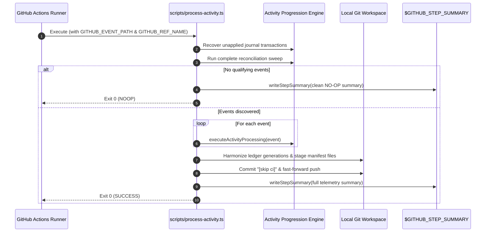

# Sprint 5.0A — Activity Progression Step Summary Implementation Report

## Summary & Objectives

This report documents the implementation of GitHub Actions execution telemetry for the **Activity Progression Workflow** (`.github/workflows/pet-activity.yml`) via `scripts/process-activity.ts`.

---

## 1. Workflow Architecture & Lifecycle

The activity progression workflow triggers on various GitHub developer actions (`push`, `issues:opened`, `pull_request:opened`, `pull_request:closed`, `pull_request_review:submitted`), as well as periodic reconciliation (`schedule: '*/30 * * * *'`) and manual dispatch (`workflow_dispatch`).

---

## 2. Key Telemetry Sections

### 2.1 Execution Context & Companion State Transition
The step summary captures a direct side-by-side transition table comparing before and after states:
- **Companion:** Name and species
- **Level:** Level before and after, highlighting `Level X 🌟 (Level Up!)` when applicable
- **XP:** Total XP accrued and progression delta (`+XP (old → new)`)
- **Vitals (Energy, Satiety, Happiness):** Numerical percentages and directional changes
- **Generation:** Monotonic state generation bump (`G_old → G_new`)

### 2.2 Evaluated Activity Events Table
Every evaluated event is individually recorded in a markdown table:
- **Event Type:** `commit`, `issue_opened`, `pr_opened`, `pr_merged`, `review_submitted`
- **Identifier:** Truncated SHA or Issue/PR reference
- **Actor:** Sanitized `@login`
- **Status:** Badge icon indicating `rewarded`, `duplicate`, `bot_filtered`, or `daily_cap`
- **XP Awarded:** Exact integer XP increment
- **Details:** Escaped commit message or issue/PR title

### 2.3 Reconciliation Sweep Telemetry
When periodic reconciliation runs:
- Counts of discovered commits, issues, PRs, and reviews.
- High-water mark checkpoints (`lastCommitSha`, `lastIssueNumber`, `lastPrNumber`).
- Completeness indicator (`✅ Fully Reconciled` or `⚠️ Incomplete / Truncated`).
- Diagnostic notices if the 5,000-commit pagination limit or time boundary was encountered.

### 2.4 Publication Telemetry
- Outcome status: `COMMITTED_AND_PUSHED`, `NO_CHANGES_COMMITTED`, or `DRY_RUN`.
- Head commit SHA.
- Verified manifest files staged and committed.

---

## 3. Failure Mode Telemetry

In the event of an unhandled exception, push retry exhaustion, or payload parsing error:
- A prominent `❌ GitHub Profile Pet — Activity Progression Failed` banner is generated.
- The failed stage name is reported (`event_payload_parsing`, `push_collision_retry_exhausted`, `activity_progression_execution`).
- The error message is sanitized (all secrets scrubbed) and escaped.
- Actionable diagnostic and recovery advice is displayed to the repository operator.
- The script exits non-zero (`process.exit(1)`), preserving GitHub Actions failure signaling while providing complete diagnostic context in the summary UI.
