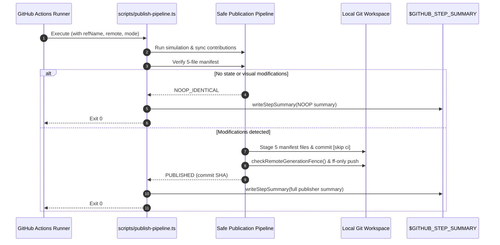

# Sprint 5.0A — SVG Publication & Simulation Step Summary Implementation Report

## Summary & Objectives

This report details the implementation of GitHub Actions execution telemetry for the **Hourly SVG Publication & Simulation Workflow** (`.github/workflows/pet-publisher.yml`) via `scripts/publish-pipeline.ts`.

---

## 1. Workflow Architecture & Lifecycle

The SVG publication workflow executes on an hourly cron schedule (`cron: '47 * * * *'`) and on manual `workflow_dispatch`. It orchestrates passive vitals simulation, public contribution fetching, level progression, SVG badge rendering, README menu alignment, 5-file manifest validation, and atomic fast-forward push.

---

## 2. Key Telemetry Sections

### 2.1 Companion Vitals & Status Table
Presents the live status of the virtual companion:
- **Name & Species:** Companion display name and sprite species.
- **Level & XP:** Current level and XP progress toward next level.
- **Energy:** Persistent energy percentage reflecting hourly recovery/decay.
- **Satiety:** Nourishment level reflecting food consumption and natural digestion.
- **Happiness:** Mood score influenced by care interactions and playtime.
- **State Generation:** Monotonic integer state generation revision (`G_x`).

### 2.2 Contribution Synchronization Telemetry Table
Reflects GitHub GraphQL API activity and rate limit consumption:
- **Increments Evaluated:** Number of UTC day windows inspected.
- **New Contributions Observed:** Delta count of verified commits/PRs/issues.
- **XP Awarded:** Satiety and experience increments earned.
- **GraphQL Query Cost:** Exact API cost charged against rate limit.
- **Rate Limit Remaining:** Clean formatted budget counter (`X / 5,000`).
- **API Latency:** Round-trip query duration in milliseconds.

### 2.3 Git Publication Telemetry Table
- **Pipeline Status:** `PUBLISHED`, `NOOP_IDENTICAL`, or `DRY_RUN`.
- **Commit SHA:** Published Git commit SHA.
- **Verified Manifest:** Staged file count and exact file list (`pet.json`, `contributions.json`, `actions.json`, `public/pet.svg`, `README.md`).
- **Push Policy:** Clear notation if push was skipped via `--dry-run` or `--skip-push`.

---

## 3. Failure Mode Telemetry

If publication fails at any phase:
- Missing `GITHUB_TOKEN`: Emits failure summary with instructions on workflow secret configuration.
- Generation Fence Violation: Explains that remote HEAD advanced concurrently and was protected from non-fast-forward overwrite.
- Manifest Mismatch: Reports unexpected files that attempted to enter the staging area outside the 5 authorized manifest paths.
- Unhandled Exceptions: Captures stack trace, redacts credentials, formats diagnostic report, and rethrows to ensure non-zero exit code.
