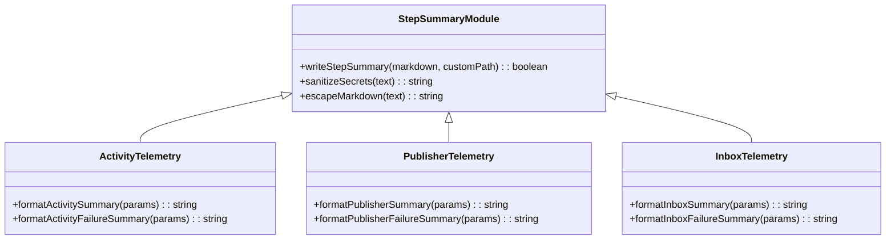

# Sprint 5.0A — Execution Telemetry & Step Summary Architecture

## Executive Overview

Sprint 5.0A introduces production-grade, human-readable execution summaries for all GitHub Actions workflows in **GitHub Profile Pet**. By standardizing telemetry output across `pet-activity.yml`, `pet-publisher.yml`, `pet-interaction.yml`, and `diagnostics-contribution-probe.yml` using GitHub's `$GITHUB_STEP_SUMMARY` interface, repository operators gain immediate, visual insight into companion progression, vitals transitions, contribution synchronization, queue drainage, and error diagnostics without parsing verbose runner logs.

---

## 1. Core Architectural Principles

### 1.1 Non-Blocking, Fail-Safe Telemetry
Telemetry collection and summary generation must **never** impede core gameplay or abort state transitions:
- `writeStepSummary` wraps all file system operations in a non-throwing `try/catch` block.
- If writing to `$GITHUB_STEP_SUMMARY` encounters an error (e.g. `ENOSPC`, permission denial, or missing directory), a warning is logged to `console.warn` and execution continues unimpeded.
- The workflow exit code is determined strictly by the underlying business logic, never by step summary generation.

### 1.2 Zero Token Persistence & Credential Sanitization
GitHub Actions runners operate in environments with sensitive secrets (`GITHUB_TOKEN`, personal access tokens, webhook payloads). The telemetry engine enforces strict secret scrubbing before any Markdown content is rendered:
- Pattern `ghp_[a-zA-Z0-9]{20,}` is redacted to `***REDACTED***`.
- Pattern `github_pat_[a-zA-Z0-9_]{20,}` is redacted to `***REDACTED***`.
- Pattern `gho_[a-zA-Z0-9]{20,}` is redacted to `***REDACTED***`.
- Authorization headers (`Bearer ...`, `token ...`) have credentials scrubbed.

### 1.3 Injection Prevention & Markdown Escaping
Untrusted strings—including Git commit messages, issue titles, branch names, and actor logins—are sanitized prior to table rendering:
- Table pipe characters (`|`) are escaped to `\|` to preserve Markdown column structure.
- HTML angle brackets (`<`, `>`) are converted to `&lt;` and `&gt;` to eliminate HTML or script injection vectors.
- Raw newlines (`\r\n`, `\n`) within table cells are converted to ` ` tags to preserve row alignment.

---

## 2. Telemetry Modules & Data Contracts

All telemetry formatting logic is housed in a dedicated, decoupled module:
- `src/features/pet-engine/reporting/stepSummary.ts`
- `src/features/pet-engine/reporting/index.ts`

### 2.1 Interface Hierarchy

### 2.2 Workflow Summary Schemas

#### Activity Progression (`pet-activity.yml`)
1. **Header & Context:** Trigger event (`push`, `issues`, `pull_request`, `schedule`, `workflow_dispatch`), target ref, execution mode (`LIVE` vs `DRY-RUN`), UTC timestamp.
2. **Companion State Transition Table:** Before vs After values for Level, XP (+delta), Energy, Satiety, Happiness, and State Generation (`G_0 → G_1`).
3. **Evaluated Activity Events Table:** Row-by-row event listing with Type (`commit`, `issue_opened`, `pr_opened`, `pr_merged`, `review_submitted`), truncated Event ID/SHA, Actor `@login`, Status (`rewarded`, `duplicate`, `bot_filtered`, `daily_cap`), XP awarded, and detail summary.
4. **Reconciliation Sweep Telemetry:** Number of discovered commits, issues, PRs, and reviews; checkpoint SHAs and issue numbers; full reconciliation flag; warnings if pagination truncated.
5. **Publication Status:** Outcome status (`COMMITTED_AND_PUSHED`, `NO_CHANGES_COMMITTED`, `DRY_RUN`), commit SHA, list of published manifest files.

#### Hourly SVG Publication & Simulation (`pet-publisher.yml`)
1. **Header & Context:** Mode (`passive_simulation` vs `baseline`), target branch, pipeline status (`PUBLISHED`, `NOOP_IDENTICAL`, `DRY_RUN`), UTC timestamp.
2. **Companion Status Table:** Current companion species, level, XP, vitals (energy, satiety, happiness), and state generation.
3. **Contribution Synchronization Telemetry Table:** Increments evaluated, new contributions observed, XP awarded, satiety awarded, GraphQL query cost, remaining rate limit budget (`/ 5,000`), and API latency in ms.
4. **Git Publication Details:** Publication notes, commit SHA, list of verified 5-file manifest paths (`pet.json`, `contributions.json`, `actions.json`, `badge.svg`, `README.md`).

#### Action Inbox Drainage (`pet-interaction.yml`)
1. **Header & Context:** Target ref, pipeline status, UTC timestamp.
2. **Queue & Drainage Statistics Table:** Total scanned issues, actions processed, accepted, rejected, duplicates, quarantined, high-water mark issue number, queue state (`Fully Drained` vs `Has More Pending`), and state generation.
3. **Git Publication Details:** Commit SHA, staged manifest files, execution mode.

---

## 3. Operational Guarantees

| Metric | Guarantee | Enforcement Mechanism |
| :--- | :--- | :--- |
| **Crash Safety** | Zero unhandled telemetry exceptions | Non-throwing `try/catch` in `writeStepSummary` |
| **Credential Hygiene** | 0 secrets or tokens in Markdown output | Regex-based sanitization for all recognized token formats |
| **Table Formatting** | 0 unescaped pipes or broken rows | `escapeMarkdown` sanitizes `\|`, ` `, `&lt;`, `&gt;` |
| **Atomic Sync** | Triplet ledgers synchronized | Generations harmonized across `pet.json`, `contributions.json`, `actions.json` |
| **Test Coverage** | 100% telemetry coverage | Dedicated unit suite `tests/unit/stepSummary.test.ts` |
