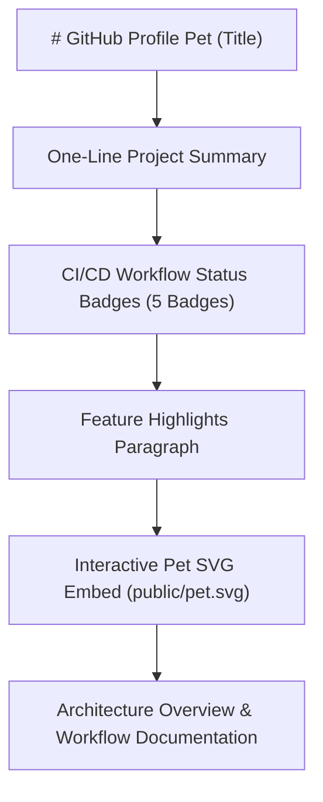

# Sprint 5.0B — README Design & Visual Hierarchy Review

## 1. Visual Hierarchy & User Experience

A virtual developer companion repository serves two primary audiences:
1. **GitHub Profile Visitors & Reviewers:** Seeking immediate visual proof of the virtual companion, its live interactive state, and developer activity integration.
2. **Open-Source Contributors & Evaluators:** Seeking CI/CD health verification, architectural transparency, and installation instructions.



---

## 2. Design Principles Applied

### 2.1 Placement Above the Fold
- **Positioning:** The badge row is placed immediately following the opening summary sentence:
  `A customizable, virtual developer pet companion hosted natively in your GitHub repository and driven by autonomous GitHub Actions workflows.`
- **Reasoning:** In modern open-source repositories, badges establish immediate trust and verify operational health before the reader encounters detailed implementation copy.
- **Preview Preservation:** Placing badges concisely on adjacent lines allows GitHub's markdown renderer to display them as an inline wrapping flex container. This ensures that the primary visual asset (`public/pet.svg`) remains prominently visible above the fold on desktop and tablet viewports.

### 2.2 Proportionality & Restraint
- **Quantity:** Exactly 5 relevant workflow badges are included (`deploy-pages`, `pet-activity`, `pet-publisher`, `pet-interaction`, and `diagnostics-contribution-probe`).
- **Exclusion of Redundancy:** One-time scripts (`pet-baseline.yml`) and third-party badges (e.g. arbitrary coverage meters or external download trackers) are excluded.
- **Clutter Elimination:** Badges are cleanly linked to their native GitHub Actions execution pages, providing 1-click drill-down capability for operators.

### 2.3 Accessibility (a11y) Standards
- Every badge includes clear, descriptive Markdown alt text matching the workflow's formal YAML name:
  - `alt="Deploy Playable Game to GitHub Pages"`
  - `alt="Pet Activity Progression"`
  - `alt="Pet SVG Publication"`
  - `alt="Pet Care Action Inbox"`
  - `alt="Diagnostics Contribution Probe"`
- Screen readers encounter meaningful labels rather than generic or missing text.

### 2.4 Integrity of Interactive Embed Markers
The interactive pet menu relies on exact operational comments:
```html
<!-- START_SECTION:github-profile-pet -->
...
<!-- END_SECTION:github-profile-pet -->
```
The badge section is positioned completely outside and preceding these markers. No markers are altered, split, or duplicated, strictly preserving the automated menu update engine.
