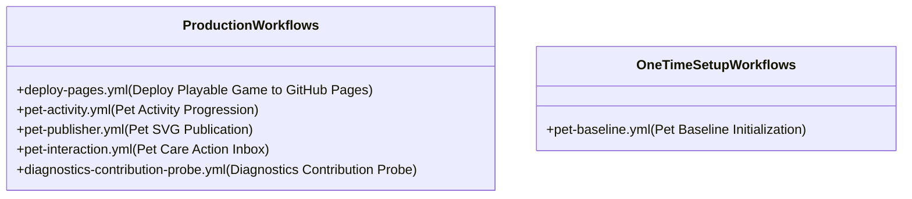

# Sprint 5.0B — Workflow Badge Inventory & Operational Mapping

## 1. Inventory Overview

This document establishes the definitive inventory of workflows in **GitHub Profile Pet**, mapping actual repository filenames to their YAML `name:` fields, triggers, and badge inclusion decisions.

---

## 2. Comprehensive Workflow Inventory



### Detailed Mapping Table

| Item | Workflow File | YAML `name:` | Triggers | Production Role | Badge Status | Inclusion Justification |
| :---: | :--- | :--- | :--- | :--- | :---: | :--- |
| **1** | `deploy-pages.yml` | `Deploy Playable Game to GitHub Pages` | `push: [main]`, `workflow_dispatch` | Continuous web deployment | **INCLUDED** | Confirms live health and deployment of the hosted web interface at `https://mnp210.github.io/GitHub-Profile-Pet/`. |
| **2** | `pet-activity.yml` | `Pet Activity Progression` | `push: [main]`, `issues`, `pull_request`, `pull_request_review`, `schedule: '*/30 * * * *'`, `workflow_dispatch` | Real-time developer activity progression | **INCLUDED** | Primary event-driven engine awarding activity XP and maintaining deduplication ledgers. |
| **3** | `pet-publisher.yml` | `Pet SVG Publication` | `schedule: '47 * * * *'` (Hourly), `workflow_dispatch` | Passive simulation & SVG generation | **INCLUDED** | Hourly daemon ensuring hunger/happiness decay simulation and profile badge updates. |
| **4** | `pet-interaction.yml` | `Pet Care Action Inbox` | `issues: [opened]`, `schedule: '47 * * * *'`, `workflow_dispatch` | Care action ingestion & processing | **INCLUDED** | Critical asynchronous consumer executing Feed, Train, Rest, and Pet requests submitted via GitHub Issues. |
| **5** | `diagnostics-contribution-probe.yml` | `Diagnostics Contribution Probe` | `workflow_dispatch` | Diagnostic probe for contribution API | **INCLUDED** | Operational diagnostic verifying GitHub GraphQL API health and numeric trainer identity resolution. |
| **6** | `pet-baseline.yml` | `Pet Baseline Initialization` | `workflow_dispatch` | Initial setup only | **EXCLUDED** | One-time bootstrap script. Running once on repository creation, displaying a permanent badge would misrepresent static setup as ongoing CI health. |

---

## 3. Badge Specification & Link Formats

### 3.1 Badge Image URL Template
All badges utilize GitHub's native Actions SVG badge generation endpoint:
```
https://github.com/mnp210/GitHub-Profile-Pet/actions/workflows/{WORKFLOW_FILE}/badge.svg?branch={DEFAULT_BRANCH}
```

### 3.2 Workflow Navigation Link Template
Each badge wraps an anchor tag targeting the corresponding workflow execution view:
```
https://github.com/mnp210/GitHub-Profile-Pet/actions/workflows/{WORKFLOW_FILE}
```

### 3.3 Fully Resolved Specifications

1. **Deploy Playable Game to GitHub Pages**
   - File: `deploy-pages.yml`
   - Image URL: `https://github.com/mnp210/GitHub-Profile-Pet/actions/workflows/deploy-pages.yml/badge.svg?branch=main`
   - Target Link: `https://github.com/mnp210/GitHub-Profile-Pet/actions/workflows/deploy-pages.yml`
   - Markdown:
     ```markdown
     [](https://github.com/mnp210/GitHub-Profile-Pet/actions/workflows/deploy-pages.yml)
     ```

2. **Pet Activity Progression**
   - File: `pet-activity.yml`
   - Image URL: `https://github.com/mnp210/GitHub-Profile-Pet/actions/workflows/pet-activity.yml/badge.svg?branch=main`
   - Target Link: `https://github.com/mnp210/GitHub-Profile-Pet/actions/workflows/pet-activity.yml`
   - Markdown:
     ```markdown
     [](https://github.com/mnp210/GitHub-Profile-Pet/actions/workflows/pet-activity.yml)
     ```

3. **Pet SVG Publication**
   - File: `pet-publisher.yml`
   - Image URL: `https://github.com/mnp210/GitHub-Profile-Pet/actions/workflows/pet-publisher.yml/badge.svg?branch=main`
   - Target Link: `https://github.com/mnp210/GitHub-Profile-Pet/actions/workflows/pet-publisher.yml`
   - Markdown:
     ```markdown
     [](https://github.com/mnp210/GitHub-Profile-Pet/actions/workflows/pet-publisher.yml)
     ```

4. **Pet Care Action Inbox**
   - File: `pet-interaction.yml`
   - Image URL: `https://github.com/mnp210/GitHub-Profile-Pet/actions/workflows/pet-interaction.yml/badge.svg?branch=main`
   - Target Link: `https://github.com/mnp210/GitHub-Profile-Pet/actions/workflows/pet-interaction.yml`
   - Markdown:
     ```markdown
     [](https://github.com/mnp210/GitHub-Profile-Pet/actions/workflows/pet-interaction.yml)
     ```

5. **Diagnostics Contribution Probe**
   - File: `diagnostics-contribution-probe.yml`
   - Image URL: `https://github.com/mnp210/GitHub-Profile-Pet/actions/workflows/diagnostics-contribution-probe.yml/badge.svg?branch=main`
   - Target Link: `https://github.com/mnp210/GitHub-Profile-Pet/actions/workflows/diagnostics-contribution-probe.yml`
   - Markdown:
     ```markdown
     [](https://github.com/mnp210/GitHub-Profile-Pet/actions/workflows/diagnostics-contribution-probe.yml)
     ```
