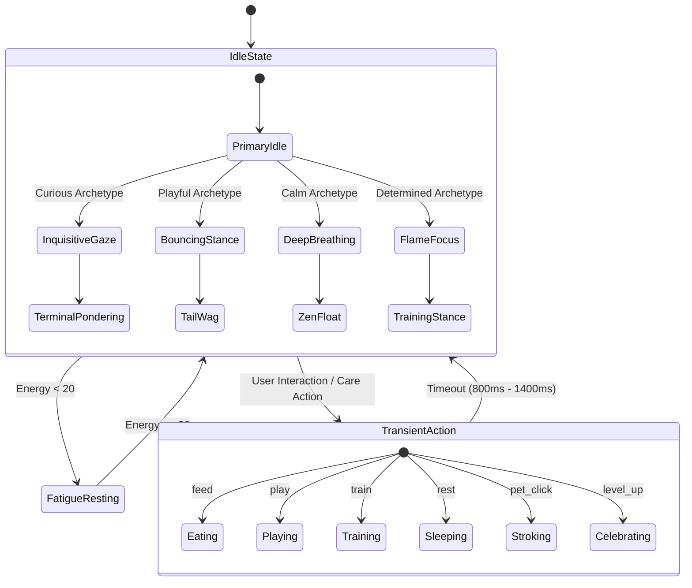

# Sprint 5.1A — Behaviour State Engine Design

## 1. Engine Overview

The Companion Behaviour Engine (`src/features/personality/behaviourEngine.ts`) implements a deterministic, context-sensitive state machine that governs companion expressions, ambient thought bubbles, and sprite animations.

---

## 2. Priority Hierarchy

The behaviour state machine evaluates conditions in strict priority order:

1. **Active Care Interaction:**
   When the user initiates `feed`, `play`, `train`, `rest`, or `pet`, the engine temporarily transitions to the corresponding transient state (`eating`, `playing`, `training`, `sleeping`, `head_tilt` / `happy`), playing an audio cue and generating an in-character reaction.
2. **Vital Extremes (Fatigue & Hunger):**
   - **Severe Exhaustion (`energy < 20`):** Overrides active idle animation with fatigue posture (`terminal_pondering`, `training_stance`, `idle_playful`, or `deep_breathing`) and surfaces tired dialogue (*"Energy low... Need to rest before analyzing further"*).
   - **Severe Hunger (`hunger < 20`):** Surfaces hungry dialogue (*"Digestive telemetry reports low satiety. Snack time?"*).
3. **Ambient Companion Cycle (6s Cadence):**
   When resting in ambient idle, the companion evaluates `selectNextBehaviour(context)` every 6 seconds. If `document.hidden` is true (background tab), the tick is skipped to conserve CPU and battery.
4. **Thought Generation (35% probability per tick):**
   Samples from the active archetype's curated thought array, displaying gentle musings in the companion thought bubble.

---

## 3. Mapping Matrix to Visual Sprite States

The behaviour engine cleanly decouples domain companion states from visual sprite animations:

| Behaviour State | Archetype | Sprite Animation State | Visual Characteristics |
| :--- | :--- | :--- | :--- |
| `idle_curious` | Curious | `curious` | 2.5s gentle head tilt, observant stance |
| `investigating` | Curious | `curious` | Head rotation, emerald eye glow |
| `head_tilt` | Curious | `curious` | Noticeable tilt toward cursor |
| `terminal_pondering` | Curious | `idle` | Quiet thoughtful posture |
| `idle_determined` | Determined | `idle` | Firm planted stance |
| `training_stance` | Determined | `training` | Subtle ready wiggle / focus |
| `flame_focus` | Determined | `idle` | Focused intense gaze |
| `ready_to_build` | Determined | `idle` | Upright guard posture |
| `idle_playful` | Playful | `playing` | 1.6s bouncy hop, agile posture |
| `bouncing` | Playful | `playing` | Springy vertical jump |
| `tail_wag` | Playful | `playing` | Joyful tail oscillation |
| `seeking_play` | Playful | `playing` | Playful crouch & jump |
| `idle_calm` | Calm | `idle` | 4.0s zen breathing pulse |
| `deep_breathing` | Calm | `idle` | Expanding & relaxing matrix |
| `zen_float` | Calm | `idle` | Gentle sinusoidal float |
| `peaceful_bubble` | Calm | `idle` | Soft ambient glow |
| `celebrating` | All | `celebrating` | Joyous 105% bounce on level-up |
| `sleeping` | All | `sleeping` | Dimmed opacity, closed eyes, floating Zzz |
