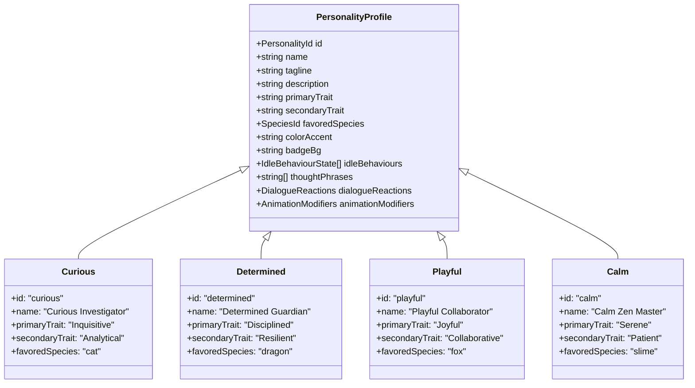

# Sprint 5.1A — Companion Personality System Design

## 1. Executive Summary

The Pet Personality System transforms GitHub Profile Pet from a passive contribution visualization into a dynamic, living developer companion. By pairing each companion species with distinct psychological archetypes, rich dialogue reactions, dynamic thought musings, and contextual responsiveness, the companion creates an enduring sense of partnership with the software engineer.

The system is strictly client-side reactive with zero progression-economy exploits: switching personalities or interacting through companion dialogues awards **zero additional XP**, preserving the 300 XP/day daily progression cap and all Phase 1-4 balance guarantees.

---

## 2. Companion Archetypes Architecture

The system formalizes four distinct, balanced personality archetypes designed to resonate with different developer temperaments and workflows:

### Archetype 1: Curious Investigator (`curious`)
- **Default Companion:** Shadow Claw (Void Familiar / Cat)
- **Tagline:** Terminal Sleuth & Code Inspector
- **Identity:** Analytical, observant, and inquisitive. Fixated on terminal diffs, commit hashes, and refactoring mysteries. Tilts head and dilates eyes when examining code.
- **Color Accent:** Emerald `#10b981` / Dark Slate `#047857`
- **Idle Behaviours:** `idle_curious`, `investigating`, `head_tilt`, `terminal_pondering`
- **Sample Ambient Thoughts:**
  - *"Checking commit hashes..."*
  - *"What does this git diff do?"*
  - *"A new branch appeared!"*
  - *"Analyzing commit patterns..."*

### Archetype 2: Determined Guardian (`determined`)
- **Default Companion:** Ignis Ember (Ruby Drake / Dragon)
- **Tagline:** Resolute CI Defender & Build Champion
- **Identity:** Disciplined, tenacious, and fiercely protective of build stability. Celebrates flawless deployments and stands vigilant against regression defects.
- **Color Accent:** Crimson `#ef4444` / Amber `#f59e0b`
- **Idle Behaviours:** `idle_determined`, `training_stance`, `flame_focus`, `ready_to_build`
- **Sample Ambient Thoughts:**
  - *"Keep the build green!"*
  - *"No regressions on my watch."*
  - *"Test suite must pass 100%."*
  - *"Standing guard over main."*

### Archetype 3: Playful Collaborator (`playful`)
- **Default Companion:** Kitsune Sol (Solar Trickster / Fox)
- **Tagline:** High-Spirited Teammate & Joyful Reviewer
- **Identity:** Bouncy, high-energy, and collaborative. Turns code reviews, pull requests, and bug hunts into celebratory team wins with confetti energy.
- **Color Accent:** Solar Amber `#f97316` / Golden `#fbbf24`
- **Idle Behaviours:** `idle_playful`, `bouncing`, `tail_wag`, `seeking_play`
- **Sample Ambient Thoughts:**
  - *"Let's review some code together!"*
  - *"Hop, skip, merge!"*
  - *"Reviewing PRs is so much fun!"*
  - *"Tail wagging at clean code!"*

### Archetype 4: Calm Zen Master (`calm`)
- **Default Companion:** Bloop Matrix (Cyber Jelly / Slime)
- **Tagline:** Mindful Absorber & Serene Stabilizer
- **Identity:** Grounded, unhurried, and peaceful. Gently diffuses debugging stress, encourages mindful pacing, and breathes through challenging architectural blockers.
- **Color Accent:** Cyan `#06b6d4` / Lavender `#a855f7`
- **Idle Behaviours:** `idle_calm`, `deep_breathing`, `zen_float`, `peaceful_bubble`
- **Sample Ambient Thoughts:**
  - *"Smooth, steady workflows..."*
  - *"Taking it one commit at a time."*
  - *"Clean code brings inner peace."*
  - *"Breathe in serenity, breathe out syntax errors."*

---

## 3. Dynamic Archetype Switcher & Persistence

Users have full autonomy to select any archetype regardless of active companion species (e.g., a *Determined* Shadow Claw or a *Calm* Ignis Ember).

1. **State Persistence:**
   The active `personality` is serialized directly into `PetState` under `localStorage['gh_pet_game_state_v1']`.
2. **Deterministic Defaults:**
   If a pet state document lacks an explicit `personality` (such as legacy save files or remote state files), `getDefaultPersonalityForSpecies(species)` assigns the canonical default.
3. **Pristine Immutability:**
   Switching archetypes mutates only the `personality` field in client state; it leaves level, XP, vitals, accumulators, and history strictly intact.
