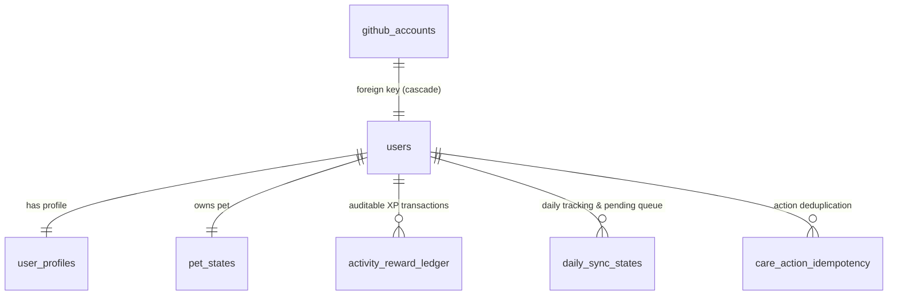

# Sprint 2.1 — Database Foundation & Implementation Specification
## GitHub Profile Pet Platform

**Milestone:** Sprint 2.1 — Database Foundation, Migrations & Persistence  
**Database Engine:** PostgreSQL 16+  
**Target Environment:** Local Docker Compose / Neon / Supabase PostgreSQL  
**Workspace:** `D:\Projects\GitHub-Profile-Pet`  
**Status:** Implemented & Verified Baseline  

---

## 1. Executive Summary & Deliverables

Sprint 2.1 delivers the production-ready PostgreSQL persistence layer for GitHub Profile Pet, translating the approved Stage 2.0, 2.0A, 2.0B, and 2.0C architecture specifications into tested code:

1. **Migrations & DDL:** `migrations/001_initial_schema.sql` and `migrations/001_initial_schema.down.sql` establishing the seven core tables with PostgreSQL 16+ native features.
2. **Database Engine & Connection Pool:** `src/lib/db/pool.ts` and `src/lib/db/config.ts` managing a bounded connection pool ($\le 10$ connections) with zero credential logging and SSL enforcement.
3. **Transaction Layer:** `src/lib/db/transaction.ts` providing `withTransaction` with guaranteed rollback on failure and client release in all cases.
4. **Deterministic Migration Runner:** `src/lib/db/migrator.ts` and `scripts/migrate.ts` tracking applied migrations in `schema_migrations` without silent application startup mutations.
5. **Data Access Layer (Repositories):** Parameterized SQL repositories:
   - `UserRepository` (`src/lib/db/repositories/userRepository.ts`)
   - `PetRepository` (`src/lib/db/repositories/petRepository.ts`)
   - `SyncRepository` (`src/lib/db/repositories/syncRepository.ts`)
   - `LedgerRepository` (`src/lib/db/repositories/ledgerRepository.ts`)
6. **Integration & Regression Test Suites:**
   - 40 Unit Tests passing across 8 suites (`npm test`).
   - 11 PostgreSQL Integration Tests across all concurrency, capping, and rollback scenarios (`npm run test:integration`).

---

## 2. Core Schema & Mandatory Safeguards

### 2.1 Table Architecture



1. **`github_accounts`:** Stores encrypted OAuth tokens (`encrypted_access_token`, `encrypted_refresh_token`), token expiration timestamps, disconnect status, and `has_private_contributions_scope`.
2. **`users`:** Represents the trainer entity. `primary_handle` stores the normalized GitHub handle (without leading `@`). Linked via `github_account_id` to `github_accounts(id)` with `ON DELETE CASCADE`.
3. **`user_profiles`:** Stores display preferences, privacy visibility (`public`, `unlisted`, `minimal`), streak display, and private contribution sync preference.
4. **`pet_states`:** Stores pet level, XP, max XP, evolution stage, mood, and bounded vitals (`energy`, `hunger`, `happiness` in $[0, 100]$).
5. **`activity_reward_ledger`:** Immutable, append-only log of every reward transaction. Enforces `UNIQUE (user_id, canonical_activity_id)` and non-negative XP awards.
6. **`daily_sync_states`:** Tracks daily contribution synchronization, high-water marks, rewarded counts, durable pending queue, and daily activity XP awards. Enforces `CHECK (daily_activity_xp_awarded <= 300)`.
7. **`care_action_idempotency`:** Deduplicates interactive care actions (feed, train, pet, rest). Enforces composite `UNIQUE (user_id, client_action_id)`.

---

### 2.2 Mandatory Safeguards Implementation

#### A. Explicit Account Deletion
`users.github_account_id` references `github_accounts.id`. To ensure that deleting a user never leaves orphaned OAuth tokens:
- `UserRepository.deleteAccountCascade(userId)` executes inside `withTransaction`:
  1. Fetches the linked `github_account_id`.
  2. Executes `DELETE FROM github_accounts WHERE id = $1;`.
  3. Cascading foreign keys (`ON DELETE CASCADE`) automatically wipe `users`, `user_profiles`, `pet_states`, `activity_reward_ledger`, `daily_sync_states`, and `care_action_idempotency`.
  4. Executes defense-in-depth purge on `users`.
  5. Zero credentials or personal data remain in the database.

#### B. Per-User Action Idempotency
- `care_action_idempotency` utilizes a composite unique constraint:
  `CONSTRAINT uq_care_action_user_client_id UNIQUE (user_id, client_action_id)`
- This prevents `client_action_id` collisions between different users while guaranteeing that duplicate action dispatches from the same user are detected and ignored idempotently.

#### C. Reward Accounting & Post-Cap Increment Forfeiture
Sprint 2.1 rigorously separates contribution accounting states to prevent conflating rewarded contributions with zero-XP post-cap contributions:
1. **Observed Increments:** Newly observed contributions from GitHub ($\Delta C = \max(0, C_{\text{observed}} - \text{recorded})$).
2. **Pending Increments:** Unrewarded increments enqueued in `pending_contribution_increments`.
3. **Hourly Throttling Quota:** Rate-throttles processing to at most 5 increments per 1-hour rolling window (`hourly_window_start`, `hourly_increments_processed`). If multiple syncs trigger within the same hour, excess increments remain safely in `pending_contribution_increments`.
4. **Rewarded Increments:** Increments that received $> 0\text{ XP}$ under the daily 300 XP cap. Tracked strictly in **`total_contributions_rewarded`**.
5. **Forfeited Increments:** Increments processed after the daily 300 XP cap was exhausted. Tracked strictly in **`total_contributions_forfeited`**.

> [!IMPORTANT]
> **Strict Accounting Separation Invariant:**
> - `total_contributions_rewarded` strictly counts increments that received XP. It **NEVER** counts zero-XP forfeited increments.
> - `total_contributions_forfeited` counts increments processed after the 300 XP cap is reached.
> - Both rewarded and forfeited increments are dequeued from `pending_contribution_increments`, guaranteeing they do not linger indefinitely or become eligible for unintended future rewards.
> - Mathematical Invariant:
>   $$\text{total\_contributions\_rewarded} + \text{total\_contributions\_forfeited} \le \text{total\_contributions\_recorded}$$

---

## 3. Concurrency & Transaction Flow

The sync protocol keeps the external GitHub API call outside database transactions:

```mermaid
sequenceDiagram
    autonumber
    participant Worker as Sync Engine
    participant DB as PostgreSQL 16+

    Note over Worker: External GitHub API Snapshot (Outside DB Lock)
    Worker->>DB: BEGIN TRANSACTION (via withTransaction)
    Worker->>DB: INSERT INTO daily_sync_states (...) ON CONFLICT DO NOTHING;
    Worker->>DB: SELECT * FROM daily_sync_states WHERE user_id = $1 AND sync_date = $2 FOR UPDATE;
    Note over Worker,DB: Row exclusively locked; checks hourly window & delta against fresh DB state
    Worker->>DB: INSERT INTO activity_reward_ledger (canonical_activity_id, ...)
    Worker->>DB: UPDATE pet_states SET xp = xp + delta, ...
    Worker->>DB: UPDATE daily_sync_states SET recorded = ..., rewarded = ..., forfeited = ..., pending = ..., daily_xp = ...
    Worker->>DB: COMMIT TRANSACTION;
    Note over Worker,DB: Lock released in < 5ms
```

---

## 4. Test Strategy & Separation of Concerns

1. **Unit Test Regression Gate (`npm test`):**
   - 40 pure in-memory unit tests across 8 suites.
   - Executes in $< 1\text{s}$ with zero database or network dependencies.
2. **PostgreSQL Integration Test Suite (`npm run test:integration`):**
   - 12 comprehensive tests validating migrations, schema constraints, concurrency, hourly throttling, high-water marks, queue drainage, and account deletion against a real PostgreSQL 16+ database (`PostgreSQL 16.15`).
   - Automatically utilizes the local PostgreSQL 16 instance with disposable test database `github_profile_pet_test` (or Docker Compose when available).
   - All 12 integration tests execute and pass with 0 failures and 0 skipped tests.
