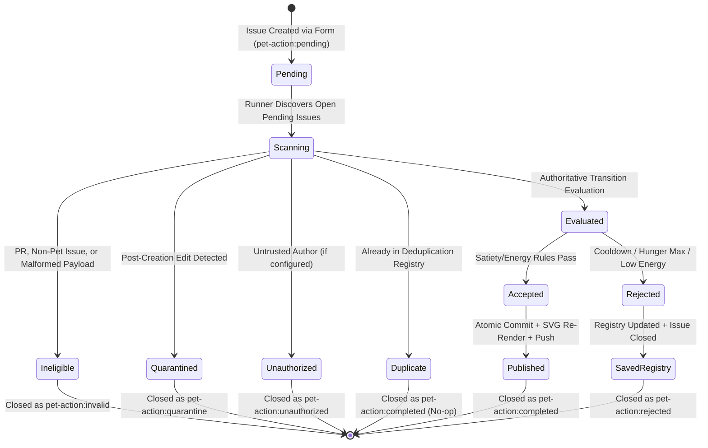

# Phase 3B: GitHub-native Pet Interaction & Durable Action Inbox Architecture

**Project:** GitHub Profile Pet  
**Architecture:** Sprint 2.7.4 — GitHub-native, self-hosted per user  
**Status:** Implemented & Verified  

---

## 1. Executive Summary

Phase 3B implements the serverless, GitHub-native interaction system for GitHub Profile Pet. Users interact with their virtual companion entirely through repository-native interfaces:
1. **Interaction Interface:** GitHub Issue Forms serve as structured input mechanisms for care actions (`feed`, `train`, `rest`, and `pet`).
2. **Action Queue (Inbox):** Open GitHub Issues bearing the `pet-action:pending` label act as a durable, monotonic action inbox.
3. **Execution Runtime:** A lightweight GitHub Actions workflow (`.github/workflows/pet-interaction.yml`) executes on `issues: [opened]` and `workflow_dispatch`.
4. **State Engine:** Actions are evaluated deterministically against the repository-native state engine (established in Phase 1) with multi-document atomic journal recovery (Phase 1.1) and concurrency locking (Phase 1.1.1).
5. **Feedback Loop:** Upon processing, the issue is updated with an explanatory, formatted Markdown comment detailing vitals changes, XP earned, level-ups, and companion reactions, and is closed with a terminal status label (`pet-action:completed`, `pet-action:rejected`, `pet-action:invalid`, `pet-action:unauthorized`, or `pet-action:quarantine`).
6. **Live Visualization:** Accepted actions immediately trigger standalone SVG re-rendering and publication (established in Phase 2 & 3A).

This design completely eliminates the need for hosted servers, databases, third-party webhook relays, or active user computers, preserving the absolute **₹0/month forever** hosting guarantee.

---

## 2. Interaction Model & Issue Forms

### 2.1 Issue Forms

Located in `.github/ISSUE_TEMPLATE/`, four declarative YAML issue forms define the interaction surface:

| Form File | Action | Inputs | Auto-Applied Labels |
|---|---|---|---|
| `pet-feed.yml` | `feed` | Meal selection (Kibble, Gourmet Salmon, Binary Bits, Star Fruit), confirmation checkbox | `pet-action:pending`, `pet:feed` |
| `pet-train.yml` | `train` | Focus area (Agility Drill, Logic Puzzle, Focus Meditation, Speed Run), confirmation checkbox | `pet-action:pending`, `pet:train` |
| `pet-rest.yml` | `rest` | Rest spot (Cozy Blanket, Sunlit Window, Cloud Hammock, Cat Tree), confirmation checkbox | `pet-action:pending`, `pet:rest` |
| `pet-pet.yml` | `pet` | Interaction type (Gentle Ear Scratch, Head Pat, Belly Rub, Chin Tickle), confirmation checkbox | `pet-action:pending`, `pet:pet` |

### 2.2 Lifecycle & Label Workflow

GitHub Issues transition through explicit lifecycle labels:



Terminal status labels:
- `pet-action:completed`: Action accepted, state mutated, XP/vitals applied, SVG published.
- `pet-action:rejected`: Action rejected due to gameplay rules (cooldown active, full hunger, insufficient energy). Zero gameplay mutation.
- `pet-action:invalid`: Submission is not an eligible issue (e.g. Pull Request, non-pet issue, malformed form body).
- `pet-action:unauthorized`: Submitted by a user ID that does not match the repository trainer (when author authorization is enabled).
- `pet-action:quarantine`: Submission was edited after initial creation (`updated_at - created_at > 10,000ms`), indicating possible payload tampering.

---

## 3. Durable Action Inbox & Queue Processing

### 3.1 Draining Invariant

The action scanner (`src/features/pet-engine/inbox/inboxScanner.ts`) enforces strict queue discipline:
1. **Chronological Ordering:** Discovered issues are sorted by `created_at ASC, number ASC`. Actions are executed in the exact order they were submitted.
2. **At-Most-Once State Execution:** Every processed issue number is recorded in the `processedRequestRegistry` inside `pet/state/actions.json`. Even if a webhook fires multiple times, or the runner restarts, an action is never applied to pet state more than once.
3. **At-Least-Once Drainage:** Unclosed or pending issues remain in the inbox until definitively evaluated and closed.

### 3.2 Sequence Gap Classification

GitHub uses a unified incrementing integer sequence across Issues and Pull Requests. When inspecting missing sequence numbers between the high-water mark (HWM) and the lowest pending issue:
- **HTTP 410 Gone (`retired_deleted_410`):** An issue was explicitly deleted by the user or organization. Eligible for HWM advancement.
- **HTTP 404 Not Found (`unresolved_ambiguous_404`):** Ambiguous. Could indicate an issue that never existed, an in-flight issue, or a private issue inaccessible to the current token. **Never advances HWM.**
- **HTTP 403 / 429 (`unresolved_rate_limited`):** Secondary or primary rate limit. Unresolved; blocks HWM advancement.
- **HTTP 5xx (`unresolved_server_error`):** Transient GitHub outage. Unresolved; blocks HWM advancement.
- **Pull Requests (`retired_pr`):** Recognized via `issue.pull_request`. PRs are classified as retired non-action gaps and advance HWM without mutating pet state.
- **Out-of-Order Execution:** Issues arriving higher than an unresolved gap are processed immediately and tracked in `sparseProcessedIssueNumbers`. When the preceding gap is resolved, `advanceHighWaterMark()` rolls forward across all consecutive processed sparse numbers in $O(N)$ time.

### 3.3 Post-Creation Edit Defense (Quarantine)

To prevent players from opening an issue for `pet` or `rest` and editing the Markdown body to `feed` after bypass validation, the parser inspects `issue.created_at` and `issue.updated_at`:
$$\Delta t = t_{\text{updated}} - t_{\text{created}}$$
If $\Delta t > 10,000\,\text{ms}$, the issue is flagged as `edited_quarantined`. It is commented with an explanation, closed with `pet-action:quarantine`, and retired in the deduplication registry without mutating pet vitals.

---

## 4. Concurrency, Locking & Safe Commit Protocol

### 4.1 Actions Runner Concurrency

The workflow `.github/workflows/pet-interaction.yml` enforces runner concurrency:
```yaml
concurrency:
  group: pet-runtime-${{ github.repository }}
  cancel-in-progress: false
```
`cancel-in-progress: false` ensures that consecutive interaction triggers are queued rather than aborted mid-flight.

### 4.2 Multi-Document Atomic Journal & Local Locking

Before writing state mutations:
1. `recoverRepositoryState()` is called to clean up or roll forward any abandoned journal from prior runner crashes.
2. `acquireLock()` obtains an exclusive file lock on `pet/state/.state.lock` with lease PID and heartbeat metadata.
3. If CAS check passes (`expectedGeneration === currentGeneration`), state changes are staged in `pet/state/.journal/target/`.
4. `meta.json` is atomically committed.
5. Target files are atomically swapped into active locations.
6. The journal is cleaned and the lock released.

### 4.3 Git Push Retry with Safe Rebase

When pushing updated state documents and rendered SVG to the default branch:
- The script fetches the latest remote commit.
- Uses `git pull --rebase` to integrate concurrent remote commits without creating merge bubbles.
- Retries up to 3 times with exponential backoff.
- **Never uses force push (`git push --force`).**

---

## 5. Security & Least Privilege

1. **GitHub Token Permissions:**
   ```yaml
   permissions:
     contents: write # Update pet state documents, SVG, and README
     issues: write   # Add comments, apply labels, and close issues
   ```
2. **Credential Redaction:** The inbox client and logger redact `GITHUB_TOKEN`, `GH_TOKEN`, and Bearer tokens matching `gh[pousr]_[A-Za-z0-9_]{36,255}`.
3. **Prompt Injection / SVG Injection Prevention:** All inputs from issue titles and bodies are strictly sanitized; dynamic text inserted into the SVG is XML-entity escaped and passed through the Phase 2 SVG validator.

---

## 6. Verification Results

All 16 acceptance criteria tests pass in `tests/pet-engine/inboxProcessing.test.ts`:
- **TC-INBOX-01:** Validates YAML schemas of all 4 Issue Forms.
- **TC-INBOX-02:** Verifies least-privilege workflow permissions and concurrency settings.
- **TC-INBOX-03:** PR rejection in shared number space without state mutation.
- **TC-INBOX-04:** Non-pet issues without `pet-action:pending` ignored.
- **TC-INBOX-05:** Malformed / unknown payloads rejected with `pet-action:invalid`.
- **TC-INBOX-06:** Post-creation edits quarantined with `pet-action:quarantine`.
- **TC-INBOX-07:** Duplicate delivery processed at-most-once.
- **TC-INBOX-08:** 410 vs 404 gap classification invariant.
- **TC-INBOX-09:** 403, 429, and 5xx errors treated as unresolved gaps.
- **TC-INBOX-10:** Out-of-order sparse tracking and deferred HWM advancement.
- **TC-INBOX-11:** Untrusted author rejection with `pet-action:unauthorized`.
- **TC-INBOX-12:** Gameplay rejections cause zero state mutation.
- **TC-INBOX-13:** Accepted actions increase vitals/XP, publish SVG, and close issue.
- **TC-INBOX-14:** Interrupted journal recovery before draining inbox.
- **TC-INBOX-15:** Strict chronological draining across multiple pending issues.
- **TC-INBOX-16:** Default client safe initialization and scanner filtering.
