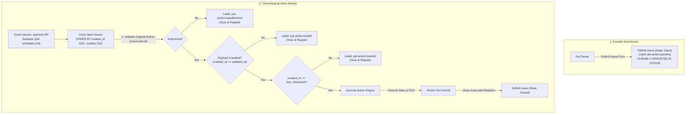
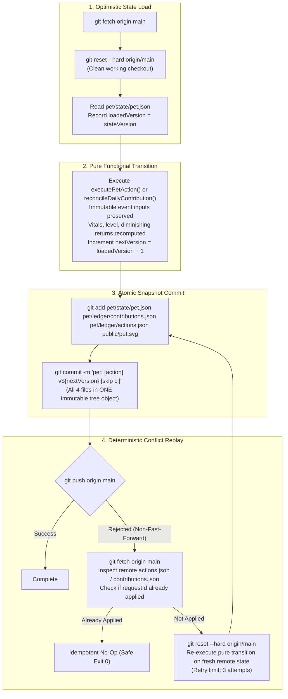
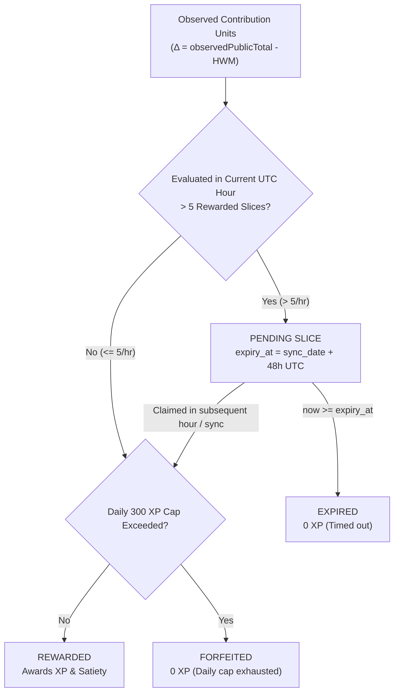
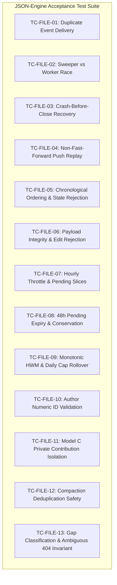

# Sprint 2.7.4 — GitHub-Native Architecture Redesign, Feasibility Verification & Technical Blueprint (Authoritative)

**Project:** GitHub Profile Pet  
**Workspace:** `D:\Projects\GitHub-Profile-Pet`  
**Date:** November 16, 2026 (Updated per Sprint 2.7.4 Final Review)  
**Mode:** ARCHITECTURE REDESIGN, FEASIBILITY VERIFICATION & FINAL CORRECTION BLUEPRINT  
**Status:** **COMPLETE**  
**Final Verdict:** **CONDITIONALLY READY**

---

## 1. Executive Summary & Confirmed Architecture Decision

### 1.1 The Definitive Architecture Decision
Following rigorous evaluation of hosting complexities, third-party database limits (Neon Free 5 GB transfer ceilings, scale-to-zero suspensions, zero SLA), and cloud dependency overhead, GitHub Profile Pet has made a definitive, permanent product and architectural pivot:

> **GitHub Profile Pet is an entirely GitHub-native, self-hosted-per-user application.**
> 
> Every user installs the companion into their own GitHub repository. Their pet operates through GitHub Actions, stores its persistent state directly in their repository, and publishes its dynamically generated SVG to their GitHub profile README.
> 
> Users interact with their pet entirely through GitHub-native interfaces (GitHub Issue Forms and `workflow_dispatch`). There is **no mandatory local web dashboard, central application server, central database, or continuously running personal computer.**

### 1.2 Fundamental Shift in Architectural Philosophy
- **GitHub is the Runtime:** The user's GitHub repository is the pet's home.
- **GitHub Actions is the Engine:** Scheduled workflows perform periodic vitals simulation, contribution synchronization, and inbox sweeping; event-driven workflows handle interactive care actions.
- **Git is the Versioned Snapshot Store (NOT a Relational Database):** State and transaction ledgers are version-controlled, append-only JSON documents committed directly to the repository with optimistic versioning.
- **The README is the Screen:** A pure, self-contained SVG is generated and committed to the repository, embedded into the developer's profile README via GitHub's Camo CDN proxy.
- **True Horizontal Zero-Cost Scaling:** Centralized server hosting and central database costs are reduced to **identically ₹0 / month ($0.00 / month)** for the project maintainer. Each user operates within their own personal GitHub allowances (100% free on public repositories; consuming ~10% of runner minutes on private repositories).

---

## 2. Current Architecture Findings from Source Inspection

A comprehensive source inspection of `D:\Projects\GitHub-Profile-Pet` establishes the actual implementation state across all layers:

### 2.1 Implemented & Decoupled Core Modules (Highly Reusable)
1. **Game Engine (`src/features/gamification/gameplay.ts`):** Fully implemented, deterministic functional engine. Pure functions validate actions, cooldowns (`ACTION_COOLDOWN_MS = 60000`), energy costs (`TRAINING_ENERGY_COST = 18`), satiety ceilings (`MAX_SATIETY_LIMIT = 100`), diminishing returns, and milestone unlocks without database coupling.
2. **Progression & Level Calculations (`src/features/gamification/progression.ts`):** Complete mathematical progression implementation based on $TotalXP(L) = 50 \times L \times (L - 1)$, with deterministic multi-level overflow carryover, mood derivation, and evolution stage mapping (`egg` $\rightarrow$ `baby` $\rightarrow$ `child` $\rightarrow$ `teen` $\rightarrow$ `adult` $\rightarrow$ `mystic`).
3. **Recovery & Inactivity System (`src/features/gamification/inactivity.ts`, `recovery.ts`):** Pure elapsed-time simulation. Strictly guarantees **zero pet death**, ethical stat floors (`INACTIVITY_HUNGER_FLOOR = 20`, `INACTIVITY_HAPPINESS_FLOOR = 40`), passive energy restoration (+0.05 energy/sec), and 24-hour welcome-back bonuses.
4. **Species Reactions (`src/features/gamification/speciesReactions.ts`):** Implemented contextual personality dialogues across species (`shadow_claw`, etc.).
5. **Character Pixel Matrix (`src/lib/sprites/shadowClawSpriteData.ts`):** 32x32 pixel matrices and 7-color indexed palettes (`#1a1228` Void Ink to `#f472b6` Rose Sigil). Directly convertible to standalone vector SVG `<rect>` elements.
6. **Date & Calendar Normalization (`src/lib/github/calendarUtils.ts`, `dailyReconciliation.ts`):** Validated UTC calendar date canonicalization (`YYYY-MM-DD`), day boundary calculation, leap-year validation, and date clamping.
7. **GraphQL Query Contract (`src/lib/github/contributionSnapshot.ts`):** Strongly-typed GraphQL query extracting `totalCommitContributions`, `totalIssueContributions`, `totalPullRequestContributions`, and `totalPullRequestReviewContributions` for verified `publicTotal`.

### 2.2 Centralized Infrastructure (To Be Superseded / Deprecated)
1. **PostgreSQL Repositories & Migrations (`src/lib/db/repositories/*`, `migrations/001-010`):** Designed for multi-tenant relational persistence. Migration 010 implemented session advisory locks (`982347102`), worker leases, and generation fencing. These become obsolete for single-tenant repository runtime but are preserved as historical references.
2. **Next.js Web Dashboard & API Routes (`src/app/`, `src/components/`):** A full-featured web dashboard with React 19 UI components (`PetDisplay`, `PixelButton`, `ActivityCalendar`). In Model B (entirely GitHub-native), this web server is not part of the active user runtime.
3. **OAuth & Session Infrastructure (`src/lib/auth/githubAuth.ts`, `sessionContext.ts`):** Server cookie session tokens, AES-256-GCM token encryption (`crypto.ts`), and OAuth state verification. In a self-hosted repository, GitHub Actions runner authentication replaces web OAuth sessions.
4. **Multi-Tenant Coordinator (`src/lib/sync/backgroundSyncCoordinator.ts`):** Complex batch worker pooling, `pg_stat_activity` backend PID tracking, and internal endpoint authorization (`POST /api/internal/sync`). Replaced by single-user repository Action scripts.

---

## 3. Workflow Concurrency & Durable Action Delivery Protocol

### 3.1 The Concurrency Limitation in GitHub Actions
The preliminary architecture assumed that:
```yaml
concurrency:
  group: pet-state-${{ github.repository }}
  cancel-in-progress: false
```
guaranteed an unlimited FIFO queue where every triggered action would eventually run. 

*Confirmed GitHub Platform Behavior:* According to official GitHub Actions documentation (https://docs.github.com/en/actions/using-workflows/workflow-syntax-for-github-actions#jobsjob_idconcurrency), when `cancel-in-progress: false` is used:
- GitHub Actions queues at most **one pending run** per concurrency group.
- If multiple workflow runs are triggered while a job is running, GitHub Actions holds the latest run in the queue, but intermediate pending runs can be dropped, canceled, or superseded during queue contention!
- Workflows can also be interrupted by runner pool outages, job timeouts, network errors, or Git push conflicts.
- **Therefore, workflow concurrency controls protect active workers from concurrent Git push collisions (acting as a serialization mutual-exclusion lock), but CANNOT act as a durable request queue.**
- **Crucial Architecture Clarification:** We explicitly avoid claiming unconditional "zero-loss" or "exactly-once" delivery. In distributed systems with external network boundaries, true "exactly-once" is impossible. Instead, the system implements **at-least-once durable request queuing** (via GitHub Issues) paired with **strictly idempotent, at-most-once state execution** (via the Git transaction ledger), resulting in **effectively once-and-only-once business logic**.



---

### 3.2 Chronological Inbox Processing Protocol
The worker is designed as a **Durable Chronological Inbox Processor**, not merely a handler for whichever individual Issue triggered the workflow.

1. **Inbox Drainage on Every Trigger:**
   - Whenever a worker runs (whether triggered immediately by `issues: [opened]` or by the 6-hour scheduler / `workflow_dispatch`), it does not blindly process only `github.event.issue.number`.
   - Instead, the worker queries the GitHub REST API for **all open issues with label `pet-action:pending`**:
     $$\text{ORDER BY } \text{issue.created\_at ASC, issue.number ASC}$$
   - The worker drains pending requests in strict ascending chronological order.
2. **Creation-Time Label Assignment Invariant:**
   - The `pet-action:pending` label **must be assigned at Issue creation** (configured directly in `.github/ISSUE_TEMPLATE/pet-action.yml` metadata `labels: [pet-action:pending]`).
   - An ordinary repository issue created without this label cannot become an eligible pet action through later relabeling. Any issue where the label was added post-creation is rejected as an ineligible action, closed, and permanently retired in the gap registry.
3. **Handling Out-of-Order Arrival & Stale Actions:**
   - In a discrete Markovian simulation, pet vitals (hunger, energy, happiness), activity cooldowns, and diminishing returns are stateful and depend on elapsed time from the previous interaction.
   - If a delayed or unblocked request (e.g. Issue #41 created at 10:00 UTC) arrives *after* a newer request (Issue #42 created at 10:15 UTC) has already been processed and committed:
     - The worker compares the pending request's $\text{created\_at}$ against $\text{pet.json.last\_interaction\_time}$.
     - **Stale Request Safe Rejection:** Retroactive application of older actions to advanced pet state is strictly forbidden. Any pending request whose $\text{created\_at} < \text{pet.json.last\_interaction\_time}$ is classified as **stale / expired**.
     - The worker labels the issue `pet-action:expired`, posts an explanatory comment (*"Action expired: a newer care action has already been processed on this pet. Actions must be processed in chronological sequence."*), records the issue number in `processedRequestRegistry`, and closes the issue with 0 rewards.
4. **Batching & Commit Amortization:**
   - When multiple pending issues are queued in the inbox, the worker processes them sequentially in-memory, updating `pet.json`, `contributions.json`, `actions.json`, and `public/pet.svg`.
   - All drained actions are committed together in a single atomic Git commit, dramatically reducing runner minutes and Git push contention.

---

### 3.3 Deduplication Storage, GitHub Gap Classification & Registry Advancement

#### 3.3.1 GitHub Sequential Numbering Taxonomy
GitHub repositories allocate integer identifiers according to distinct platform semantics:
1. **Issues and Pull Requests (Shared Numbering Sequence):**
   - In GitHub repositories, Issues and Pull Requests share the exact same sequential integer sequence (`/issues/{n}` and `/pull/{n}`). A single auto-incrementing sequence assigns numbers across both.
   - When querying the REST endpoint `GET /repos/{owner}/{repo}/issues/{n}`, a Pull Request returns `200 OK` with the `pull_request` key populated (`issue.pull_request !== undefined`).
2. **Discussions (Separate Numbering Sequence):**
   - GitHub Discussions allocate their own separate category-specific numbering sequence (`/discussions/{n}`), accessible via GraphQL (`repository.discussions`) and discussion REST endpoints.
   - Discussions do not share the Issue/PR sequence unless an Issue was converted into a Discussion via GitHub's UI, which locks and closes the original issue number, creating an archival gap in the Issue sequence.

#### 3.3.2 Rigorous Gap Classification Protocol
When the inbox processor or sweeper inspects numbers between $\text{highWaterIssueNumber} + 1$ and the lowest active pet action, it queries `GET /repos/{owner}/{repo}/issues/{number}` and classifies each integer according to strict HTTP and platform semantics:

| API Response / State | Classification | Registry Action | HWM Advancement Eligibility |
| :--- | :--- | :--- | :--- |
| **`200 OK` with `pull_request` object** | Confirmed Pull Request | Record in `retiredNonActionGaps` | **Eligible** to advance HWM past this number. |
| **`200 OK` without `pet-action:pending`** (at creation) | Confirmed Non-Pet Issue | Record in `retiredNonActionGaps` | **Eligible** to advance HWM past this number. |
| **`200 OK` with `pet-action:pending`** | Active or Processed Pet Action | Record in `sparseProcessedIssueNumbers` | **Eligible** to advance HWM once committed or rejected. |
| **`410 Gone`** | Definitively Deleted Resource | Record in `retiredNonActionGaps` | **Eligible** to advance HWM (API semantics establish permanent deletion). |
| **`404 Not Found`** | **Ambiguous Gap** | Retain in `unresolvedGaps` | **INELIGIBLE.** Never advance HWM past this number. |
| **`403 Forbidden` / `429 Too Many Requests`** | Rate-Limited / Blocked | Retain in `unresolvedGaps` | **INELIGIBLE.** Never advance HWM past this number. |
| **`5xx Server Error` / Network Drop** | Transient Infrastructure Failure | Retain in `unresolvedGaps` | **INELIGIBLE.** Never advance HWM past this number. |
| **Incomplete Pagination / Partial Listing** | Incomplete Data Stream | Retain in `unresolvedGaps` | **INELIGIBLE.** Never advance HWM past this number. |

> [!IMPORTANT]
> **The 404 Ambiguity Rule:** A `404 Not Found` from the GitHub REST API does **not** prove that a number is unused or deleted. A 404 occurs when a token lacks permission to view a private transfer, when an issue is converted or partitioned, or during transient propagation delays. Therefore, **HTTP 404 is treated strictly as an unresolved gap** unless independently verified via GraphQL or repository admin confirmation.

#### 3.3.3 The High-Water Mark Advancement Rule
- **The Core Invariant:** The high-water mark $\text{highWaterIssueNumber}$ is strictly defined as the highest integer $K$ such that **every integer $i \le K$ in the repository has been definitively and unambiguously accounted for**.
- **Rule:** If any integer $j$ is an unresolved gap (404, 403, 429, 5xx, or network failure), **the high-water mark MUST NOT advance past $j - 1$**.

#### 3.3.4 Safe Recovery for Indefinitely Unresolved Gaps
What happens if an issue number remains an unresolved gap indefinitely (e.g. an ambiguous 404 from a deleted private transfer that never returns 410)?
1. **Zero System Deadlock:**
   - The pet engine does **not** stall or pause. Pet actions with numbers $> \text{gap}$ continue to be processed and committed in chronological sequence.
   - Processed actions are recorded in `sparseProcessedIssueNumbers` using run-length interval encoding (`[[44, 100]]`).
   - $\text{highWaterIssueNumber}$ simply remains pinned below the unresolved gap.
   - Deduplication continues to function with 100% mathematical precision:
     $$\text{isProcessed} = (\text{issueNumber} \le \text{highWaterIssueNumber}) \lor (\text{sparseProcessedIssueNumbers.includes}(\text{issueNumber}))$$
2. **Correctness Over Compact Storage:**
   - We **never sacrifice correctness to achieve compact storage**. Unresolved numbers are never assumed to be non-existent or silently skipped.
3. **Administrative Gap Reconciliation (`workflow_dispatch`):**
   - To prevent unbounded growth of the sparse set if a gap is permanently orphaned, the repository administrator can run a manual maintenance workflow (`pet-scheduler.yml` with `workflow_dispatch`) passing `forceRetireGap: [n]` after manually confirming the repository history, safely retiring the number into `retiredNonActionGaps` and allowing the HWM to advance.

---

### 3.4 Immutable Action Payload & Conservative Integrity Verification

#### 3.4.1 Realistic Limits of the Ordinary GitHub REST API
GitHub's standard REST API does **not** provide an immutable historical body snapshot for standard `GITHUB_TOKEN` workflows. Once an issue description is edited in the GitHub UI, `GET /repos/{owner}/{repo}/issues/{n}` returns only the *current, edited markdown body*.

Furthermore, inspecting the Issue Timeline API (`GET /repos/{owner}/{repo}/issues/{n}/timeline`) can indicate that an `issue_edited` event occurred, but it does **not** provide the previous raw text payload.

#### 3.4.2 Conservative Unchanged-Since-Creation Check
The engine employs:
$$\text{issue.created\_at} === \text{issue.updated\_at}$$
as a **conservative unchanged-since-creation check, NOT cryptographic proof of body integrity**.
- *Conservative Behavior (Fail-Closed):* In GitHub, adding a label, milestone, or reaction can update `updated_at` even if the markdown body was not edited. This check may occasionally reject an issue whose metadata was altered post-creation, which is safe, deterministic, and strictly fail-closed.
- *Timeline Event Verification:* In addition to timestamp comparison, the worker queries the Issue Events / Timeline endpoint. If an `issue_edited` event exists, the payload is conclusively confirmed to be modified.

#### 3.4.3 Payload Handling Protocol (Immediate Event vs. Delayed Sweeper)
1. **Immediate Event Workflow (`issues: [opened]`):**
   - The authentic, original form submission is captured directly from `github.event.issue.body` delivered in the immutable webhook context at the exact moment of issue creation.
   - The worker validates inputs against the strict YAML action schema and executes immediately.
2. **Sweeper & Delayed Processing (The Safe Rejection Rule):**
   - If an event was dropped due to runner concurrency queue contention and the issue is picked up later by the Sweeper or a delayed worker:
   - The worker performs the conservative integrity check: $\text{issue.created\_at} === \text{issue.updated\_at}$ and checks for `issue_edited` timeline events.
   - **Safe Rejection Rule:** If the original payload cannot be verified, or if the issue has been edited after creation:
     - The worker **strictly refuses to execute the request from edited or ambiguous content**.
     - The issue is labeled `pet-action:invalid`.
     - The worker posts a comment: *"Action rejected: This issue was modified after creation. Because GitHub's REST API cannot establish original payload integrity for edited issues, actions must remain unedited. Please submit a fresh action via the README."*
     - The issue number is recorded in `processedRequestRegistry` as rejected, and the issue is closed immediately with **zero state mutation**.
     - An action is **never** executed using unverified, edited, or ambiguous content.

---

### 3.5 Authorization Identity (Author vs. Sender vs. Bot)
In GitHub Actions, multiple identity contexts exist on every run:
- `github.actor`: The entity that triggered the workflow run (e.g. `github-actions[bot]` on cron schedules, or repo admin).
- `github.event.sender`: The account that generated the event (e.g. a user commenting on, reacting to, or editing an issue).
- `github.event.issue.user`: The **original author who created the Issue**.

**Authoritative Authorization Rule:**
- The engine validates **exclusively the original Issue Author's immutable numeric GitHub account ID**: `issue.user.id`.
- Neither `sender.id` nor `github.actor` is ever treated as the pet owner or authorized trainer.
- The identical authorization rule applies universally across immediate event workers and scheduled sweepers:
  - **Personal Repositories (`repositoryOwnerType: "User"`):**
    $$\text{issue.user.id} === \text{config.expectedOwnerId}$$
  - **Organization Repositories (`repositoryOwnerType: "Organization"`):**
    $$\text{config.authorizedTrainerIds.includes}(\text{issue.user.id})$$
- Any issue whose `issue.user.id` fails authorization is immediately labeled `pet-action:unauthorized`, closed with an unauthorized warning comment, recorded in `processedRequestRegistry`, and granted zero state mutation.

---

### 3.6 Failure Modes, Recovery Protocols & Action Disposition Matrix

| Scenario / Event | Engine Behavior | Issue Status | State / Ledger Impact | Retry vs Reject |
| :--- | :--- | :--- | :--- | :--- |
| **Normal Execution** | Action succeeds, state & SVG committed to Git. | Closed with pet reaction comment. | Vitals updated; issue number added to registry. | Terminal Success. |
| **Duplicate Event Delivery** | Second run inspects `processedRequestRegistry`, finds issue already recorded. | Verified Closed (no duplicate comment). | No state mutation; no XP granted. | Idempotent No-Op. |
| **Crash After Commit, Before Close** | Git commit succeeded on remote. Runner crashes before issue close. | Remains OPEN with `pet-action:pending`. | State already advanced in Git. | Sweeper finds issue in registry. Posts "Recovered from prior commit", closes issue without re-executing. |
| **Crash Before Git Commit** | Runner killed before push. Issue remains open. | Remains OPEN with `pet-action:pending`. | Zero Git mutation (atomic Git tree). | Sweeper inspects open issue on next run, executes action chronologically. Retried. |
| **Push Conflict (Non-Fast-Forward)** | Concurrent commit occurred. Push rejected. | Remains OPEN during replay. | Replays against fresh `origin/main` (see Section 5.3). | Retried up to 3 times in-session. If still failing, deferred to sweeper. |
| **Unauthorized Author** (`issue.user.id` mismatch) | Author guard triggers on `issue.user.id`. | Labeled `pet-action:unauthorized`, closed immediately. | Zero state mutation. Added to registry. | Permanently Rejected. Never retried. |
| **Edited Issue Body** (`created_at != updated_at`) | Conservative payload integrity check fails. | Labeled `pet-action:invalid`, closed with tamper warning. | Zero state mutation. Added to registry. | Permanently Rejected. Never retried. |
| **Malformed / Invalid Body** (Bad YAML) | Schema validator fails to parse action. | Labeled `pet-action:invalid`, closed with syntax instructions. | Zero state mutation. Added to registry. | Permanently Rejected. Never retried. |
| **Post-Creation Relabeled Issue** | Issue created without `pet-action:pending`, labeled later. | Labeled `pet-action:invalid`, closed as ineligible. | Zero state mutation. Added to registry. | Permanently Rejected. Never retried. |
| **Stale Action** (`created_at < last_interaction_time`) | Causal ordering check fails. | Labeled `pet-action:expired`, closed with sequence explanation. | Zero state mutation. Added to registry. | Permanently Rejected. Never retried. |
| **Ambiguous Gap (HTTP 404 / 403 / 5xx)** | Cannot establish definitive non-action status. | Retained in `unresolvedGaps`. | Zero state mutation. HWM remains pinned below gap. | Retained as unresolved. Engine continues via sparse set. |
| **Closed Issue** | User manually closed issue before worker runs. | Worker checks `issue.state === 'open'`. Skips closed issues. | Zero mutation. Added to gap registry. | Skipped / Retired. |
| **Semantic Rejection** (Pet sleeping, zero energy, overfed) | Action engine executes cleanly but business rules reject operation. | Closed with dialogue: *"Shadow Claw is too tired to train right now!"* | State unchanged or partial cooldown applied; recorded in registry. | Clean Rejection. Not retried. |

---

## 4. GitHub Identity & Contribution Synchronization Protocol

### 4.1 The `GITHUB_TOKEN` Identity Reality
*Confirmed Platform Fact:* The ephemeral `GITHUB_TOKEN` automatically provided by GitHub Actions is an **installation access token for the repository's GitHub App integration (`github-actions[bot]`)**. It does **not** represent the human repository owner.
- Querying `viewer` in the GraphQL API with `GITHUB_TOKEN` returns the bot identity (`login: "github-actions[bot]"`).
- Querying `viewer.contributionsCollection` returns 0 contributions or fails.

---

### 4.2 Public Contribution Retrieval Architecture (Zero Secrets Required, Strictly Public)
To synchronize the repository owner's public contributions using the standard, zero-secret `GITHUB_TOKEN`:
1. **The Public GraphQL Query:**
   The workflow explicitly queries the repository owner's `user(login: $ownerLogin)` node:
   ```graphql
   query UserPublicContributions($login: String!, $from: DateTime!, $to: DateTime!) {
     user(login: $login) {
       id
       databaseId
       login
       contributionsCollection(from: $from, to: $to) {
         totalCommitContributions
         totalIssueContributions
         totalPullRequestContributions
         totalPullRequestReviewContributions
       }
     }
   }
   ```
   *Strict Public Scope:* Notice that `restrictedContributionsCount` is **not queried** in Model C. Public synchronization reads strictly public, verified GitHub contributions.
2. **Immutable Numeric GitHub ID Verification (Defense-in-Depth):**
   - GitHub usernames (`login`) can be renamed or transferred, creating potential impersonation vectors if matched purely by string.
   - The authoritative anchor is the user's **immutable numeric GitHub account ID** (`databaseId` in GraphQL, `issue.user.id` in webhook payloads).
   - `pet/config/pet.config.json` stores the authoritative owner metadata:
     ```json
     {
       "repositoryOwnerType": "User",
       "expectedOwnerId": 12345678,
       "authorizedTrainerIds": [12345678]
     }
     ```
   - Before accepting any contribution data, the synchronization script validates:
     ```typescript
     if (user.databaseId !== config.expectedOwnerId) {
       throw new GitHubIdentityMismatchError(
         `Security Violation: user.databaseId (${user.databaseId}) does not match expectedOwnerId (${config.expectedOwnerId}).`
       );
     }
     ```
3. **Personal vs. Organization-Owned Repositories:**
   - **Personal Repositories (`repositoryOwnerType: "User"`):**
     - Single-owner companion. The sole authorized caregiver is the repository owner.
     - Action validation: `issue.user.id === config.expectedOwnerId`.
   - **Organization-Owned Repositories (`repositoryOwnerType: "Organization"`):**
     - Organizations do not have personal contribution graphs or individual user sessions.
     - In an organization repo (e.g. a team mascot), `config.expectedOwnerId` represents the organization ID or designated primary maintainer.
     - The configuration defines `authorizedTrainerIds: number[]` containing the numeric GitHub account IDs of authorized team members.
     - Actions from users whose numeric ID is not in `authorizedTrainerIds` are rejected with `pet-action:unauthorized` and closed.
     - For contribution synchronization, the configuration specifies `targetContributionLogin: string` and `targetContributionId: number` indicating whose activity feeds the organization pet.
4. **Public Data Availability:**
   - Public contribution counts (`totalCommitContributions`, `totalIssueContributions`, etc.) are fully readable for any user via public GraphQL using the standard `GITHUB_TOKEN`.
   - Zero personal access tokens (PATs) or external secrets are required for default public contribution sync.

---

### 4.3 Private Contribution Isolation (Model C Zero-Leakage vs. Model B Private Engine)

A critical privacy finding of Sprint 2.7.3 is that **blended private contribution synchronization cannot be safely supported in a public repository (Model C)**:
- In a public repository, any update to public state (`pet.json`), daily XP, contribution ledgers (`contributions.json`), SVG embeds, or Git commit messages that reflects private contributions inherently creates a public timing, frequency, and volume side-channel of the user's private repository activity.
- Anyone inspecting the repository's Git commit history or state files would be able to deduce when the user pushed commits to private repositories and how many contributions were made.

Therefore, the system enforces a strict architectural boundary:

1. **Model C (Public Repository): Strictly Public Contributions Only:**
   - Private contribution synchronization is **completely disabled**.
   - No Personal Access Tokens (`PET_CONTRIBUTION_PAT`) are accepted or utilized.
   - Private-derived counts **cannot** influence publicly published pet state, ledgers, SVGs, commits, or workflow logs.
   - Operates with 100% zero secrets, strictly auditing public GitHub profile contributions.
2. **Model B (Two-Repository Model): Private Contribution Support:**
   - If a user explicitly wishes to count private contributions toward their pet, they must deploy under **Model B**.
   - In Model B, the entire engine, state files, ledgers, issues, and workflow execution run inside a **strictly private repository**.
   - The private workflow optionally accepts `PET_CONTRIBUTION_PAT` (with `read:user` scope) to query `viewer.contributionsCollection` with `restrictedContributionsCount`.
   - Because all Git commits, logs, and state files remain in the private repository, zero private metadata is exposed.
   - The workflow pushes only the sanitized, compiled visual badge (`public/pet.svg`) to the public asset repository via a deploy key. The public SVG displays only the overall level, current vitals, and pet mood, with zero breakdown of private commits or timings.

---

### 4.4 Rate Limits & GraphQL Point Accounting
- **Primary Limit for `GITHUB_TOKEN`:** GitHub Actions provides a dedicated resource limit of **1,000 GraphQL points per hour** per repository for the automatic `GITHUB_TOKEN`. (In contrast, User Personal Access Tokens have 5,000 points/hr, and GitHub Enterprise PATs have 15,000 points/hr).
- **Query Cost:** A single `user` contribution query costs exactly **1 GraphQL point**.
- **Percentage Consumption:** Running 1 query consumes $\frac{1}{1,000} = 0.001 = \mathbf{0.1\%}$ of the hourly quota.
- Running 4 times per day consumes **4 points/day** across the 24,000 daily points available to the repository. Rate limit exhaustion is structurally impossible under normal operation.

---

## 5. Git Repository Persistence Protocol (Git is NOT a Database)

Git provides versioned snapshots of file trees; it does not provide database row locks, transactional rollbacks, or serializable isolation. The persistence architecture is designed around this reality:



---

### 5.1 Canonical State Documents
1. **Authoritative Entity State (`pet/state/pet.json`):**
   Holds current vitals (`hunger`, `energy`, `happiness`), XP, level, evolution stage, last interaction timestamp, and optimistic generation version (`version: number`).
2. **Append-Only Contribution Ledger (`pet/ledger/contributions.json`):**
   Holds monotonic high-water marks (`monotonicPublicHwm`), daily XP accumulation (`dailyAccruedXp`), and verified slice records (`slice_YYYY-MM-DD_start_end`) with cryptographic receipt hashes.
3. **Decoupled Action Ledger (`pet/ledger/actions.json`):**
   - Structurally partitioned into **`recentActions`** (rolling 60-second window for cooldowns and diminishing returns calculations) and **`processedRequestRegistry`** (permanent, uncompacted index of processed request IDs and high-water issue numbers).

---

### 5.2 Atomic Snapshot Commit Protocol
- **No Partial State Writes:** A state change touches `pet.json`, `contributions.json`, `actions.json`, and `public/pet.svg`.
- All files are staged together in a single atomic transaction:
  ```bash
  git add pet/state/pet.json pet/ledger/contributions.json pet/ledger/actions.json public/pet.svg
  git commit -m "pet: feed v${nextVersion} [skip ci]"
  ```
- In Git, a commit object is an immutable root tree pointing to all files simultaneously. It is structurally impossible to have a partial commit where `pet.json` updates but `pet.svg` does not.

---

### 5.3 Deterministic Git Conflict Replay Protocol
When multiple workers execute or when an event-driven run races with a scheduled sync, `git push origin main` may fail with a non-fast-forward rejection. A blind rebase (`git pull --rebase`) can silently corrupt structured JSON files.

The system enforces a **Deterministic Git Conflict Replay Protocol**:

1. **Working Checkout Reset to Clean Remote Baseline:**
   ```bash
   git fetch origin main
   git reset --hard origin/main
   ```
   This guarantees that local unpushed commits and potential file conflicts are cleanly discarded, leaving the working directory identical to the latest remote commit.
2. **Fresh Remote State Reload:**
   The worker reloads `pet/state/pet.json`, `pet/ledger/contributions.json`, and `pet/ledger/actions.json` from the newly reset tree.
3. **Remote Idempotency Verification:**
   Before recalculating, the worker inspects the fresh `processedRequestRegistry` and `contributions.json`.
   - *Check:* Is `requestId` (`issue-${issue.number}` or `sync-${targetDate}-${scope}`) already present?
   - *Result:* If already recorded, the action was already committed by another concurrent worker. The current worker exits cleanly with status 0 (idempotent no-op), closes the issue if open, and aborts replay.
4. **Strict Partitioning of Immutable Event Inputs vs. Recalculated Inputs:**
   - **Immutable Event Inputs (Preserved Exactly):**
     - `requestId`: The unique issue number or sync batch key.
     - `actionType`: `feed`, `train`, `rest`, or `sync`.
     - `eventTimestampMs`: The original immutable `issue.created_at` timestamp (or scheduled run initiation timestamp). This is preserved across retries to ensure cooldown verification and action recording reflect the true submission time.
     - `rawSnapshotTotals`: The observed contribution counts fetched from the GraphQL API for that query window.
   - **Recalculated State Inputs (Evaluated Against Fresh Remote State):**
     - Current pet vitals (`hunger`, `energy`, `happiness`) reloaded from the latest `pet.json`.
     - Current XP, level, and evolution stage.
     - Diminishing returns multiplier: re-evaluated against the fresh `recentActions` array at the original `eventTimestampMs`.
     - Monotonic High-Water Mark: re-evaluated as $\text{HWM}_{\text{next}} = \max(\text{freshRemoteHWM}, \text{rawSnapshotTotals.publicTotal})$.
     - State version: incremented as $\text{nextVersion} = \text{freshRemoteVersion} + 1$.
5. **Duplicate Reward Prevention Across Replay:**
   - UTC date boundaries, daily XP caps ($300 \text{ XP/day}$), hourly contribution throttles (max 5 slices/hour), and 48-hour pending slice expirations are computed strictly against the freshly fetched remote ledger.
   - Passive recovery cannot be double-awarded because `last_interaction_time` is updated to $\max(\text{freshRemoteLastInteraction}, \text{eventTimestampMs})$.
   - If a slice for the given contribution delta was already granted in the remote commit, no duplicate slice is issued.
6. **Pure Transition & SVG Re-rendering:**
   The deterministic state machine re-executes using the fresh state and original event inputs. A fresh `public/pet.svg` is rendered.
7. **Atomic Stage and Commit:**
   All updated documents (`pet.json`, `contributions.json`, `actions.json`, `public/pet.svg`) are staged and committed in a new atomic commit.
8. **Bounded Retry Limit & Terminal Failure Handling:**
   - Maximum replay attempts: **3 attempts** (`MAX_REPLAY_RETRIES = 3`).
   - If 3 push attempts fail due to sustained contention, the worker halts with an error and **does not modify the remote branch**.
   - *Terminal Safety Invariant:* The GitHub Issue remains OPEN with label `pet-action:pending` in the repository inbox. The scheduled sweeper will pick it up on its next run and execute it sequentially. Zero actions are lost or corrupted.

---

### 5.4 Ledger Growth & Compaction Strategy
1. **Action Ledger Compaction (`actions.json`):**
   - `recentActions`: Prunes entries where $\text{nowMs} - \text{timestamp} > 60000 \text{ ms}$ (60 seconds). This keeps diminishing returns evaluation fast and bounded.
   - `processedRequestRegistry`: **NEVER purged.** Stores `highWaterIssueNumber`, `sparseProcessedIssueNumbers`, and `retiredNonActionGaps`.
   - *Storage Bounds Clarification:* As established in Section 3.3, registry storage cannot be claimed as strictly $O(1)$ or unconditionally $< 5\text{ KB}$. While run-length interval encoding (`[[start, end]]`) compresses contiguous sequences into small JSON structures (typically 1–10 KB), the registry scale reflects the distance between the lowest unresolved non-action gap and the latest processed issue. Crucially, compaction never drops processed request IDs, guaranteeing permanent deduplication.
2. **Contribution Ledger Compaction (`contributions.json`):**
   - Contribution slices older than 30 days that are finalized (`rewarded`, `forfeited`, `expired`) are aggregated into a monthly summary record (`monthlyHistoricalSummary`).
   - Slices within the active 30-day window and any active pending slices are retained in full detail.
   - This keeps `contributions.json` strictly bounded under **50 KB** after years of operation.

---

### 5.5 Preserved Accounting Guarantees & Lifecycle Policies
The contribution accounting engine enforces strict conservation of all observed contribution units, reconciling hourly throttles, daily caps, and 48-hour slice expirations:



1. **Monotonic High-Water Mark:**
   $$\text{HWM}_{t+1} = \max(\text{HWM}_t, \text{observedPublicTotal})$$
   The high-water mark never regresses, even if external GitHub APIs return transient zeroes or lower counts due to network/API degradation.
2. **Hourly Contribution Throttle (Max 5 Rewarded Slices per UTC Hour):**
   - To encourage consistent coding habits rather than single-burst dumping, at most **5 contribution slices** can be rewarded in any single calendar UTC hour ($XX:00:00$ to $XX:59:59$).
   - Any slice discovered after the 5-slice hourly threshold is reached enters **`pending`** status.
   - Each pending slice is recorded with its creation timestamp and $\text{expiry\_at} = \text{sync\_date}::\text{date} + \text{INTERVAL '48 hours'}$ (UTC).
3. **Daily XP Cap Ceiling ($300\text{ XP/day}$) & Forfeiture:**
   - A user can earn a maximum of **300 XP per calendar day** (00:00:00 to 23:59:59 UTC) from contribution activity.
   - When a slice is evaluated (either immediately or upon release from pending status):
     - If daily accrued XP is already at 300 XP, or if awarding the full slice would exceed 300 XP, the portion of contributions that cannot award XP is marked as **`forfeited`**.
     - Forfeited units count toward the high-water mark but grant zero XP and zero satiety, permanently preventing cap bypass.
4. **48-Hour Pending Slice Expiry:**
   - Slices placed into `pending` status due to the hourly throttle can be claimed and rewarded in subsequent hours of the same UTC day (if daily cap room exists) or during subsequent syncs within 48 hours.
   - If a pending slice reaches $\text{now} \ge \text{expiry\_at}$ without being rewarded (e.g. daily cap was persistently full or user was inactive), its status transitions to **`expired`**.
   - Expired slices yield 0 XP and 0 satiety.
5. **Exact 5-Increment Reward Math:**
   - Slices of 5 contributions award strictly **60 XP** and **19 satiety** ($12 \text{ XP}$ and $3.8 \text{ satiety}$ per contribution increment, with exact integer rounding preserving 60/19 balance).
6. **Strict Accounting Conservation Invariant:**
   At all times, across every reconciliation run and historical ledger compaction, every observed contribution unit satisfies:
   $$\text{observedUnits} = \text{rewardedUnits} + \text{forfeitedUnits} + \text{pendingUnits} + \text{expiredUnits}$$
   No contribution unit is silently discarded, double-counted, or untracked.

---

## 6. Public vs. Private Repository Privacy Architecture

### 6.1 Public-Data Disclosure Boundary Matrix (Model C vs. Model B)

| Surface | Nature of Surface | Model C: Public Repository with Minimized State (Recommended Default) | Model B: Two-Repository Model (Private Engine + Public Assets) |
| :--- | :--- | :--- | :--- |
| **`pet/state/pet.json`** | State Document | **Publicly Visible:** Contains sanitized game stats (pet name, level, current vitals 0-100, mood, evolution form). **Zero private activity.** | **Strictly Private:** Exists only in private engine repository. Not visible to the public. |
| **`pet/ledger/contributions.json`** | Contribution Ledger | **Publicly Visible:** Aggregated daily public contribution counts (e.g. 14 commits on 2026-11-15), monotonic HWM, and slice XP rewards. **Zero private activity.** | **Strictly Private:** Resides solely in private engine repository. Can include private contribution accounting. |
| **`pet/ledger/actions.json`** | Action Ledger | **Publicly Visible:** Action history (timestamps, action type `feed`/`train`, satiety/XP deltas) and processed issue numbers. | **Strictly Private:** Resides solely in private engine repository. |
| **Git Commit History & Messages** | Git Log | **Publicly Visible:** Standardized automated messages: `pet: feed v42 [skip ci]`, `pet: sync-contributions v43 [skip ci]`. | **Public commits in public asset repo only show:** `pet: update visual badge [skip ci]`. Engine commits remain private. |
| **GitHub Issues & Comments** | Issue Tracker | **Publicly Visible:** Pet care requests (`pet: feed`) and pet dialogue replies. Public issues are visible to repository visitors. | **Strictly Private:** Issues are opened and resolved in the private engine repository. |
| **Workflow Run Logs** | Actions Console | **Publicly Visible:** Execution steps, state transitions, and sanitization logs. | **Strictly Private:** Workflow runs execute in the private repository. |
| **`public/pet.svg`** | Visual Badge | **Publicly Visible:** The generated SVG image embedded in the developer's profile README. | **Publicly Visible:** Mirrored/pushed to public repository via deploy key for README embedding. |
| **Private Contributions & PATs** | Credentials & Data | **STRICTLY PROHIBITED:** Zero private contributions fetched or processed. No PATs supported. | **Supported:** Optional `PET_CONTRIBUTION_PAT` supported strictly inside private repo. |

---

### 6.2 Explicit Public Data Whitelist & Prohibited Data Blacklist (Model C)

#### Permitted Public Data (Whitelist):
- **Pet State Metadata:** Pet custom name, species (`shadow_claw`, `ignis_ember`, etc.), current level ($1$ to $100$), current XP and XP to next level, current vitals (hunger, energy, happiness bounded $0$ to $100$), mood string, and evolution stage.
- **Aggregate Public Contribution Totals:** Public daily counts matching GitHub's public profile activity (e.g. "Public commits: 5, PRs: 1").
- **Streak & Calendar Metrics:** Daily contribution streak count and UTC sync date (`YYYY-MM-DD`).
- **Pet Dialogue & Reactions:** Contextual in-game response text (e.g. *"Shadow Claw is energized!"*).
- **Standalone SVG Asset:** Clean pixel vector art, health bars, and badge graphics.

#### Strictly Prohibited Data (Blacklist — NEVER committed, logged, or rendered):
- **Authentication Credentials:** Secrets, PATs, `GITHUB_TOKEN` values, OAuth tokens, SSH keys, or webhook secrets.
- **Private Contribution Data & Timing:** In Model C, private repository contributions, private commit counts, private-derived stats, or PATs are **strictly prohibited**. Private commits cannot influence public state, SVGs, or commit logs.
- **Specific Contribution Metadata:** Specific repository names, commit messages, PR titles, issue descriptions, code diffs, or branch names.
- **Personal & Infrastructure Identifiers:** Author email addresses, runner IP addresses, machine hostnames, internal absolute directory paths, or runner environment dumps.

---

### 6.3 Architecture Model Comparison & Recommendation

| Dimension | Model A: Single Public Repo (Unrestricted) | Model B: Two-Repository Model (Private Engine + Public Badge) | Model C: Public Repo with Minimized State (Default Recommendation) |
| :--- | :--- | :--- | :--- |
| **Cost** | **$0.00 / ₹0** (Free unlimited Linux runners). | **$0.00 / ₹0** (~212 mins/mo of personal 2,000 min allowance). | **$0.00 / ₹0** (Free unlimited Linux runners). |
| **Setup Complexity** | Very Low (1-click template). | Medium-High (2 repos, cross-repo Deploy Key / PAT). | Very Low (1-click template). |
| **State Privacy** | Fully public. | **100% Private State & Ledgers.** | Sanitized Public State (Game stats only). |
| **Private Contributions** | Disallowed. | **Supported (Isolated in Private Repo).** | **Strictly Disallowed (Zero Leaks).** |
| **Zero-Secret Operation** | Yes (Default `GITHUB_TOKEN`). | No (Requires `DEPLOY_KEY` or `TARGET_REPO_PAT`). | Yes (Default `GITHUB_TOKEN`). |
| **Runner Overhead** | 0% of private minute quota. | ~10.6% of private 2,000 min quota. | 0% of private minute quota. |

**Recommendation:**
- **Model C is the Default Recommendation:** Ideal for the vast majority of developers. It operates with 100% zero secrets, strictly tracks public GitHub contributions, requires zero setup overhead, zero maintenance, and consumes zero private runner minutes.
- **Model B is the Privacy Alternative:** The only supported model for developers who wish to include private repository contributions, because its dual-repo isolation guarantees that private commit volume and timing remain strictly private.

---

## 7. Resolved Interaction Model

### 7.1 Interaction Model Comparison
- **Option A: `workflow_dispatch` Only:**
  - *Pros:* Native GitHub UI under Actions tab; requires repository write permission automatically (zero griefing).
  - *Cons:* No mobile-friendly one-click link from profile README; Actions tab is hidden on mobile; no interactive pet reaction comments.
- **Option B: GitHub Issue Forms Only:**
  - *Pros:* Excellent UX; supports direct one-click prefilled links in README; mobile-compatible; pet can post dialogue comments before closing issue.
  - *Cons:* Notification emails sent to repository owner (unless muted); public issues open to non-owner spam (mitigated by owner guard).
- **Option C: Hybrid Model (Recommended):**
  - **Issue Forms** as the primary interactive care channel linked from the README.
  - **`workflow_dispatch`** as the direct maintenance/developer trigger.

### 7.2 The One-Click README Interaction Bar
The profile README displays direct markdown links that open pre-filled Issue Forms:
```markdown
| [🍖 Feed Pet](https://github.com/<owner>/github-profile-pet/issues/new?template=pet-action.yml&title=pet%3A+feed) | [⚔️ Train Pet](https://github.com/<owner>/github-profile-pet/issues/new?template=pet-action.yml&title=pet%3A+train) | [💤 Rest Pet](https://github.com/<owner>/github-profile-pet/issues/new?template=pet-action.yml&title=pet%3A+rest) |
```

### 7.3 Notification Management & Open Decisions
- *Owner Notification Note:* Submitting an issue form creates an issue notification. Users can set their repository notification settings to "Ignore" or "Participating only" to mute issue emails.
- *Open Project-Owner Decision:* The exact weighting between Issue Forms vs. Workflow Dispatch remains a project-owner choice to be finalized during Phase 3 implementation.

---

## 8. GitHub Free-Tier Capacity and Billing Analysis

*Official References:*
- *GitHub Actions Billing:* https://docs.github.com/en/billing/concepts/product-billing/github-actions (Accessed Nov 15, 2026)
- *Workflow Concurrency & Limits:* https://docs.github.com/en/actions/using-workflows/workflow-syntax-for-github-actions (Accessed Nov 15, 2026)
- *GraphQL API Resource Limits:* https://docs.github.com/en/graphql/overview/resource-limitations (Accessed Nov 15, 2026)

### 8.1 Platform Allowance Accounting
1. **Public Repository Runner Allowance:** Standard GitHub-hosted Linux runners (2-core, 7 GB RAM) are **free and unlimited** for public repositories, subject to platform abuse and fair-use guidelines.
2. **Private Repository Runner Allowance:** GitHub Free accounts include **2,000 Linux runner minutes/month**.
   - Scheduled Maintenance: 4 runs/day × 30.5 days = ~122 runs/month @ ~15–25s (billed as 1 min) = **~122 minutes/month**.
   - Interactive Care Actions: ~3 actions/day = ~90 runs/month @ ~15s (billed as 1 min) = **~90 minutes/month**.
   - Total Consumption: **~212 runner minutes/month** (**10.6% of personal allowance**), leaving ~89% of minutes for private software development.
3. **Storage & Cache Limits:** Actions cache and artifact storage is capped at 500 MB free per repo. **Our target architecture stores state in Git, consuming 0 MB of Actions artifact/cache storage.**
4. **Concurrency Ceiling (Plan-Specific Limits):**
   - **GitHub Free:** Maximum **20 concurrent jobs** per user account.
   - **GitHub Pro:** 40 concurrent jobs.
   - **GitHub Team:** 60 concurrent jobs.
   - **GitHub Enterprise:** 180 concurrent jobs.
   - Across all plans, GitHub Actions limits pending runs in a concurrency group to **at most 1 pending job**.
5. **Scheduled Workflow Inactivity Disablement (The 60-Day Rule):** GitHub automatically disables scheduled workflows on public repositories with no commit activity for 60 consecutive days.
   - *Mitigation:* Interactive care actions create commits that keep the schedule active. If a user is absent for >60 days, opening an issue upon return triggers `pet-action.yml`, which executes `resolveOfflineInactivity()`, restores state, creates a commit, and re-enables the schedule.
6. **Platform Capacity Disclaimer:** Zero direct hosting cost to the maintainer does **not** equal infinite platform capacity. We do not guarantee that 1,000,000 installations will run without GitHub platform throttling. Capacity is distributed across users' individual accounts under GitHub's fair-use policies.

---

## 9. Pet SVG Generation & Camo Caching Strategy

### 9.1 Zero-Dependency Standalone SVG Generator (`scripts/render-svg.ts`)
- **Node.js TypeScript Script Execution:**
  - *Runtime Clarification:* Standard Node.js 20 LTS does **not** natively execute TypeScript (`.ts`) files without a transpilation step.
  - To ensure fast, zero-friction execution in GitHub Actions runners, scripts are executed via either:
    1. **Pre-Transpilation / Bundling (Production Default):** Lightweight zero-dependency bundled JavaScript files in `scripts/dist/` generated during repository setup via `npm run build:scripts`.
    2. **Direct TypeScript Execution (`npx tsx`):** Executing directly via `npx tsx scripts/render-svg.ts` or Node 22+ with `--experimental-strip-types`.
  - Zero browser, Chromium, canvas, or React dependencies are required in the runner.
- **Pixel-to-Vector Mapping:** Converts `shadowClawSpriteData.ts` 32x32 color index matrix into optimized SVG `<rect>` elements with crisp pixel rendering (`shape-rendering="crispEdges"`).
- **Security & XML Sanitization:**
  - All text (pet name, level, titles) passes through strict XML entity escaping (`&`, `<`, `>`, `"`).
  - Strictly prohibits `<script>`, `<foreignObject>`, `onload`, `xlink:href`, external CSS stylesheets, and remote images.

### 9.2 Camo CDN Caching Reality
- *Guaranteed vs. Testable Caching:* GitHub Camo proxies raw content URLs (`raw.githubusercontent.com/<owner>/<repo>/main/public/pet.svg`) and caches images (typically 5 to 60 minutes).
- *Cache-Busting Strategy:* The README snippet supports a commit-SHA query string:
  ```markdown
  
  ```
- *Reality:* Camo cache invalidation is controlled by GitHub's CDN. Cache-busting query strings reduce stale views, but absolute immediate global cache eviction cannot be guaranteed by any third-party app.

---

## 10. Existing Component Migration Matrix (Updated)

| Component / File Path | Architectural Role in Target System | Migration Classification | Action Plan & Replacement Rationale |
| :--- | :--- | :---: | :--- |
| `src/features/gamification/gameplay.ts` | Validates actions, cooldowns, energy costs, and diminishing returns. | **REUSE AS-IS** | Pure functional module. Directly invoked by `scripts/pet-action.ts`. |
| `src/features/gamification/progression.ts` | XP formulas, level calculations, multi-level overflow carryover. | **REUSE AS-IS** | Pure math module. Directly reused. |
| `src/features/gamification/recovery.ts` | Rest action energy and happiness recovery. | **REUSE AS-IS** | Pure functional module. Reused directly. |
| `src/features/gamification/inactivity.ts` | Passive energy recharge, safe hunger/happiness decay floors. | **REUSE AS-IS** | Pure elapsed-time simulation. Critical for scheduled pet simulation. |
| `src/features/gamification/speciesReactions.ts` | Contextual pet dialogues across species and states. | **REUSE AS-IS** | Reused for Issue response comments and SVG mood bubbles. |
| `src/lib/sprites/shadowClawSpriteData.ts` | 32x32 frame matrix pixel definitions for Shadow Claw. | **REUSE AS-IS** | Reused directly by SVG vector generator (`render-svg.ts`). |
| `src/lib/github/calendarUtils.ts` | Calendar date normalization, UTC formatting, day boundaries. | **REUSE AS-IS** | Reused for contribution slice date canonicalization. |
| `src/lib/github/dailyReconciliation.ts` | Reconciles snapshots, detects newly observed contributions. | **REUSE WITH ADAPTATION** | Adapt persistence from `SyncRepository` calls to `contributions.json` ledger. |
| `src/lib/github/contributionSnapshot.ts` | Strongly-typed GitHub GraphQL ContributionsCollection client. | **REUSE WITH ADAPTATION** | Adapt to query `user(login: $owner)` using ephemeral `GITHUB_TOKEN`. |
| `src/lib/github/embedUtils.ts` | Generates profile README Markdown embed snippets. | **REUSE WITH ADAPTATION** | Update URLs to reference `raw.githubusercontent.com/<user>/<repo>/main/public/pet.svg`. |
| `src/lib/db/repositories/*` | PostgreSQL repository data access objects. | **DEPRECATE** | Superseded by JSON file state engine (`pet/state/pet.json`, `ledger/`). Preserved for legacy reference. |
| `migrations/001-010` | Relational database schema migrations. | **DEPRECATE** | Not needed for self-hosted execution. Preserved in repository for optional hosted reference. |
| `src/lib/auth/githubAuth.ts`, `sessionContext.ts` | Web cookie OAuth session management. | **DEPRECATE** | In self-hosted model, GitHub repository ownership replaces web cookies. |
| `src/lib/security/crypto.ts` | AES-256-GCM token encryption for database storage. | **DEPRECATE** | Users do not store tokens in a database; GitHub Secrets handle any optional PAT. |
| `src/lib/sync/backgroundSyncCoordinator.ts` | Multi-user queue coordinator, batch leases, advisory locks. | **REPLACE** | Replaced by single-user Action script (`scripts/pet-sync.ts`) and workflow `concurrency`. |
| `src/app/api/internal/sync/route.ts` | Internal HTTP sync trigger endpoint. | **DEPRECATE** | Superseded by direct CLI script invocation inside GitHub Actions runner. |
| `src/app/`, `src/components/` | Next.js 16 web application and dashboard components. | **DEPRECATE / SEPARATE** | Not part of GitHub-native runtime. Retained in repo as optional standalone local viewer. |
| `public/pet.svg` | Generated pet visual asset. | **REPLACE** | Replaced by new standalone SVG vector generator (`scripts/render-svg.ts`). |
| `.github/workflows/scheduled-contribution-sync.yml` | Curl-based internal sync cron workflow. | **REPLACE** | Replaced by native `.github/workflows/pet-scheduler.yml` executing repository scripts. |

---

## 11. JSON-Engine Accounting Acceptance Criteria & Test Suite

To prove that the Git JSON engine provides the identical financial and gameplay consistency guarantees as the previous PostgreSQL engine without requiring a database, Phase 1 implementation must satisfy the following thirteen concrete acceptance tests:



| Test ID | Guarantee Tested | Simulated Preconditions | Trigger & Execution | Expected Outcome & Assertion |
| :--- | :--- | :--- | :--- | :--- |
| **`TC-FILE-01`** | **Duplicate Event Deduplication** | `pet.json` at v10. Issue #42 (`feed`) opened. | Worker 1 processes and commits #42 to registry (v11). Worker 2 triggered with identical Issue #42 payload. | Worker 2 detects #42 in `processedRequestRegistry`, aborts execution, performs zero state mutation, and exits cleanly with code 0. |
| **`TC-FILE-02`** | **Sweeper vs. Worker Race** | Issue #45 open with `pet-action:pending`. | Event worker and 6-hour Sweeper concurrently attempt to process Issue #45. | Concurrency lock serializes execution. The second worker detects Issue #45 already processed in remote registry, avoids double-processing, and skips commit. |
| **`TC-FILE-03`** | **Crash-After-Commit Recovery** | State committed for Issue #48 (v15), but runner terminated before GitHub Issue was closed. Issue #48 remains OPEN. | Scheduled sweeper executes and inspects open issues. | Sweeper identifies that Issue #48 is already present in `processedRequestRegistry`. Sweeper adds comment *"Recovered from prior commit; action already applied"*, closes Issue #48, and grants zero new XP. |
| **`TC-FILE-04`** | **Non-Fast-Forward Push Replay** | Worker local branch has commit for Issue #50 (v12). Remote `origin/main` has advanced to v13 due to scheduled sync. Push rejected. | Worker invokes `reconcilePushConflict()`. | Worker executes `git reset --hard origin/main`, reloads fresh v13 state, preserves original event inputs (Issue #50, `feed`, `eventTimestampMs`), recalculates vitals/XP, generates v14, and commits/pushes cleanly. |
| **`TC-FILE-05`** | **Chronological Inbox Draining & Stale Rejection** | Issue #52 created at 10:15 UTC is committed (sets `last_interaction_time = 10:15 UTC`). Issue #51 created at 10:00 UTC was delayed and arrives later. | Inbox worker drains pending open issues. | Worker checks Issue #51's `created_at` against `last_interaction_time`. Detects `created_at < last_interaction_time`. Labels Issue #51 `pet-action:expired`, posts sequence explanation, registers #51 in registry, closes it with 0 state change. |
| **`TC-FILE-06`** | **Payload Integrity & Edit Rejection** | Issue #55 submitted as `feed`, but edited by user at $T+30\text{s}$ before worker execution (`created_at != updated_at`). | Worker processes Issue #55. | Worker checks `issue.created_at === issue.updated_at` and verifies timeline for edit events. Detects modification. Rejects execution, labels `pet-action:invalid`, posts tamper warning, registers #55 as rejected, closes issue with 0 state mutation. |
| **`TC-FILE-07`** | **Hourly Throttle & Pending Slices** | 8 contribution slices discovered in one UTC clock hour. First 5 slices rewarded (5 slices/hr limit reached). | Reconcile contribution delta. | Slices 1–5 are rewarded (60 XP / 19 satiety each). Slices 6–8 enter `pending` status with `expiry_at = sync_date + 48h UTC`. Zero XP awarded for slices 6–8 in the current hour. |
| **`TC-FILE-08`** | **48-Hour Pending Expiry & Conservation Invariant** | Slices 6–8 held as pending from `2026-11-15`. Sync executes on `2026-11-17T00:00:01Z` (`now >= expiry_at`). | Daily reconciliation runs. | Slices 6–8 transition to `expired` (0 XP, 0 satiety). Conservation invariant is strictly verified: $\text{observedUnits} = \text{rewardedUnits} + \text{forfeitedUnits} + \text{pendingUnits} + \text{expiredUnits}$. |
| **`TC-FILE-09`** | **Monotonic HWM & Daily Cap Rollover** | User accrued 280 XP on `2026-11-15`. Action submitted at `23:59:59 UTC` granting 20 XP (hits 300 cap). Next action submitted at `00:00:01 UTC`. External GraphQL API returns transient count regression. | Execute actions and reconcile across midnight. | High-Water Mark preserves $\max(\text{HWM}, \text{count})$ and never decreases. Action 1 reaches exactly 300 XP (excess forfeited). Action 2 resets daily accrual bucket to 0 XP for the new UTC date. |
| **`TC-FILE-10`** | **Author Numeric ID Validation** | Issue #60 created by unauthorized user (ID 99999). Workflow triggered where `github.actor` or commenter is repo owner. | Worker evaluates Issue #60. | Worker inspects original author `issue.user.id` (99999). Fails authorization. Labels `pet-action:unauthorized`, closes issue, records in registry, 0 state mutation. |
| **`TC-FILE-11`** | **Model C Private Contribution Isolation** | User deploys under Model C (public repo) and attempts to configure `PET_CONTRIBUTION_PAT`. | Daily contribution sync executes. | Worker ignores secret, executes strictly public GraphQL query without `restrictedContributionsCount`, processes 0 private commits, and logs 0 private data. |
| **`TC-FILE-12`** | **Compaction Deduplication Safety** | `actions.json` contains 100 historical actions and registry entries. Compaction runs at $T + 120\text{ s}$. | Execute `compactActionLedger()`. | `recentActions` is pruned past 60 seconds. `processedRequestRegistry` retains `highWaterIssueNumber`, sparse sets, and retired gaps. Attempting to re-execute compacted issue #15 is permanently rejected. |
| **`TC-FILE-13`** | **Gap Classification & Ambiguous 404 Invariant** | High-water mark is 42. Integer 43 returns HTTP 404 (ambiguous gap). Integer 44 is pet action #44. Integer 45 is Pull Request #45 (returns 200 with `pull_request`). | Inbox processor scans numbers 43 to 45. | Integer 43 is retained in `unresolvedGaps`. High-water mark strictly does NOT advance past 42. Integer 44 is executed and stored in `sparseProcessedIssueNumbers: [44]`. Integer 45 is retired into `retiredNonActionGaps: [45]`. Proves HWM never bypasses an unresolved number. |

---

## 12. Proposed 8-Phase Implementation Roadmap

A dependency-aware implementation roadmap:

```mermaid
flowchart LR
    P1[Phase 1:<br>State & Ledger Engine] --> P2[Phase 2:<br>Standalone SVG Generator]
    P2 --> P3[Phase 3:<br>Interactive Issue Engine]
    P3 --> P4[Phase 4:<br>Scheduler & Sync Engine]
    P4 --> P5[Phase 5:<br>Security & Anti-Griefing]
    P5 --> P6[Phase 6:<br>Template & Onboarding]
    P6 --> P7[Phase 7:<br>End-to-End Live Validation]
    P7 --> P8[Phase 8:<br>Documentation & Release]
```



### Phase 1: Repository-Native State Format & Ledger Engine
- **Scope:** Build `scripts/lib/stateManager.ts` to read, validate, update, and persist `pet/state/pet.json`, `pet/ledger/contributions.json`, and `pet/ledger/actions.json`. Implement high-water mark deduplication registry with non-action gap tracking, ambiguous 404 gap pinning, deterministic conflict replay, diminishing returns, and 48-hour slice expiration with strict conservation invariant.
- **Dependencies:** `src/features/gamification/*`.
- **Test Strategy:** Automated unit test suite implementing the thirteen acceptance criteria tests (`TC-FILE-01` through `TC-FILE-13`).
- **Explicit Non-Goals:** No GitHub Actions workflow creation in this phase.

### Phase 2: Standalone SVG Vector Generation Engine
- **Scope:** Create `scripts/render-svg.ts` to convert `shadowClawSpriteData.ts` 32x32 pixel matrices into standalone, valid SVG XML with vitals progress bars, level badges, and mood titles.
- **Dependencies:** Phase 1 state schema.
- **Test Strategy:** SVG XML validator tests ensuring strict escaping, no `<script>`, and crisp rendering.

### Phase 3: GitHub-Native Interactive Issue Action System
- **Scope:** Create `.github/ISSUE_TEMPLATE/pet-action.yml` and `.github/workflows/pet-action.yml`. Implement `scripts/pet-action.ts` as a chronological inbox processor parsing unedited issue form inputs (`created_at === updated_at`), verifying creation-time label assignment and original author numeric IDs (`issue.user.id`), executing actions, updating state/SVG, and closing issues automatically.
- **Dependencies:** Phase 1 and Phase 2.
- **Security:** Implement immutable numeric ID verification (`issue.user.id === config.expectedOwnerId`).

### Phase 4: GitHub Actions Contribution Synchronization & Simulation Scheduler
- **Scope:** Create `.github/workflows/pet-scheduler.yml` running every 6 hours. Implement `scripts/pet-sync.ts` querying GitHub GraphQL API (`user(login: ...)`) for owner public contributions, applying hourly throttles and daily caps, sweeping the inbox, and updating `contributions.json`.
- **Dependencies:** Phase 1 and `src/lib/github/*`.

### Phase 5: Security Hardening & Concurrency Protection
- **Scope:** Add workflow concurrency groups (`group: pet-state-${{ github.repository }}`), durable inbox sweeper, pre-push conflict replay handling, payload sanitization, and token permission scoping (`permissions: contents: write, issues: write`).

### Phase 6: Template Repository Onboarding & README Polish
- **Scope:** Create initial configuration templates (`pet.config.json`), dynamic README embed snippet generator, and interactive one-click action links.

### Phase 7: End-to-End Live Validation with Real GitHub Test Repository
- **Scope:** Fork/template into a live GitHub test repository, verify workflow runs, issue interactions, Camo rendering, and 6-hour cron behavior.

### Phase 8: Authoritative Documentation Finalization & Project Release
- **Scope:** Update developer documentation, user adoption guides, and mark centralized hosting documents as superseded.

---

## 13. Final Readiness Verdict

### **VERDICT: CONDITIONALLY READY**

**Justification:**  
The architectural corrections in Sprint 2.7.4 resolve all remaining GitHub gap classification, numbering, and payload integrity ambiguities:
1. **GitHub Sequential Numbering & Gap Classification:** Issues and Pull Requests share a single sequence, while Discussions maintain separate sequences. Gaps are classified using exact HTTP semantics: `410 Gone` establishes deletion; `404 Not Found` is treated as ambiguous (missing access/transfer/delay) and **never advances the HWM**. Rate limits (403, 429), server errors (5xx), and network drops are strictly unresolved. Actions above an ambiguous gap proceed via interval-encoded sparse sets, preserving correctness over compact storage without deadlocks.
2. **Creation-Time Label Assignment Invariant:** The `pet-action:pending` label must be assigned at issue creation. An ordinary issue cannot become an eligible pet action through later relabeling.
3. **Payload Integrity & Conservative Verification:** Timestamp equality ($\text{created\_at} === \text{updated\_at}$) is explicitly documented as a conservative unchanged-since-creation check, not cryptographic proof. GitHub REST API does not provide pre-edit historical body text. If an issue is edited, the safe rejection rule strictly prevents executing unverified or tampered content without state mutation.
4. **Private Contribution Isolation in Model C:** Completely disabled in Model C, ensuring zero private commit timing or volume leaks to public commits or SVGs. Model B is preserved as the sole supported private contribution alternative.
5. **Contribution Accounting Conservation:** Enforces hourly throttles, daily caps, and 48-hour expirations, strictly preserving $\text{observed} = \text{rewarded} + \text{forfeited} + \text{pending} + \text{expired}$.
6. **Chronological Inbox Processing & Author Identity:** Workers drain the inbox in ascending order (`created_at ASC, number ASC`). Stale actions are expired safely. Author identity validates exclusively `issue.user.id`, never mistaking event senders or the bot for the owner.

**Conditions Prior to Implementation Authorization:**
1. Explicit project owner approval of this authoritative Sprint 2.7.4 blueprint.
2. Formal acceptance of the Issue Form + `workflow_dispatch` interaction model and the 13 acceptance criteria test suites.
3. Agreement on preserving legacy database migrations and Next.js source code as reference rather than deletion during Phase 1.

*Execution halts here in accordance with instructions. Awaiting explicit project owner approval before proceeding to Phase 1 implementation.*
