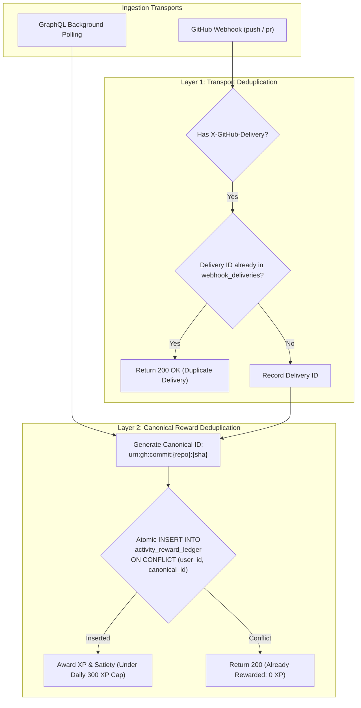

# STAGE 1.3A — ARCHITECTURE CORRECTIONS & DOMAIN FOUNDATION SPECIFICATION
## GitHub Profile Pet Platform: Revised Master Architecture

**Author:** Staff Software Architect & Game Systems Designer  
**Status:** Approved Architecture Corrections & Prototype Baseline (Reconciled)  
**Project Workspace:** `D:\Projects\GitHub-Profile-Pet`  

---

## 1. Architectural Decisions & Corrections

### 1.1 README Embed Rendering: Static SVG Standard vs. Animated Alternatives
- **The GitHub Camo Image Proxy Reality:**
  GitHub proxies all external and embedded images through its Camo proxy (`camo.githubusercontent.com`). While simple CSS `@keyframes` in SVG work in standalone browser tabs, GitHub Camo sanitizes or halts SMIL and CSS script execution in many markdown rendering contexts, and aggressive HTTP caching often causes visual animation freezes.
- **Architectural Policy:**
  1. **Static SVG as the Canonical Default Standard:** The primary `/api/pet/[username]/svg` endpoint emits a standalone, crystal-clear **Static SVG** card (`shape-rendering="crispEdges"`). It renders the companion's current pose (resting if low energy, proud idle if active, sleeping if offline), current level, evolution form, vital bars, streak count, and verified contribution stats. It guarantees 100% deterministic rendering across GitHub dark (`#0d1117`) and light (`#ffffff`) surfaces without script execution risks or proxy sanitization bugs.
  2. **Optional Animated GIF After Real GitHub Testing:** High-performance GIF endpoint (`/api/pet/[username]/gif` or `?format=gif`). Rendered server-side with zero CSS/JS dependencies, looping at 15–20 fps with an LZW-optimized global 7-color palette (< 45 KB). Only recommended for profile READMEs after real-world Camo caching validation.

---

### 1.2 Dual-Layer Deduplication: Transport Layer vs. Reward Layer
A critical architectural correction separates **transport-level packet deduplication** from **reward-level activity deduplication**:



1. **Transport Layer Deduplication (Webhooks):**
   - Webhook deliveries supply the `X-GitHub-Delivery` header (a unique UUID generated by GitHub per delivery attempt).
   - If GitHub retries a delivery due to timeout or network blip, `X-GitHub-Delivery` is identical.
   - The transport layer checks `webhook_deliveries (delivery_id)`: if already seen, it acknowledges with `200 OK` immediately without downstream evaluation.
   - Background GraphQL sync does NOT have delivery IDs; it bypasses Layer 1 and proceeds directly to Layer 2.

2. **Reward Layer Deduplication (Canonical Activity Identity):**
   - Completely transport-agnostic.
   - Canonical Activity ID formats:
     - **Commits:** `urn:gh:commit:{owner}/{repo}:{commitSha}`
     - **Pull Request Merged:** `urn:gh:pr:{owner}/{repo}:{prNumber}:merged:{mergeCommitSha}`
     - **Issue Closed:** `urn:gh:issue:{owner}/{repo}:{issueNumber}:closed`
   - **Database Unique Constraint:**
     ```sql
     CREATE TABLE activity_reward_ledger (
       id UUID PRIMARY KEY DEFAULT gen_random_uuid(),
       user_id VARCHAR(64) NOT NULL REFERENCES users(id),
       canonical_activity_id VARCHAR(255) NOT NULL,
       activity_type VARCHAR(32) NOT NULL,
       xp_awarded INTEGER NOT NULL,
       satiety_awarded INTEGER NOT NULL,
       awarded_at TIMESTAMP WITH TIME ZONE DEFAULT NOW(),
       transport_source VARCHAR(32) NOT NULL, -- 'webhook' | 'graphql_polling'
       transport_delivery_id VARCHAR(64),     -- X-GitHub-Delivery if webhook, NULL if polling
       CONSTRAINT uq_user_canonical_activity UNIQUE (user_id, canonical_activity_id)
     );
     ```
   - **Transactional & Idempotent:** If the same commit arrives via Webhook and later via GraphQL sync, the unique constraint causes `INSERT ... ON CONFLICT DO NOTHING` to award 0 XP.

---

### 1.3 Activity Caps & Anti-Farming Rules
- **Daily Cap:** `DAILY_ACTIVITY_XP_CAP = 300 XP` (resets daily at 00:00 UTC).
- **Per-Push Diminishing Multiplier:**
  - 1st commit in a push: $+25\text{ XP}$, $+10\text{ Satiety}$.
  - 2nd commit in a push: $+15\text{ XP}$, $+5\text{ Satiety}$.
  - 3rd commit in a push: $+10\text{ XP}$, $+2\text{ Satiety}$.
  - 4th+ commit in a push: $+5\text{ XP}$, $+1\text{ Satiety}$.
- **Hourly Rate Limiter:** Maximum 5 rewarded commits per hour. Subsequent commits award 0 XP but refresh satiety.

---

### 1.4 GitHub App Permissions Formal Analysis

We explicitly distinguish **OAuth App scopes** from **GitHub App fine-grained permissions**:

| Dimension | Legacy OAuth App | Modern GitHub App (ADOPTED) |
| :--- | :--- | :--- |
| **Permission Taxonomy** | Coarse string scopes (`read:user`, `repo`, `public_repo`). | Fine-grained split: **Account Permissions** vs **Repository Permissions**. |
| **Token Model** | Long-lived bearer token (no automatic expiry). | **User-to-Server Token** (8-hr lifespan with refresh rotation) and **Installation Token** (server-to-server). |
| **Repository Access** | Asking for private contributions previously required full `repo` read/write access. | **Zero Repository Access Required** for public profiles and public contribution calendars. |
| **Rate Limits** | 5,000 req/hr shared across the entire app per user. | 5,000 req/hr per installation (scaling to 12,500 req/hr for organizations). |

#### Minimum Required GitHub App Permissions
1. **Account Permissions:**
   - `Email addresses`: **Read-only** (to resolve trainer identity and send notification summaries if opted-in).
2. **Repository Permissions:**
   - **None** (Default). The App does NOT request `Contents`, `Issues`, or `Pull requests`.
   - `Metadata`: **Read-only** (Mandatory default applied by GitHub to all Apps).
3. **Organization Permissions:**
   - **None**.

#### GraphQL Contribution Queries & Permissions
- **Public Profile & Public Calendar:**
  ```graphql
  query getPublicContributions($login: String!) {
    user(login: $login) {
      avatarUrl
      name
      contributionsCollection {
        contributionCalendar {
          totalContributions
          weeks {
            contributionDays {
              contributionCount
              date
            }
          }
        }
      }
    }
  }
  ```
  - **Required Permission:** None beyond standard User-to-Server access token or unauthenticated public GraphQL API.
- **Optional Private Contributions:**
  - If a user has checked *"Include private contributions on my profile"* in their GitHub settings, GitHub's `contributionsCollection` automatically includes private contributions in `totalContributions` and `contributionCalendar` without requiring repo read permissions!
  - If the user has private contributions hidden on GitHub, reading `restrictedContributionsCount` requires user token authorization without granting source code access.
  - **Zero Repo Read Principle:** GitHub Profile Pet will NEVER request repository code read access (`Contents: Read`).

---

### 1.5 Gameplay Progression Formulas & Unification

All systems adhere strictly to the dual economic formulas:
1. **Level-Up Required XP:**
   $$\text{MaxXP}(L) = L \times 100$$
2. **Cumulative Threshold to Reach Level $L$:**
   $$\text{TotalXP}(L) = 50 \times L \times (L - 1)$$

```text
Threshold Table:
  Level 1:       0 XP  (Hatchling)
  Level 2:     100 XP
  Level 3:     300 XP
  Level 4:     600 XP
  Level 5:   1,000 XP  (Juvenile Form Milestone)
  Level 10:  4,500 XP  (Ascended Form Milestone)
  Level 14:  9,100 XP
  Level 15: 10,500 XP
  Level 20: 19,000 XP  (Celestial Form Milestone)
```

#### Reconciled 30-Day Simulation Results Across 5 Developer Profiles

| Profile Archetype | Total XP | Correct Level | Current XP | Max XP | XP Remaining | Evolution Stage | GitHub XP / Care XP | Notes |
| :--- | :---: | :---: | :---: | :---: | :---: | :---: | :---: | :--- |
| **Profile 1: Casual Dev** | 918 XP | **Level 4** | 318 XP | 400 XP | **82 XP** | Hatchling | 300 / 618 | Reaches Lvl 4 with 318/400 XP. Needs 82 XP to reach Juvenile Form (Lvl 5, 1,000 cumulative XP). |
| **Profile 2: Click-Farmer** | 554 XP | **Level 3** | 254 XP | 300 XP | **46 XP** | Hatchling | 0 / 554 | 1,500 clicks yield only 554 XP due to 60s diminishing returns. Stalls at Level 3. |
| **Profile 3 (Capped): 10x Dev** | 9,165 XP | **Level 14** | 65 XP | 1,400 XP | **1,335 XP** | Ascended | 7,500 / 1,665 | 300 XP daily cap smoothly spaces progression over 30 days to Level 14. |
| **Profile 3 (Uncapped): 10x Dev** | 20,415 XP | **Level 20** | 1,415 XP | 2,000 XP | **585 XP** | Celestial | 18,750 / 1,665 | Without cap, user exhausts game in 30 days reaching Celestial. Validates cap necessity. |
| **Profile 4: Low-Activity Dev** | 372 XP | **Level 3** | 72 XP | 300 XP | **228 XP** | Hatchling | 150 / 222 | Weekend committer reaches Level 3 comfortably without feeling left behind. |
| **Profile 5: 14-Day Inactive** | 385 XP | **Level 3** | 85 XP | 300 XP | **215 XP** | Hatchling | 150 / 235 | 14 days offline results in 0 XP lost, 0 stats decayed below floor. Seamless return. |

---

### 1.6 Inactivity Mechanics & Anti-Exploit Rules
1. **Passive Offline Recovery:**
   - Energy restores passively at $+0.05\text{ energy/sec}$ ($3\text{ energy/minute}$) when logged off, up to the 100 maximum (takes ~33 minutes).
2. **Ethical Floors (Zero Pet Death):**
   - Hunger decays at $0.0001/\text{sec}$ down to a strict minimum floor of $20\%$ (never 0).
   - Happiness decays at $0.0001/\text{sec}$ down to a strict minimum floor of $40\%$ (never 0).
   - Level, XP, and evolution stages are permanent. Pets NEVER die or regress.
3. **Welcome-Back Bonus Anti-Exploit Rules:**
   - **Eligibility Threshold:** Absence duration $\ge 24\text{ hours}$ (86,400 seconds).
   - **Cooldown Safeguard:** Maximum 1 welcome-back claim per 24 hours (`lastWelcomeBonusAt`).
   - Rapid login/logout loops immediately following an absence award 0 additional bonuses.

---

### 1.7 Canonical Sprite Pipeline & Manifest Specification
The asset pipeline delivers dual-format exports:

```text
public/sprites/pets/cat/
  ├── manifest.json              (Canonical metadata)
  ├── idle_sheet.png             (PNG horizontal sprite sheet: 128x32)
  ├── idle_sheet.svg             (SVG horizontal sprite sheet: 256x64)
  ├── idle_animated.svg          (SMIL/CSS animated SVG preview: 96x96)
  └── idle_frame0.svg            (Static fallback frame 0: 96x96)
```

#### Frame Manifest Schema (`public/sprites/pets/cat/manifest.json`)

```json
{
  "speciesId": "cat",
  "speciesName": "Shadow Claw",
  "archetype": "Void Familiar (Nocturnal Debugger)",
  "frameWidth": 32,
  "frameHeight": 32,
  "totalStates": 8,
  "rendering": {
    "pixelScaling": "pixelated",
    "shapeRendering": "crispEdges",
    "recommendedScales": [32, 48, 64, 96],
    "transparentBackground": true,
    "bounds": {
      "coreBodyMax": "24x24 px (Centered in 32x32)",
      "animationEnvelopeMax": "24x27 px (Reserving >= 2px margin on all sides)"
    }
  },
  "states": {
    "idle":     { "frameCount": 4, "durationMs": 800,  "playbackBehavior": "loop" },
    "happy":    { "frameCount": 4, "durationMs": 600,  "playbackBehavior": "loop" },
    "curious":  { "frameCount": 3, "durationMs": 600,  "playbackBehavior": "one-shot" },
    "tired":    { "frameCount": 2, "durationMs": 1200, "playbackBehavior": "loop" },
    "sleeping": { "frameCount": 4, "durationMs": 1600, "playbackBehavior": "loop" },
    "eating":   { "frameCount": 6, "durationMs": 750,  "playbackBehavior": "one-shot" },
    "training": { "frameCount": 6, "durationMs": 600,  "playbackBehavior": "one-shot" },
    "evolve":   { "frameCount": 8, "durationMs": 1200, "playbackBehavior": "one-shot" }
  }
}
```

---

### 1.8 Shadow Claw Palette & Ear Pixel-Art Correction
- **Indexed Palette (Strict 7 Colors):**
  - `0`: Transparent `none`
  - `1`: `#1a1228` [Void Ink] — Perimeter outline
  - `2`: `#2d184a` [Deep Velvet] — Base shadow & ear transition
  - `3`: `#4a247a` [Arcane Plum] — Body coat midtone
  - `4`: `#6d39a8` [Astral Violet] — Upper coat highlight & crown sheen
  - `5`: `#10b981` [Emerald Terminal] — Eye iris jewel tone
  - `6`: `#d1fae5` [Mint Gleam] — Eye specular glint
  - `7`: `#f472b6` [Rose Sigil] — Inner ear tissue & chest crest
- **Ear Outline Correction:**
  - Row 9 transparent notch eliminated: Row 9 now connects the ear base into the skull with Deep Velvet (`#2d184a`) and Arcane Plum (`#4a247a`) shading.
  - Symmetrical across $x = 15.5$ center axis.
  - Crisp outline contrast verified on white (`#ffffff`) and charcoal (`#0c0e12`) surfaces.
