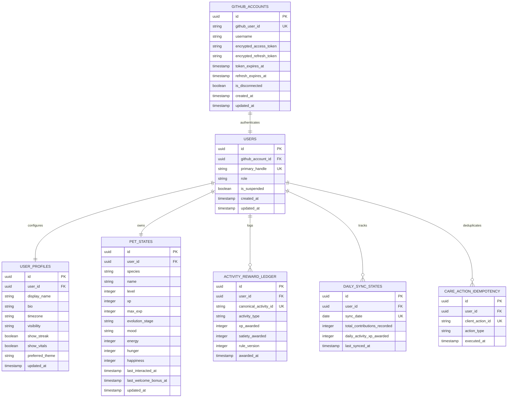
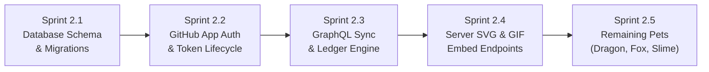

# Stage 2.0 — Pre-Implementation Architecture Validation & System Specification
## GitHub Profile Pet Platform

**Document Version:** 2.0.1-PROD-SPEC (Reconciled with Stage 2.0A Corrections)  
**Author:** Staff Software Architect & Principal Systems Designer  
**Target Architecture:** Next.js 16 (App Router), PostgreSQL 16+, GitHub App GraphQL Sync Engine  
**Project Workspace:** `D:\Projects\GitHub-Profile-Pet`  
**Status:** Approved Architecture Specification — Implementation Ready  
*Note: For the final Stage 2.0C specifications (private contribution authorization matrix, durable pending increment queue, Basic Auth revocation failure model, and external-call-first transaction flow), see [stage-2-0c-final-authorization-accounting.md](file:///d:/Projects/GitHub-Profile-Pet/docs/architecture/stage-2-0c-final-authorization-accounting.md).*

---

## 1. Executive Summary

This specification establishes the architectural, economic, database, security, and operational foundation for **GitHub Profile Pet** prior to Stage 2 implementation.

The fundamental architectural finding of this validation is:
> **User authorization via a GitHub App does NOT provide a global commit webhook stream.**  
> Webhooks only fire for repositories where the App has been explicitly installed by a repository admin. Developers routinely commit to employer organizations, client projects, and third-party open-source repositories where third-party App installations are strictly prohibited.  
> **Therefore, aggregate daily contribution synchronization via GitHub's GraphQL API (`contributionsCollection`) is decisively selected as the default, robust, privacy-preserving reward mechanism.** It operates with zero repository permissions, requires zero organization installations, and reliably rewards coding activity regardless of repository ownership.

All gameplay mechanics adhere strictly to the reconciled economic formulas:
$$\text{MaxXP}(L) = L \times 100$$
$$\text{TotalXP}(L) = 50 \times L \times (L - 1)$$
Daily activity XP is strictly capped at **300 XP/day** (UTC), preventing runaway progression on high-commit accounts while preserving rewarding gameplay for hobbyists and weekend developers. Vitals floor at safe bounds (hunger $\ge 20$, happiness $\ge 40$, energy recovering passively to 100 offline), ensuring pets never starve, die, or regress.

---

## 2. Confirmed Decisions

| Area | Confirmed Architectural Decision | Rationale & Impact |
| :--- | :--- | :--- |
| **Auth Model** | **GitHub App (Zero Repository & Zero Account Scopes)** | Provides user-level authorization, 8-hour short-lived tokens with automatic 6-month refresh token rotation. `GET /user` provides immutable ID, login, and avatar without requesting email or private data. |
| **Ingestion Engine** | **Daily GraphQL Aggregate Synchronization** | Queries `user(login).contributionsCollection` on user login and via scheduled background jobs. Captures all public/private contributions across all repos without repository installation dependencies. |
| **Reward Accounting** | **Daily Snapshots & Delta Processing** | Rewards newly observed contributions ($\Delta C = \max(0, C_{\text{observed}} - C_{\text{prev}})$). Non-regressive: retroactive GitHub contribution drops never subtract XP. |
| **README Embed** | **Static SVG as Primary Default** | Emits `/api/pet/[username]/svg` (`shape-rendering="crispEdges"`). Zero dependency on SMIL/CSS scripts that are stripped by GitHub Camo proxy. Optional GIF endpoint (`/api/pet/[username]/gif`) supported for tested clients. |
| **Economic Cap** | **`DAILY_ACTIVITY_XP_CAP = 300 XP` (UTC)** | Prevents bots and 10x high-commit power users from exhausting 20 levels in 30 days. Paces endgame (Celestial Form, Lvl 20) over ~63 days. |
| **Wellbeing & Death** | **Strict Zero-Death Philosophy** | Vitals floor at 20% hunger and 40% happiness. Offline passive recovery restores energy to 100. Pets never die or lose progress during developer vacations or hiatuses. |
| **Database** | **PostgreSQL 16+ with Row-Level Sync Locking** | Enforces transactional idempotency via `SELECT ... FOR UPDATE` on `daily_sync_states` and `UNIQUE(user_id, canonical_activity_id)` on `activity_reward_ledger`. |
| **Security & Privacy** | **Zero Repository Content Access** | The application NEVER requests `Contents: Read` or `repo` scopes. Users can verify in GitHub settings that GitHub Profile Pet has zero access to private source code. |

---

## 3. Rejected Approaches and Reasons

### 3.1 Rejected: Global Push Webhooks as Primary Ingestion
- **The Proposal:** Rely on GitHub Webhook `push` events to award real-time XP as commits occur.
- **Why Rejected:** 
  1. GitHub Apps only receive webhooks for repositories where the App has been explicitly installed.
  2. Developers cannot install Apps on corporate organizations or external open-source repositories where they contribute daily.
  3. Requiring users to install the App on every individual repository creates massive friction and privacy concerns.
  4. Webhook deliveries can fail silently without self-healing.
- **Adopted Alternative:** Scheduled and on-demand GraphQL `contributionsCollection` synchronization.

### 3.2 Rejected: Legacy OAuth App Model
- **The Proposal:** Use classic GitHub OAuth App with flat string scopes (`read:user`, `repo`).
- **Why Rejected:**
  1. OAuth App tokens are static, unexpiring bearer strings. If leaked from a database, they remain valid indefinitely until manually revoked.
  2. Private contributions in OAuth require asking for the broad `repo` scope, which grants read/write access to all public and private source code. Users rightfully refuse to grant this.
  3. Shared 5,000 req/hr rate limit across all OAuth apps on a user account.
- **Adopted Alternative:** GitHub App with short-lived User-to-Server tokens (8 hours) and token rotation.

### 3.3 Rejected: Interactive Animated SVG in GitHub README
- **The Proposal:** Rely exclusively on CSS `@keyframes` and SMIL embedded animations in README SVGs.
- **Why Rejected:**
  1. GitHub Camo proxy strips or disables embedded SVG scripts and SMIL animation loops in foreign contexts.
  2. Camo caches SVG responses aggressively; when CSS animations loop infinitely, many browsers burn GPU cycles or freeze the frame.
- **Adopted Alternative:** Deterministic Static SVG by default; optional server-rendered Animated GIF.

### 3.4 Rejected: Punitive Inactivity (Pet Death & Stat Decay to 0)
- **The Proposal:** Tamagotchi-style stat decay where neglected pets become sick, run away, or die if the developer doesn't log in.
- **Why Rejected:**
  1. Developers take vacations, experience burnout, or work on offline side projects. Punishing them creates negative product sentiment and abandonment.
  2. Gamification must motivate coding, not induce guilt.
- **Adopted Alternative:** Ethical flooring (hunger floor = 20, happiness floor = 40) with passive energy replenishment and a welcome-back bonus.

---

## 4. GitHub Integration Feasibility Matrix

### 4.1 Token Models & Lifecycles

```text
┌─────────────────────────────────────────────────────────────────────────────┐
│                           GITHUB APP AUTH LIFECYCLES                        │
├──────────────────────────────────────┬──────────────────────────────────────┤
│ 1. User-to-Server Access Token       │ 2. Installation Access Token         │
├──────────────────────────────────────┼──────────────────────────────────────┤
│ • Obtained via User OAuth code grant │ • Obtained server-to-server via JWT  │
│ • Lifespan: 8 hours (28,800 seconds) │ • Lifespan: 1 hour (3,600 seconds)   │
│ • Refresh token lifespan: 6 months   │ • Authenticates as App Installation  │
│ • Uses automatic token rotation      │ • Only acts within repositories      │
│ • Grants access to User's profile &  │   where App is explicitly installed  │
│   authorized GraphQL contributions   │ • Generated ephemerally in-memory    │
│ • Stored encrypted in PostgreSQL     │   (never stored in database)         │
│   using AES-256-GCM                  │ • Not needed for default gameplay    │
└──────────────────────────────────────┴──────────────────────────────────────┘
```

#### User Token Refresh Dance
1. Every token response includes `access_token`, `expires_in` (28800), `refresh_token`, and `refresh_token_expires_in` (~6 months).
2. When current time $\ge \text{token\_expires\_at} - 300\text{s}$, the background sync worker calls:
   `POST https://github.com/login/oauth/access_token`
   `grant_type=refresh_token&refresh_token=...&client_id=...&client_secret=...`
3. GitHub issues a new `access_token` AND a new `refresh_token`. The old refresh token is immediately invalidated. Both are atomically updated in `github_accounts`.

### 4.2 Permission-to-API-Operation Matrix

| Operation | Target GitHub Endpoint | Minimum GitHub App Permission | Requires Repo Install? | Official Documentation Reference |
| :--- | :--- | :--- | :---: | :--- |
| **User Identity** | `GET /user` | **None** (Default Identity) | **No** | [GitHub Apps: User Identity](https://docs.github.com/en/apps/creating-github-apps/authenticating-with-a-github-app/authenticating-with-a-github-app-on-behalf-of-a-user) |
| **Public Profile** | GraphQL `user(login) { avatarUrl, name }` | **None** (Public) | **No** | [GitHub GraphQL User](https://docs.github.com/en/graphql/reference/objects#user) |
| **Public Contributions** | GraphQL `contributionsCollection { contributionCalendar }` | **None** (Public) | **No** | [contributionsCollection](https://docs.github.com/en/graphql/reference/objects#contributionscollection) |
| **Private Contribution Counts** | GraphQL `restrictedContributionsCount` | User Access Token | **No** | [ContributionsCollection Field Docs](https://docs.github.com/en/graphql/reference/objects#contributionscollection) |
| **Granular Commits** | `GET /repos/{owner}/{repo}/commits` | Repository: **Contents (Read)** | **YES** | [GitHub REST Commits](https://docs.github.com/en/rest/commits/commits#list-commits) |
| **Push Webhooks** | Webhook `push` event | Repository: **Contents (Read)** | **YES** | [Webhook Events & Payloads](https://docs.github.com/en/webhooks/webhook-events-and-payloads#push) |

### 4.3 Selected Contribution Reward Engine: Aggregate Daily Sync
- **Mechanism:** On user login and via scheduled worker, GitHub Profile Pet queries `contributionsCollection(from: todayStart, to: todayEnd)`.
- **First-Sync Atomic Row-Locking Sequence:**
  1. `INSERT INTO daily_sync_states (user_id, sync_date, total_contributions_recorded, daily_activity_xp_awarded) VALUES ($1, $2, 0, 0) ON CONFLICT (user_id, sync_date) DO NOTHING;`
  2. `SELECT * FROM daily_sync_states WHERE user_id = $1 AND sync_date = $2 FOR UPDATE;`
  *(Guarantees a row lock on first-time synchronization when no row previously existed).*
- **Differential Ingestion:**
  $$\Delta C = \max(0, C_{\text{observed}} - C_{\text{prev}})$$
- If $\Delta C > 0$, the engine awards **GitHub Activity XP** based on the diminishing schedule for newly observed daily contributions up to `DAILY_ACTIVITY_XP_CAP = 300 XP`.
- **Monotonic High-Water Mark (Non-Regression Guarantee):** If $C_{\text{observed}} < C_{\text{prev}}$ (e.g. from a branch rebase or commit deletion), $\Delta C = 0$. The application **never subtracts XP** or reverts pet levels, and $C_{\text{prev}}$ remains as the high-water mark.

---

## 5. Reward Economy Specification

### 5.1 Progression & Cumulative XP Curves

$$\text{MaxXP}(L) = L \times 100$$
$$\text{TotalXP}(L) = 50 \times L \times (L - 1)$$

```text
Threshold Reference Table:
  Level 1:       0 XP  (Hatchling)
  Level 2:     100 XP
  Level 3:     300 XP
  Level 4:     600 XP
  Level 5:   1,000 XP  (Juvenile Form Milestone)
  Level 10:  4,500 XP  (Ascended Form Milestone)
  Level 14:  9,100 XP  (10x Capped Dev 30-Day Milestone)
  Level 15: 10,500 XP
  Level 20: 19,000 XP  (Celestial Form Milestone)
```

### 5.2 XP Budgets: Manual Care vs. GitHub Activity

```text
┌─────────────────────────────────────────────────────────────────────────────┐
│                             DAILY XP BUDGETS                                │
├──────────────────────────────────────┬──────────────────────────────────────┤
│ 1. GitHub Activity XP Budget         │ 2. Manual Care Action XP Budget      │
├──────────────────────────────────────┼──────────────────────────────────────┤
│ • Strict Daily Cap: 300 XP (UTC)     │ • Soft Natural Cap: ~50-80 XP/day    │
│ • Diminishing schedule per observed  │ • Petting: +6 XP (Diminishes in 60s) │
│   contribution increment:            │ • Feeding: +10 XP, +24 Satiety       │
│   - 1st increment: +25 XP, +10 Sat   │ • Training: +30 XP, -18 Energy       │
│   - 2nd increment: +15 XP, +5 Sat    │ • Resting: Strictly 0 XP             │
│   - 3rd increment: +10 XP, +2 Sat    │ • Diminishing Multipliers (60s):     │
│   - 4th+ increment: +5 XP, +1 Sat    │   [1.0, 0.60, 0.35, 0.20, 0.10]      │
│ • Max rewarded increments/batch: 5   │ • Cooldown: 800ms debounce           │
│ • Resets daily at 00:00:00 UTC       │ • Versioned Rule: rule_version = 1   │
└──────────────────────────────────────┴──────────────────────────────────────┘
```

### 5.3 Daily UTC Reset Policy & Timezone Alignment
- All daily caps (`daily_activity_xp_awarded`, `daily_commits_processed`) reset strictly at **`00:00:00 UTC`**.
- User profile timezone preference (`user_profiles.timezone`, default `'UTC'`) is used strictly for localized calendar day labeling in the web dashboard. All ledger aggregation and daily cap checks remain strictly UTC to prevent timezone-shifting exploits.

---

## 6. Inactivity and Pet Wellbeing Engine

### 6.1 Server-Side Timestamp-Based Deterministic Calculations
The pet's live state at any point in time $t_{\text{now}}$ is evaluated as a pure function of its last recorded state at $t_{\text{last}}$:

$$\Delta t = \max(0, t_{\text{now}} - t_{\text{last}})$$

1. **Passive Offline Energy Recovery:**
   $$\text{Energy}(t_{\text{now}}) = \min(100, \text{Energy}(t_{\text{last}}) + \lfloor \Delta t \times 0.05 \rfloor)$$
   *(Restores +3 energy/minute; full recovery from 0 to 100 takes 33.3 minutes).*

2. **Hunger Decay (Bounded by Floor 20):**
   $$\text{Hunger}(t_{\text{now}}) = \max(20, \text{Hunger}(t_{\text{last}}) - \lfloor \Delta t \times 0.0001 \rfloor)$$
   *(Decays at ~8.6 points/day; takes ~7 days to reach the safe floor of 20).*

3. **Happiness Decay (Bounded by Floor 40):**
   $$\text{Happiness}(t_{\text{now}}) = \max(40, \text{Happiness}(t_{\text{last}}) - \lfloor \Delta t \times 0.0001 \rfloor)$$
   *(Decays at ~8.6 points/day; takes ~4.6 days to reach the safe floor of 40).*

4. **Zero-Death Guarantee:**
   Vitals never reach 0. Level and XP are never decremented. When a user returns after 6 months, their pet is alive, fully energized (100⚡), resting comfortably, and ready to play.

### 6.2 Welcome-Back Bonus & Anti-Exploit Rules
- **Eligibility:** $\Delta t \ge 86,400\text{ seconds}$ (24 hours of inactivity).
- **Cooldown Safeguard:** $\ge 24\text{ hours}$ must have elapsed since `last_welcome_bonus_at`.
- **Anti-Exploit:** Rapid login/logout loops immediately following return evaluate to $\Delta t < 86,400\text{s}$, awarding 0 bonus XP.
- **Yield:** $+25\text{ XP}$, $+15\text{ Happiness}$, $+15\text{ Satiety}$, $+20\text{ Energy}$.

---

## 7. Database and API Contracts

### 7.1 Entity Relationship Diagram



### 7.2 Database Schema DDL (PostgreSQL 16+)

```sql
CREATE EXTENSION IF NOT EXISTS "pgcrypto";

-- 1. GitHub Accounts
CREATE TABLE github_accounts (
    id UUID PRIMARY KEY DEFAULT gen_random_uuid(),
    github_user_id VARCHAR(64) NOT NULL UNIQUE,
    username VARCHAR(100) NOT NULL,
    encrypted_access_token TEXT,
    encrypted_refresh_token TEXT,
    token_expires_at TIMESTAMPTZ,
    refresh_expires_at TIMESTAMPTZ,
    is_disconnected BOOLEAN NOT NULL DEFAULT FALSE,
    created_at TIMESTAMPTZ NOT NULL DEFAULT NOW(),
    updated_at TIMESTAMPTZ NOT NULL DEFAULT NOW()
);
CREATE INDEX idx_github_accounts_username ON github_accounts(username);

-- 2. Core Users
CREATE TABLE users (
    id UUID PRIMARY KEY DEFAULT gen_random_uuid(),
    github_account_id UUID NOT NULL UNIQUE REFERENCES github_accounts(id) ON DELETE CASCADE,
    primary_handle VARCHAR(100) NOT NULL UNIQUE,
    role VARCHAR(32) NOT NULL DEFAULT 'trainer',
    is_suspended BOOLEAN NOT NULL DEFAULT FALSE,
    created_at TIMESTAMPTZ NOT NULL DEFAULT NOW(),
    updated_at TIMESTAMPTZ NOT NULL DEFAULT NOW()
);

-- 3. User Profiles & Privacy Preferences
CREATE TABLE user_profiles (
    id UUID PRIMARY KEY DEFAULT gen_random_uuid(),
    user_id UUID NOT NULL UNIQUE REFERENCES users(id) ON DELETE CASCADE,
    display_name VARCHAR(100) NOT NULL,
    bio VARCHAR(255) NOT NULL DEFAULT '',
    timezone VARCHAR(64) NOT NULL DEFAULT 'UTC',
    visibility VARCHAR(32) NOT NULL DEFAULT 'public', -- 'public' | 'unlisted' | 'minimal'
    show_streak BOOLEAN NOT NULL DEFAULT TRUE,
    show_vitals BOOLEAN NOT NULL DEFAULT TRUE,
    preferred_theme VARCHAR(32) NOT NULL DEFAULT 'dark',
    updated_at TIMESTAMPTZ NOT NULL DEFAULT NOW(),
    CONSTRAINT chk_visibility CHECK (visibility IN ('public', 'unlisted', 'minimal'))
);

-- 4. Pet State (With Database Vitals Constraints)
CREATE TABLE pet_states (
    id UUID PRIMARY KEY DEFAULT gen_random_uuid(),
    user_id UUID NOT NULL UNIQUE REFERENCES users(id) ON DELETE CASCADE,
    species VARCHAR(32) NOT NULL DEFAULT 'cat',
    name VARCHAR(64) NOT NULL DEFAULT 'Shadow Claw',
    level INTEGER NOT NULL DEFAULT 1,
    xp INTEGER NOT NULL DEFAULT 0,
    max_exp INTEGER NOT NULL DEFAULT 100,
    evolution_stage VARCHAR(32) NOT NULL DEFAULT 'Hatchling',
    mood VARCHAR(32) NOT NULL DEFAULT 'Focused',
    energy INTEGER NOT NULL DEFAULT 80,
    hunger INTEGER NOT NULL DEFAULT 60,
    happiness INTEGER NOT NULL DEFAULT 70,
    last_interacted_at TIMESTAMPTZ NOT NULL DEFAULT NOW(),
    last_welcome_bonus_at TIMESTAMPTZ,
    updated_at TIMESTAMPTZ NOT NULL DEFAULT NOW(),
    CONSTRAINT chk_level_positive CHECK (level >= 1),
    CONSTRAINT chk_xp_non_negative CHECK (xp >= 0),
    CONSTRAINT chk_energy_bounds CHECK (energy >= 0 AND energy <= 100),
    CONSTRAINT chk_hunger_bounds CHECK (hunger >= 0 AND hunger <= 100),
    CONSTRAINT chk_happiness_bounds CHECK (happiness >= 0 AND happiness <= 100)
);

-- 5. Auditable Reward Ledger (Append-Only)
CREATE TABLE activity_reward_ledger (
    id UUID PRIMARY KEY DEFAULT gen_random_uuid(),
    user_id UUID NOT NULL REFERENCES users(id) ON DELETE CASCADE,
    canonical_activity_id VARCHAR(255) NOT NULL,
    activity_type VARCHAR(64) NOT NULL,
    xp_awarded INTEGER NOT NULL,
    satiety_awarded INTEGER NOT NULL DEFAULT 0,
    rule_version INTEGER NOT NULL DEFAULT 1,
    awarded_at TIMESTAMPTZ NOT NULL DEFAULT NOW(),
    CONSTRAINT uq_user_canonical_activity UNIQUE (user_id, canonical_activity_id),
    CONSTRAINT chk_xp_awarded_positive CHECK (xp_awarded >= 0)
);
CREATE INDEX idx_ledger_user_awarded ON activity_reward_ledger(user_id, awarded_at DESC);

-- 6. Daily Sync Tracking (Atomic 300 XP Cap Enforcement)
CREATE TABLE daily_sync_states (
    id UUID PRIMARY KEY DEFAULT gen_random_uuid(),
    user_id UUID NOT NULL REFERENCES users(id) ON DELETE CASCADE,
    sync_date DATE NOT NULL,
    total_contributions_recorded INTEGER NOT NULL DEFAULT 0,
    daily_activity_xp_awarded INTEGER NOT NULL DEFAULT 0,
    last_synced_at TIMESTAMPTZ NOT NULL DEFAULT NOW(),
    CONSTRAINT uq_user_sync_date UNIQUE (user_id, sync_date),
    CONSTRAINT chk_daily_xp_cap CHECK (daily_activity_xp_awarded <= 300)
);
CREATE INDEX idx_daily_sync_user_date ON daily_sync_states(user_id, sync_date);

-- 7. Care Action Idempotency Store
CREATE TABLE care_action_idempotency (
    id UUID PRIMARY KEY DEFAULT gen_random_uuid(),
    user_id UUID NOT NULL REFERENCES users(id) ON DELETE CASCADE,
    client_action_id VARCHAR(64) NOT NULL UNIQUE,
    action_type VARCHAR(32) NOT NULL,
    executed_at TIMESTAMPTZ NOT NULL DEFAULT NOW()
);
CREATE INDEX idx_action_idempotency_time ON care_action_idempotency(user_id, executed_at DESC);
```

---

## 8. Public Identity, Privacy and README Security

### 8.1 Visibility Semantics

| Visibility Mode | Embed Route (`/api/pet/:user/svg`) | Public Web Profile (`/u/:user`) | README Stats Displayed |
| :--- | :--- | :--- | :--- |
| **`public`** (Default) | Fully rendered SVG with pet sprite, level, streak, and vital indicators. | Accessible to all visitors; shows pet stage and recent contribution badges. | Full level, stats, streak, vitals. |
| **`unlisted`** | Fully rendered SVG embed functions as normal. | Web profile is hidden from search indexes and directory listings (`noindex`). | Full level, stats, streak, vitals. |
| **`minimal`** | Renders pet sprite, pet name, and level badge ONLY. | Profile shows companion avatar and level without telemetry. | Vitals, streak, and exact commit numbers are completely hidden. |

### 8.2 Account Deletion, Revocation & GDPR Erasure
When a user requests account deletion via `DELETE /api/account`:
1. **Upstream Token Revocation:**
   The server calls GitHub REST API `DELETE https://api.github.com/applications/{client_id}/grant` with **HTTP Basic Authentication (`client_id:client_secret`)** and `{ "access_token": "..." }` in the JSON request body.
   - If GitHub returns `204 No Content` or `404 Not Found` (already revoked): upstream grant is cleared.
   - If GitHub times out or fails (5xx): local deletion proceeds deterministically. The local encrypted token is permanently wiped, and any orphan token on GitHub automatically expires within $\le 8\text{ hours}$.
2. **Local Atomic Database Purge:**
   In PostgreSQL:
   ```sql
   BEGIN;
   DELETE FROM users WHERE id = $1; -- Cascades to github_accounts, pet_states, ledger, sync_states, idempotency
   COMMIT;
   ```
3. **Public Edge Cache Purge:**
   Edge caches for `/api/pet/[username]/svg` are invalidated with `Cache-Control: no-store, max-age=0`. Subsequent requests return a generic fallback resting egg graphic.

### 8.3 SVG Security & Output Sanitization
- **Strict XML Escaping:**
  ```ts
  function escapeXml(unsafe: string): string {
    return unsafe
      .replace(/&/g, '&amp;')
      .replace(/</g, '&lt;')
      .replace(/>/g, '&gt;')
      .replace(/"/g, '&quot;')
      .replace(/'/g, '&apos;');
  }
  ```
- **Prohibited Elements:** SVGs emitted by `/api/pet/:user/svg` MUST NOT contain `<script>`, `<foreignObject>`, external fonts, or external image links (`<image xlink:href="...">`).
- **Cache Headers:**
  - Public SVG Embed: `Cache-Control: public, max-age=300, s-maxage=300, stale-while-revalidate=60` + `ETag: W/"<pet-hash>"`
  - Private Dashboard: `Cache-Control: private, no-store, no-cache, must-revalidate`

---

## 9. Deployment and Operational Feasibility

### 9.1 Evaluation of Free-Tier Constraints

| Provider & Service | Official Plan Constraints | Impact on Architecture | Architecture Resolution |
| :--- | :--- | :--- | :--- |
| **Vercel Cron (Hobby Tier)** | Max **1 cron job** per project; frequency limit: **once per day** (`0 0 * * *`). | Cannot run 6-hour background sync on Vercel Free. | **Resolution:** Use **GitHub Actions Scheduled Workflow** (`cron: '0 */6 * * *'`) calling `/api/cron/sync` with bearer `CRON_SECRET`. |
| **Vercel Hobby Terms** | Personal, **non-commercial** projects only. | Permissible for open-source / hobby pet platform. | Keep commercial monetization out of Hobby deployments. |
| **Supabase Free Tier** | Database **pauses after 7 days of inactivity**; no point-in-time recovery. | If a pet has few visitors, database could pause and fail SVG embeds. | **Resolution:** Active cron sync prevents pausing; or use **Neon Serverless PostgreSQL** (free tier does not pause and offers instant branching). |
| **Database Portability** | Proprietary extensions avoided. | Architecture can migrate freely without rewrites. | Standard PostgreSQL 16+ DDL, portable to Docker, Neon, Supabase, Render, or Fly.io. |

---

## 10. Open Risks and Unresolved Decisions

| Priority | Decision / Question | Options Considered | Recommended Default | Next Milestone Trigger |
| :---: | :--- | :--- | :--- | :---: |
| **P1** | **Primary Database Host** | Neon Serverless vs. Supabase vs. Self-Hosted Docker. | **Neon Serverless PostgreSQL** (no inactivity pausing, excellent Next.js driver). | Sprint 2.1 |
| **P2** | **Background Cron Orchestrator** | GitHub Actions Cron vs. Upstash QStash vs. Vercel Pro. | **GitHub Actions Cron Workflow** (100% free, versioned in repo). | Sprint 2.3 |
| **P3** | **Optional GIF Generation Location** | Next.js API Route (Node.js buffer) vs. Edge Worker. | **Next.js Node.js Route** using pure `gifenc` buffer. | Sprint 2.4 |

---

## 11. Revised Stage 2 Implementation Sequence



- **Sprint 2.1 (Database & Migrations):** Provision PostgreSQL schema, run migration scripts, write database repository wrappers, and execute PostgreSQL integration tests (`tests/integration/*.test.ts`) covering concurrent first syncs, row locks, daily caps, and rollbacks.
- **Sprint 2.2 (GitHub App Auth):** Implement User-to-Server OAuth code exchange, AES-256 token encryption, and 8-hour token refresh worker.
- **Sprint 2.3 (GraphQL Sync & Reward Ledger):** Implement `contributionsCollection` fetcher, transactional ledger insertion, 300 XP daily cap, and hourly throttling.
- **Sprint 2.4 (Server-Side SVG & GIF Embed Endpoints):** Implement `/api/pet/[username]/svg` and `/api/pet/[username]/gif` with Camo cache headers and sanitization.
- **Sprint 2.5 (Character Art Expansion):** Produce 37 frames each for **Ignis Ember** (Dragon), **Kitsune Sol** (Fox), and **Bloop Matrix** (Slime) matching the Shadow Claw pipeline.
