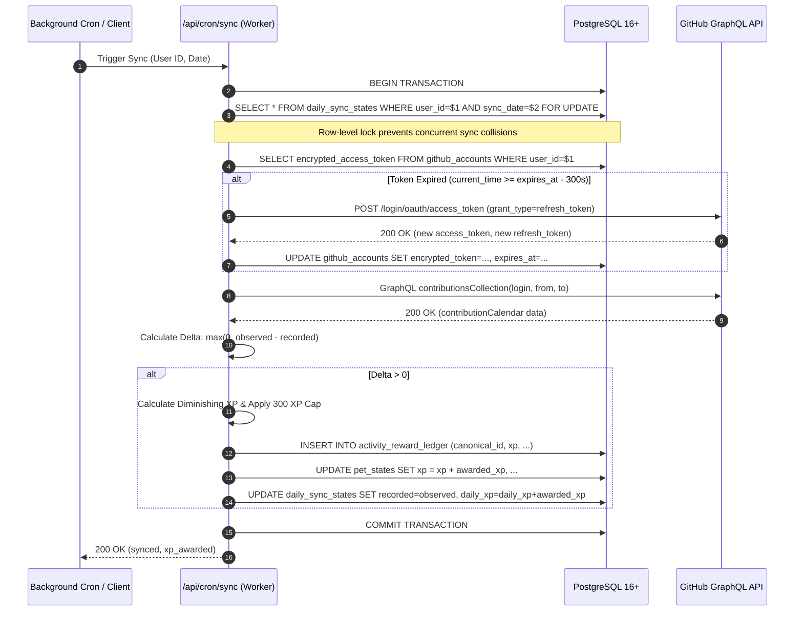
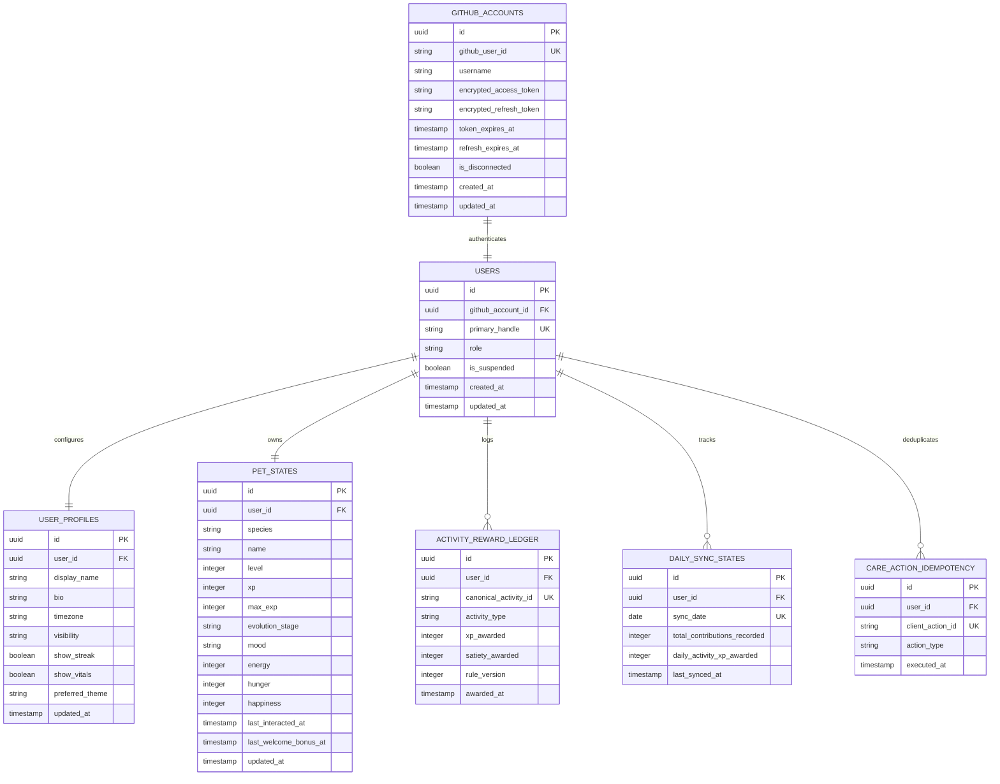

# Stage 2.0A — Architecture Corrections & Implementation Readiness Specification
## GitHub Profile Pet Platform

**Document Version:** 2.0.1-STAGE-2.0A  
**Author:** Staff Software Architect & Principal Systems Designer  
**Target Milestone:** Sprint 2.1 — Database and Migrations  
**Workspace:** `D:\Projects\GitHub-Profile-Pet`  
**Status:** Approved Architectural Specification (Pre-Implementation Baseline)  
*Note: For the final Stage 2.0C accounting queue, `read:user` permission matrix, and lock-optimized transaction flow, see [stage-2-0c-final-authorization-accounting.md](file:///d:/Projects/GitHub-Profile-Pet/docs/architecture/stage-2-0c-final-authorization-accounting.md).*

---

## 1. Executive Summary of Corrections

Stage 2.0 established the architectural baseline. This Stage 2.0A correction pass resolves six critical operational realities:

1. **GitHub App Permissions & Identity Minimalization:** Confirmed that `GET /user` returns immutable trainer identity (`id`, `login`, `avatar_url`, `name`) with **zero GitHub App permissions**. Email access is NOT required for trainer identity. The GitHub App permission footprint is reduced to **strictly Zero Repository Permissions** and **Zero Account Permissions**, maximizing developer trust and adoption.
2. **Aggregate Contribution Reward Accounting (No Individual Commit Pretenses):** Since GitHub's GraphQL API provides aggregate calendar counts rather than individual commit SHAs (without repository code access), the reward model is re-architected around **daily contribution snapshots** and **differential delta rewards** ($\Delta C = \max(0, \text{observedCount} - \text{previouslyRecordedCount})$).
3. **Append-Only Ledger & Non-Regressive Progress:** Ingestion jobs are strictly append-only. Retroactive GitHub contribution decreases (e.g., from force-pushes or commit rebases) **never subtract XP** or cause pet regression.
4. **PostgreSQL Concurrency & Atomic Daily Cap:** Daily 300 XP caps and differential calculations are enforced atomically using PostgreSQL row-level locks (`SELECT ... FOR UPDATE` on `daily_sync_states`), eliminating race conditions between concurrent webhooks, background sync workers, and user manual refreshes.
5. **Operational Realities (Vercel & Supabase Free Tier Limits):** Corrected unrealistic assumptions regarding free-tier cron schedules (Vercel Hobby supports only 1 cron run per day) and database inactivity pausing (Supabase Free pauses after 7 days). Specified portable external scheduling (Upstash QStash / GitHub Actions) and Neon/PostgreSQL portability.
6. **Versioned Economic Rules & Zero Pet Death:** Standardized on versioned economic rules (`rule_version = 1`) with timestamp-based deterministic decay, guaranteeing pets never starve, die, or lose levels due to hiatuses.

---

## 2. GitHub App Authorization & Identity Audit

### 2.1 Trainer Identification Without Email Permission
Official GitHub API verification confirms:
- An authenticated `GET https://api.github.com/user` with a GitHub App User-to-Server token returns:
  ```json
  {
    "login": "octocat",
    "id": 583231,
    "node_id": "MDQ6VXNlcjU4MzIzMQ==",
    "avatar_url": "https://avatars.githubusercontent.com/u/583231?v=4",
    "name": "The Octocat",
    "company": "@github",
    "blog": "https://github.blog",
    "location": "San Francisco",
    "email": null,
    "bio": "GitHub mascot and developer advocate"
  }
  ```
- **Architectural Decision:** We **DO NOT** request `Email addresses: Read`. The immutable GitHub user ID `id` (integer) is the permanent foreign key anchor in `github_accounts.github_user_id`.
- **Username Change Handling:** If a developer renames their GitHub account from `@octocat` to `@mona-cat`, their integer `github_user_id` remains `583231`. On each login or sync, the application detects `login != primary_handle` and updates `primary_handle` in `users` and `github_accounts` atomically, preserving pet stats and history seamlessly.

### 2.2 Minimum Permissions Footprint
By leveraging public profile data and the user's GraphQL contribution collection:

| Permission Category | Setting | Architectural Purpose |
| :--- | :---: | :--- |
| **Account Permissions** | **None** | No email, plan, or personal data access required. |
| **Repository Permissions** | **None** | Zero source code, commit message, branch, or file access. |
| **Organization Permissions** | **None** | Zero organization membership or secret access. |

Developers authenticating with GitHub Profile Pet see an authorization screen confirming:
> **"GitHub Profile Pet has no access to your repositories, source code, or private email."**

### 2.3 Public vs. Restricted/Private Contribution Data
GitHub's GraphQL `contributionsCollection` behaves as follows:
```graphql
query getTrainerContributions($login: String!, $from: DateTime!, $to: DateTime!) {
  user(login: $login) {
    contributionsCollection(from: $from, to: $to) {
      contributionCalendar {
        totalContributions
        weeks {
          contributionDays {
            date
            contributionCount
          }
        }
      }
      restrictedContributionsCount
    }
  }
}
```
1. **Public Contributions:** The `contributionCalendar` days and `totalContributions` are always available for any public user profile.
2. **Private Contributions:**
   - **Scenario A (User enabled "Include private contributions on my profile" on GitHub):** GitHub automatically folds private contributions directly into `contributionDays.contributionCount` and `totalContributions`. The application rewards them with zero extra scopes needed!
   - **Scenario B (Private contributions hidden on GitHub profile):** `contributionDays` contains public counts only. `restrictedContributionsCount` contains the private aggregate scalar count (e.g. `12`).
   - **Graceful Fallback:** If `restrictedContributionsCount` is null or inaccessible, the application logs `private_contributions_accessible = false` and synchronizes public contributions without failing.

### 2.4 Token Lifecycle & Refresh Rotation Protocol
1. **Access Token Lifespan:** Strictly **8 hours** (28,800 seconds).
2. **Refresh Token Lifespan:** **6 months** (15,552,000 seconds).
3. **Rotation Mechanics:**
   - When refreshed via `POST https://github.com/login/oauth/access_token` (`grant_type=refresh_token`), GitHub returns a **new access token** AND a **new refresh token**.
   - The previous refresh token is immediately invalidated.
   - The application updates both tokens inside a single database transaction.
4. **Revocation & Expiration Handling:**
   - If a refresh attempt returns `HTTP 400` or `HTTP 401` (e.g. user revoked App access in GitHub Settings), the account is marked `is_disconnected = true`, the stored tokens are erased (`NULL`), and the pet is set to `Mood: Resting` with an embed badge `"COMPANION OFFLINE"`.

---

## 3. Contribution Synchronization & Reward Accounting

### 3.1 Aggregate Contribution Model (No Individual Commit Identity)
Because the core integration queries aggregate daily calendar counts rather than individual commit SHAs, the sync engine operates on **daily contribution snapshots**:

```text
Each sync checks date YYYY-MM-DD:
  New Contributions = max(0, observedGitHubCount - previouslyRecordedCount)
```

### 3.2 Synchronization Workflow & Mathematical Rules
For a given user and target date $D$:
1. **Initialize Row if Missing & Acquire Lock:**
   ```sql
   INSERT INTO daily_sync_states (user_id, sync_date, total_contributions_recorded, daily_activity_xp_awarded)
   VALUES ($1, $2, 0, 0)
   ON CONFLICT (user_id, sync_date) DO NOTHING;

   SELECT * FROM daily_sync_states
   WHERE user_id = $1 AND sync_date = $2
   FOR UPDATE;
   ```
   *Guarantees a row-level lock even on first-time synchronization when no row previously existed.*
2. Let $C_{\text{prev}} = \text{total\_contributions\_recorded}$ (default 0).
3. Let $XP_{\text{prev}} = \text{daily\_activity\_xp\_awarded}$ (default 0).
4. Fetch current GitHub contribution count $C_{\text{observed}}$ for date $D$.
5. **Delta Calculation:**
   $$\Delta C = \max(0, C_{\text{observed}} - C_{\text{prev}})$$
6. If $\Delta C = 0$: No new contributions. Terminate sync with status `no_change`.
7. **XP Calculation on Delta (GitHub Activity XP):**
   Evaluate each new contribution increment $i$ from $C_{\text{prev}} + 1$ to $C_{\text{observed}}$ using the diminishing schedule:
   - Contribution increment 1: 25 XP
   - Contribution increment 2: 15 XP
   - Contribution increment 3: 10 XP
   - Contribution increment 4+: 5 XP
   - Max 5 rewarded increments per sync batch / hour.
8. **Atomic Cap Enforcement:**
   $$\text{AvailableBudget} = \max(0, 300 - XP_{\text{prev}})$$
   $$XP_{\text{to\_award}} = \min(\text{CalculatedXP}, \text{AvailableBudget})$$
9. **Append-Only Reward Ledger:**
   Insert record into `activity_reward_ledger`:
   $$\text{canonical\_activity\_id} = \text{"urn:gh:daily:"} + \text{user\_id} + \text{":"} + D + \text{":c:"} + C_{\text{prev}} + \text{"-" + } C_{\text{observed}}$$
10. **State Update:**
    Update `daily_sync_states` with:
    $$\text{total\_contributions\_recorded} = \max(C_{\text{prev}}, C_{\text{observed}})$$
    $$\text{daily\_activity\_xp\_awarded} = XP_{\text{prev}} + XP_{\text{to\_award}}$$
11. **Monotonic High-Water Mark Invariant (Non-Regression Rule):**
    If $C_{\text{observed}} < C_{\text{prev}}$ (e.g. user rebased or deleted a commit), $\Delta C = 0$. We **NEVER subtract XP** or revert pet progress. The recorded snapshot remains the high-water mark.

### 3.3 Worked Examples

#### Example 1: First Synchronization of the Day
- User performs 3 GitHub contributions (e.g. 2 commits, 1 PR review) on 2026-11-15.
- $C_{\text{prev}} = 0$, $XP_{\text{prev}} = 0$.
- $C_{\text{observed}} = 3$.
- $\Delta C = 3$.
- GitHub Activity XP for increments 1, 2, 3: $25 + 15 + 10 = 50\text{ XP}$.
- Available cap: $300 - 0 = 300\text{ XP}$. $XP_{\text{awarded}} = 50\text{ XP}$.
- Ledger entry created: `urn:gh:daily:usr_1:2026-11-15:c:0-3` for $+50\text{ XP}$.
- Updated state: $C_{\text{recorded}} = 3$, $XP_{\text{awarded}} = 50\text{ XP}$.

#### Example 2: Repeated Sync (No New Contributions)
- Background job runs 1 hour later.
- $C_{\text{prev}} = 3$, $XP_{\text{prev}} = 50$.
- $C_{\text{observed}} = 3$.
- $\Delta C = \max(0, 3 - 3) = 0$.
- Status: `no_change`. Zero XP awarded, zero ledger rows created.

#### Example 3: Subsequent Contributions Hitting the Daily Cap
- User performs 60 contributions in a massive sprint.
- $C_{\text{prev}} = 3$, $XP_{\text{prev}} = 50$. Available budget: $300 - 50 = 250\text{ XP}$.
- $C_{\text{observed}} = 63$. $\Delta C = 60$.
- Theoretical raw yield: 60 increments $\times 5\text{ XP} = 300\text{ XP}$.
- Capped yield: $\min(300, 250) = 250\text{ XP}$.
- Ledger entry created: `urn:gh:daily:usr_1:2026-11-15:c:3-63` for $+250\text{ XP}$.
- Updated state: $C_{\text{recorded}} = 63$, $XP_{\text{awarded}} = 300\text{ XP}$ (Cap reached).
- Any further contributions on 2026-11-15 award $0\text{ XP}$ while updating $C_{\text{recorded}}$.

#### Example 4: Concurrent First-Sync Jobs
- Worker A and Worker B trigger simultaneously for user `usr_1` on date `2026-11-15` when no row exists yet.
- Worker A executes `INSERT ... ON CONFLICT DO NOTHING` and acquires lock with `SELECT ... FOR UPDATE`.
- Worker B attempts the same sequence and blocks on `SELECT ... FOR UPDATE` waiting for Worker A.
- Worker A observes $C_{\text{observed}} = 2$, awards 40 XP, updates state to $C=2, XP=40$, and commits.
- Worker B unblocks, reads the newly committed state ($C_{\text{prev}} = 2$), observes $C_{\text{observed}} = 2$, calculates $\Delta C = 0$, and exits cleanly without awarding duplicate XP.

#### Example 5: Retroactive Contribution Reduction (Rebase / Force-Push)
- User rebases branch, reducing daily count from 10 to 8.
- $C_{\text{prev}} = 10$, $XP_{\text{prev}} = 85$.
- $C_{\text{observed}} = 8$.
- $\Delta C = \max(0, 8 - 10) = 0$.
- Result: 0 XP change. Pet level and XP remain untouched. $C_{\text{recorded}}$ remains 10 (monotonic high-water mark).
- If the user later adds 3 more contributions ($C_{\text{observed}} = 11$), delta is $\max(0, 11 - 10) = 1$, awarding XP for exactly the 1 genuinely new contribution above the high-water mark.

---

## 4. Sequence Diagrams

### 4.1 Contribution Synchronization Sequence



---

## 5. Database Schema & Concurrency Design

### 5.1 Entity Relationship Diagram



### 5.2 Atomic DDL & Constraint Specification

```sql
-- PostgreSQL 16+ Production DDL

CREATE EXTENSION IF NOT EXISTS "pgcrypto";

-- 1. GitHub Accounts
CREATE TABLE github_accounts (
    id UUID PRIMARY KEY DEFAULT gen_random_uuid(),
    github_user_id VARCHAR(64) NOT NULL UNIQUE,
    username VARCHAR(100) NOT NULL,
    encrypted_access_token TEXT,
    encrypted_refresh_token TEXT,
    token_expires_at TIMESTAMPTZ,
    refresh_expires_at TIMESTAMPTZ,
    is_disconnected BOOLEAN NOT NULL DEFAULT FALSE,
    created_at TIMESTAMPTZ NOT NULL DEFAULT NOW(),
    updated_at TIMESTAMPTZ NOT NULL DEFAULT NOW()
);
CREATE INDEX idx_github_accounts_username ON github_accounts(username);

-- 2. Core Users
CREATE TABLE users (
    id UUID PRIMARY KEY DEFAULT gen_random_uuid(),
    github_account_id UUID NOT NULL UNIQUE REFERENCES github_accounts(id) ON DELETE CASCADE,
    primary_handle VARCHAR(100) NOT NULL UNIQUE,
    role VARCHAR(32) NOT NULL DEFAULT 'trainer',
    is_suspended BOOLEAN NOT NULL DEFAULT FALSE,
    created_at TIMESTAMPTZ NOT NULL DEFAULT NOW(),
    updated_at TIMESTAMPTZ NOT NULL DEFAULT NOW()
);

-- 3. User Profiles & Privacy Preferences
CREATE TABLE user_profiles (
    id UUID PRIMARY KEY DEFAULT gen_random_uuid(),
    user_id UUID NOT NULL UNIQUE REFERENCES users(id) ON DELETE CASCADE,
    display_name VARCHAR(100) NOT NULL,
    bio VARCHAR(255) NOT NULL DEFAULT '',
    timezone VARCHAR(64) NOT NULL DEFAULT 'UTC',
    visibility VARCHAR(32) NOT NULL DEFAULT 'public', -- 'public' | 'unlisted' | 'minimal'
    show_streak BOOLEAN NOT NULL DEFAULT TRUE,
    show_vitals BOOLEAN NOT NULL DEFAULT TRUE,
    preferred_theme VARCHAR(32) NOT NULL DEFAULT 'dark',
    updated_at TIMESTAMPTZ NOT NULL DEFAULT NOW(),
    CONSTRAINT chk_visibility CHECK (visibility IN ('public', 'unlisted', 'minimal'))
);

-- 4. Pet State (With Database Vitals Constraints)
CREATE TABLE pet_states (
    id UUID PRIMARY KEY DEFAULT gen_random_uuid(),
    user_id UUID NOT NULL UNIQUE REFERENCES users(id) ON DELETE CASCADE,
    species VARCHAR(32) NOT NULL DEFAULT 'cat',
    name VARCHAR(64) NOT NULL DEFAULT 'Shadow Claw',
    level INTEGER NOT NULL DEFAULT 1,
    xp INTEGER NOT NULL DEFAULT 0,
    max_exp INTEGER NOT NULL DEFAULT 100,
    evolution_stage VARCHAR(32) NOT NULL DEFAULT 'Hatchling',
    mood VARCHAR(32) NOT NULL DEFAULT 'Focused',
    energy INTEGER NOT NULL DEFAULT 80,
    hunger INTEGER NOT NULL DEFAULT 60,
    happiness INTEGER NOT NULL DEFAULT 70,
    last_interacted_at TIMESTAMPTZ NOT NULL DEFAULT NOW(),
    last_welcome_bonus_at TIMESTAMPTZ,
    updated_at TIMESTAMPTZ NOT NULL DEFAULT NOW(),
    CONSTRAINT chk_level_positive CHECK (level >= 1),
    CONSTRAINT chk_xp_non_negative CHECK (xp >= 0),
    CONSTRAINT chk_energy_bounds CHECK (energy >= 0 AND energy <= 100),
    CONSTRAINT chk_hunger_bounds CHECK (hunger >= 0 AND hunger <= 100),
    CONSTRAINT chk_happiness_bounds CHECK (happiness >= 0 AND happiness <= 100)
);

-- 5. Auditable Reward Ledger (Append-Only)
CREATE TABLE activity_reward_ledger (
    id UUID PRIMARY KEY DEFAULT gen_random_uuid(),
    user_id UUID NOT NULL REFERENCES users(id) ON DELETE CASCADE,
    canonical_activity_id VARCHAR(255) NOT NULL,
    activity_type VARCHAR(64) NOT NULL,
    xp_awarded INTEGER NOT NULL,
    satiety_awarded INTEGER NOT NULL DEFAULT 0,
    rule_version INTEGER NOT NULL DEFAULT 1,
    awarded_at TIMESTAMPTZ NOT NULL DEFAULT NOW(),
    CONSTRAINT uq_user_canonical_activity UNIQUE (user_id, canonical_activity_id),
    CONSTRAINT chk_xp_awarded_positive CHECK (xp_awarded >= 0)
);
CREATE INDEX idx_ledger_user_awarded ON activity_reward_ledger(user_id, awarded_at DESC);

-- 6. Daily Sync Tracking (Atomic 300 XP Cap Enforcement)
CREATE TABLE daily_sync_states (
    id UUID PRIMARY KEY DEFAULT gen_random_uuid(),
    user_id UUID NOT NULL REFERENCES users(id) ON DELETE CASCADE,
    sync_date DATE NOT NULL,
    total_contributions_recorded INTEGER NOT NULL DEFAULT 0,
    daily_activity_xp_awarded INTEGER NOT NULL DEFAULT 0,
    last_synced_at TIMESTAMPTZ NOT NULL DEFAULT NOW(),
    CONSTRAINT uq_user_sync_date UNIQUE (user_id, sync_date),
    CONSTRAINT chk_daily_xp_cap CHECK (daily_activity_xp_awarded <= 300)
);
CREATE INDEX idx_daily_sync_user_date ON daily_sync_states(user_id, sync_date);

-- 7. Care Action Idempotency & Debounce Store
CREATE TABLE care_action_idempotency (
    id UUID PRIMARY KEY DEFAULT gen_random_uuid(),
    user_id UUID NOT NULL REFERENCES users(id) ON DELETE CASCADE,
    client_action_id VARCHAR(64) NOT NULL UNIQUE,
    action_type VARCHAR(32) NOT NULL,
    executed_at TIMESTAMPTZ NOT NULL DEFAULT NOW()
);
CREATE INDEX idx_action_idempotency_time ON care_action_idempotency(user_id, executed_at DESC);
```

---

## 6. Account Lifecycle, Privacy & Threat Review

### 6.1 Account Deletion & GDPR Erasure (Cascading Purge)
When a user requests account deletion via `DELETE /api/account`:
1. **Upstream Token Revocation:**
   The server calls GitHub REST API `DELETE https://api.github.com/applications/{client_id}/grant` with **HTTP Basic Authentication (`client_id:client_secret`)** and `{ "access_token": "..." }` in the JSON request body.
   - If GitHub returns `204 No Content` or `404 Not Found` (already revoked): upstream grant is cleared.
   - If GitHub times out or fails (5xx): local deletion proceeds deterministically. The local encrypted token is permanently wiped, and any orphan token on GitHub automatically expires within $\le 8\text{ hours}$.
2. **Local Atomic Database Purge:**
   In PostgreSQL:
   ```sql
   DELETE FROM users WHERE id = $1;
   ```
   Cascading foreign keys (`ON DELETE CASCADE`) automatically wipe `github_accounts`, `user_profiles`, `pet_states`, `activity_reward_ledger`, `daily_sync_states`, and `care_action_idempotency` within the transaction.
3. **Public Edge Cache Purge:**
   Edge caches for `/api/pet/[username]/svg` are invalidated with `Cache-Control: no-store, max-age=0`. Subsequent requests return a generic fallback resting egg graphic.

### 6.2 Data Export (GDPR Article 20)
`GET /api/account/export` returns a sanitized, portable JSON package containing:
- Account profile (`primary_handle`, `display_name`, `created_at`).
- Companion state (`species`, `name`, `level`, `xp`, `evolution_stage`, `vitals`).
- Ledger history (`canonical_activity_id`, `xp_awarded`, `awarded_at`).
- **Zero Token Leakage:** Never includes access tokens, refresh tokens, client secrets, or internal encryption nonces.

### 6.3 README Embed Security & Injection Prevention
- **XML Sanitization:** All user-controlled strings (`display_name`, `pet_name`, `species`) are escaped before SVG generation:
  ```ts
  function escapeXml(unsafe: string): string {
    return unsafe
      .replace(/&/g, '&amp;')
      .replace(/</g, '&lt;')
      .replace(/>/g, '&gt;')
      .replace(/"/g, '&quot;')
      .replace(/'/g, '&apos;');
  }
  ```
- **Prohibited Elements:** SVGs emitted by the public endpoint NEVER contain `<script>`, `<foreignObject>`, `<iframe`, `<embed>`, `<style>@import</style>`, or `<image href="...">`.
- **Cache Headers:**
  - Public SVG Embed: `Cache-Control: public, max-age=300, s-maxage=300, stale-while-revalidate=60` + `ETag: W/"<pet-hash>"`
  - Private Dashboard: `Cache-Control: private, no-store, no-cache, must-revalidate`

---

## 7. Operational Feasibility & True Free-Tier Constraints

| Provider & Service | Official Plan Constraints | Impact on GitHub Profile Pet | Architectural Resolution |
| :--- | :--- | :--- | :--- |
| **Vercel Cron (Hobby Tier)** | Max **1 cron job** per project; frequency limit: **once per day** (`0 0 * * *`). | Cannot run 6-hour background sync on Vercel Free. | **Resolution:** Use an external free scheduler: GitHub Actions workflow (`schedule: - cron: '0 */6 * * *'`) or Upstash QStash calling `/api/cron/sync` with `CRON_SECRET`. |
| **Vercel Hobby Terms** | Personal, **non-commercial** projects only. | Completely permissible for open-source / hobby pet platform. | Keep commercial monetization out of Hobby deployments. |
| **Supabase Free Tier** | Database **pauses after 7 days of inactivity**; no point-in-time recovery. | If a pet has few visitors, database could pause and fail SVG embeds. | **Resolution:** Active cron sync prevents pausing; or use **Neon Serverless PostgreSQL** (free tier does not pause and offers instant branching). |
| **Rate Limiting** | Next.js Serverless runtime has no persistent in-memory rate limit across lambdas. | Abuse on `/api/pet/action` could spam PostgreSQL. | **Resolution:** Use `@upstash/ratelimit` with free Upstash Redis (10,000 req/day free) or database-enforced row locks. |

---

## 8. Prioritized List of Unresolved Decisions

| Priority | Decision / Question | Options Considered | Recommended Default | Next Milestone Trigger |
| :---: | :--- | :--- | :--- | :---: |
| **P1** | **Primary Database Host** | Neon Serverless vs. Supabase vs. Self-Hosted Docker. | **Neon Serverless PostgreSQL** (no inactivity pausing, excellent Next.js driver). | Sprint 2.1 |
| **P2** | **Background Cron Orchestrator** | GitHub Actions Cron vs. Upstash QStash vs. Vercel Pro. | **GitHub Actions Cron Workflow** (100% free, versioned in repo). | Sprint 2.3 |
| **P3** | **Optional GIF Generation Location** | Next.js API Route (Node.js buffer) vs. Edge Worker. | **Next.js Node.js Route** using pure `gifenc` buffer. | Sprint 2.4 |

---

## 9. Sprint 2.1 Implementation Checklist (Measurable Criteria)

- [ ] **Step 1: Database Migration Scripts**
  - Create `migrations/001_initial_schema.sql` implementing all 7 tables with DDL constraints and indices.
  - Create `migrations/001_initial_schema.down.sql` for clean rollback testing.
- [ ] **Step 2: Database Connection & Pooling Layer**
  - Author `src/lib/db/pool.ts` using `pg` or `@neondatabase/serverless` with connection pool bounds ($2 \le N \le 10$).
  - Configure `DATABASE_URL` parsing with SSL mode enforcement.
- [ ] **Step 3: Repositories & Data Access Layer**
  - Author `UserRepository`, `PetRepository`, and `LedgerRepository`.
  - Implement atomic transaction wrapper `withTransaction(async (client) => { ... })`.
- [ ] **Step 4: Atomic Sync Lock & Cap Test Suite**
  - Author automated integration test asserting that two concurrent transactions attempting to award daily activity XP for the same user on the same date strictly respect the 300 XP cap without deadlocking or over-awarding.
- [ ] **Step 5: Regression & Gate Checks**
  - `npm test` passes with 100% success.
  - `npm run lint` passes with 0 errors and 0 warnings.
  - `npm run build` succeeds cleanly.
