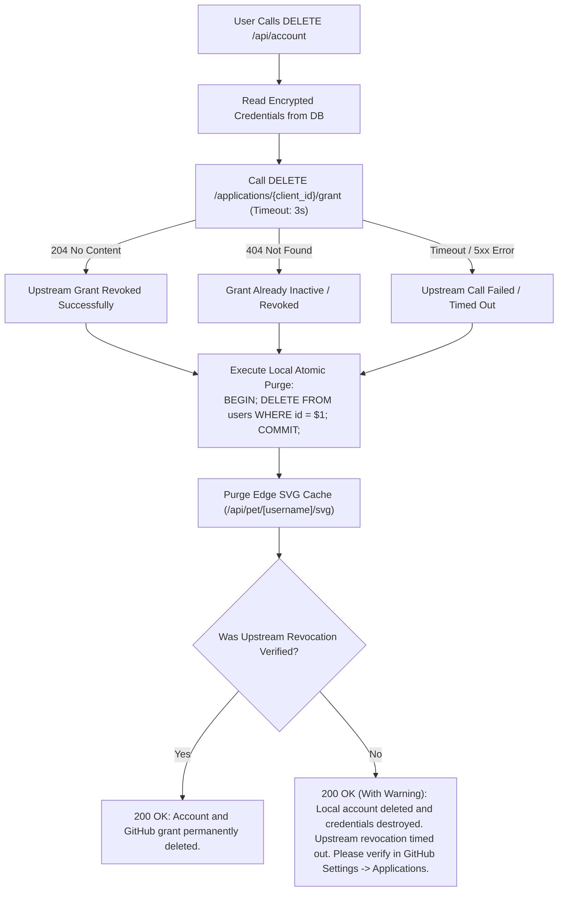
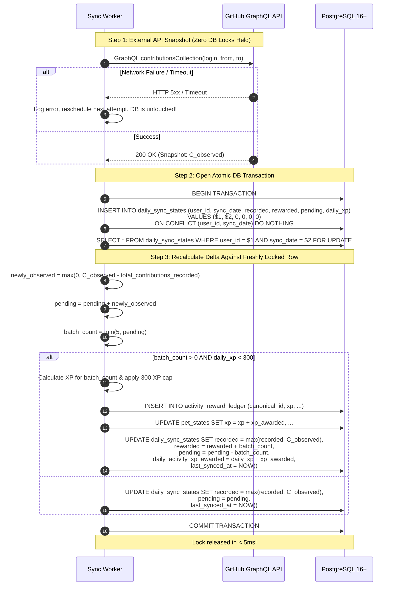

# Stage 2.0C — Final GitHub Authorization & Reward Queue Corrections Specification
## GitHub Profile Pet Platform

**Document Version:** 2.0.3-STAGE-2.0C  
**Author:** Staff Software Architect & Principal Systems Designer  
**Target Milestone:** Sprint 2.1 — Database and Migrations  
**Workspace:** `D:\Projects\GitHub-Profile-Pet`  
**Status:** Final Architectural Corrections — Implementation Ready  

---

## 1. Executive Summary & Final Decision Table

Stage 2.0C resolves the final four architectural items before Sprint 2.1:
1. Reconciling GitHub authorization: clarifying that private contribution data requires the optional `read:user` OAuth scope alongside the user's GitHub profile toggle.
2. Specifying a durable pending reward increment queue to prevent dropping contributions that exceed the 5-increment hourly throttle.
3. Defining the upstream revocation failure model and user remediation protocol.
4. Moving external GitHub API calls outside database transactions to minimize lock hold times.

### Final Decision Table

| Decision Area | Priority | Identified Flaw / Ambiguity | Resolution & Architectural Invariant | Sprint 2.1 Status |
| :--- | :---: | :--- | :--- | :---: |
| **1. Private Contribution Authorization** | **P0** | Claimed private contributions worked with zero scopes. | **Public-only sync is default with zero scopes.** Optional private contribution sync requires explicit consent and the **`read:user`** scope, plus user's GitHub profile toggle. | **READY** |
| **2. Reward Queue & Throttling** | **P1** | Excess increments (>5) were dropped without rollover. | Separated high-water mark ($C_{\text{recorded}}$) from rewarded count ($C_{\text{rewarded}}$). Introduced **pending increment queue** (`pending_contribution_increments`). Up to 5 processed per batch; remainder safely queued for subsequent runs under daily 300 XP cap. | **READY** |
| **3. Upstream Revocation Failure Model** | **P1** | Assumed 8-hour token expiry revoked 6-month refresh grant. | Upstream revocation (`DELETE /applications/{client_id}/grant` with Basic Auth) attempted *before* local purge. If upstream times out/fails, local deletion still completes deterministically, credentials are wiped, and user is instructed to revoke via GitHub Settings. | **READY** |
| **4. Transaction Efficiency** | **P2** | External GitHub GraphQL API call was inside the row-lock transaction. | **External call moved outside transaction.** GitHub snapshot is fetched first. Transaction opens, locks row, recalculates delta against latest DB state, processes up to 5 increments, commits. Zero network latency inside locks. | **READY** |

---

## 2. Private Contribution Authorization (P0)

### 2.1 Official GitHub GraphQL Permission Matrix
GitHub's official GraphQL documentation for `ContributionsCollection` establishes the exact authorization rules:
- **Public Contributions Only (Default):**
  - Requires **Zero Account Permissions** and **Zero Repository Permissions**.
  - Standard User-to-Server token queries `user(login) { contributionsCollection { contributionCalendar { ... } } }`.
  - Returns public repository commits, opened PRs, issues, and reviews.
- **Private & Internal Contributions (Optional Opt-In):**
  - Requires the optional User authorization scope: **`read:user`**.
  - In addition, the developer must have enabled:  
    *GitHub Settings $\rightarrow$ Public profile $\rightarrow$ Contribution settings $\rightarrow$ "Include private contributions on my profile"*.
  - When both conditions are met, `contributionCalendar` includes private contribution counts without granting source code access.

### 2.2 User-Facing Consent Dialog & Graceful Fallback
1. **Default Experience:** Zero extra scopes requested. The user authorizes the GitHub App with default public identity.
2. **Optional Opt-In Switch:** In Pet Settings, users can enable *"Sync Private Contributions"*.
   - **Consent Explanation:**  
     > *"To count contributions from private and internal repositories, GitHub requires granting the 'read:user' authorization scope. GitHub Profile Pet will ONLY read aggregate contribution counts. It will NEVER request repository access, read repository names, inspect source code, or read commit messages."*
   - Clicking *"Enable Private Sync"* triggers a reauthorization redirect with `scope=read:user`.
3. **Graceful Fallback:** If `read:user` is revoked or private contributions are not shared on the user's GitHub profile, the synchronization engine syncs public contributions with zero errors and displays a tooltip: *"Private contributions are hidden on your GitHub profile."*

---

## 3. Durable Reward Queue & Throttling Engine (P1)

### 3.1 Separation of High-Water Mark and Rewarded Progress
In `daily_sync_states`, we explicitly separate:
1. `total_contributions_recorded`: Monotonically non-decreasing high-water mark of observed contributions on date $D$.
2. `total_contributions_rewarded`: Monotonically non-decreasing count of contributions that have already been converted into XP.
3. `pending_contribution_increments`: Unprocessed eligible contribution increments awaiting reward processing.

$$\text{NewlyObserved} = \max(0, C_{\text{observed}} - \text{total\_contributions\_recorded})$$
$$\text{total\_contributions\_recorded} \leftarrow \max(\text{total\_contributions\_recorded}, C_{\text{observed}})$$
$$\text{pending\_contribution\_increments} \leftarrow \text{pending\_contribution\_increments} + \text{NewlyObserved}$$

### 3.2 Batch Throttling & Queue Processing Rules
When a sync worker processes rewards for date $D$:
1. Read current `pending_contribution_increments` and `daily_activity_xp_awarded`.
2. Determine batch slice size:
   $$\text{BatchCount} = \min(5, \text{pending\_contribution\_increments})$$
3. If $\text{BatchCount} = 0$: No pending increments. Exit sync.
4. Calculate XP for the slice using the diminishing schedule based on increments $(\text{total\_contributions\_rewarded} + 1)$ to $(\text{total\_contributions\_rewarded} + \text{BatchCount})$:
   - Increments 1: 25 XP
   - Increments 2: 15 XP
   - Increments 3: 10 XP
   - Increments 4+: 5 XP
5. **Apply Daily 300 XP Cap:**
   $$\text{AvailableBudget} = \max(0, 300 - \text{daily\_activity\_xp\_awarded})$$
   $$XP_{\text{awarded}} = \min(\text{CalculatedBatchXP}, \text{AvailableBudget})$$
6. **State Transitions (Atomic):**
   $$\text{total\_contributions\_rewarded} \leftarrow \text{total\_contributions\_rewarded} + \text{BatchCount}$$
   $$\text{pending\_contribution\_increments} \leftarrow \text{pending\_contribution\_increments} - \text{BatchCount}$$
   $$\text{daily\_activity\_xp\_awarded} \leftarrow \text{daily\_activity\_xp\_awarded} + XP_{\text{awarded}}$$
7. **Append to Ledger:** Record transaction for the slice:
   $$\text{canonical\_activity\_id} = \text{"urn:gh:daily:"} + \text{user\_id} + \text{":"} + D + \text{":slice:"} + \text{rewarded}_{\text{old}} + \text{"-" + } \text{rewarded}_{\text{new}}$$

### 3.3 Worked Example: Massive 12-Contribution Sprint
- User pushes 12 contributions within a single hour on date $D$.
- $C_{\text{prev}} = 0$, $C_{\text{rewarded}} = 0$, $\text{pending} = 0$, $XP_{\text{awarded}} = 0$.
- **Sync Batch 1 (Hour 0):**
  - Observed $C_{\text{observed}} = 12$. Newly observed: 12.
  - $C_{\text{recorded}} = 12$. $\text{pending} = 12$.
  - Process slice of 5 increments (increments 1 to 5):
    $25 + 15 + 10 + 5 + 5 = 60\text{ XP}$.
  - State updated: $C_{\text{rewarded}} = 5$, $\text{pending} = 12 - 5 = 7$, $XP_{\text{awarded}} = 60\text{ XP}$.
  - Ledger created: `urn:gh:daily:usr_1:2026-11-15:slice:0-5` (+60 XP).
- **Sync Batch 2 (Hour 1):**
  - Observed $C_{\text{observed}} = 12$. Newly observed: $\max(0, 12 - 12) = 0$.
  - $\text{pending}$ available: 7.
  - Process slice of 5 increments (increments 6 to 10):
    $5 \times 5\text{ XP} = 25\text{ XP}$.
  - State updated: $C_{\text{rewarded}} = 10$, $\text{pending} = 7 - 5 = 2$, $XP_{\text{awarded}} = 60 + 25 = 85\text{ XP}$.
  - Ledger created: `urn:gh:daily:usr_1:2026-11-15:slice:5-10` (+25 XP).
- **Sync Batch 3 (Hour 2):**
  - Process remaining 2 increments (increments 11 to 12):
    $2 \times 5\text{ XP} = 10\text{ XP}$.
  - State updated: $C_{\text{rewarded}} = 12$, $\text{pending} = 0$, $XP_{\text{awarded}} = 85 + 10 = 95\text{ XP}$.
  - Ledger created: `urn:gh:daily:usr_1:2026-11-15:slice:10-12` (+10 XP).
  - Queue is completely drained. Zero increments lost.

### 3.4 UTC Day Boundary & Expiration Invariant
- Contributions belong to the UTC date $D$ on which they occurred.
- If pending increments remain unconsumed at `00:00:00 UTC` (e.g. from late evening coding), background workers continue draining pending increments for date $D$ during a **24-hour grace window**.
- XP awarded counts toward date $D$'s 300 XP cap.
- Any unconsumed pending increments older than 48 hours ($\text{sync\_date} < \text{CURRENT\_DATE} - \text{INTERVAL '2 days'}$) expire safely without error.

---

## 4. Account Deletion & Upstream Revocation Failure Model (P1)

### 4.1 Upstream Revocation Protocol
- **Endpoint:** `DELETE https://api.github.com/applications/{client_id}/grant`
- **Authentication:** **HTTP Basic Authentication** (`client_id:client_secret`).
- **Body:** `{ "access_token": "<token>" }`.
- **Timing:** Executed with a **strict 3-second network timeout** *before* local credentials are wiped.

### 4.2 Failure & Timeout Model



### 4.3 Why 8-Hour Token Expiry Does Not Suffice
An access token expires in 8 hours, but the GitHub App **authorization grant** and its 6-month refresh token remain valid on GitHub. If local deletion destroyed credentials without attempting upstream revocation, the user would still see "GitHub Profile Pet" listed under their GitHub Authorized Applications.
Therefore:
1. Upstream revocation is ALWAYS attempted first.
2. If it succeeds, the grant is severed immediately.
3. If it fails or times out, local deletion still completes (GDPR compliance), and the UI displays an actionable link to `https://github.com/settings/applications` so the user can click "Revoke" with one click.
4. Tokens are NEVER hoarded after user deletion.

---

## 5. Transaction Efficiency & Lock Optimization (P2)

### 5.1 Revised Synchronization Protocol
External network requests MUST NEVER occur inside a PostgreSQL database transaction.



---

## 6. Updated Database Schema DDL (Sprint 2.1 Ready)

```sql
CREATE EXTENSION IF NOT EXISTS "pgcrypto";

-- 1. GitHub Accounts (Encrypted Tokens & Disconnect State)
CREATE TABLE github_accounts (
    id UUID PRIMARY KEY DEFAULT gen_random_uuid(),
    github_user_id VARCHAR(64) NOT NULL UNIQUE,
    username VARCHAR(100) NOT NULL,
    encrypted_access_token TEXT,
    encrypted_refresh_token TEXT,
    token_expires_at TIMESTAMPTZ,
    refresh_expires_at TIMESTAMPTZ,
    has_private_contributions_scope BOOLEAN NOT NULL DEFAULT FALSE,
    is_disconnected BOOLEAN NOT NULL DEFAULT FALSE,
    created_at TIMESTAMPTZ NOT NULL DEFAULT NOW(),
    updated_at TIMESTAMPTZ NOT NULL DEFAULT NOW()
);
CREATE INDEX idx_github_accounts_username ON github_accounts(username);

-- 2. Core Users
CREATE TABLE users (
    id UUID PRIMARY KEY DEFAULT gen_random_uuid(),
    github_account_id UUID NOT NULL UNIQUE REFERENCES github_accounts(id) ON DELETE CASCADE,
    primary_handle VARCHAR(100) NOT NULL UNIQUE,
    role VARCHAR(32) NOT NULL DEFAULT 'trainer',
    is_suspended BOOLEAN NOT NULL DEFAULT FALSE,
    created_at TIMESTAMPTZ NOT NULL DEFAULT NOW(),
    updated_at TIMESTAMPTZ NOT NULL DEFAULT NOW()
);

-- 3. User Profiles & Privacy Preferences
CREATE TABLE user_profiles (
    id UUID PRIMARY KEY DEFAULT gen_random_uuid(),
    user_id UUID NOT NULL UNIQUE REFERENCES users(id) ON DELETE CASCADE,
    display_name VARCHAR(100) NOT NULL,
    bio VARCHAR(255) NOT NULL DEFAULT '',
    timezone VARCHAR(64) NOT NULL DEFAULT 'UTC',
    visibility VARCHAR(32) NOT NULL DEFAULT 'public',
    show_streak BOOLEAN NOT NULL DEFAULT TRUE,
    show_vitals BOOLEAN NOT NULL DEFAULT TRUE,
    preferred_theme VARCHAR(32) NOT NULL DEFAULT 'dark',
    sync_private_contributions BOOLEAN NOT NULL DEFAULT FALSE,
    updated_at TIMESTAMPTZ NOT NULL DEFAULT NOW(),
    CONSTRAINT chk_visibility CHECK (visibility IN ('public', 'unlisted', 'minimal'))
);

-- 4. Pet State (With Vitals Bounds)
CREATE TABLE pet_states (
    id UUID PRIMARY KEY DEFAULT gen_random_uuid(),
    user_id UUID NOT NULL UNIQUE REFERENCES users(id) ON DELETE CASCADE,
    species VARCHAR(32) NOT NULL DEFAULT 'cat',
    name VARCHAR(64) NOT NULL DEFAULT 'Shadow Claw',
    level INTEGER NOT NULL DEFAULT 1,
    xp INTEGER NOT NULL DEFAULT 0,
    max_exp INTEGER NOT NULL DEFAULT 100,
    evolution_stage VARCHAR(32) NOT NULL DEFAULT 'Hatchling',
    mood VARCHAR(32) NOT NULL DEFAULT 'Focused',
    energy INTEGER NOT NULL DEFAULT 80,
    hunger INTEGER NOT NULL DEFAULT 60,
    happiness INTEGER NOT NULL DEFAULT 70,
    last_interacted_at TIMESTAMPTZ NOT NULL DEFAULT NOW(),
    last_welcome_bonus_at TIMESTAMPTZ,
    updated_at TIMESTAMPTZ NOT NULL DEFAULT NOW(),
    CONSTRAINT chk_level_positive CHECK (level >= 1),
    CONSTRAINT chk_xp_non_negative CHECK (xp >= 0),
    CONSTRAINT chk_energy_bounds CHECK (energy >= 0 AND energy <= 100),
    CONSTRAINT chk_hunger_bounds CHECK (hunger >= 0 AND hunger <= 100),
    CONSTRAINT chk_happiness_bounds CHECK (happiness >= 0 AND happiness <= 100)
);

-- 5. Auditable Reward Ledger (Append-Only)
CREATE TABLE activity_reward_ledger (
    id UUID PRIMARY KEY DEFAULT gen_random_uuid(),
    user_id UUID NOT NULL REFERENCES users(id) ON DELETE CASCADE,
    canonical_activity_id VARCHAR(255) NOT NULL,
    activity_type VARCHAR(64) NOT NULL,
    xp_awarded INTEGER NOT NULL,
    satiety_awarded INTEGER NOT NULL DEFAULT 0,
    rule_version INTEGER NOT NULL DEFAULT 1,
    awarded_at TIMESTAMPTZ NOT NULL DEFAULT NOW(),
    CONSTRAINT uq_user_canonical_activity UNIQUE (user_id, canonical_activity_id),
    CONSTRAINT chk_xp_awarded_positive CHECK (xp_awarded >= 0)
);
CREATE INDEX idx_ledger_user_awarded ON activity_reward_ledger(user_id, awarded_at DESC);

-- 6. Daily Sync Tracking (With Durable Pending Queue & 300 XP Cap)
CREATE TABLE daily_sync_states (
    id UUID PRIMARY KEY DEFAULT gen_random_uuid(),
    user_id UUID NOT NULL REFERENCES users(id) ON DELETE CASCADE,
    sync_date DATE NOT NULL,
    total_contributions_recorded INTEGER NOT NULL DEFAULT 0,
    total_contributions_rewarded INTEGER NOT NULL DEFAULT 0,
    pending_contribution_increments INTEGER NOT NULL DEFAULT 0,
    daily_activity_xp_awarded INTEGER NOT NULL DEFAULT 0,
    last_synced_at TIMESTAMPTZ NOT NULL DEFAULT NOW(),
    CONSTRAINT uq_user_sync_date UNIQUE (user_id, sync_date),
    CONSTRAINT chk_daily_xp_cap CHECK (daily_activity_xp_awarded <= 300),
    CONSTRAINT chk_pending_non_negative CHECK (pending_contribution_increments >= 0),
    CONSTRAINT chk_rewarded_le_recorded CHECK (total_contributions_rewarded <= total_contributions_recorded)
);
CREATE INDEX idx_daily_sync_user_date ON daily_sync_states(user_id, sync_date);

-- 7. Care Action Idempotency Store
CREATE TABLE care_action_idempotency (
    id UUID PRIMARY KEY DEFAULT gen_random_uuid(),
    user_id UUID NOT NULL REFERENCES users(id) ON DELETE CASCADE,
    client_action_id VARCHAR(64) NOT NULL UNIQUE,
    action_type VARCHAR(32) NOT NULL,
    executed_at TIMESTAMPTZ NOT NULL DEFAULT NOW()
);
CREATE INDEX idx_action_idempotency_time ON care_action_idempotency(user_id, executed_at DESC);
```

---

## 7. Sprint 2.1 Implementation Checklist (PostgreSQL & Database Layer)

- [ ] **Task 2.1.1: Migration DDL Files**
  - Author `migrations/001_initial_schema.sql` implementing all 7 tables above with constraints and indices.
  - Author `migrations/001_initial_schema.down.sql` for rollback testing.
- [ ] **Task 2.1.2: Database Connection Layer**
  - Author `src/lib/db/pool.ts` using `pg` with connection pooling ($2 \le N \le 10$) and SSL mode enforcement.
  - Author `src/lib/db/transaction.ts` implementing `withTransaction(async (client) => { ... })`.
- [ ] **Task 2.1.3: Repositories & Data Access Objects**
  - Author `UserRepository`: CRUD, handle updates on username changes, cascading delete.
  - Author `PetRepository`: Vitals fetch, offline recovery evaluation, care action atomic update.
  - Author `SyncRepository`: First-sync `INSERT ... ON CONFLICT DO NOTHING`, row lock `SELECT ... FOR UPDATE`, high-water mark snapshot update, and pending queue incrementation.
  - Author `LedgerRepository`: Append-only insertion with rule versioning.
- [ ] **Task 2.1.4: PostgreSQL Concurrency Integration Tests**
  - Create `tests/integration/syncConcurrency.test.ts` executing the 5 mandatory scenarios:
    1. Concurrent first sync row lock.
    2. Concurrent existing row sync.
    3. Daily 300 XP cap clamp.
    4. Durable pending queue drain across multiple slices.
    5. Rebase drop monotonic high-water mark protection.
- [ ] **Task 2.1.5: Verification Gates**
  - `npm test` passes (40/40 unit tests).
  - `npm run lint` passes (0 errors, 0 warnings).
  - `npm run build` succeeds cleanly.
