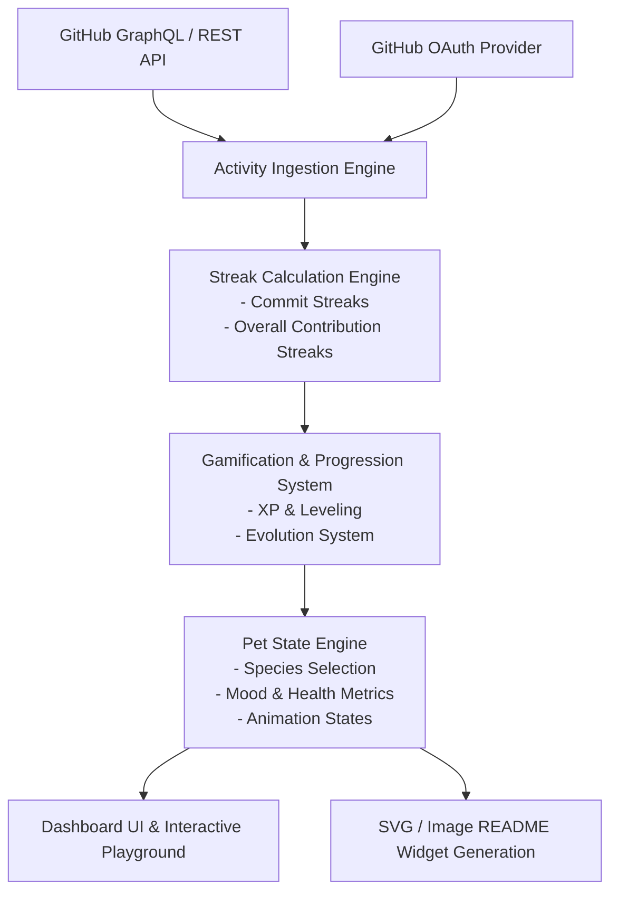

# System Architecture Overview

## 1. Vision & Purpose

**GitHub Profile Pet** is a customizable virtual pet platform driven by a user's GitHub contribution activity. Developers nurture and evolve digital companions whose mood, growth, and states respond dynamically to daily development habits (commits, pull requests, issues, and contribution streaks).

## 2. Architectural & Financial Principles

To ensure production-grade scalability, maintainability, clean separation of concerns, and long-term sustainability, the project follows strict architectural and financial rules:

### 2.1 Non-Negotiable Product Financial Policy

GitHub Profile Pet is designed and operated as a **permanently free project** for both end-users and the project owner. This is a foundational product and architecture constraint, not a temporary preference.

#### User-Facing Financial Policy
All users access the full core experience without payment:
- GitHub sign-in and account integration.
- Pet adoption, naming, and customization.
- Daily gameplay (feeding, training, resting, mood management).
- XP accumulation, level progression, achievement unlocking, and form evolutions.
- Public pet profile pages.
- README dynamic SVG embed widgets.
- GitHub activity synchronization and contribution streaks.
- All core and future features.

The project strictly prohibits:
- Paid subscriptions or premium membership tiers.
- Paywalled or feature-gated capabilities.
- Third-party advertisements or tracking monetization.
- Mandatory donations or pay-to-win mechanics.
- Paid API keys or external services required for basic operation.
- Inactivity or profile maintenance fees.

#### Project-Owner Financial Policy
The project targets an ongoing operating cost of **₹0 / month ($0.00 / month)**.

Infrastructure and architecture must strictly prioritize:
1. Free-tier cloud hosting (e.g. Vercel Hobby for non-commercial open source).
2. Free-tier managed PostgreSQL (e.g. Neon Free with scale-to-zero compute).
3. Free-tier scheduled execution within published allowances (e.g. GitHub Actions).
4. Permissive open-source dependencies and tools.
5. Existing local development workstations for testing and builds.
6. Efficient resource usage and minimal idle consumption.
7. Avoiding unnecessary external third-party microservices.

**Zero Silent Upgrades:** No paid service, automatic plan upgrade, or recurring billable resource may be introduced without the project owner's explicit written approval.

**Free Limit Escalation Policy:** If any free provider threshold (compute hours, storage, bandwidth, or runner minutes) is approached or exceeded, the engineering response sequence is mandatory:
1. *Measure:* Accurately inspect and profile actual consumption metrics.
2. *Optimize:* Tune application caching, connection pool sizes, query efficiency, and state storage.
3. *Prune:* Reduce redundant background workloads or unnecessary poll frequencies while preserving consistency invariants.
4. *Evaluate:* Investigate compatible alternative free providers (e.g. Cloudflare Pages, Netlify, Supabase).
5. *Self-Host:* Consider self-hosted or containerized alternatives where practical.
6. *Throttle:* Pause or limit non-essential operations if no sustainable zero-cost solution exists. Under no circumstances may infrastructure costs be shifted to users or silently charged to paid cards.

### 2.2 Technical Architectural Principles

1. **Separation of Domain and Presentation**:
   - Presentation components (`src/components/`) remain purely visual and state-driven via props.
   - Domain logic, business rules, and state computations reside in `src/features/`.
2. **Modular Feature-Sliced Layout**:
   - Each major functional domain (`authentication`, `github`, `streaks`, `pets`, `gamification`) is isolated within its feature module.
   - Cross-cutting technical capabilities (network clients, encryption, third-party adapters) reside in `src/lib/`.
3. **Unidirectional Data Flow**:
   - Server Components and API route handlers fetch and validate external GitHub data.
   - Feature services calculate game state, streaks, and evolution milestones.
   - Pure UI components render deterministic representations of pet state, stats, and widgets.
4. **Strict Type Safety**:
   - TypeScript is configured in strict mode with `@/*` path aliases.
   - Strong contracts bridge API responses, calculation engines, and render layers.

### 2.3 Architectural Evolution: The GitHub-Native Paradigm (Sprint 2.7+)

Following the Sprint 2.7 architectural assessment and Sprint 2.7.4 final hardening, GitHub Profile Pet made a definitive product and architectural pivot:

- **Historical Architecture (Sprint 1.0–2.6):** The application was initially modeled as a centralized multi-tenant platform hosted on Vercel with a managed Neon PostgreSQL database. While robust and fully audited, this model introduced third-party platform dependencies, database transfer ceilings, scale-to-zero compute latencies, and operational overhead.
- **Definitive Architecture (Sprint 2.7+):** The product is now an **entirely GitHub-native, self-hosted-per-user companion**:
  - **Runtime & Inbox Draining:** GitHub Actions executes scheduled maintenance (6-hour cron), inbox sweeping, and event-driven care actions. Workers drain the pending inbox in strict ascending chronological order (`created_at ASC, number ASC`), safely expiring stale actions (`created_at < last_interaction_time`) to preserve Markovian state integrity.
  - **Durable Action Delivery & Payload Integrity:** GitHub Issue Forms (`.github/ISSUE_TEMPLATE/pet-action.yml`) act as a durable request inbox (`pet-action:pending` assigned at creation). Workers enforce a conservative unchanged-since-creation check (`created_at === updated_at` and timeline verification), strictly rejecting edited issues (`pet-action:invalid`) to prevent unverified content execution.
  - **Immutable Numeric Security:** Repository owner authorization verifies exclusively the original issue author's immutable numeric account ID (`issue.user.id === config.expectedOwnerId`), never treating event senders or the Actions bot as the owner.
  - **State Store & Deduplication Registry:** Git version-controlled JSON documents (`pet/state/pet.json`, `pet/ledger/contributions.json`, `pet/ledger/actions.json`) replace PostgreSQL. A permanent deduplication registry (`processedRequestRegistry`) tracks `highWaterIssueNumber`, sparse sets, and non-action gaps. Ambiguous HTTP 404s, 403s, and server errors are classified as unresolved gaps; the high-water mark strictly never advances past an unresolved number. Actions proceed via interval-encoded sparse sets without deadlocks.
  - **Contribution Accounting Conservation:** Enforces hourly throttles (max 5 rewarded slices/hr; excess enters `pending`), daily caps (excess is `forfeited`), and 48-hour expirations, strictly preserving $\text{observed} = \text{rewarded} + \text{forfeited} + \text{pending} + \text{expired}$.
  - **Privacy Isolation (Model C vs Model B):** Model C completely disables private contributions, ensuring zero private activity leaks to public commits or SVGs. Model B isolates private contributions within a private engine repository.
  - **Deterministic Git Conflict Replay:** Non-fast-forward push conflicts cleanly reset to `origin/main`, preserve immutable event inputs, recompute dynamic state against the fresh remote baseline, and retry up to 3 times before failing safe to the inbox.
  - **Display:** Standalone SVG badges (`public/pet.svg`) embedded directly into the user's GitHub profile README replace dynamic web rendering.
- **Status of Centralized Artifacts:** Legacy PostgreSQL migrations (001–010), centralized coordinator routes, and Next.js web dashboard components are retained in the codebase as historical references and for optional future hosted editions, but are formally superseded by the GitHub-native architecture.
- *Authoritative Specification:* See [`docs/architecture/sprint-2.7-github-native-redesign.md`](./sprint-2.7-github-native-redesign.md) for the complete technical blueprint and acceptance criteria.

## 3. Layer Responsibilities

| Layer / Directory | Primary Responsibility | Rules & Boundaries |
| :--- | :--- | :--- |
| `src/app/` | Routing, Layouts, Metadata, API Endpoints | Thin controllers only; delegates business logic to feature services. |
| `src/components/` | Reusable presentation components | Dumb / Presentational components; no direct external API calls or core algorithms. |
| `src/features/` | Domain-specific application logic | Houses entities, calculation engines, business rules, and domain-scoped hooks. |
| `src/lib/` | Shared infrastructure & integrations | GitHub GraphQL/REST clients, OAuth utilities, configuration helpers, general utils. |
| `src/hooks/` | Reusable utility React hooks | General UI/browser hooks (e.g., `useMediaQuery`, `useDebounce`). |
| `src/types/` | Cross-domain TypeScript definitions | Core entity schemas, shared contracts, common utility types. |
| `src/constants/` | Global configuration constants | System-wide static constants, game balancing tables, route definitions. |
| `tests/` | Automated test suites | `unit/` for pure logic and calculations; `integration/` for end-to-end flows. |
| `docs/` | Architecture and development specs | High-level architectural guides, domain boundaries, onboarding documentation. |

## 4. Planned Capabilities Roadmap

The foundational structure is designed to support the following upcoming milestones:

1. **GitHub OAuth**: Secure session handling and token lifecycle management (`src/features/authentication/`, `src/lib/auth/`).
2. **GitHub GraphQL API Integration**: Efficient query batches fetching contribution calendars, commits, pull requests, and review counts (`src/features/github/`, `src/lib/github/`).
3. **Commit Streak Engine**: Algorithmic evaluation of consecutive calendar days with validated commits (`src/features/streaks/`).
4. **Overall Contribution Streak Engine**: Comprehensive streak evaluation across all GitHub contribution activities (`src/features/streaks/`).
5. **Multi-Species System**: Modular definitions for distinct pet archetypes and evolutionary paths (`src/features/pets/`).
6. **Pet Mood & Animation States**: State machines governing pet status (Happy, Hungry, Sleeping, Evolving, Idle) based on developer habits (`src/features/pets/`).
7. **XP & Evolution System**: Experience formulas, achievement thresholds, and form transitions (`src/features/gamification/`).
8. **README Widget Generator**: Dynamic SVG rendering endpoint suitable for direct embedding in GitHub user profile READMEs (`src/app/api/widget/`, `src/features/pets/`). *Note: Implementation of this public SVG endpoint is an explicit release prerequisite before README embeds are operational; no placeholder or preview URL substitutes for this live contract.*
