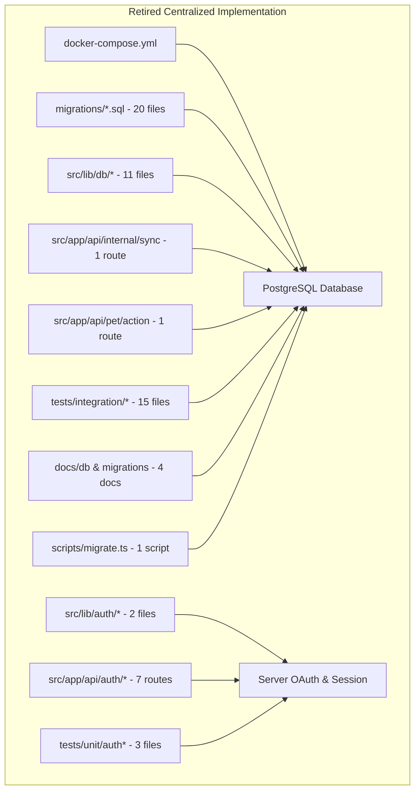

# Legacy Centralized Architecture Boundary & Reference Record

**Project:** GitHub Profile Pet  
**Classification:** OBSOLETE_CENTRALIZED & HISTORICAL_REFERENCE  
**Status:** Retired / Non-Runtime  
**Authoritative Product Runtime:** GitHub-Native Self-Hosted Engine (`pet/` + GitHub Actions)

---

## 1. Architectural Evolution Context

During Sprint 1 through Sprint 2.6, GitHub Profile Pet was initially conceptualized and prototyped as a traditional centralized web service:
- A multi-tenant **Next.js** web application server.
- A centralized **PostgreSQL 16** relational database.
- A central **GitHub OAuth 2.0 App** exchanging user tokens.
- An encrypted token storage mechanism using authenticated AES-256-GCM.
- A centralized background synchronization engine orchestrated via authenticated webhook endpoints (`POST /api/internal/sync`).

In **Sprint 2.7**, the project underwent an architectural redesign to become **100% GitHub-Native**:
- **₹0/Month Operational Target:** Eliminated the requirement for external hosted databases, continuous application servers, paid API gateways, or third-party schedulers.
- **Self-Hosted per User:** Each developer hosts their companion entirely within their own GitHub repository.
- **Autonomous Platform Runtime:** State management (`pet/state/pet.json`), immutable ledgers (`pet/ledger/`), passive simulation, care interactions, and SVG badge generation are executed natively inside **GitHub Actions**.

---

## 2. Scope & Status of Retained Legacy Files

The repository retains **67 files** associated with the retired centralized architecture. These files are preserved exclusively for **historical engineering context, architectural auditability, and selected reusable utility code**:

### Complete Inventory of Retained Centralized Files:

| Category | File Path(s) | Description |
| :--- | :--- | :--- |
| **Local Container** | [`docker-compose.yml`](../docker-compose.yml) | Local PostgreSQL container setup used for legacy integration tests. |
| **Database Migrations** | [`migrations/`](../migrations/) (20 files: 001 through 010 up/down) | Relational SQL schema definitions for centralized accounts, tokens, and sync logs. |
| **Database Tooling** | [`scripts/migrate.ts`](../scripts/migrate.ts) | Node CLI migration runner for PostgreSQL. |
| **Database Infrastructure** | [`src/lib/db/`](../src/lib/db/) (`config.ts`, `pool.ts`, `transaction.ts`, `errors.ts`, `migrator.ts`, `types.ts`) (6 files) | PostgreSQL connection pool and transaction wrappers. |
| **Relational Repositories** | [`src/lib/db/repositories/`](../src/lib/db/repositories/) (`userRepository.ts`, `sessionRepository.ts`, `petRepository.ts`, `ledgerRepository.ts`, `syncRepository.ts`) (5 files) | SQL query repositories for relational state storage. |
| **Centralized Auth & Session** | [`src/lib/auth/`](../src/lib/auth/) (`githubAuth.ts`, `sessionContext.ts`) (2 files) | OAuth 2.0 Web application flow and cookie session verification. |
| **Legacy Server Route Handlers** | `src/app/api/auth/*` (`login`, `callback`, `logout`, `me`, `session`, `account`, `disconnect`) (7 files) | API endpoints for central user authentication. |
| **Legacy Webhook Endpoint** | `src/app/api/internal/sync/route.ts` (1 file) | Webhook target previously invoked by legacy cron workflows. |
| **Legacy Pet Action Endpoint** | `src/app/api/pet/action/route.ts` (1 file) | HTTP API mutating pet state in PostgreSQL. |
| **Legacy Integration Tests** | `tests/integration/*.test.ts` (14 test files + `.gitkeep`) (15 files) | Test suites verifying PostgreSQL migrations, token encryption, and centralized concurrency. |
| **Centralized Unit Tests** | `tests/unit/authSecurityIsolation.test.ts`, `tests/unit/oauthState.test.ts`, `tests/unit/sessionToken.test.ts` (3 files) | Unit tests verifying session cookie headers and OAuth state encryption. |
| **Legacy Documentation** | `docs/architecture/database-implementation.md`, `docs/architecture/github-authentication-and-sessions.md`, `docs/development/database-setup.md`, `docs/development/migrations.md` (4 files) | Specifications describing the retired database and OAuth system. |

---

## 3. Clear Boundaries & Non-Support Statement

To prevent any misunderstanding by users, contributors, or deployment engineers:

1. **Not Runtime Dependencies:** None of these 67 files are required, imported, or executed by the authoritative GitHub-native pet runtime. The pet functions entirely via [`pet/`](../pet/) documents and GitHub Actions workflows.
2. **Not a Supported Hosted Path:** The centralized architecture is **not** an active, supported, or maintained deployment path. Attempting to deploy this repository to Vercel, AWS, or a custom VPS with PostgreSQL is unsupported unless explicitly redesigned and authorized in a future project phase.
3. **Selective Reusability:** Certain cryptographic and formatting utilities developed during this period (such as CSRF protection, crypto helpers, and calendar utilities) may be adapted for frontend presentation components, but the database and server-side OAuth subsystems are strictly retired.
4. **No Operating Requirement:** Users installing GitHub Profile Pet **do not** need PostgreSQL, Docker, GitHub OAuth App credentials, or `.env` server secrets.
