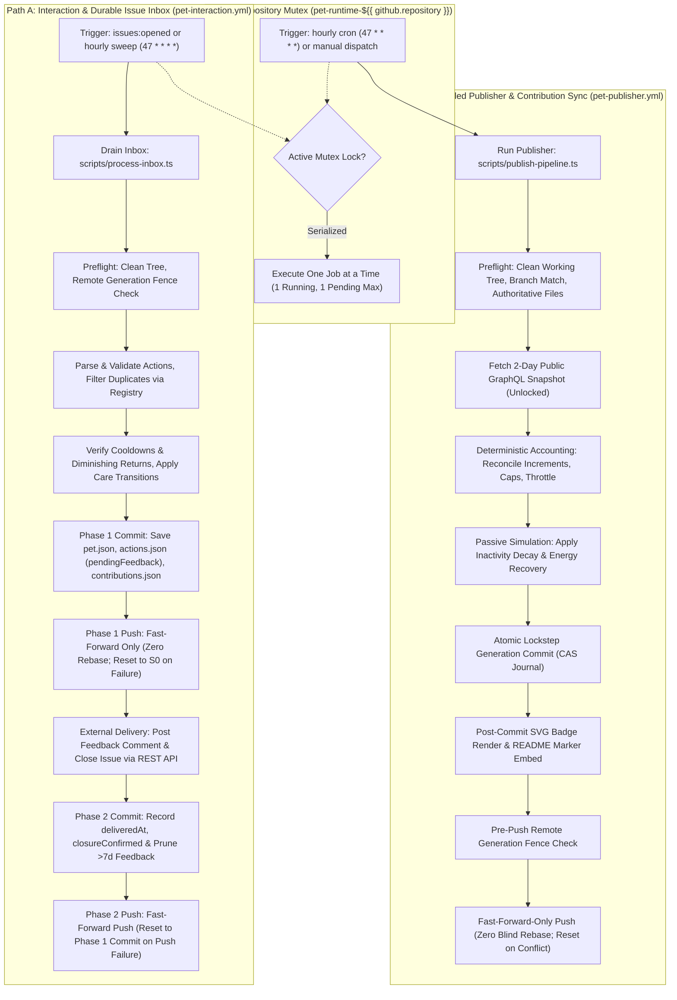

# GitHub Profile Pet — Production Runtime Runbook

**Document ID:** `docs/operations/production-runtime-runbook.md`  
**Milestone:** Phase 3C2.3-A.2 (Final Operational Recovery, Documentation Acceptance & Path A Hardening Reconciliation)  
**Target Repository:** `<owner>/<repo>` (Operational Reference)  
**Status:** Approved Reference  

---

## 1. Runtime Architecture & Execution Paths

GitHub Profile Pet operates as a 100% serverless, zero-cost, repository-native virtual pet. Persistent state, historical ledgers, and visual badge assets reside directly within Git tracking on the repository's `main` branch.

Rather than executing as a single monolithic transaction, the runtime operates across **distinct, independently triggered execution paths** sharing a repository-level concurrency mutex:



---

## 2. Detailed Execution Path Specifications

### 2.1 Path A — Interaction and Durable Issue Inbox (`pet-interaction.yml`)
- **Workflow File:** `.github/workflows/pet-interaction.yml`
- **Entry Point:** `scripts/process-inbox.ts` (orchestrating `inboxPublicationPipeline.ts`)
- **Triggers:** `issues: [opened]`, hourly recovery sweep `schedule: - cron: '47 * * * *'`, `workflow_dispatch`.
- **Primary Modules:** `src/features/pet-engine/inbox/actionProcessor.ts`, `inboxPublicationPipeline.ts`, `careTransitions.ts`, `stateRepository.ts`.
- **GraphQL Contribution Provider Call:** **NONE.** Path A communicates solely with GitHub's REST API for Issue comments and closures. It never invokes the GraphQL contribution provider.
- **Two-Commit Hardened Transaction Lifecycle (Phases 3C2.3-B0, B0.1, B0.1-R2):**
  1. **Preflight & Remote Fence Check:**
     - Asserts clean working tree (`git status --porcelain`) and branch alignment (`git branch --show-current === targetBranch`).
     - Evaluates `checkRemoteGenerationFence()` against `origin/${targetBranch}` before modifying local files.
  2. **Action Parsing, Deduplication & Validation:**
     - Scans open issues for structured YAML payloads.
     - Inspects `processedRequestRegistry` (`highWaterIssueNumber` and `sparseProcessedIssueNumbers`). Any issue already recorded in the registry is skipped immediately with zero state mutation.
     - Enforces 60-second cooldown and diminishing returns.
  3. **Phase 1 Commit (State & Deduplication):**
     - Applies care transitions to `pet/state/pet.json`.
     - Records action in `processedRequestRegistry` and stages an initial `pendingFeedback` record in `pet/ledger/actions.json`.
     - Advances generation lockstep $G \to G+1$ and atomically saves files via journaled persistence.
     - Creates local Phase 1 Git commit: `chore(pet): process inbox action #${issueNumber} [skip ci]`.
  4. **Phase 1 Fast-Forward Push:**
     - Dispatches `git push origin HEAD:${targetBranch}`. Zero blind rebase, zero merge commits, zero force-push.
     - *Push Failure / Remote Conflict:* If push is rejected (e.g. Path B pushed in the interim), executes `git reset --hard sourceCommitSha`. The issue remains open with pending label; zero feedback comment is posted to GitHub; the next hourly sweep cleanly retries from the fresh remote HEAD.
  5. **External Feedback Delivery & Issue Closure:**
     - Posts explanatory markdown comment to GitHub Issue via REST API (`createComment()`).
     - Closes the issue via REST API (`closeIssue()`) with `pet-action:completed` (or `pet-action:rejected`).
     - Captures exact `deliveredAt` timestamp and confirms `closureConfirmed = true`.
  6. **Phase 2 Commit (Feedback Completion & Compaction):**
     - Updates `pendingFeedback` record with `feedbackDelivered: true`, `closureConfirmed: true`, and `deliveredAt`.
     - Applies bounded 7-day compaction: completed feedback records with `feedbackDelivered: true`, `closureConfirmed: true`, and `deliveredAt` older than 7 days (604,800,000 ms) are pruned. The permanent `processedRequestRegistry` is strictly preserved.
     - Advances generation lockstep $G+1 \to G+2$ and creates local Phase 2 Git commit: `chore(pet): record feedback delivery for issue #${issueNumber} [skip ci]`.
  7. **Phase 2 Fast-Forward Push & Eventual Recovery:**
     - Dispatches `git push origin HEAD:${targetBranch}`.
     - *Push Failure / Network Error:* If Phase 2 push fails (e.g. transient network drop), local clone resets to Phase 1 commit (`git reset --hard phase1CommitSha`). On the next scheduled sweep, `process-inbox.ts` scans pending feedback. Because the action was already committed to `processedRequestRegistry` in Phase 1, **care vitals and rewards are NEVER re-applied**. The recovery loop merely completes comment delivery/closure confirmation and publishes Phase 2!
     - *Ambiguous Push Failure Handling:* If remote accepted the push but the client encountered an ambiguous connection drop (e.g. `ECONNRESET`), subsequent sweep verifies remote HEAD alignment and avoids duplicate operations.

### 2.2 Path B — Scheduled Publisher and Contribution Synchronization (`pet-publisher.yml`)
- **Workflow File:** `.github/workflows/pet-publisher.yml`
- **Entry Point:** `scripts/publish-pipeline.ts`
- **Triggers:** Hourly maintenance `schedule: - cron: '47 * * * *'`, manual `workflow_dispatch` (with `force_render` option).
- **Primary Modules:** `publishPipeline.ts`, `contributionSyncService.ts`, `contributionEngine.ts`, `svgRenderer.ts`, `readmePublication.ts`.
- **GraphQL Contribution Provider Call:** **YES.** Invokes `twoDayContributionProvider.ts` with `USER_CONTRIBUTION_2DAY_SNAPSHOT_QUERY`.
- **Expected Schedule vs. Absolute Maximum:** Expected execution cadence is **24 scheduled publisher runs per day** (once per hour at `:47`). This is an expected schedule, not an absolute daily maximum, because manual dispatches of `pet-publisher.yml` can trigger additional runs.
- **Execution Order (Strict Source Code Sequence):**
  1. **Preflight Checks (Step 1–4):**
     - Step 1: Capture initial source commit SHA ($S_0$).
     - Step 2: `git status --porcelain --untracked-files=all` rejects dirty or untracked changes before any network I/O or simulation.
     - Step 3: `git branch --show-current` rejects detached HEAD and branch mismatches against destination.
     - Step 4: `verifyRequiredAuthoritativeFiles()` validates that `pet/state/pet.json`, `pet/ledger/contributions.json`, `pet/ledger/actions.json`, and `public/pet.svg` exist and are readable.
  2. **Snapshot Retrieval (Step 5.2):** Dispatches unlocked GraphQL query `USER_CONTRIBUTION_2DAY_SNAPSHOT_QUERY`. Obtains two fixed UTC windows: yesterday (complete) and today (open).
  3. **Rate-Limit Inspection (Step 5.3):** Inspects actual `rateLimit.cost` and `rateLimit.remaining`. Defers cleanly with zero mutation if quota is below 50 points (evaluated against a conservative 1,000 pt/hr planning ceiling).
  4. **Lock Acquisition & Journal Recovery (Step 5.4–5.5):** Acquires local mutex lock `pet/.pet.lock`. Auto-recovers any interrupted `.journal/` directory.
  5. **Identity & Pristine Check (Step 5.6):** Verifies immutable numeric `databaseId` or evaluates strict pristine predicate (`isPristineContributionLedger`).
  6. **Deterministic Accounting (Step 5.7):** Calls `reconcileContributions()`: calculates daily increments, diminishing rewards (25/15/10/5 XP), 5-increment hourly throttle, 300 XP daily cap, whole-increment forfeitures, 48h expiry, and unit conservation.
  7. **Passive Simulation (Step 5.8):** Applies `applyInactivitySimulation()` to the reconciled pet state: calculates elapsed seconds since `lastInteractionTime` and updates hunger/happiness decay and energy recovery.
  8. **Atomic Persistence (Step 5.9):** Invokes `saveRepositoryState()` to commit `pet.json`, `contributions.json`, and `actions.json` simultaneously to generation $G+1$.
  9. **Post-Commit Asset Publication (Step 5.10):** Calls `publishPetSvg()` to render visual vector badge to `public/pet.svg` and update embed snippet in `README.md`. Releases local lock.
  10. **Pre-Push Fence & Allowlist Staging (Step 6–10):** Queries `checkRemoteGenerationFence()`. Inspects `git status --porcelain` and stages only modified allowlisted manifest paths (`pet/state/pet.json`, `pet/ledger/contributions.json`, `pet/ledger/actions.json`, `public/pet.svg`, `README.md`). Clean no-op skips commit and push if zero files changed.
  11. **Commit & Push (Step 11–13):** Creates commit with `[skip ci]`. Dispatches `git push origin HEAD:${targetBranch}`. On rejection: immediately aborts without blind rebase; executes `git reset --hard sourceCommitSha` to restore pristine checkout.

### 2.3 Diagnostic GraphQL Probe (`diagnostics-contribution-probe.yml`)
- **Workflow File:** `.github/workflows/diagnostics-contribution-probe.yml`
- **Entry Point:** `scripts/probe-github-contributions.ts`
- **Trigger:** Manual `workflow_dispatch` only.
- **Behavior:** Dispatches a standalone read-only GraphQL query to inspect user identity and rate-limit headers.
- **Operational Boundary:** This probe is strictly a diagnostic tool. **It does NOT execute contribution accounting, mutate ledgers, or publish commits.** Dispatches of this diagnostic workflow consume $\approx 1$ point against the repository GraphQL quota per run, but are completely decoupled from production pet state.

---

## 3. Concurrency, Runner Capacity & Eventual Recovery

### 3.1 Concurrency Mutex Mechanics
Both workflows share the identical concurrency group:
```yaml
concurrency:
  group: pet-runtime-${{ github.repository }}
  cancel-in-progress: false
```
GitHub Actions concurrency enforces that at most **one** job executes at any given time for this group, with at most **one** additional job queued in the pending state. If multiple events arrive while a job is running, GitHub Actions holds one pending run and may replace earlier pending runs with the latest run.

### 3.2 Eventual Recovery Semantics
> **Operational Guarantee:** The durable Issue inbox and subsequent recovery sweeps provide **eventual recovery opportunities**, subject to GitHub Actions availability, scheduling delays, and concurrency contention.

Because scheduled crons and issue events can experience runner queue latency during peak platform load, the runtime does not guarantee immediate real-time execution. Stranded or deferred items are discovered and resolved during subsequent execution cycles.

### 3.3 Proposed Schedule Staggering (Future Operational Recommendation)
Both workflows currently fire at minute 47 (`47 * * * *`). To reduce lock contention and runner queue wait times, it is recommended (as a future non-breaking optimization in Phase 3C2.3) to stagger the schedules:
- `pet-interaction.yml`: `17 * * * *` (hourly inbox sweep)
- `pet-publisher.yml`: `47 * * * *` (hourly simulation & contribution sync)

---

## 4. Operational Safety, Quota Safeguards & Environment Qualifications

### 4.1 GraphQL Quota & Rate-Limit Safeguard
- **Primary Quota Baseline:** GitHub Actions provides a documented primary quota of **1,000 points per hour per repository** for the default `GITHUB_TOKEN`. The 5,000 pt/hr ceiling observed in individual hosted diagnostic runs is treated as an opportunistic platform artifact, not an authoritative Actions quota.
- **Dynamic Cost & Telemetry:** The runtime dynamically queries `rateLimit.cost` and `rateLimit.remaining`. The observed query cost of 1 point is a runtime measurement, not a fixed-cost contract guarantee.
- **Deferral Threshold:** If remaining points fall below `< 50`, synchronization is deferred cleanly with zero ledger mutation.
- **Safeguard Limitation Statement:**
  > **The configured threshold is a conservative safeguard intended to reduce rate-limit exhaustion risk. It cannot guarantee immunity from primary or secondary rate limits, external API usage, or changes to GitHub's policies.**

### 4.2 Rollback Safety Qualification
`git reset --hard sourceCommitSha` in Path B and Path A is safe exclusively under the isolated, single-tenant GitHub Actions runner model where no concurrent processes or human edits exist on the runner filesystem. Local CLI execution is conditionally safe only when no concurrent local edits occur.

### 4.3 Remote Destination Qualification
Pipeline code validates local branch and requested destination branch names (`git branch --show-current === targetBranch`). It does not independently inspect the remote URL (`git remote get-url origin`). Production safety relies on `actions/checkout@v4` to configure the correct repository origin.

### 4.4 Path A Hardened Two-Commit Publication Safety (Phases 3C2.3-B0, B0.1, B0.1-R2)
The previously identified risks regarding Path A shell-based rebase have been **completely resolved**:
1. **Zero Blind Rebase:** `inboxPublicationPipeline.ts` uses fast-forward push only (`git push origin HEAD:${targetBranch}`). Zero blind rebase, zero merge, and zero force-push.
2. **Remote Generation Fence:** Before staging or committing, Path A verifies `checkRemoteGenerationFence()`. If remote HEAD has advanced, local processing aborts cleanly.
3. **Two-Commit Transaction Lifecycle:**
   - **Phase 1:** Core pet state mutations and deduplication registry entries are committed and pushed first. If push fails, state rolls back to $S_0$; the issue remains open; zero feedback comment is created.
   - **Phase 2:** External feedback comment and issue closure occur *after* Phase 1 is published. Delivery completion (`deliveredAt`, `closureConfirmed: true`) and 7-day compaction are committed in Phase 2. If Phase 2 push fails, local clone resets to Phase 1 commit; the next sweep discovers the pending feedback and completes delivery/compaction without ever re-awarding pet vitals.
4. **Verified by 36 Automated Tests:** Hardened recovery semantics are verified by `tests/pet-engine/durableFeedbackCompletion.test.ts` (TC-INBOX-COMPL-01 through 24, R2-A-01 through R2-A-08, and ECONNRESET network push injection TC-INBOX-COMPL-10).

### 4.5 60-Day Workflow Inactivity Disablement
If GitHub pauses scheduled crons after 60 days of inactivity, the workflows must be re-enabled through an approved management interface:
- **GitHub Web UI:** Navigate to Actions tab $\rightarrow$ select workflow $\rightarrow$ click "Enable workflow" banner.
- **GitHub CLI:** `gh workflow enable pet-publisher.yml` and `gh workflow enable pet-interaction.yml`.
- **REST API:** `PUT /repos/{owner}/{repo}/actions/workflows/{workflow_id}/enable`.
- **Diagnostic Dispatch Distinction:** Triggering `workflow_dispatch` alone does NOT re-enable an automatically disabled scheduled workflow.

### 4.6 Capacity and Cost Qualifications
- **Public Repositories:** Standard hosted runners (`ubuntu-latest`: 4 vCPUs, 16 GB RAM, 14 GB SSD) are free of runner-minute charges for public repositories, subject to GitHub usage policies and platform capacity. "Free of charge" does not mean unlimited execution capacity, unlimited concurrency, or guaranteed scheduling precision.
- **Private Repositories:** Standard hosted runners (`ubuntu-latest`: 2 vCPUs, 8 GB RAM, 14 GB SSD; SKU: `actions_linux`) draw compute from the account's monthly included monetary compute allowance (e.g. $12.00 USD/month on GitHub Free) at the standard Linux runner rate ($0.006/min for 2-core x64). Job durations round up to the nearest whole minute. In an illustrative scenario of 48 runs/day at 1 min/job across a 30-day month, usage is ~1,440 billable minutes (~$8.64 USD/month, or ~72% of a $12.00 allowance). This is an illustrative estimate; all other account workflows and shared compute workloads draw from the same allowance.
