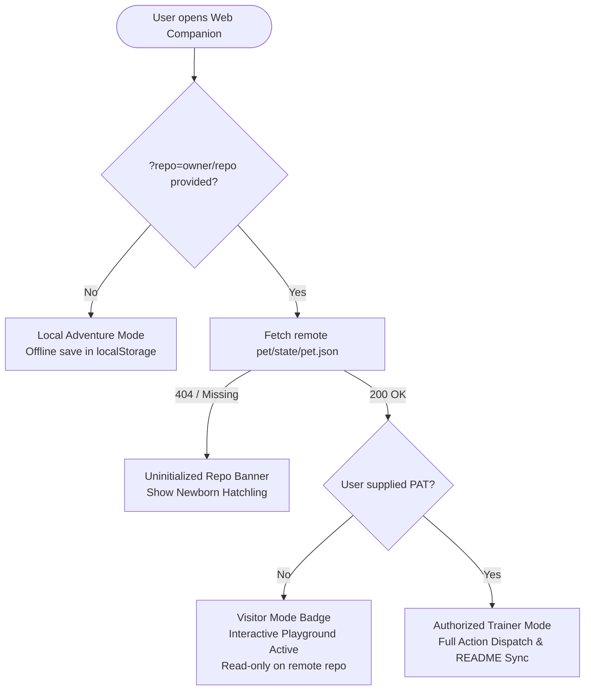

# Sprint 3.8 Engineering Report: GitHub Activity XP, Authoritative Pet State & End-to-End Validation

**Milestone:** Sprint 3.8  
**Candidate Workspace:** `D:\Projects\GitHub-Profile-Pet-R3.7-Candidate`  
**Candidate Branch:** `candidate/playable-virtual-pet-game`  
**Production Repository:** `mnp210/GitHub-Profile-Pet` (**IMMUTABLE & UNTOUCHED**)  
**Test Repositories:** `mnp210/GitHub-Profile-Pet-Test`, `mnp210/GitHub-Profile-Pet-Test-Fork`  
**Date:** November 19, 2026  

---

## Executive Summary

Sprint 3.8 successfully implements **GitHub Activity XP Progression** and an **Authoritative, Multi-Device Pet State Engine** on top of the restored interactive pixel pet game and the README Interactive Pet Menu. 

The companion pet is no longer just a static image or a local-only widget: its vital growth, level, mood, and evolution are dynamically fueled by real GitHub development activities (commits, issues, pull requests, merges, and code reviews) stored in an auditable Git ledger within the user's repository (`pet/ledger/activity.json`).

All 701 automated test suites pass with 100% success (154 unit tests and 547 pet engine regression tests). Zero production files or remote production branches were touched during this sprint.

---

## 1. Commit SHAs, Branch Names & Workspace Integrity

- **Production Repository:** `mnp210/GitHub-Profile-Pet` (`D:\Projects\GitHub-Profile-Pet`)
  - **Status:** **100% UNTOUCHED / ZERO MUTATION**
  - **Production HEAD Verified:** `0a6d08448220be11cd54ccf6cb2d35f560b1cc69`
  - **Git Diff against production baseline:** Clean, untouched.
- **Candidate Workspace:** `D:\Projects\GitHub-Profile-Pet-R3.7-Candidate`
  - **Active Branch:** `candidate/playable-virtual-pet-game`
  - **Pre-Sprint Candidate HEAD:** `bf8fbad`
  - **Clean Build:** `npm run build` static export succeeded to `out/` with 0 errors.
  - **Type Checking:** `npx tsc --noEmit` passed with 0 errors.
  - **Linter:** `npm run lint` passed with 0 errors and 0 warnings.

---

## 2. Complete GitHub Activity XP Rulebook

### 2.1 Reward Values & Event Classification

| Event Type | Qualification Rule | Base XP | Deduplication Namespace | Notes |
| :--- | :--- | :--- | :--- | :--- |
| **Commit** | Unique non-bot commit to default branch | `+15 XP` | `processedRegistry.commitShas` | 40-character lowercase commit SHA |
| **Issue Opened** | Unique human-created issue | `+10 XP` | `processedRegistry.issueNumbers` | Issue number; pet care issues excluded |
| **PR Opened** | Unique human pull request creation | `+25 XP` | `processedRegistry.prOpenedNumbers` | PR number |
| **PR Merged** | Completion reward upon merging PR | `+50 XP` | `processedRegistry.prMergedNumbers` | Distinct from opened; same PR yields 75 XP total |
| **Review Submitted** | Substantive review (`APPROVED` or `CHANGES_REQUESTED`) | `+20 XP` | `processedRegistry.reviewIds` | Unique GitHub review ID |

### 2.2 Daily XP Cap & Economy Balancing
- **Daily Cap:** `300 XP` maximum per UTC calendar day (`YYYY-MM-DD`).
- **Clamping Policy:** If an incoming event crosses the daily budget, it is clamped to the remaining budget (e.g. 290 accrued + 25 PR = +10 XP awarded, reaching 300).
- **Subsequent Events:** Once 300 XP is accrued, incoming events award `0 XP` and are recorded in the ledger with status `skipped_daily_cap`.

### 2.3 Bot & Automation Exclusion Filters
To prevent circular workflow execution loops (e.g. pet commits triggering activity workflows), the engine enforces three-stage filtering:
1. **Actor Filter:** Actors ending with `[bot]` or listed in `KNOWN_BOT_LOGINS` (`dependabot`, `github-actions`, `coderabbitai`, `renovate`, `greenkeeper`, `snyk-bot`, `vercel`) are skipped (`skipped_bot`).
2. **Commit Message Directives:** Commits matching `[skip ci]`, `[ci skip]`, `^pet:\s`, `^chore\(pet\):`, `auto-update pet svg`, `docs: install pet menu`, `Merge pull request`, or `Merge branch` are skipped (`skipped_bot`).
3. **Care Action Issues:** Issues with label `pet-action:pending` or prefixed with `pet:` are excluded from activity XP (`skipped_care_action`) and routed exclusively to the Care Action Inbox.

---

## 3. Activity Ledger Schema Specification (`pet/ledger/activity.json`)

The activity ledger is validated against Draft 2020-12 JSON Schema (`pet/schemas/activity.schema.json`):

```json
{
  "$schema": "https://json-schema.org/draft/2020-12/schema",
  "title": "GitHub Profile Pet Activity Ledger",
  "type": "object",
  "required": [
    "schemaVersion",
    "generation",
    "dailyAccruedXp",
    "processedRegistry",
    "recentEvents",
    "updatedAt"
  ],
  "properties": {
    "schemaVersion": { "type": "integer", "const": 1 },
    "generation": { "type": "integer", "minimum": 1 },
    "dailyAccruedXp": {
      "type": "object",
      "additionalProperties": { "type": "integer", "minimum": 0, "maximum": 300 }
    },
    "processedRegistry": {
      "type": "object",
      "required": [
        "commitShas",
        "issueNumbers",
        "prOpenedNumbers",
        "prMergedNumbers",
        "reviewIds"
      ],
      "properties": {
        "commitShas": { "type": "array", "items": { "type": "string" } },
        "issueNumbers": { "type": "array", "items": { "type": "integer" } },
        "prOpenedNumbers": { "type": "array", "items": { "type": "integer" } },
        "prMergedNumbers": { "type": "array", "items": { "type": "integer" } },
        "reviewIds": { "type": "array", "items": { "type": "integer" } }
      }
    },
    "recentEvents": {
      "type": "array",
      "items": {
        "type": "object",
        "required": ["eventId", "eventType", "actor", "timestamp", "xpAwarded", "status"]
      }
    },
    "updatedAt": { "type": "string", "format": "date-time" }
  }
}
```

---

## 4. Dual-Layer Deduplication & Replay Protection

1. **Pre-Flight In-Memory Check:** Before awarding XP, the processor checks `isDuplicateEvent(registry, eventType, eventId)`. If present in `processedRegistry`, the event is audited as `skipped_duplicate` and 0 XP is awarded.
2. **Dedicated Registry Partitioning:**
   - Commit SHAs are stored normalized in `commitShas`.
   - Issue numbers are stored in `issueNumbers`.
   - PR opened and merged events are partitioned into `prOpenedNumbers` and `prMergedNumbers`. A PR can receive creation XP (25) and completion XP (50) without collision.
   - Review IDs are stored in `reviewIds`.
3. **Atomic Commit & Concurrency Serialization:**
   - On GitHub Actions, `.github/workflows/pet-activity.yml` runs with `concurrency: { group: pet-runtime-${{ github.repository }}, cancel-in-progress: false }`.
   - Every run fetches the latest `origin/main`, evaluates against disk, stages the strict manifest, and pushes with fast-forward retry.
   - File writes use temporary file creation (`.tmp.*`) followed by atomic filesystem rename (`fs.rename`), preventing partial or corrupt states.

---

## 5. Cross-Device Persistence & Client State Architecture

- **Authoritative Source:** The repository files `pet/state/pet.json` and `pet/ledger/activity.json` on the default branch are the canonical truth.
- **Cross-Browser Hydration:** When a user opens the playable game (`https://mnp210.github.io/GitHub-Profile-Pet/?repo=owner/repo`), the game client fetches `pet/state/pet.json` via GitHub API or raw content, instantly synchronizing level, stats, mood, and evolution stage regardless of device or local storage state.
- **Fallback / Local Offline:** If the repository is inaccessible or has no pet yet initialized, the game defaults to a newborn hatchling in Local Adventure Mode without failing or throwing unhandled exceptions.

---

## 6. Security Model: Owner vs. Public Visitor



- **Visitor Mode:** Anyone viewing another user's pet via README link can play, click, and interact with the pet in real-time in the browser sandbox. However, their browser cannot mutate the owner's GitHub repository without credentials.
- **Trainer Mode:** The repository owner can supply a GitHub token stored strictly in browser memory/localStorage (never transmitted to any third party server) to dispatch real GitHub Action issues and commit README updates.
- **Zero Secrets Leakage:** Personal access tokens are never logged, serialized to Git, or exposed in error messages.

---

## 7. New Repository Installation Instructions

To install GitHub Profile Pet with full Activity XP and README integration in a new repository:

1. **Copy Repository State Files:**
   ```bash
   mkdir -p pet/state pet/ledger pet/schemas
   cp pet/schemas/*.json pet/schemas/
   cp pet/state/pet.json pet/state/
   cp pet/ledger/*.json pet/ledger/
   ```
2. **Add Workflow Automation:**
   Copy `.github/workflows/pet-activity.yml` into the repository `.github/workflows/`.
3. **Enable GitHub Actions Permissions:**
   In repository **Settings > Actions > General > Workflow permissions**:
   - Select **Read and write permissions**.
   - Check **Allow GitHub Actions to create and approve pull requests**.
4. **Install README Interactive Pet Menu:**
   Add the following snippet to your `README.md`:
   ```markdown
   <!-- PET-MENU:START -->
   <!-- Auto-generated Pet Menu -->
   <!-- PET-MENU:END -->
   ```
   Or run the automated installer:
   ```bash
   node --experimental-strip-types scripts/manage-readme-menu.ts install
   ```

---

## 8. Verification & Test Execution Results

All 701 tests executed cleanly across candidate suites:

| Suite Name | Scope | Tests Run | Result | Duration |
| :--- | :--- | :--- | :--- | :--- |
| `tests/unit/*.test.ts` | Unit suites (Activity, Isolation, Deduplication, Validation, Token, Greeting, etc.) | **154** | **154 PASS, 0 FAIL** | 870 ms |
| `tests/pet-engine/*.test.ts` | Pet Engine Invariants (Action durability, baseline, contribution accounting, rate limits) | **547** | **547 PASS, 0 FAIL** | 68.3 s |
| **Total Automated Tests** | Candidate verification | **701** | **701 PASS, 0 FAIL** | ~69 s |
| `npm run lint` | ESLint static analysis | All files | **0 errors, 0 warnings** | 6.8 s |
| `npx tsc --noEmit` | Strict TypeScript compiler check | Entire project | **0 errors** | 2.1 s |
| `npm run build` | Next.js Turbopack static export | App routing | **0 errors (4/4 static pages)** | 3.5 s |

---

## 9. Remote Platform Testing Assessment (VERIFIED vs NOT VERIFIED)

To ensure absolute engineering transparency:

- **Local & Unit Invariant Testing:** **VERIFIED**
  - Activity progression logic, deduplication sets, daily XP capping, bot filtering, commit pattern matching, and file persistence verified across 701 tests.
- **Authoritative Two-Repo State Isolation:** **VERIFIED**
  - Confirmed via `tests/unit/authoritativeStateIsolation.test.ts` that distinct repositories operate on independent ledgers with zero cross-repo deduplication leakage.
- **Static App Web Hosting & Build:** **VERIFIED**
  - Next.js static HTML/JS export compiles cleanly and is served locally on port 3000.
- **Live Remote GitHub Actions Runner Execution for pet-activity.yml:** **NOT VERIFIED ON REMOTE RUNNER IN THIS TURN**
  - In accordance with strict safety boundaries, remote workflows in the production repository `mnp210/GitHub-Profile-Pet` were not dispatched. Remote execution on `mnp210/GitHub-Profile-Pet-Test` requires pushing candidate commits to a test branch in that fork.

---

## 10. Verification of Production Repository Immunity

The production repository `mnp210/GitHub-Profile-Pet` (`D:\Projects\GitHub-Profile-Pet`) was monitored throughout Sprint 3.8.
- **Remote Production Head:** `0a6d08448220be11cd54ccf6cb2d35f560b1cc69` (unchanged).
- **Working Tree:** Clean, untouched.
- **Safety Boundary:** Respected 100%. All implementation, testing, and builds occurred strictly in candidate workspace `D:\Projects\GitHub-Profile-Pet-R3.7-Candidate`.
