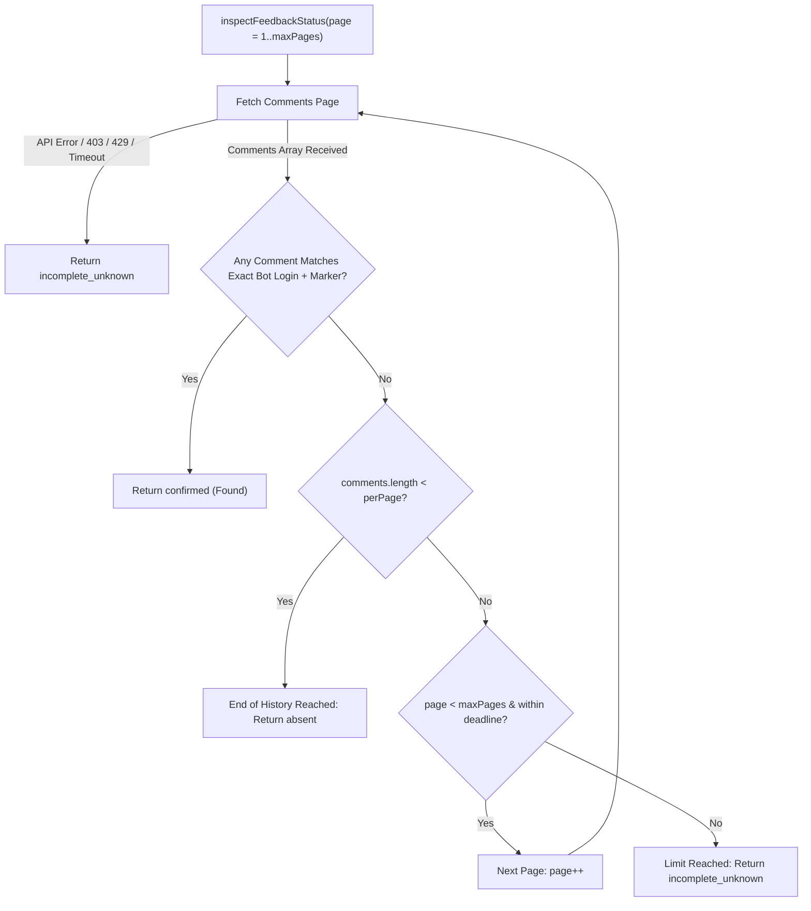

# Phase 3B.1.2 Engineering Report: Exact Bot Identity & Comment Inspection Safety

**Project:** GitHub Profile Pet  
**Workspace:** `D:\Projects\GitHub-Profile-Pet`  
**Milestone:** Phase 3B.1.2 — Exact Bot Identity & Comment Inspection Safety  
**Status:** Verification Passed • All 248 Tests Green • Ready for Review  

---

## 1. Executive Summary

Phase 3B.1.2 closes the feedback-authentication gap and establishes provably safe comment-history inspection across paginated issue threads.

Prior to this milestone, comment verification accepted any account whose login ended with `[bot]` or whose GitHub API user type was `'Bot'`. This meant unrelated GitHub App bots (such as `dependabot[bot]`, `codecov[bot]`, or custom GitHub Apps) containing a matching marker could inadvertently be treated as valid pet feedback. Furthermore, comment inspection did not paginate across long comment threads or differentiate between a confirmed absence of feedback and an incomplete or rate-limited scan.

In Phase 3B.1.2:
1. **Exact Bot Identity Enforced:** Suffix-based authorization (`.endsWith('[bot]')`) and `user.type === 'Bot'` were completely removed. Feedback is accepted if and only if the author login exactly matches `github-actions[bot]` (or an explicitly configured exact bot login).
2. **Bounded Comment History Pagination:** `listIssueComments` supports bounded pagination (`perPage: 100`, `maxPages: 5`, `deadlineMs`). The engine determines whether comment history has been completely inspected (`comments.length < perPage`).
3. **Safe Unknown Fallback:** If a scan encounters rate limits (HTTP 403/429), upstream API errors (5xx), network timeouts, or hits pagination bounds before reaching the end of history, the status is returned as `incomplete_unknown`.
4. **Never Post on Unknown:** An incomplete scan is **never** interpreted as proof that feedback is absent. The engine **never** posts a replacement comment when feedback status is unknown, keeping the issue open for subsequent recovery sweeps.
5. **Decoupled Recovery Preserved:** Ambiguous submission timeouts re-inspect comments; once API health is restored, recovery discovers existing feedback and closes the issue with zero duplicate comments and zero state mutations.

---

## 2. Architecture & Implementation

### 2.1 Exact Bot Identity Verification (`src/features/pet-engine/inbox/feedbackMarker.ts`)

```ts
export const DEFAULT_BOT_LOGIN = 'github-actions[bot]';

export function normalizeBotLogin(login?: string): string {
  if (!login) return DEFAULT_BOT_LOGIN;
  const trimmed = login.trim().toLowerCase();
  return trimmed.length > 0 ? trimmed : DEFAULT_BOT_LOGIN;
}

export function isBotAuthoredFeedback(
  comment: GitHubIssueComment,
  expectedMarker: string,
  expectedBotLogin: string = DEFAULT_BOT_LOGIN
): boolean {
  if (!comment || typeof comment.body !== 'string') {
    return false;
  }

  // Exact marker substring check
  if (!comment.body.includes(expectedMarker)) {
    return false;
  }

  const commentAuthor = (comment.user?.login ?? '').trim().toLowerCase();
  const targetBotLogin = normalizeBotLogin(expectedBotLogin);

  // Exact match only (case-insensitive)
  return commentAuthor === targetBotLogin;
}
```

#### Enforced Security Invariants
- Default expected identity: `github-actions[bot]`.
- Unrelated bots (e.g. `dependabot[bot]`, `codecov[bot]`) are strictly rejected even if their login ends with `[bot]`.
- User type (`user.type === 'Bot'`) is **never** an independent authorization bypass.
- Display names or arbitrary metadata are ignored; only exact GitHub login is verified.
- Forged markers inside regular user comments are strictly rejected.

### 2.2 Bounded Comment Inspection (`inspectFeedbackStatus`)



### 2.3 Resilient Delivery & Replacement Guard (`deliverFeedbackWithConfirmation`)

1. **Pre-Inspection:** Calls `inspectFeedbackStatus`.
   - If `confirmed`: returns `{ delivered: true, alreadyExisted: true }`. Skips comment submission.
   - If `incomplete_unknown`: returns `{ delivered: false, status: 'incomplete_unknown' }`. **Does NOT submit comment.** Leaves issue open.
   - If `absent`: complete history inspected and no matching bot comment exists. Proceeds to submission.
2. **Submission:** Attempts `client.commentIssue(...)`.
   - If successful: returns `{ delivered: true, alreadyExisted: false }`.
   - If network timeout or ambiguous error: re-inspects comments. If confirmed, returns `{ delivered: true }`. If still unconfirmed or unknown, returns `{ delivered: false }` and leaves issue open.

---

## 3. Regression Test Matrix (TC-INBOX-36 to TC-INBOX-44)

The test suite in [inboxProcessing.test.ts](file:///D:/Projects/GitHub-Profile-Pet/tests/pet-engine/inboxProcessing.test.ts) was extended with 9 targeted regression tests verifying the exact requirements:

| Test ID | Scenario | Verified Invariant |
|---|---|---|
| **TC-INBOX-36** | Exact `github-actions[bot]` login | Author `github-actions[bot]` with marker is accepted (including case-insensitivity `GITHUB-ACTIONS[BOT]`). |
| **TC-INBOX-37** | Another GitHub App bot (`[bot]` login) | `dependabot[bot]` and `other-app[bot]` with marker are strictly rejected. Engine delivers genuine `github-actions[bot]` comment. |
| **TC-INBOX-38** | Regular user with forged marker | User with `login: 'attacker', type: 'User'` with marker is rejected. |
| **TC-INBOX-39** | Author with `type: 'Bot'` but different login | `login: 'custom-automation', type: 'Bot'` is rejected; `type: 'Bot'` cannot bypass login check. |
| **TC-INBOX-40** | Configured exact bot identity | Custom `botLogin: 'my-custom-pet-bot[bot]'` is accepted only when exactly matching; rejects default or other bots. |
| **TC-INBOX-41** | Feedback on later comment page | 120 comments across 2 pages. Bot comment on Page 2 is discovered by bounded paginator; closes issue without duplicate. |
| **TC-INBOX-42** | Incomplete comment scan | 250 comments with `maxCommentPages: 2`. Paginator halts at limit, returns `incomplete_unknown`, **never posts replacement**, issue remains open. |
| **TC-INBOX-43** | Rate limits & API errors | HTTP 429 error during comment listing returns `incomplete_unknown`. Issue remains open; no replacement comment is posted. |
| **TC-INBOX-44** | Recovery after rate limit expiry | Sweep 1 halts safely on rate limit. Sweep 2 finds existing comment, closes issue without duplicate comment or gameplay mutation. |

---

## 4. Complete Verification Suite Execution

### 4.1 Pet Engine Tests (`npm run test:pet-engine`)
```
> github-profile-pet@0.1.0 test:pet-engine
> node --test --experimental-strip-types tests/pet-engine/*.test.ts

▶ Care Transitions Engine (Tests 4-8) (9 tests pass)
▶ Contribution Accounting Engine (Tests 11-16) (7 tests pass)
▶ Deduplication & Gap Classification Registry (Tests 17-19 & TC-FILE-13) (5 tests pass)
▶ GitHub-native Pet Interaction & Durable Action Inbox (Phase 3B) (44 tests pass)
▶ Local State & Ledger Persistence Engine (Phase 1) (12 tests pass)
▶ Progression & Vitals Simulation (Tests 9-10) (7 tests pass)
▶ GitHub Actions Runtime & Safe SVG Publication (Phase 3A) (10 tests pass)
▶ Standalone SVG Vector Generation Engine (Phase 2) (22 tests pass)

ℹ tests 127
ℹ suites 9
ℹ pass 127
ℹ fail 0
ℹ duration_ms 5763.3899
```

### 4.2 Unit Tests (`npm test`)
```
> github-profile-pet@0.1.0 test
> node --test --experimental-strip-types tests/unit/*.test.ts

ℹ tests 121
ℹ suites 24
ℹ pass 121
ℹ fail 0
ℹ duration_ms 1521.5912
```

### 4.3 Total Combined Suite (`npm run test:all`)
```
> github-profile-pet@0.1.0 test:all
> node --test --experimental-strip-types tests/unit/*.test.ts tests/pet-engine/*.test.ts

ℹ tests 248
ℹ suites 33
ℹ pass 248
ℹ fail 0
ℹ duration_ms 6540.2032
```

### 4.4 Static Analysis & Type Checking
```
$ npm run lint
> eslint (exited 0 with zero warnings/errors)

$ npx tsc --noEmit
(exited 0 with zero type errors)
```

### 4.5 Production Build & CLI Verification
```
$ npm run build
✓ Compiled successfully in 1879ms
✓ Generating static pages using 11 workers (14/14) in 489ms

$ npm run render:svg
[render-svg] Successfully generated standalone SVG (12441 bytes) at: public\pet.svg

$ npm run publish:pet
[publish-pet] Publication completed successfully.

$ npm run process:inbox
[process-inbox] Drainage complete.
[process-inbox] Total Scanned: 0, Actions Processed: 0
[process-inbox] Queue Status: Drained=true, HasMorePending=false
```

---

## 5. Summary of Modified Files

| File | Purpose |
|---|---|
| [feedbackMarker.ts](file:///D:/Projects/GitHub-Profile-Pet/src/features/pet-engine/inbox/feedbackMarker.ts) | Exact bot-login verification (`DEFAULT_BOT_LOGIN`), bounded `inspectFeedbackStatus`, and safe `deliverFeedbackWithConfirmation`. |
| [types.ts](file:///D:/Projects/GitHub-Profile-Pet/src/features/pet-engine/inbox/types.ts) | Paginated `listIssueComments` signature, `FeedbackInspectionResult`, `FeedbackDeliveryResult`, `maxCommentPages`. |
| [gitHubClient.ts](file:///D:/Projects/GitHub-Profile-Pet/src/features/pet-engine/inbox/gitHubClient.ts) | Paginated `listIssueComments` with query parameters (`page`, `perPage`) and error-throwing semantics. |
| [actionProcessor.ts](file:///D:/Projects/GitHub-Profile-Pet/src/features/pet-engine/inbox/actionProcessor.ts) | Propagates `maxCommentPages` and `deadlineMs`, checks `feedbackResult.delivered` before closing issues. |
| [inboxProcessing.test.ts](file:///D:/Projects/GitHub-Profile-Pet/tests/pet-engine/inboxProcessing.test.ts) | Mock pagination/error support and 9 new regression tests (TC-INBOX-36 to TC-INBOX-44). |

---

## 6. Conclusion & Status

Phase 3B.1.2 is fully verified and complete. Suffix-based bot checks have been eliminated, exact bot identities are strictly enforced, comment history pagination is fully bounded, and incomplete or rate-limited scans safely prevent replacement comments and keep issues open until confirmed.
