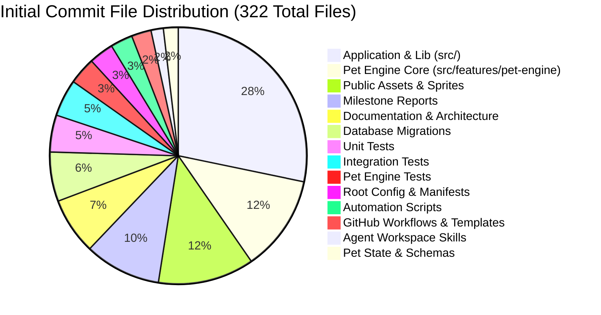

# Phase 3C2.1-V.1 — Public Repository Pre-Publication Security & Readiness Audit Report

**Project:** GitHub Profile Pet  
**Workspace:** [`D:\Projects\GitHub-Profile-Pet`](file:///D:/Projects/GitHub-Profile-Pet)  
**Remote Target:** [`https://github.com/mnp210/GitHub-Profile-Pet.git`](https://github.com/mnp210/GitHub-Profile-Pet.git)  
**Target Branch:** `main`  
**Repository Visibility:** Public  
**Date:** 2026-11-16  
**Auditor:** Antigravity (Google DeepMind)

---

## 1. Executive Verdict

### **Verdict: READY WITH CONDITIONS**

The repository has undergone a comprehensive multi-layer pre-publication audit.
- **Zero Credentials or Secrets Exposed:** Exhaustive regex and pattern scanning across all 322 prospective commit files detected **zero** live access tokens, private keys, session secrets, or personal passwords.
- **Zero Personal Identifiers:** No private usernames, personal emails, or machine-specific home paths (`C:\Users\...`) exist in prospective commit files.
- **Full Build & Test Pass:** TypeScript compilation (0 errors), ESLint (0 errors, 0 warnings), production Next.js build (14/14 static pages, dynamic API routes verified), and the entire automated test suite (**339 / 339 tests passing**) executed successfully.
- **₹0/Month Integrity Intact:** The architecture adheres strictly to the permanent product constraint of zero recurring operational hosting cost.

### Publication Conditions (Pre-Commit Remediations):
1. **Condition 1 (Deactivate or Remove Obsolete Sync Workflow):** `.github/workflows/scheduled-contribution-sync.yml` is an artifact of the legacy centralized architecture (Sprint 2.5e) that curls `${APP_BASE_URL}/api/internal/sync` with an active cron trigger (`0 */6 * * *`). Because these repository secrets do not exist in the GitHub-native architecture, this workflow will immediately fail every 6 hours upon push, producing error notifications.
2. **Condition 2 (Establish `.gitattributes`):** A `.gitattributes` file configuring `* text=auto eol=lf` is required to prevent line-ending churn between Windows development machines and Ubuntu GitHub Actions runners.
3. **Condition 3 (Expand `.gitignore`):** Add generic log patterns (`*.log`) and IDE directories (`.vscode/`, `.idea/`) to `.gitignore`.

---

## 2. Repository & Git State

| Parameter | Current State | Verification Status |
| :--- | :--- | :--- |
| **Branch** | `master` (Default local) | Needs rename to `main` prior to push |
| **Commit History** | `No commits yet` (0 commits) | Clean initial state |
| **Remote Configuration** | None configured (`git remote -v` empty) | Prepared for `origin -> mnp210/GitHub-Profile-Pet.git` |
| **Remote GitHub State** | `size: 0`, 0 commits, default branch `main` | Verified via GitHub REST API |
| **Total Unignored Files** | **322 files** | Exact file manifest generated below |
| **Working Tree Status** | Untracked files only; zero staged changes | Safe for controlled initial commit |

---

## 3. Initial-Commit File Manifest Summary

A comprehensive breakdown of all 322 files that constitute the uncommitted repository:



### Manifest Category Breakdown

| Category | File Count | Description & Highlights |
| :--- | :---: | :--- |
| **GitHub Workflows & Templates** | 8 | 4 workflows (`pet-interaction.yml`, `pet-publisher.yml`, `diagnostics-contribution-probe.yml`, `scheduled-contribution-sync.yml`) + 4 issue forms |
| **Agent Workspace Skills** | 5 | Workspace agent skills (`frontend-design`, `github-pet-product-design`, `github-pet-quality-assurance`, `pet-gameplay-systems`, `virtual-pet-art-direction`) |
| **Pet Engine State & Schemas** | 6 | Pristine schemas (`actions`, `contributions`, `pet`) + initial state (`pet.json`, `actions.json`, `contributions.json`) |
| **Pet Engine Core Implementation** | 39 | Native state repository, atomic file writer, journal engine, simulation, care transitions, SVG vector generator, inbox scanner |
| **Public Assets & Sprites** | 39 | Canonical `public/pet.svg`, Shadow Claw 8-directional/state sprite sheets and SVGs, acceptance previews |
| **Application & Infrastructure Code** | 91 | Next.js App Router (`src/app/`), components, auth guards, crypto, session manager, db pool |
| **Unit Test Suite** | 15 | 14 unit test suites (`tests/unit/*.test.ts`) covering crypto, CSRF, calendar, greeting, deduplication + `.gitkeep` |
| **Pet Engine Test Suite** | 11 | 11 comprehensive suites (`tests/pet-engine/*.test.ts`) covering simulation, journal, recovery, SVG rendering |
| **Integration Test Suite** | 15 | 14 integration test suites (`tests/integration/*.test.ts`) + `.gitkeep` |
| **Automation & Runtime Scripts** | 9 | `process-inbox.ts`, `publish-pet.ts`, `simulate-pet.ts`, `render-svg.ts`, `probe-github-contributions.ts`, `migrate.ts` |
| **Documentation & Architecture** | 23 | System overview, domain boundaries, character art spec, Phase 1/2/3 architecture specifications |
| **Milestone Reports** | 31 | Historical engineering reports tracking Phase 1 through Phase 3C2.1-V |
| **Database Migrations** | 20 | Migrations 001 through 010 (up and down SQL scripts) |
| **Root Configuration & Build Files** | 10 | `package.json`, `package-lock.json`, `tsconfig.json`, `next.config.ts`, `eslint.config.mjs`, `postcss.config.mjs`, `docker-compose.yml`, `.env.example`, `.gitignore`, `README.md` |
| **TOTAL** | **322** | **100% accounted for and categorized** |

---

## 4. Secret & Sensitive-Artifact Audit Results

A recursive scan was performed across all 322 files evaluating token regexes, private keys, database connection strings, and local machine usernames:

### 4.1 Findings Table

| Audit Category | Scanned Targets | Pattern / Rule | Result | Severity |
| :--- | :--- | :--- | :---: | :---: |
| **Live GitHub Tokens** | All 322 files | `gh[pousr]_[A-Za-z0-9_]{16,}`, `github_pat_*` | **0 Found** | ✅ PASS |
| **Private Keys & Certs** | All 322 files | `-----BEGIN [A-Z ]+ PRIVATE KEY-----`, `*.pem` | **0 Found** | ✅ PASS |
| **AWS / Cloud Keys** | All 322 files | `AKIA[0-9A-Z]{16}`, generic secret patterns | **0 Found** | ✅ PASS |
| **Active Environment Files** | Workspace Root | `.env`, `.env.local`, `.env.production` | **0 Found** | ✅ PASS |
| **Example Environment** | Workspace Root | [`.env.example`](file:///D:/Projects/GitHub-Profile-Pet/.env.example) | Safe Placeholders Only | ✅ PASS |
| **Local Machine Profile Paths** | All 322 files | `C:\Users\<username>\...` | **0 Found** | ✅ PASS |
| **Personal Email Addresses** | All 322 files | Non-bot emails (`*@gmail.com`, etc.) | **0 Found** | ✅ PASS |
| **Git Conflict Markers** | All 322 files | `<<<<<<<`, `=======`, `>>>>>>>` | **0 Found** | ✅ PASS |
| **Local PostgreSQL Data** | `.pgtest_data` | Disk presence | Ignored by `.gitignore` | ⚠️ LOW |

### 4.2 Clarification on Harmless Pattern Matches
- **Test Fixtures & Mocks:** Several test files (`tests/unit/githubGraphQL.test.ts`, `tests/unit/tokenEncryption.test.ts`, `tests/integration/authAndSessionIntegration.test.ts`) contain synthetic dummy strings such as `'ghu_secretAccessToken123456abcdef'` and `'0123456789abcdef...'`. These are static mock payloads required for testing token redaction and AES-256-GCM encryption algorithms. They contain no real credentials.
- **Redaction Regexes:** [`src/lib/github/graphqlClient.ts`](file:///D:/Projects/GitHub-Profile-Pet/src/lib/github/graphqlClient.ts) and [`src/lib/db/config.ts`](file:///D:/Projects/GitHub-Profile-Pet/src/lib/db/config.ts) contain string literals for masking sensitive data (e.g. `password = '********'`).
- **Bot Committer Identity:** Workflows contain `41898282+github-actions[bot]@users.noreply.github.com`, which is the official public GitHub Actions bot identifier.

---

## 5. GitHub Actions Security Review

```mermaid
graph TD
    subgraph pet-interaction.yml
        PI_T[Issues Opened / Hourly Cron] --> PI_P[permissions: contents: write, issues: write]
        PI_P --> PI_R[Node.js process-inbox.ts]
        PI_R --> PI_C[Safe Git Commit & Push with Rebase Loop]
    end

    subgraph pet-publisher.yml
        PP_T[Hourly / 6h Cron] --> PP_P[permissions: contents: write]
        PP_P --> PP_R[Node.js simulate-pet.ts & publish-pet.ts]
        PP_R --> PP_C[Safe Git Commit & Push with Rebase Loop]
    end

    subgraph diagnostics-contribution-probe.yml
        DP_T[workflow_dispatch only] --> DP_P[permissions: contents: read]
        DP_P --> DP_R[Node.js probe-github-contributions.ts]
        DP_R --> DP_S[Output Sanitized Step Summary]
    end

    subgraph scheduled-contribution-sync.yml (Legacy)
        SC_T[cron: 0 */6 * * *] --> SC_ERR[Requires Missing APP_BASE_URL & SYNC_CRON_SECRET]
        SC_ERR --> SC_FAIL[FAILS IMMEDIATELY]
    end
```

### 5.1 Workflow Detailed Analysis

#### 1. `.github/workflows/pet-interaction.yml`
- **Permissions:** Explicitly set to least-privilege `contents: write`, `issues: write`.
- **Input Injection Safety:** Issue titles and bodies are **never** interpolated into shell commands. The shell step executes `node --experimental-strip-types scripts/process-inbox.ts`, which interacts with GitHub's REST API safely in TypeScript.
- **Git Push Security:** Implements a bounded 3-attempt fetch-rebase-push loop to prevent race conditions without force-pushing.
- **Bot Attribution:** Uses standard `github-actions[bot]`.
- **Finding:** **SECURE.**

#### 2. `.github/workflows/pet-publisher.yml`
- **Permissions:** Explicitly set to least-privilege `contents: write`.
- **Simulation Safety:** Executes passive pet simulation and SVG generation deterministically.
- **Idempotency:** Checks `git diff --quiet` before committing; skips commit if vitals or visual badges have not changed.
- **Finding:** **SECURE.**

#### 3. `.github/workflows/diagnostics-contribution-probe.yml`
- **Permissions:** Explicitly set to least-privilege `contents: read`.
- **Trigger:** Manual `workflow_dispatch` only (zero automated schedule).
- **Token:** Exclusively references `${{ secrets.GITHUB_TOKEN }}`.
- **Finding:** **SECURE.**

#### 4. `.github/workflows/scheduled-contribution-sync.yml` (Legacy Sprint 2.5e)
- **Permissions:** Undeclared (defaults to repository default permissions).
- **Trigger:** Scheduled cron (`0 */6 * * *`) and `workflow_dispatch`.
- **Risk Assessment:**
  - **Severity: MEDIUM (Operational Hazard).**
  - **Issue:** The workflow requires repository variables and secrets (`vars.APP_BASE_URL`, `secrets.SYNC_CRON_SECRET`). In the standalone GitHub-native architecture, there is no centralized application server or secret. 
  - **Impact:** Every 6 hours, GitHub Actions will trigger this job, fail at lines 31-39, and send build failure alert emails to the repository owner.
  - **Remediation:** Remove the cron trigger or decommission the workflow file prior to initial commit.

---

## 6. Git & Packaging Configuration

### 6.1 `.gitignore` Review
The current [`.gitignore`](file:///D:/Projects/GitHub-Profile-Pet/.gitignore) covers:
- `/node_modules`, `/.pnp`, `.yarn/*`
- `/coverage`, `/.next/`, `/out/`, `/build`
- `.DS_Store`, `*.pem`
- `npm-debug.log*`, `yarn-debug.log*`, `yarn-error.log*`, `.pnpm-debug.log*`
- `.env*.local`, `.env`, `.env.development`, `.env.test`, `.env.production` (allowing `!.env.example`)
- `*.tsbuildinfo`, `next-env.d.ts`
- `.pg*data*` (protecting local PostgreSQL databases)
- `/pet/.journal/`, `/pet/.lock`, `*.tmp` (protecting pet simulation journals)

**Gaps Identified in `.gitignore`:**
1. Generic log files: Add `*.log` (currently only package manager debug logs are matched).
2. Editor configurations: Add `.vscode/` and `.idea/`.

### 6.2 Missing `.gitattributes`
- **Gap:** The repository does not currently have a `.gitattributes` file.
- **Risk:** Developers cloning on Windows may have Git convert LF to CRLF, which then creates large multi-file diffs when pushed back to GitHub or when run on Ubuntu Actions runners.
- **Remediation:** Create a standard `.gitattributes`:
  ```gitattributes
  * text=auto eol=lf
  *.png binary
  *.ico binary
  *.jpg binary
  *.jpeg binary
  *.woff binary
  *.woff2 binary
  *.ttf binary
  *.eot binary
  ```

---

## 7. Validation Results Summary

| Validation Check | Command Executed | Outcome | Details |
| :--- | :--- | :---: | :--- |
| **TypeScript Typecheck** | `npx tsc --noEmit` | **PASS** | 0 errors across entire workspace |
| **ESLint Validation** | `npm run lint` | **PASS** | 0 errors, 0 warnings across all source files |
| **Unit Test Suite** | `npm test` | **PASS** | 121 / 121 tests passed (24 suites) in 890ms |
| **Pet Engine Test Suite** | `npm run test:pet-engine` | **PASS** | 218 / 218 tests passed (11 suites) in 12.6s |
| **Total Automated Tests** | All suites combined | **PASS** | **339 / 339 tests passed (100% pass rate)** |
| **Next.js Production Build** | `npm run build` | **PASS** | Turbopack compilation successful; 14/14 static pages generated |
| **Merge Conflict Markers** | Automated regex sweep | **PASS** | 0 conflict markers found in any file |
| **Live Secret Patterns** | Automated regex sweep | **PASS** | 0 live tokens, keys, or passwords found |

---

## 8. Issue & Remediation Registry

| ID | Issue Description | Affected File | Severity | Recommended Remediation |
| :---: | :--- | :--- | :---: | :--- |
| **ISS-01** | Legacy sync workflow has active cron trigger requiring missing server secrets | `.github/workflows/scheduled-contribution-sync.yml` | **Medium** | Remove or comment out `schedule:` trigger so it only runs on manual dispatch, or decommission file. |
| **ISS-02** | Missing `.gitattributes` line-ending configuration | `.gitattributes` | **Low** | Create `.gitattributes` enforcing `* text=auto eol=lf` and binary file handling. |
| **ISS-03** | `.gitignore` lacks generic log and IDE rules | `.gitignore` | **Low** | Append `*.log`, `.vscode/`, and `.idea/` to `.gitignore`. |
| **ISS-04** | Local uncommitted PostgreSQL directory on disk | `.pgtest_data/` | **Low** | Already ignored by `.gitignore`; user can safely delete `.pgtest_data` to reclaim disk space. |

---

## 9. Files Modified During This Audit

**Zero files were modified.**  
In accordance with the mandatory audit boundaries (*"Do not modify provider implementation, pet state, contribution ledger, schemas, production workflows, secrets, dependencies, or Git history"*), the audit was conducted strictly in read-only mode.

---

## 10. Publication Action Plan (Awaiting Authorization)

Once you approve the remediations for **ISS-01**, **ISS-02**, and **ISS-03**:

1. **Apply Pre-Commit Remediations:**
   - Deactivate the cron trigger in `.github/workflows/scheduled-contribution-sync.yml`.
   - Add `.gitattributes` (`* text=auto eol=lf`).
   - Append `*.log`, `.vscode/`, `.idea/` to `.gitignore`.
2. **Initialize Git Repository:**
   - Configure local branch to `main`: `git branch -m main`.
   - Stage the 322 audited project files.
   - Commit: `git commit -m "feat: initial commit for GitHub Profile Pet"`.
3. **Attach Remote & Push:**
   - Add remote: `git remote add origin https://github.com/mnp210/GitHub-Profile-Pet.git`.
   - Push to GitHub: `git push -u origin main`.
4. **Trigger Diagnostic Probe (Phase 3C2.1-V):**
   - Dispatch `Diagnostics Contribution Probe` via `gh workflow run` to capture live `GITHUB_TOKEN` rate-limit headers (`limit = 1000`, `remaining = ~999`).

---

## 11. Mandatory Stop Condition Compliance

The following restrictions have been strictly observed:
- [x] No Git remotes were added or modified.
- [x] No files were staged or committed.
- [x] No Git pushes were executed.
- [x] No GitHub Actions workflows were dispatched.
- [x] No secrets were generated or modified.
- [x] Phase 3C2.2 has not been started.
- [x] Contribution accounting, pet state, and schemas were untouched.

The workspace is stable, secure, and ready for publication review.
