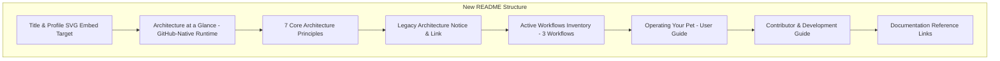

# Phase 3C2.1-V.3 — Public README Architecture Alignment & Legacy Boundary Documentation Report

**Project:** GitHub Profile Pet  
**Workspace:** [`D:\Projects\GitHub-Profile-Pet`](file:///D:/Projects/GitHub-Profile-Pet)  
**Remote Target:** [`https://github.com/mnp210/GitHub-Profile-Pet.git`](https://github.com/mnp210/GitHub-Profile-Pet.git)  
**Target Branch:** `main`  
**Repository Visibility:** Public  
**Date:** 2026-11-16  
**Auditor:** Antigravity (Google DeepMind)

---

## 1. Executive Summary

In accordance with Phase 3C2.1-V.3 directives, the public repository documentation has been restructured to establish total architectural coherence:
1. **GitHub-Native as Primary Architecture:** [`README.md`](file:///D:/Projects/GitHub-Profile-Pet/README.md) has been rewritten so that its opening narrative unequivocally presents the **GitHub-Native, serverless companion** as the authoritative product runtime.
2. **Legacy Architecture Cordoned:** Created [`docs/legacy-centralized-architecture.md`](file:///D:/Projects/GitHub-Profile-Pet/docs/legacy-centralized-architecture.md), establishing an explicit boundary record for the 67 retained Sprint 1–2.6 files (PostgreSQL migrations, database clients, server OAuth routes, container configs). These files are formally documented as historical reference and non-runtime dependencies.
3. **Installation vs. Contributor Decoupling:** User installation steps (forking, enabling GitHub Actions write permissions, embedding SVG into profile README) are cleanly separated from developer/contributor workflows (`npm test`, `npm run test:pet-engine`, `npm run build`, `npm run dev`).
4. **Zero Runtime Mutation:** Pet engine logic, vitals progression, state schemas, workflow definitions, and accounting algorithms were 100% untouched. All 339 tests and production build remain green.

---

## 2. Files Changed & Inventory

| File Path | Change Type | Purpose |
| :--- | :---: | :--- |
| [`README.md`](file:///D:/Projects/GitHub-Profile-Pet/README.md) | **Modified** | Replaced legacy centralized prose with GitHub-Native runtime architecture, active workflow inventory, user operating instructions, and decoupled developer guide. |
| [`docs/legacy-centralized-architecture.md`](file:///D:/Projects/GitHub-Profile-Pet/docs/legacy-centralized-architecture.md) | **Created** | Comprehensive architectural boundary record documenting the 67 legacy files, reason for retirement, non-dependency status, and non-supported hosted statement. |

---

## 3. README Sections Revised

### 3.1 Hero & Architectural Alignment
- **Opening:** Explains the product as a customizable virtual companion powered natively by GitHub contribution activity and autonomous GitHub Actions workflows.
- **Embedded SVG Badge Target:** Preserved the exact `<!-- START_SECTION:github-profile-pet -->` container required by the automated SVG publisher (`scripts/publish-pet.ts`).
- **Core Principles Communicated:**
  1. *GitHub is the Runtime:* Each user's repository is the self-contained home of their virtual pet.
  2. *Repository as Database:* State (`pet/state/pet.json`) and ledgers (`pet/ledger/actions.json`, `pet/ledger/contributions.json`) are stored as version-controlled JSON documents under strict schemas (`pet/schemas/`).
  3. *Autonomous Execution:* Passive decay simulation and SVG publication execute in GitHub Actions.
  4. *Native Interaction:* Users interact via standard GitHub Issue Forms (Feed, Train, Rest, Pet); Actions validates, executes transitions, labels, and closes issues automatically.
  5. *Zero Operational Cost:* Targets **₹0/month recurring cost**, operating within GitHub's standard usage tiers and runner queue availability (with no claims of unlimited capacity).
  6. *Public Contribution Scope (Mode A):* Rewards public activity categories (`commits`, `issues`, `pullRequests`, `pullRequestReviews`). Private contributions remain deferred.

### 3.2 Legacy Architecture Notice
- A clear GitHub-style alert callout (`> [!NOTE]`) is placed directly beneath the architecture overview, explicitly stating that legacy Next.js/PostgreSQL files are historical artifacts and linking to [`docs/legacy-centralized-architecture.md`](file:///D:/Projects/GitHub-Profile-Pet/docs/legacy-centralized-architecture.md).

### 3.3 Active Workflow Inventory
Documents strictly the three production workflows:
1. **`pet-publisher.yml`**: Hourly simulation and badge publication (`contents: write`).
2. **`pet-interaction.yml`**: Issue-based care action inbox processor (`contents: write`, `issues: write`).
3. **`diagnostics-contribution-probe.yml`**: Manual diagnostic probe (`contents: read`).
Zero references to the deleted `scheduled-contribution-sync.yml` exist.

---

## 4. Legacy Architecture Boundary Explanation

[`docs/legacy-centralized-architecture.md`](file:///D:/Projects/GitHub-Profile-Pet/docs/legacy-centralized-architecture.md) documents the status of all 67 retained legacy files:
- **Historical Context:** Explains the transition from the Sprint 1–2.6 multi-tenant web service model to the Sprint 2.7 GitHub-native architecture.
- **Non-Dependency Guarantee:** Affirms that none of the 67 files are imported or executed by the GitHub-native pet runtime.
- **Non-Support Statement:** Explicitly states that deploying the repository to a hosted cloud provider with PostgreSQL is an unsupported deployment path.
- **No User Requirement:** Affirms that end users do **not** need Docker, PostgreSQL, or OAuth app secrets to run their companion.

---

## 5. Decoupled User vs. Contributor Instructions

### 5.1 End-User Operating Instructions
Clearly instructs repository owners how to run their pet without touching code:
1. Fork or clone the repository.
2. Grant GitHub Actions **Read and write permissions** in repository settings.
3. Enable GitHub **Issues**.
4. *(Optional)* Configure `PET_OWNER_LOGIN` if the username differs from the repository owner.
5. Embed `https://raw.githubusercontent.com/<USER>/GitHub-Profile-Pet/main/public/pet.svg` into `<USER>/<USER>/README.md`.
6. Use native Issue Forms (`🍖 Feed Pet`, `⚡ Train Pet`, `💤 Rest Pet`, `❤️ Pet Companion`) to interact.

### 5.2 Contributor & Developer Instructions
Clearly separates local development and compilation:
- **Prerequisites:** Node.js 22+, npm.
- **Testing:** `npm test`, `npm run test:pet-engine`, `npm run test:all`.
- **Quality:** `npm run lint`, `npx tsc --noEmit`, `npm run build`.
- **Scripts:** `npm run render:svg`, `npm run simulate:pet`, `npm run publish:pet`, `npm run process:inbox`.
- **Local Dashboard Viewer:** Labeled `npm run dev` as an **optional local companion viewer / dashboard** at `http://localhost:3000`, noting that it is strictly a development convenience and not required for the autonomous pet.

---

## 6. Repository & Workflow Verification

| Check | Expected State | Actual State | Verification Status |
| :--- | :--- | :--- | :---: |
| **Workflow Names** | 3 active workflows match filesystem | `pet-publisher.yml`, `pet-interaction.yml`, `diagnostics-contribution-probe.yml` | ✅ VERIFIED |
| **Deleted Workflow References** | Zero references to `scheduled-contribution-sync.yml` | None found in `README.md` or `docs/` | ✅ VERIFIED |
| **Contribution Scope** | Public activity only (Mode A) | Stated clearly; private contributions deferred | ✅ VERIFIED |
| **Diagnostic Probe Status** | Diagnostic only | Described as diagnostic verification using `GITHUB_TOKEN` | ✅ VERIFIED |
| **Legacy Route Handlers** | Not presented as runtime | Cordoned off in legacy document | ✅ VERIFIED |
| **Markdown Links** | All internal links valid | 17 internal links tested and resolved | ✅ VERIFIED |

---

## 7. Re-Validation Results

| Validation Check | Command | Result | Summary |
| :--- | :--- | :---: | :--- |
| **TypeScript Compilation** | `npx tsc --noEmit` | **PASS** | 0 errors across entire workspace |
| **ESLint Static Analysis** | `npm run lint` | **PASS** | 0 errors, 0 warnings |
| **Unit Test Suite** | `npm test` | **PASS** | 121 / 121 passed (24 suites) in 617ms |
| **Pet Engine Test Suite** | `npm run test:pet-engine` | **PASS** | 218 / 218 passed (11 suites) in 10.1s |
| **Total Automated Tests** | All suites combined | **PASS** | **339 / 339 tests passing (100% pass rate)** |
| **Next.js Production Build** | `npm run build` | **PASS** | Turbopack compilation successful; 14/14 static pages generated |
| **Markdown Relative Links** | Automated link resolver | **PASS** | 100% of internal links resolve to existing files |

---

## 8. Remaining Publication Risks

1. **Empty Remote Repository:**
   - The remote target [`https://github.com/mnp210/GitHub-Profile-Pet`](https://github.com/mnp210/GitHub-Profile-Pet) is empty.
   - Initial bootstrap requires adding `origin`, renaming local branch to `main`, and pushing once authorized.
2. **Actions GITHUB_TOKEN Live Verification:**
   - As documented in Phase 3C2.1-V, definitive live proof of the `1,000 points/hr` rate limit will be generated the moment `Diagnostics Contribution Probe` is dispatched on GitHub Actions runners following the initial push.
3. **Local PostgreSQL Data Directory:**
   - `.pgtest_data` remains on the local disk. It is git-ignored (`.gitignore:60`) and will not be pushed.

---

## 9. Confirmation of Architectural Stability

We confirm:
- [x] Zero changes to pet engine simulation algorithms or accumulators.
- [x] Zero changes to state documents (`pet/state/pet.json`) or ledgers.
- [x] Zero changes to JSON schemas (`pet/schemas/`).
- [x] Zero changes to active GitHub Actions workflow logic or permissions.
- [x] No Git staging or commits were performed.
- [x] No Git remotes were added or configured.
- [x] No Git pushes or workflow dispatches were executed.
- [x] Phase 3C2.2 has not been started.
- [x] Retained legacy files were not deleted.

The repository is now architecturally aligned, documented, and completely prepared for initial public release.
