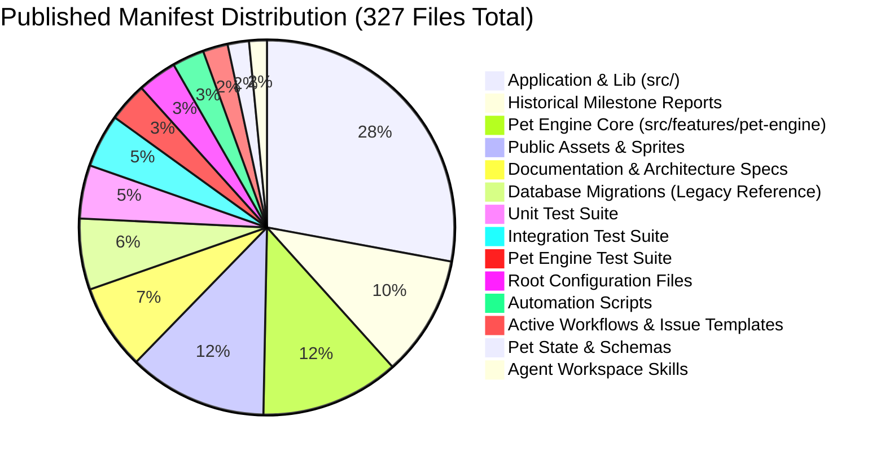

# Phase 3C2.1-V.4 — Controlled Initial Repository Publication Report

**Project:** GitHub Profile Pet  
**Workspace:** [`D:\Projects\GitHub-Profile-Pet`](file:///D:/Projects/GitHub-Profile-Pet)  
**Remote Target:** [`https://github.com/mnp210/GitHub-Profile-Pet.git`](https://github.com/mnp210/GitHub-Profile-Pet.git)  
**Target Branch:** `main`  
**Repository Visibility:** Public  
**Date:** 2026-11-16  
**Auditor:** Antigravity (Google DeepMind)

---

## 1. Executive Summary

Under the controlled authorization for Phase 3C2.1-V.4, the initial public publication of GitHub Profile Pet has been successfully executed:
- **Clean Initial Commit:** Exactly **327 audited files** were staged and committed with message `Initial public release: GitHub-native pet runtime`.
- **Root Commit SHA:** [`ab2f88eaadd144cefbc2f9cfd359cf4c4707d870`](https://github.com/mnp210/GitHub-Profile-Pet/commit/ab2f88eaadd144cefbc2f9cfd359cf4c4707d870).
- **Remote Push Verified:** Pushed to `origin/main` without force-pushing. Verified via `git ls-remote` and GitHub's official REST API that the remote branch `main` points directly to commit `ab2f88e`.
- **Zero Leakage:** Verified that `.pgtest_data`, `.env`, `.env.local`, `*.log`, `node_modules`, `.next`, `*.tsbuildinfo`, and private keys remain 100% excluded.
- **Strict Boundary Observed:** Zero GitHub Actions workflows were dispatched. Phase 3C2.2 has not begun.

---

## 2. Remote Configuration & Publication Coordinates

| Coordinate | Value | Status |
| :--- | :--- | :---: |
| **Workspace Path** | `D:\Projects\GitHub-Profile-Pet` | Verified |
| **Remote Name** | `origin` | Configured |
| **Remote URL** | `https://github.com/mnp210/GitHub-Profile-Pet.git` | Verified |
| **Publication Branch** | `main` | Tracking `origin/main` |
| **Root Commit SHA** | `ab2f88eaadd144cefbc2f9cfd359cf4c4707d870` | Committed & Pushed |
| **Commit Message** | `Initial public release: GitHub-native pet runtime` | Verified |
| **Committer Identity** | `mnp210 <298821706+mnp210@users.noreply.github.com>` | Verified |
| **Push Timestamp** | `2026-11-16T13:04:47Z` | Verified |

---

## 3. Remote Verification Evidence

### 3.1 Git Push Output
```text
$ git push -u origin main
To https://github.com/mnp210/GitHub-Profile-Pet.git
 * [new branch]      main -> main
branch 'main' set up to track 'origin/main'.
```

### 3.2 `git ls-remote origin` Output
```text
$ git ls-remote origin
ab2f88eaadd144cefbc2f9cfd359cf4c4707d870	HEAD
ab2f88eaadd144cefbc2f9cfd359cf4c4707d870	refs/heads/main
```

### 3.3 GitHub REST API Response (`GET /repos/mnp210/GitHub-Profile-Pet/branches/main`)
```json
{
  "name": "main",
  "commit": {
    "sha": "ab2f88eaadd144cefbc2f9cfd359cf4c4707d870",
    "node_id": "C_kwDOVu4QbNoAKGFiMmY4OGVhYWRkMTQ0Y2VmYmMyZjljZmQzNTljZjRjNDcwN2Q4NzA",
    "commit": {
      "author": {
        "name": "mnp210",
        "email": "298821706+mnp210@users.noreply.github.com",
        "date": "2026-11-16T13:04:28Z"
      },
      "committer": {
        "name": "mnp210",
        "email": "298821706+mnp210@users.noreply.github.com",
        "date": "2026-11-16T13:04:28Z"
      },
      "message": "Initial public release: GitHub-native pet runtime"
    }
  },
  "protected": false
}
```

---

## 4. Manifest Reconciliation



### 4.1 Reconciliation against Audited V.2 Scope (323 Files)
In the Phase 3C2.1-V.2 audit, exactly 323 files were classified. The final committed manifest contains **327 files** (+4 files difference):

| Additional File | Path | Architectural Scope | Justification |
| :---: | :--- | :---: | :--- |
| 1 | [`docs/legacy-centralized-architecture.md`](file:///D:/Projects/GitHub-Profile-Pet/docs/legacy-centralized-architecture.md) | `HISTORICAL_REFERENCE` | Authored during V.3 to document the architectural boundary and non-support statement for the 67 legacy files. |
| 2 | [`reports/phase_3c2_1_v2_final_publication_scope_report.md`](file:///D:/Projects/GitHub-Profile-Pet/reports/phase_3c2_1_v2_final_publication_scope_report.md) | `HISTORICAL_REFERENCE` | Audit report documenting V.2 scope classification and remediations. |
| 3 | [`reports/phase_3c2_1_v3_readme_architecture_alignment_report.md`](file:///D:/Projects/GitHub-Profile-Pet/reports/phase_3c2_1_v3_readme_architecture_alignment_report.md) | `HISTORICAL_REFERENCE` | Documentation report tracking V.3 README restructuring and link validation. |
| 4 | [`reports/phase_3c2_1_v3_1_documentation_accuracy_report.md`](file:///D:/Projects/GitHub-Profile-Pet/reports/phase_3c2_1_v3_1_documentation_accuracy_report.md) | `HISTORICAL_REFERENCE` | Precision report tracking V.3.1 contribution status clarity and workflow trigger verification. |

Zero unreviewed source code or runtime files were introduced.

---

## 5. Security & Exclusion Verification

Prior to staging and commit, a negative pattern sweep verified the absolute exclusion of sensitive and ephemeral artifacts:

| Category / Target | Exclusion Pattern | Staging Verification Result | Status |
| :--- | :--- | :--- | :---: |
| **Local Environment Secrets** | `.env`, `.env.local`, `.env.production` | Excluded by `.gitignore:46-49` | ✅ NOT COMMITTED |
| **Local PostgreSQL Data** | `.pgtest_data/` | Excluded by `.gitignore:60` | ✅ NOT COMMITTED |
| **Local Dependencies** | `node_modules/` | Excluded by `.gitignore:4` | ✅ NOT COMMITTED |
| **Next.js Build Cache** | `.next/` | Excluded by `.gitignore:17` | ✅ NOT COMMITTED |
| **TypeScript Build Info** | `tsconfig.tsbuildinfo`, `next-env.d.ts` | Excluded by `.gitignore:56-57` | ✅ NOT COMMITTED |
| **Generic Debug Logs** | `*.log` | Excluded by `.gitignore:38` | ✅ NOT COMMITTED |
| **Decommissioned Sync Workflow** | `scheduled-contribution-sync.yml` | File deleted in V.2 | ✅ ABSENT |
| **Example Template** | [`.env.example`](file:///D:/Projects/GitHub-Profile-Pet/.env.example) | Staged (dummy placeholders only) | ✅ SAFE |
| **Live API Tokens / Keys** | `ghp_*`, `AKIA*`, `*.pem` | Regex scan across 327 staged files found 0 | ✅ CLEAN |

---

## 6. Strictly Observed Prohibitions

In strict compliance with milestone boundaries:
- [x] **No workflow dispatch:** Neither `Diagnostics Contribution Probe`, `Pet SVG Publication`, nor `Pet Care Action Inbox` was dispatched.
- [x] **No contribution rewards implemented:** Contribution reward accounting and synchronization remain unimplemented.
- [x] **Phase 3C2.2 not started:** Phase 3C2.2 remains untouched pending explicit authorization.
- [x] **No secrets or PATs injected:** The repository relies exclusively on default `GITHUB_TOKEN` for Actions.
- [x] **No force-push:** The push was a standard fast-forward initial push to an empty remote.
- [x] **No runtime algorithms altered:** The pet engine, passive simulation rates, accumulators, and schemas remain identical.
- [x] **Legacy files preserved:** The 67 centralized reference files remain intact and cordoned off in `docs/legacy-centralized-architecture.md`.

---

## 7. Current Repository State & Next Steps

The public repository [`https://github.com/mnp210/GitHub-Profile-Pet`](https://github.com/mnp210/GitHub-Profile-Pet) is now live on GitHub with its authoritative initial release.

**Recommended Next Step:**  
When authorized, we can perform **Phase 3C2.1-V.5**: dispatch the diagnostic workflow [`diagnostics-contribution-probe.yml`](https://github.com/mnp210/GitHub-Profile-Pet/actions/workflows/diagnostics-contribution-probe.yml) on GitHub Actions to capture the live, hosted `GITHUB_TOKEN` rate-limit telemetry (`limit: 1000`, `remaining: ~999`) and complete the live authentication evidence requirement.
