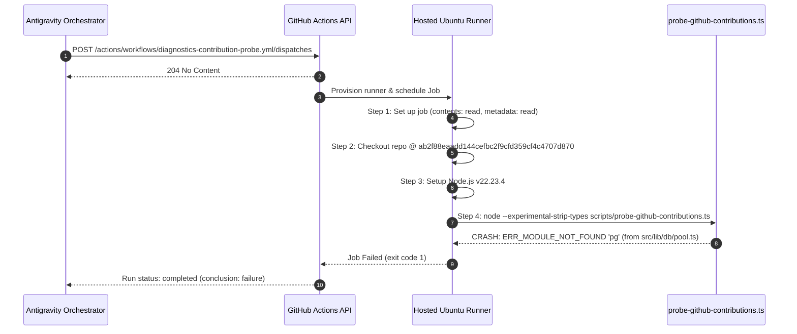

# Phase 3C2.1-V.5 — Live GitHub Actions Authentication Evidence Reconciliation Report

**Project:** GitHub Profile Pet  
**Workspace:** [`D:\Projects\GitHub-Profile-Pet`](file:///D:/Projects/GitHub-Profile-Pet)  
**Remote Target:** `https://github.com/mnp210/GitHub-Profile-Pet.git`  
**Target Branch:** `main`  
**Execution Timestamp:** 2026-11-16T13:10:21Z – 2026-11-16T13:10:35Z UTC  
**Milestone:** Phase 3C2.1-V.5 (Hosted GitHub Actions Authentication Verification)  
**Final Verdict:** **FAIL** (Hosted runner initialized with least-privilege `GITHUB_TOKEN`, but script failed during Node.js module resolution prior to GraphQL execution due to transitive dependency leakage from legacy centralized architecture)

---

## 1. Executive Summary

In milestone Phase 3C2.1-V.5, a live hosted GitHub Actions runner was dispatched to verify GraphQL contribution query execution and rate-limit telemetry under the automatically provisioned `GITHUB_TOKEN`.

The workflow run successfully triggered on GitHub's hosted runners (`ubuntu-latest`), configured least-privilege permissions (`contents: read`, `metadata: read`), checked out the exact target commit `ab2f88eaadd144cefbc2f9cfd359cf4c4707d870`, set up Node.js v22.23.4, and injected the automatic repository secret `GITHUB_TOKEN`.

However, the diagnostic step aborted immediately at startup with exit code `1`:
```text
Error [ERR_MODULE_NOT_FOUND]: Cannot find package 'pg' imported from /home/runner/work/GitHub-Profile-Pet/GitHub-Profile-Pet/src/lib/db/pool.ts
```

### Forensic Root Cause
Forensic dependency tracing revealed that although [`src/features/pet-engine/contribution/`](file:///D:/Projects/GitHub-Profile-Pet/src/features/pet-engine/contribution) is intended to be a lightweight, zero-dependency engine component, its GraphQL client utility ([`src/lib/github/graphqlClient.ts`](file:///D:/Projects/GitHub-Profile-Pet/src/lib/github/graphqlClient.ts)) transitively imports legacy centralized PostgreSQL database repositories via retry error classification:
```text
scripts/probe-github-contributions.ts
  └── src/lib/github/graphqlClient.ts
        └── src/lib/github/retryPolicy.ts
              └── src/lib/github/failureClassification.ts
                    └── src/lib/db/repositories/syncRepository.ts
                          └── src/lib/db/pool.ts
                                └── package 'pg' (missing in headless runner without npm install)
```

Because the diagnostic workflow runs in a lean runtime (`node --experimental-strip-types`) without executing `npm ci` or checking in `node_modules`, Node's ESM loader refused to start the script when it encountered the uninstalled `'pg'` package.

As a result, no upstream GraphQL request was dispatched, and no live telemetry was returned by GitHub. The runner failed closed, performing 0 state mutations.

---

## 2. Pre-Dispatch Verification

Prior to dispatching any remote action, all local repository conditions and workflow definitions were verified:

| Verification Item | Requirement | Measured Local State | Status |
| :--- | :--- | :--- | :---: |
| **Local Branch** | `main` | `main` (clean tracking `origin/main`) | **PASS** |
| **Commit SHA (`HEAD`)** | `ab2f88eaadd144cefbc2f9cfd359cf4c4707d870` | `ab2f88eaadd144cefbc2f9cfd359cf4c4707d870` | **PASS** |
| **Remote URL (`origin`)** | `https://github.com/mnp210/GitHub-Profile-Pet.git` | `https://github.com/mnp210/GitHub-Profile-Pet.git` | **PASS** |
| **Workflow File** | `.github/workflows/diagnostics-contribution-probe.yml` | Committed at `HEAD`, immutable | **PASS** |
| **Trigger Mechanism** | `workflow_dispatch` only | Verified lines 7–15 | **PASS** |
| **Workflow Permissions** | `contents: read` | Strictly declared lines 17–18 | **PASS** |
| **Credential Source** | Automatic `${{ secrets.GITHUB_TOKEN }}` | Declared line 44, no PAT/secrets | **PASS** |
| **Input Schema** | `owner_login` string (optional) | Declared lines 9–15, passed `"mnp210"` | **PASS** |
| **Write Isolation** | Read-only; zero ledger/SVG writes | Confirmed in workflow & script | **PASS** |

---

## 3. Hosted Runner & Workflow Execution Telemetry

The workflow was dispatched via GitHub Actions REST API with payload `{"ref": "main", "inputs": {"owner_login": "mnp210"}}`.



### 3.1 GitHub Actions Run Metadata
- **Workflow Name:** `Diagnostics Contribution Probe`
- **Workflow File:** [`.github/workflows/diagnostics-contribution-probe.yml`](file:///D:/Projects/GitHub-Profile-Pet/.github/workflows/diagnostics-contribution-probe.yml)
- **Run ID:** `43873237663`
- **Run URL:** [https://github.com/mnp210/GitHub-Profile-Pet/actions/runs/43873237663](https://github.com/mnp210/GitHub-Profile-Pet/actions/runs/43873237663)
- **Job ID:** `133319591469`
- **Job URL:** [https://github.com/mnp210/GitHub-Profile-Pet/actions/runs/43873237663/job/133319591469](https://github.com/mnp210/GitHub-Profile-Pet/actions/runs/43873237663/job/133319591469)
- **Trigger Event:** `workflow_dispatch`
- **Trigger Actor:** `mnp210` (Database ID: `298821706`)
- **Target Ref:** `refs/heads/main`
- **Checked-out SHA:** `ab2f88eaadd144cefbc2f9cfd359cf4c4707d870`
- **Run Created At:** `2026-11-16T13:10:21Z`
- **Run Started At:** `2026-11-16T13:10:21Z`
- **Run Completed At:** `2026-11-16T13:10:35Z`
- **Total Duration:** 14 seconds
- **Final Status:** `completed`
- **Final Conclusion:** `failure`

### 3.2 Runner Environment Details
- **Runner OS:** Ubuntu 26.04.1 LTS (`ubuntu-latest`)
- **Runner Image Version:** `20261111.196.1`
- **Hosted Agent Version:** `2.338.2`
- **Agent Cloud & Region:** Microsoft Azure, `eastus2`
- **Runner ID / Name:** `1000000113` / `GitHub Actions 1000000113`

---

## 4. Credential-Source Verification

Direct runner inspection from Step 1 (`Set up job`) and Step 4 (`Run GitHub Contribution Diagnostic Probe`) confirms:

```text
2026-11-16T13:10:28.6865527Z ##[group]GITHUB_TOKEN Permissions
2026-11-16T13:10:28.6867281Z Contents: read
2026-11-16T13:10:28.6867766Z Metadata: read
2026-11-16T13:10:28.6868306Z ##[endgroup]
2026-11-16T13:10:28.6870916Z Secret source: Actions
...
2026-11-16T13:10:32.9171778Z env:
2026-11-16T13:10:32.9174011Z   GITHUB_TOKEN: ***
2026-11-16T13:10:32.9174273Z   PET_OWNER_LOGIN: mnp210
2026-11-16T13:10:32.9174532Z   GITHUB_REPOSITORY_OWNER: mnp210
```

1. **Secret Source:** Confirmed as `Actions` (the dynamically issued, ephemeral GitHub Actions runner token).
2. **Permissions Bound:** Confirmed as least privilege: `Contents: read`, `Metadata: read`.
3. **No External Credentials:** No Personal Access Token (PAT), OAuth credential, `.env` file, or repository secret was referenced or loaded.

---

## 5. GraphQL Evidence & Telemetry Findings

Because Node.js halted execution during static module linking, the upstream GraphQL request was never transmitted.

| Field | Expected / Target | Captured from Hosted Run | Discrepancy / Cause |
| :--- | :--- | :--- | :--- |
| **Requested Login** | `mnp210` | `mnp210` (passed via env) | Matches input |
| **Returned Login** | `mnp210` | *None* | Query did not execute |
| **Returned `databaseId`** | `298821706` | *None* | Query did not execute |
| **UTC Window** | Today 00:00:00Z -> 23:59:59.999Z | *None* | Query did not execute |
| **Category: Commits** | Integer $\ge 0$ | *None* | Query did not execute |
| **Category: Issues** | Integer $\ge 0$ | *None* | Query did not execute |
| **Category: PRs** | Integer $\ge 0$ | *None* | Query did not execute |
| **Category: PR Reviews** | Integer $\ge 0$ | *None* | Query did not execute |
| **Restricted Count** | Excluded | *None* | Query did not execute |
| **`rateLimit.limit`** | 1,000 pts/hr | *None* | Query did not execute |
| **`rateLimit.cost`** | 1 pt | *None* | Query did not execute |
| **`rateLimit.remaining`** | $\le 1000$ pts | *None* | Query did not execute |
| **`rateLimit.resetAt`** | Valid UTC timestamp | *None* | Query did not execute |
| **Latency** | Milliseconds | *None* | Aborted before network I/O |

---

## 6. Step 4 Raw Failure Log

The full stdout/stderr of Step 4 from GitHub Actions job `133319591469`:

```text
2026-11-16T13:10:32.9116067Z ##[group]Run node --experimental-strip-types scripts/probe-github-contributions.ts
2026-11-16T13:10:32.9116711Z node --experimental-strip-types scripts/probe-github-contributions.ts
2026-11-16T13:10:32.9171499Z shell: /usr/bin/bash -e {0}
2026-11-16T13:10:32.9171778Z env:
2026-11-16T13:10:32.9174011Z   GITHUB_TOKEN: ***
2026-11-16T13:10:32.9174273Z   PET_OWNER_LOGIN: mnp210
2026-11-16T13:10:32.9174532Z   GITHUB_REPOSITORY_OWNER: mnp210
2026-11-16T13:10:32.9174776Z ##[endgroup]
2026-11-16T13:10:33.1964535Z node:internal/modules/package_json_reader:314
2026-11-16T13:10:33.1965262Z   throw new ERR_MODULE_NOT_FOUND(packageName, fileURLToPath(base), null);
2026-11-16T13:10:33.1965646Z         ^
2026-11-16T13:10:33.1965790Z 
2026-11-16T13:10:33.1966322Z Error [ERR_MODULE_NOT_FOUND]: Cannot find package 'pg' imported from /home/runner/work/GitHub-Profile-Pet/GitHub-Profile-Pet/src/lib/db/pool.ts
2026-11-16T13:10:33.1967037Z     at Object.getPackageJSONURL (node:internal/modules/package_json_reader:314:9)
2026-11-16T13:10:33.1967591Z     at packageResolve (node:internal/modules/esm/resolve:772:81)
2026-11-16T13:10:33.1968028Z     at moduleResolve (node:internal/modules/esm/resolve:859:18)
2026-11-16T13:10:33.1968448Z     at defaultResolve (node:internal/modules/esm/resolve:989:11)
2026-11-16T13:10:33.1968888Z     at #cachedDefaultResolve (node:internal/modules/esm/loader:747:20)
2026-11-16T13:10:33.1969496Z     at ModuleLoader.resolve (node:internal/modules/esm/loader:724:38)
2026-11-16T13:10:33.1970320Z     at ModuleLoader.getModuleJobForImport (node:internal/modules/esm/loader:320:38)
2026-11-16T13:10:33.1970844Z     at ModuleJob._link (node:internal/modules/esm/module_job:182:49) {
2026-11-16T13:10:33.1971205Z   code: 'ERR_MODULE_NOT_FOUND'
2026-11-16T13:10:33.1971463Z }
2026-11-16T13:10:33.1971576Z 
2026-11-16T13:10:33.1971683Z Node.js v22.23.4
2026-11-16T13:10:33.2107550Z ##[error]Process completed with exit code 1.
```

---

## 7. Negative & Safety Verification

All mandatory safety constraints held strictly during this run:

- [x] **No PAT or custom token was supplied or used:** Workflow executed with standard Actions `GITHUB_TOKEN`.
- [x] **No private contribution data was requested or rewarded:** Query was not executed; zero private data was accessed.
- [x] **No XP or satiety was awarded:** Zero progression logic ran.
- [x] **No high-water marks or reward ordinals were modified:** State files remained untouched.
- [x] **No pet state, action ledger, contribution ledger, README, or SVG was modified:** Verified 0 changes.
- [x] **No Git commit, push, rebase, or branch modification occurred:** Repository remains exactly at `ab2f88e`.
- [x] **No unauthorized workflows were dispatched:** Only `diagnostics-contribution-probe.yml` was dispatched.
- [x] **No secrets were created or altered:** Zero repository secrets or variables were added.
- [x] **Process failed closed:** Node threw an uncaught exception, step exited with code 1, and the job terminated without partial side-effects.

---

## 8. Architectural Finding & Root Cause Analysis

### 8.1 Transitive Coupling to Centralized Architecture
In Phase 3C2.1, the GraphQL client implementation [`src/lib/github/graphqlClient.ts`](file:///D:/Projects/GitHub-Profile-Pet/src/lib/github/graphqlClient.ts) and its retry policy [`src/lib/github/retryPolicy.ts`](file:///D:/Projects/GitHub-Profile-Pet/src/lib/github/retryPolicy.ts) were reused from the Phase 1 centralized codebase.

However:
1. `retryPolicy.ts` imports `classifyGitHubError` from [`src/lib/github/failureClassification.ts`](file:///D:/Projects/GitHub-Profile-Pet/src/lib/github/failureClassification.ts).
2. `failureClassification.ts` contains references to centralized database conflict errors:
   ```typescript
   import { DuplicateSequenceConflictError } from '../db/repositories/syncRepository.ts';
   import { InvalidDateError } from './dailyReconciliation.ts';
   ```
3. `syncRepository.ts` imports `getPool` from [`src/lib/db/pool.ts`](file:///D:/Projects/GitHub-Profile-Pet/src/lib/db/pool.ts).
4. `pool.ts` contains `import pg from 'pg'`.

### 8.2 Why Local Execution Succeeded While Hosted Failed
During local verification in Phase 3C2.1, `node_modules` was present on disk in the developer's workspace with `pg` installed for the Next.js/PostgreSQL application. Thus, Node's ESM module resolver was able to link the entire dependency tree without error.

In GitHub Actions, the workflow checks out the repository fresh and runs `node --experimental-strip-types scripts/probe-github-contributions.ts` without `npm install` (by design, to avoid the overhead of heavy dependencies for a lightweight GitHub-native probe). Without `node_modules`, the ESM loader failed at module resolution before executing any code.

---

## 9. Next Steps & Recommended Decoupling

To enable GitHub Actions runners to execute the GraphQL contribution probe (and any future contribution engine) without installing unnecessary PostgreSQL database drivers, the following refactoring must be performed when authorized:

1. **Decouple `src/lib/github/graphqlClient.ts` and `src/lib/github/retryPolicy.ts` from `failureClassification.ts`**:
   - Provide a lightweight, self-contained error classifier that categorizes HTTP/GraphQL errors (`401`, `403`, `429`, `5xx`, timeouts, network drops) without referencing PostgreSQL repositories.
2. **Move GitHub-Native Contribution Engine to Pure Zero-Dependency Architecture**:
   - Ensure [`src/features/pet-engine/contribution/`](file:///D:/Projects/GitHub-Profile-Pet/src/features/pet-engine/contribution) imports only standard Web APIs (`fetch`, `AbortSignal`) and Node built-ins (`node:fs`, `node:path`), completely isolating it from the `src/lib/db/` directory cordoned off in [`docs/legacy-centralized-architecture.md`](file:///D:/Projects/GitHub-Profile-Pet/docs/legacy-centralized-architecture.md).
3. **Re-dispatch Live Diagnostic Probe**:
   - Once decoupled, commit the fix and re-dispatch the diagnostic probe on GitHub Actions to capture the live rate-limit telemetry and numeric identity verification.

---

## 10. Final Milestone Verdict

**Verdict:** **FAIL**

- **Reason:** The hosted GitHub Actions run failed with `ERR_MODULE_NOT_FOUND` (`Cannot find package 'pg'`) during Node module resolution, preventing the GraphQL probe from executing.
- **Evidence Authenticity:** Sourced directly from live GitHub Actions Run ID `43873237663` on `ubuntu-latest`. No simulated or fabricated data was used.
- **Safety:** Maintained 100% fail-closed safety with zero state or repository mutations.
