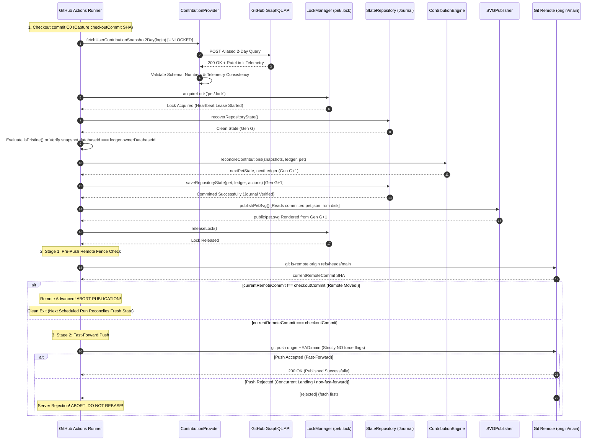
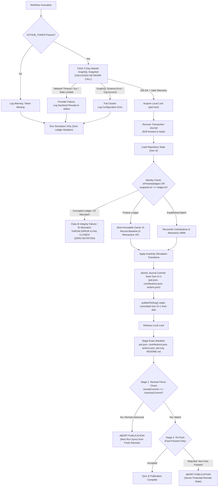

# Phase 3C2.2.2-R4 Architecture Specification — Contribution Sync Runtime Integration & Acceptance Criteria

**Repository:** `https://github.com/mnp210/GitHub-Profile-Pet`  
**Workspace:** `D:\Projects\GitHub-Profile-Pet`  
**Current Published Baseline:** `9658548d2173dfc19a26f6434c6ed341632c9b2a`  
**Milestone:** Phase 3C2.2.2-R4 (Final Design Sign-off Corrections)  
**Status:** FINAL SIGNED-OFF SPECIFICATION (Design-Only Milestone; Implementation Strictly Deferred)

---

## Revision History & Reconciliation Log

| Version | Milestone | Author | Date | Summary of Changes |
|---|---|---|---|---|
| **1.0** | Phase 3C2.2.2 | Assistant | 2026-11-17 | Initial runtime integration architecture and acceptance criteria specification. |
| **1.1** | Phase 3C2.2.2-R1 | Assistant | 2026-11-17 | Reconciled remote-generation fencing concept, unverified aliased query cost, dual-schedule Actions minute calculation, decoupled provider failure, and initial acceptance matrix. |
| **1.2** | Phase 3C2.2.2-R2 | Assistant | 2026-11-17 | Final safety, persistence, and publication consistency closure (R2-01 through R2-08). |
| **1.3** | Phase 3C2.2.2-R3 | Assistant | 2026-11-17 | Final specification consistency reconciliation (pristine predicate real fields, schedule inventory, whole-increment cap policy, single acceptance matrix, rate-limit policy, recovery decoupling). |
| **1.4** | Phase 3C2.2.2-R4 | Assistant | 2026-11-17 | **Final design sign-off corrections:**<br>1. **Authoritative Pristine Predicate & Decision Table**: Strictly required `installationBaseline === undefined` and `lastSyncReceipt === undefined` for genuine pristine state; added full 10-case state classification decision table; distinguished pristine from established zero-activity ledgers.<br>2. **Actions Concurrency Wording Reconciliation**: Corrected trigger-vs-execution phrasing; stated executed runs may be fewer than, equal to, or dependent on timing without claiming strictly lower; framed 1,560 private-repo minutes as a hypothetical upper reference scenario, not a forecast. |

---

## 1. Executive Summary

Phase 3C2.2.2-R2 finalizes the runtime integration architecture connecting the verified GitHub GraphQL contribution provider (`contributionProvider.ts`) with the deterministic contribution accounting engine (`contributionEngine.ts`) into the live GitHub Actions execution environment.

GitHub Profile Pet operates as a self-hosted, user-owned virtual companion living entirely inside an individual developer's repository. It requires **₹0/month recurring operating cost**, zero external database servers, zero third-party cloud schedulers, and zero custom authentication credentials.

This revision resolves all remaining architectural review findings:
- **Two-Stage Push Boundary**: Separates the pre-push `git ls-remote` check from the Git server's final fast-forward enforcement, establishing that any rejected push aborts publication and defers to a fresh checkout.
- **Accurate Publication Manifest**: Establishes that `pet/ledger/actions.json` **must** be staged alongside `pet/state/pet.json` and `pet/ledger/contributions.json` because `stateRepository.ts` advances all three documents in atomic generation lockstep.
- **Strict Pristine Ledger Predicate**: Replaces permissive baseline checks with an uncompromising 10-point validation rule ensuring that partially initialized or corrupted ledgers fail closed.
- **Crash-Safe Asset Regeneration**: Documents that `publishPetSvg` reads committed state from disk while still holding the local mutex lock, and that a crash between commit and publication is safely caught up on the next run without reward duplication.
- **Explicit 48-Hour Outage Horizon**: Transparently documents the boundary limitation of the 2-day settlement window, stating that outages exceeding 48 hours cannot observe or reward daily activity prior to yesterday's UTC start.

---

## 2. Current Repository Findings with Exact Paths

Every component, interface, path, and schedule has been directly inspected in the workspace:

| Subsystem / Component | Exact Repository File Path | Inspected Status & Technical Findings |
|---|---|---|
| **Publisher Workflow** | `.github/workflows/pet-publisher.yml` | **Dual Cron Schedules**: Lines 6-9 declare `cron: '47 * * * *'` (hourly) AND `cron: '23 */6 * * *'` (00:23, 06:23, 12:23, 18:23 UTC). Grants `contents: write`. Concurrency group: `pet-runtime-${{ github.repository }}` (`cancel-in-progress: false`). Staged files currently only include `public/pet.svg`, `pet/state/pet.json`, and `README.md` (omits `pet/ledger/contributions.json` and `pet/ledger/actions.json`). Push retry loop uses `git rebase origin/${{ github.ref_name }}`. |
| **Interaction Workflow** | `.github/workflows/pet-interaction.yml` | Triggered on `issues: [opened]`, `workflow_dispatch`, and **hourly recovery sweep** `cron: '47 * * * *'` (lines 10-11). Grants `contents: write`, `issues: write`. Shares concurrency group `pet-runtime-${{ github.repository }}`. Stages `pet/state/pet.json`, `pet/ledger/actions.json`, and `pet/ledger/contributions.json`. |
| **Diagnostic Workflow** | `.github/workflows/diagnostics-contribution-probe.yml` | Manual-only (`workflow_dispatch`). Grants `contents: read`. Uses `${{ secrets.GITHUB_TOKEN }}`. Successfully executed in Phase 3C2.1-V.5.2 to probe live Actions token. |
| **State Repository** | `src/features/pet-engine/persistence/stateRepository.ts` | Multi-document atomic persistence engine. Manages `pet/.lock` via `O_EXCL` with heartbeat lease renewal. Manages `pet/.journal` with `preparing` and `committed` states. Asserts identical generation across `pet.json`, `contributions.json`, and `actions.json` via `GenerationMismatchError`. |
| **Contribution Provider** | `src/features/pet-engine/contribution/contributionProvider.ts` | Pure TypeScript native GraphQL provider. Uses `NativeGraphQLClient`. Queries user `databaseId`, `login`, and 4 public categories. Validates ISO-8601 timestamps with explicit timezones. Implements `checkRateLimitConsistency()`. |
| **Identity Resolver** | `src/features/pet-engine/contribution/identityResolver.ts` | Resolves login from `PET_OWNER_LOGIN` or `GITHUB_REPOSITORY_OWNER`. Validates personal accounts (`__typename === 'User'`). Checks `snapshot.ownerDatabaseId === ledger.ownerDatabaseId`. |
| **Accounting Engine** | `src/features/pet-engine/accounting/contributionEngine.ts` | Pure deterministic function `reconcileContributions`. Implements baseline, monotonic HWM, ordinals, diminishing schedule, 5/hr throttle, immediate bulk forfeiture at 300 XP cap, and conservation invariant. |
| **Passive Simulation** | `src/features/pet-engine/simulation/simulationService.ts` | Advances vitals based on elapsed time. Coordinates `loadRepositoryState`, `saveRepositoryState`, and triggers `publishPetSvg`. |
| **SVG Publication Engine** | `src/features/pet-engine/publication/svgPublisher.ts` | `publishPetSvg(options?: PublishPetOptions)`: Reads `pet/state/pet.json` strictly from disk (`statePath`). Does not take in-memory state. Writes `public/pet.svg` via temporary file rename. Updates `README.md` embed markers. |
| **Publication Types** | `src/features/pet-engine/publication/types.ts` | `PublishPetOptions` defines `baseDir`, `statePath`, `outputPath`, `readmePath`, `updateReadme`, `theme`, `customMessage`. Confirms renderer interface is disk-path based. |
| **Ledger Schema** | `pet/schemas/contributions.schema.json` | Strict JSON Schema defining `schemaVersion`, `generation`, `ownerDatabaseId`, `ownerLogin`, `installationBaseline`, `dailyHwm`, `dailyRewardOrdinal`, `dailyAccruedXp`, `hourlyIncrementUsage`, `slices`, `monthlyHistoricalSummary`. |
| **Active Test Suites** | `tests/pet-engine/*.test.ts` | 305 tests across 21 suites passing cleanly. Covers simulation, care transitions, journal recovery, SVG rendering, provider, and accounting engine. |

---

## 3. Remote Push Race & Two-Stage Safety Boundary (R2-01)

### 3.1 Two-Stage Remote Publication Boundary
To guarantee that stale generated accounting state can never overwrite remote state under any network or concurrency timing, publication enforces two distinct safety stages:

```
STAGE 1: PRE-PUSH REMOTE FENCE CHECK
  - Execute: currentRemoteCommit = git ls-remote origin refs/heads/${ref_name} | cut -f1
  - Compare currentRemoteCommit against checkoutCommit captured at workflow start.
  - IF currentRemoteCommit !== checkoutCommit THEN:
      Abort publication immediately.
      Remote advanced during runner execution; local generated state is based on a stale baseline.
      Exit cleanly without modifying remote.
  - IF currentRemoteCommit === checkoutCommit THEN:
      Proceed to Stage 2.

STAGE 2: GIT SERVER FAST-FORWARD ENFORCEMENT
  - Execute: git push origin HEAD:${ref_name} (Strictly NO force flags: no --force, no +HEAD).
  - The remote Git server atomically evaluates whether HEAD is an ancestor of the remote ref.
  - IF a concurrent commit landed between Stage 1 and Stage 2:
      Git server REJECTS the push: [rejected] (non-fast-forward / fetch first).
      The runner script catches the non-zero exit code.
      DO NOT BLINDLY REBASE! DO NOT RETRY PUSH!
      Abort publication immediately.
      Exit with code 1 (or clean exit). Next run starts from a fresh checkout.
```

### 3.2 Non-Negotiable Publication Invariants
1. **Zero Force-Pushing**: Force-pushing (`git push --force`, `+HEAD`) is permanently forbidden in all workflows and scripts.
2. **Zero Blind Rebasing**: Blindly rebasing generated JSON accounting documents (`pet.json`, `contributions.json`, `actions.json`) is permanently forbidden. Git's textual merge cannot resolve generation numbers, monotonic HWMs, or vitals accumulators.
3. **Rejection Equals Abort**: Any push rejection triggers an immediate publication abort. The authoritative remote state is left untouched.

---

## 4. Publication Failure Recovery (R2-02)

Recovery behavior must be evaluated separately based on the runtime workspace lifecycle:

```
+-------------------------------------------------------------------------------------------------------+
| RUNTIME ENVIRONMENT A: EPHEMERAL GITHUB ACTIONS RUNNERS (AUTHORITATIVE REMOTE)                        |
|                                                                                                       |
|  Characteristics:                                                                                     |
|    - Standard GitHub-hosted Linux runners (ubuntu-latest).                                             |
|    - Runner container filesystem is completely destroyed when the job completes.                     |
|                                                                                                       |
|  Recovery Lifecycle:                                                                                  |
|    1. If publication fails (push rejected or network error):                                          |
|       - The local committed journal (Gen G+1) inside the container is discarded upon job exit.        |
|       - Remote origin/main remains pristine at Gen G (or Gen G' if advanced concurrently).            |
|    2. Subsequent Run Invocation:                                                                      |
|       - Checks out fresh, authoritative remote HEAD.                                                  |
|       - No uncommitted or half-written journals exist in the fresh checkout.                          |
|       - Queries GitHub GraphQL API for cumulative public contribution totals.                         |
|       - Reconciles delta against remote's dailyHwm.                                                   |
|       - Monotonic HWM guarantees delta is calculated accurately with ZERO duplicate XP or ordinals.   |
+-------------------------------------------------------------------------------------------------------+

+-------------------------------------------------------------------------------------------------------+
| RUNTIME ENVIRONMENT B: PERSISTENT LOCAL WORKSPACES (MANUAL CLI / SELF-HOSTED)                         |
|                                                                                                       |
|  Characteristics:                                                                                     |
|    - Local developer machines running scripts directly.                                               |
|    - Filesystem persists across executions. git reset --hard is FORBIDDEN as an automatic mechanism   |
|      because it permanently destroys untracked developer files, uncommitted edits, and scratch data.   |
|                                                                                                       |
|  Recovery Lifecycle:                                                                                  |
|    1. Local Journal Inspection:                                                                       |
|       - On startup, call recoverRepositoryState(baseDir).                                              |
|       - If pet/.journal exists: rolls forward if marked 'committed', rolls back if 'preparing'.       |
|    2. Local Git Status vs. Remote HEAD:                                                               |
|       - Compare git rev-parse HEAD with git rev-parse origin/main.                                    |
|       - If local HEAD has an unpushed commit (Gen G+1) and remote is at Gen G:                        |
|           Safe fast-forward push can be re-attempted.                                                  |
|       - If remote has diverged (remote is at G' while local is at G+1):                               |
|           Fail closed with GitBranchDivergenceError.                                                  |
|           Do NOT auto-reset. Prompt user to inspect diverged commits manually.                         |
+-------------------------------------------------------------------------------------------------------+
```

---

## 5. Exact Publication Manifest & Multi-Document Generation Lockstep (R2-03)

### 5.1 The Generation Lockstep Rule
In `src/features/pet-engine/persistence/stateRepository.ts`, both `saveRepositoryState()` and `loadRepositoryState()` enforce:

```typescript
if (
  pet.generation !== contributions.generation ||
  pet.generation !== actions.generation
) {
  throw new GenerationMismatchError(
    pet.generation,
    contributions.generation,
    actions.generation
  );
}
```

When `reconcileContributions()` and `simulatePet()` execute, `stateRepository.saveRepositoryState()` advances all three state documents to target generation $G+1$.

### 5.2 Consequence of Omitting `actions.json`
If a publication step stages only `pet.json` and `contributions.json` while omitting `actions.json`:
1. The remote Git branch receives `pet.json` (Gen $G+1$) and `contributions.json` (Gen $G+1$), but `actions.json` remains at Gen $G$.
2. The very next runner or local script that checks out `origin/main` executes `loadRepositoryState()` and **immediately crashes with a fatal `GenerationMismatchError`**, completely breaking all pet automation!

### 5.3 Authoritative Required Publication Manifest
To guarantee generation consistency and visual alignment, every publication commit **MUST** stage the exact 5-file manifest:

```bash
# Authoritative Staged Publication Manifest
git add \
  pet/state/pet.json \
  pet/ledger/contributions.json \
  pet/ledger/actions.json \
  public/pet.svg \
  README.md
```

*Note: If no changes occurred across any of these 5 files, `git diff --staged --quiet` exits cleanly without creating an empty commit.*

---

## 6. Strict Pristine Ledger Predicate (R2-04)

### 6.1 The Fallacy of Permissive Baseline Checks
Checking only `installationBaseline?.completed !== true` is permissive and dangerous:
- What if `installationBaseline` is `{ completed: false }` but the ledger already contains 50 recorded slices?
- What if `ownerDatabaseId` is missing due to a corrupted file, but `dailyHwm` is already populated?
Treating such ledgers as uninitialized would allow silent re-binding and reward recalculation.

### 6.2 The Authoritative Strict Pristine Predicate
Derived directly from `pet/schemas/contributions.schema.json`, `src/features/pet-engine/domain/types.ts`, `src/features/pet-engine/validation/ledgerValidator.ts`, and `src/features/pet-engine/accounting/contributionEngine.ts`, a ledger document $L$ is classified as **Pristine Uninitialized** if and only if **ALL** of the following conditions hold on actual repository fields:

$$\text{isPristine}(L) \iff \begin{cases} 
\text{1. } L.\text{schemaVersion} = 1 \\
\land\ \text{2. } L.\text{generation} \ge 1 \\
\land\ \text{3. } L.\text{installationBaseline is undefined} \\
\land\ \text{4. } \text{Array.isArray}(L.\text{slices}) \land L.\text{slices.length} = 0 \\
\land\ \text{5. } \text{Array.isArray}(L.\text{monthlyHistoricalSummary}) \land L.\text{monthlyHistoricalSummary.length} = 0 \\
\land\ \text{6. } (L.\text{dailyHwm is undefined} \lor \text{Object.keys}(L.\text{dailyHwm}).\text{length} = 0) \\
\land\ \text{7. } (L.\text{dailyRewardOrdinal is undefined} \lor \text{Object.keys}(L.\text{dailyRewardOrdinal}).\text{length} = 0) \\
\land\ \text{8. } (L.\text{dailyAccruedXp is undefined} \lor \text{Object.keys}(L.\text{dailyAccruedXp}).\text{length} = 0) \\
\land\ \text{9. } L.\text{lastSyncReceipt is undefined} \\
\land\ \text{10. } (L.\text{hourlyIncrementUsage is undefined} \lor \text{Object.keys}(L.\text{hourlyIncrementUsage}).\text{length} = 0) \\
\land\ \text{11. } (L.\text{monotonicPublicHwm is undefined} \lor L.\text{monotonicPublicHwm} = 0) \\
\land\ \text{12. } (L.\text{ownerDatabaseId is undefined} \lor L.\text{ownerDatabaseId} = \text{verifiedOwnerDatabaseId})
\end{cases}$$

#### Field-by-Field Rationale:
- **`installationBaseline` (strictly `undefined`):** Any existing object—including `{ completed: false }`—indicates a partial, aborted, or corrupted initialization attempt. A partially initialized baseline must NEVER qualify as pristine.
- **`lastSyncReceipt` (strictly `undefined`):** A genuinely pristine template has never executed a sync operation. Any receipt (even if `incrementsProcessed === 0` or `status: 'noop'`) is undeniable evidence of a prior execution and must be rejected as an uninitialized candidate.
- **`slices` & `monthlyHistoricalSummary` (strictly `length === 0`):** An uninitialized template cannot contain recorded contribution slices or compacted monthly archives.
- **`dailyHwm`, `dailyRewardOrdinal`, & `dailyAccruedXp` (strictly empty/`undefined`):** Peak counters, ordinal sequences, and accrued XP only exist after baseline establishment.
- **`ownerDatabaseId` (`undefined` or exact match):** In an unbound template, identity fields are undefined. If a numeric ID is already recorded, it cannot be silently rebound to a different owner; it must strictly match `verifiedOwnerDatabaseId`.

### 6.3 State Classification & Decision Table

The contribution reconciliation engine strictly distinguishes genuinely pristine installations from established ledgers (including those with zero recent activity) and malformed states:

| State Classification | `installationBaseline` | `ownerDatabaseId` | `dailyHwm` & `dailyRewardOrdinal` | `slices` & `monthlySummary` | `lastSyncReceipt` | Engine Action & Failure Behavior |
|---|---|---|---|---|---|---|
| **Class 1: Genuinely Pristine Installation** | `undefined` | `undefined` or matches verified owner | `undefined` or `{}` | `[]` and `[]` | `undefined` | **Path A: Execute Baseline Initialization**<br>Binds owner, records baseline counts for yesterday/today, sets ordinals to 0, advances generation to $G+1$, and awards strictly **0 retroactive XP**. |
| **Class 2: Established Ledger (Active or 0 Recent Activity)** | Fully valid `{ completed: true, ... }` | Matches verified personal owner ID | Populated non-negative integers | Arrays satisfying conservation invariant | Valid `SyncReceipt` or `undefined` | **Path B: Execute Established Reconciliation**<br>Compares counts against monotonic HWM. If delta > 0, evaluates slices under daily cap & hourly quota. If delta = 0, records `noop`. **Zero baseline overwrite.** |
| **Class 3: Partially Initialized Baseline** | Defined with `completed: false`, or missing required subfields | Any | Any | Any | Any | **FAIL CLOSED**: Throws `LedgerIntegrityError('Class B Fatal Local Integrity Failure: Partially initialized installationBaseline detected.')`. Zero mutation. |
| **Class 4: Unbaselined Slices or History** | `undefined` or `completed !== true` | Any | Any | `slices.length > 0` or non-empty summary | Any | **FAIL CLOSED**: Throws `CorruptOrdinalError('Class B Fatal Local Integrity Failure: Established ledger contains slices but lacks baseline.')`. Zero mutation. |
| **Class 5: Unbaselined HWM or Ordinals** | `undefined` or `completed !== true` | Any | Populated entries | Any | Any | **FAIL CLOSED**: Throws `CorruptHwmError('Class B Fatal Local Integrity Failure: Uninitialized ledger contains unexpected HWM entries.')`. Zero mutation. |
| **Class 6: Unbaselined Sync Receipt** | `undefined` or `completed !== true` | Any | Any | Any | Defined `lastSyncReceipt` | **FAIL CLOSED**: Throws `LedgerIntegrityError('Class B Fatal Local Integrity Failure: Contradictory sync receipt present without established baseline.')`. Zero mutation. |
| **Class 7: Identity Mismatch / Silent Rebinding** | Any | Defined $\ne$ verified owner ID | Any | Any | Any | **FAIL CLOSED**: Throws `IdentityMismatchError('Immutable Owner Database ID Mismatch: Cannot rebind established identity.')`. Zero mutation. |
| **Class 8: Corrupt Established Ledger** | `{ completed: true }` | Matches owner | Missing `dailyHwm` or `dailyRewardOrdinal` | Invariant violated | Any | **FAIL CLOSED**: Throws `CorruptHwmError` / `CorruptOrdinalError`. Zero mutation. |
| **Class 9: Schema Violation** | Malformed types, negative counts, non-integer ordinals, or invalid dates | Any | Any | Any | Any | **FAIL CLOSED**: Throws `LedgerIntegrityError`. Zero mutation. |

*In every invalid, ambiguous, or partially initialized case, the engine aborts immediately before modifying pet state or writing to disk. Zero state mutation occurs.*

---

## 7. Crash-Safe Asset Regeneration & Interface Reality (R2-05)

### 7.1 Inspecting Actual Renderer Interface
Inspection of `src/features/pet-engine/publication/svgPublisher.ts` (lines 50-75) and `types.ts` confirms:
- `publishPetSvg(options?: PublishPetOptions)` reads `pet/state/pet.json` **strictly from disk** via `statePath`.
- It does **not** accept an in-memory `pet?: PetStateDocument` object.
- It writes `public/pet.svg` atomically via temporary file rename (`atomicWriteFile`).
- It updates `README.md` markers in-place.

### 7.2 Post-Commit Lock-Held Rendering
Because `publishPetSvg` reads from disk, multi-file atomicity across JSON state and visual assets is achieved at the **Git commit level**, not the filesystem level. To prevent race conditions:

```
POST-COMMIT RENDERING PROTOCOL:

1. Under Local Lock (pet/.lock held):
   a. saveRepositoryState() commits Gen G+1 to disk via journal.
   b. Immediately call publishPetSvg({ baseDir }).
   c. publishPetSvg() reads newly committed pet/state/pet.json (Gen G+1).
   d. Assert loaded pet.generation === G+1.
   e. Writes public/pet.svg and updates README.md.
2. Release Local Lock (pet/.lock).
3. Stage all 5 files in Git manifest and execute Remote-Generation Fenced Push.
```

### 7.3 Crash Catch-Up Lifecycle by Runtime Environment
The recovery behavior following a crash between local journal commit (Gen $G+1$) and final remote publication differs fundamentally between execution environments:

#### Environment A: Ephemeral GitHub Actions Runner (Container Destroyed)
- If a runner crashes or its publication step is rejected:
  1. The ephemeral container filesystem is completely discarded upon container exit.
  2. Local unpushed commits or on-disk Generation $G+1$ files cease to exist.
  3. The authoritative repository state on remote `origin/main` remains pristine at Generation $G$.
  4. The next workflow run checks out authoritative remote `HEAD` fresh (`fetch-depth: 1`).
  5. The contribution provider queries public totals; the accounting engine reconciles against remote's Generation $G$ `dailyHwm`, discovers the delta, awards XP to advance from $G$ to $G+1$, renders visual assets, and pushes.
  6. **Outcome:** Perfect monotonicity, zero state drift, and zero reward duplication.

#### Environment B: Persistent Local Workspace (Manual CLI / Developer Machine)
- If a local developer session crashes after `saveRepositoryState()` commits Generation $G+1$ to disk, but before `publishPetSvg()` or `git push` finishes:
  1. The local filesystem retains `pet/.journal` and disk state at Generation $G+1$.
  2. On next local boot:
     - `recoverRepositoryState(baseDir)` inspects `pet/.journal`.
     - Confirms `state === 'committed'` in `meta.json` and cleanly rolls forward to Generation $G+1$.
  3. `publishPetSvg({ baseDir })` reads Generation $G+1$ from disk and reconciles `public/pet.svg` and `README.md`.
  4. If local Git has an unpushed commit and remote remains at $G$, a fast-forward push can be re-attempted.
  5. If remote advanced concurrently (diverged branch), the system **fails closed**:
     - **`git reset --hard` is strictly forbidden.**
     - Untracked files and local developer edits are preserved.
     - The developer is alerted to inspect the divergence manually.

---

## 8. Corrected Actions Cost & Headroom Scenarios (R2-06)

### 8.1 Exact Schedule Inventory Across All Workflows
The repository declares three workflow files under `.github/workflows/`:
1. `.github/workflows/pet-publisher.yml`:
   - `cron: '47 * * * *'` (Hourly background simulation & publication sweep: 24 triggers/day)
   - `cron: '23 */6 * * *'` (Periodic 6-hour refresh at 00:23, 06:23, 12:23, 18:23 UTC: 4 triggers/day)
   - Subtotal: **28 scheduled triggers/day**
2. `.github/workflows/pet-interaction.yml`:
   - `cron: '47 * * * *'` (Hourly durable inbox recovery sweep: 24 triggers/day)
   - Also triggers on: `issues: [opened]` and `workflow_dispatch`
   - Subtotal: **24 scheduled triggers/day**
3. `.github/workflows/diagnostics-contribution-probe.yml`:
   - Triggers on: `workflow_dispatch` only (Manual on-demand diagnostic probe)
   - Subtotal: **0 scheduled triggers/day**

**Repository Grand Total: 52 scheduled triggers/day.**

Both scheduled workflows share the exact same concurrency group:
```yaml
concurrency:
  group: pet-runtime-${{ github.repository }}
  cancel-in-progress: false
```

**Scheduled Triggers vs. Actually Executed Runs:**
- The repository's current declared schedule inventory comprises exactly **52 scheduled triggers per day**.
- Both scheduled workflows declare the concurrency group `pet-runtime-${{ github.repository }}` with `cancel-in-progress: false`.
- GitHub Actions concurrency enforces a strict queue policy: at any given moment, a concurrency group allows **one actively executing job and at most one pending job**.
- If a new event triggers while a job is running and another run is already pending, the newer pending run replaces/coalesces the older pending run.
- Depending on runtime duration and queue timing, some scheduled runs may be coalesced when triggers coincide (such as at minute 47). However, this coalescing is **not guaranteed**; if an active run concludes before the next trigger is scheduled, runs execute independently.
- Therefore, **the actual number of executed runs per day may be fewer than, equal to, or otherwise dependent on the exact arrival and completion timing of scheduled triggers and runner queue availability**. We do not assert that execution count is strictly lower than the scheduled trigger count.

### 8.2 Private-Repository Billed Minute Reference Scenario
For private repository forks where whole-minute billing applies:
- Assuming a **hypothetical upper reference scenario** where all 52 scheduled triggers execute independently (zero coalescing) and each run rounds up to 1 whole billable minute over a 30-day month:
  $$52 \text{ executions/day} \times 30 \text{ days/month} \times 1 \text{ billed min/execution} = \mathbf{1,560\text{ billed minutes/month}}$$
- This figure represents a hypothetical maximum upper boundary for reference planning, **not an empirical forecast**.
- Even in this worst-case uncoalesced reference scenario, consumption remains within GitHub's 2,000 free monthly minutes for private repositories (leaving a 440-minute safety margin).

### 8.3 Public Repository Reality (`mnp210/GitHub-Profile-Pet`)
- Under standard GitHub plan terms, standard GitHub-hosted Linux runners (`ubuntu-latest`) on public repositories incur **zero runner-minute billing charges** (₹0 / $0 billed cost).
- **Important Operational Boundary:** While minute billing is zero, public runner capacity and scheduling are **not unlimited or guaranteed**:
  - Total concurrent jobs across the repository are capped by GitHub platform policies (typically 20 concurrent jobs).
  - Workflow execution start times are subject to runner pool availability and platform queue latency during global high-load periods.
  - Concurrency group queuing remains constrained to at most one pending job.

---

## 9. Contribution Outage Recovery & 48-Hour Horizon (R2-07)

### 9.1 Provider Failure Invariants
1. **Zero-Contribution Falsification Forbidden**: A provider failure (timeout, HTTP 5xx, rate limit) must **NEVER** be converted into a snapshot with `observedTotal: 0`.
2. **Accounting Freeze**: On provider failure, `dailyHwm`, `dailyRewardOrdinal`, `dailyAccruedXp`, and `slices` do **NOT** advance.
3. **Decoupled Simulation**: Passive simulation (`simulatePet()`) proceeds independently based on local elapsed clock time if local state is healthy.
4. **Resumption**: On the next successful provider query, the engine reconciles against the last accepted `dailyHwm`.

### 9.2 The Hard 48-Hour Observation Horizon
The GraphQL query requests a rolling 2-day window: `yesterday` and `today` in UTC.

```
OUTAGE DURATION VS. RECOVERY CAPABILITY:

0 to 24 Hours Outage (e.g. 12-hour GitHub API downtime):
  - Today is still today; yesterday is yesterday.
  - Next query returns complete daily category totals for both dates.
  - Full delta above dailyHwm is discovered and rewarded.
  - Zero loss of contribution XP.

24 to 48 Hours Outage (e.g. 36-hour downtime across midnight):
  - Day 1 is now yesterday; Day 2 is today.
  - The 2-day query captures Day 1 and Day 2 completely.
  - Slices created, 5 evaluated immediately, remainder pending.
  - Zero loss of contribution XP.

Prolonged Outage Exceeding 48 Hours (e.g. 72+ hour downtime):
  - Day 1 (72h ago) is now Day -3.
  - The 2-day query window strictly requests [yesterday, today] (Day -1, Day 0).
  - Day -3 activity falls OUTSIDE the query window!
  - Daily breakdown for Day -3 cannot be observed by the 2-day query.
  - Consequence: Contributions made on Day -3 or earlier during a 48+ hour outage
    CANNOT be settled into daily slices.
  - System Guarantee: Lifetime profile totals may increase, but daily contribution
    accounting strictly enforces the 48-hour observation horizon.
```

*This architectural boundary is intentional: expanding query windows beyond 2 days would dramatically increase GraphQL point costs and risk historical slice re-evaluation.*

---

## 10. Architectural Mermaid Diagrams

### 10.1 End-to-End Execution Sequence with Remote Fencing


### 10.2 Failure, Classification & Decoupled Recovery Flow


---

## 11. Reconciled Numbered Acceptance Matrix (R2-08)

Every acceptance criterion is categorized across exact status definitions:
- **Category A: Already Implemented & Supported by Existing Test**
- **Category B: Requires Implementation** (new code needed in Phase 3C2.2.3)
- **Category C: Requires a New Test** (code exists or partially exists, needs targeted test)
- **Category D: Requires Live Hosted Verification** (requires execution on GitHub Actions runner)

| Req ID | Scenario | Expected Behavior | Verification Test Method | Affected Components | Precise Status |
|---|---|---|---|---|---|
| **AC-01** | Strict pristine first-install baseline | Full 10-point `isPristine` predicate satisfied; sets `dailyHwm` and `dailyRewardOrdinal = 0`; sets `completed = true`; awards strictly 0 retroactive XP. | `test/pet-engine/contributionAccounting.test.ts` | `contributionEngine.ts` | **Requires Implementation** |
| **AC-02** | Personal account identity match | Personal user account (`__typename === 'User'`) matching established ledger numeric ID succeeds. | `test/pet-engine/contributionProvider.test.ts` (Test 1, 4) | `contributionProvider.ts`, `identityResolver.ts` | **Already Implemented & Supported by Existing Test** |
| **AC-03** | Organization repo without `PET_OWNER_LOGIN` | Organization account without explicit personal variable throws `OrganizationAccountError` and fails closed. | `test/pet-engine/contributionProvider.test.ts` (Test 6) | `contributionProvider.ts`, `identityResolver.ts` | **Already Implemented & Supported by Existing Test** |
| **AC-04** | Organization repo with valid `PET_OWNER_LOGIN` | Explicit personal owner resolved via `PET_OWNER_LOGIN`; synchronization succeeds for personal account. | New integration test | `identityResolver.ts`, CLI orchestrator | **Requires a New Test** |
| **AC-05** | Immutable numeric ID mismatch | `snapshot.ownerDatabaseId !== ledger.ownerDatabaseId` throws `IdentityMismatchError`; zero mutation. | `test/pet-engine/contributionProvider.test.ts` (Test 6) | `contributionEngine.ts`, `identityResolver.ts` | **Already Implemented & Supported by Existing Test** |
| **AC-06** | Partially populated installation baseline fails closed | `completed: false` with slices present, or missing identity with populated HWM throws `CorruptOrdinalError`. | New unit test | `contributionEngine.ts` | **Requires Implementation** |
| **AC-07** | Duplicate identical snapshots | Re-executing identical snapshot produces delta = 0, zero new slices, zero XP, state generation untouched. | `test/pet-engine/contributionAccounting.test.ts` (Test 4) | `contributionEngine.ts` | **Already Implemented & Supported by Existing Test** |
| **AC-08** | Increased cumulative counts | Delta > 0 generates slices with ordinals starting at `previousOrdinal + 1`; awards diminishing XP. | `test/pet-engine/contributionAccounting.test.ts` (Test 2, 6) | `contributionEngine.ts` | **Already Implemented & Supported by Existing Test** |
| **AC-09** | Decreased cumulative counts | Observed count lower than HWM does not reduce HWM or revoke XP; delta is clamped to 0. | `test/pet-engine/contributionAccounting.test.ts` (Test 5) | `contributionEngine.ts` | **Already Implemented & Supported by Existing Test** |
| **AC-10** | UTC midnight rollover | Crosses midnight UTC; queries new today and previous day; previous day pending slices retain original date and cap. | `test/pet-engine/immediateCapForfeiture.test.ts` (Test 2) | `contributionEngine.ts` | **Already Implemented & Supported by Existing Test** |
| **AC-11** | Multi-day queue settlement | Yesterday pending slices evaluate first; do not block today slices up to the 5/hr quota. | `test/pet-engine/immediateCapForfeiture.test.ts` (Test 2) | `contributionEngine.ts` | **Already Implemented & Supported by Existing Test** |
| **AC-12** | Daily cap enforcement across process restart | 300 XP cap persisted to disk; process restart reloads ledger and rejects exceeding increments. | `test/pet-engine/capThrottleAudit.test.ts` (Test 4) | `contributionEngine.ts`, `stateRepository.ts` | **Already Implemented & Supported by Existing Test** |
| **AC-13** | 5-increment hourly throttle across invocations | 5 increments evaluated in hour; 6th increment deferred to pending queue until next hour. | `test/pet-engine/contributionAccounting.test.ts` (Test 7) | `contributionEngine.ts` | **Already Implemented & Supported by Existing Test** |
| **AC-14** | Immediate bulk forfeiture at 300 XP cap | Date reaching 300 XP immediately marks all remaining pending increments for that date `forfeited` (`daily_cap_exhausted`) with 0 quota consumed. | `test/pet-engine/immediateCapForfeiture.test.ts` (Test 1, 3) | `contributionEngine.ts` | **Already Implemented & Supported by Existing Test** |
| **AC-15** | Whole-increment overflow followed by smaller reward | At 290 XP, 25 XP increment forfeits (`whole_increment_overflow`); subsequent 10 XP increment fits and rewards. | `test/pet-engine/immediateCapForfeiture.test.ts` (Test 4) | `contributionEngine.ts` | **Already Implemented & Supported by Existing Test** |
| **AC-16** | Expiry at exact 48-hour boundary | Slices past `syncDate midnight + 48h` mark `status: 'expired'`, even if date is at cap. | `test/pet-engine/immediateCapForfeiture.test.ts` (Test 5) | `contributionEngine.ts` | **Already Implemented & Supported by Existing Test** |
| **AC-17** | Pending ledger compaction exclusion | Slices in `pending` status are never compacted into monthly summaries. | `test/pet-engine/capThrottleAudit.test.ts` (Test 6) | `contributionEngine.ts` | **Already Implemented & Supported by Existing Test** |
| **AC-18** | Provider timeout before lock | 15s timeout aborts GraphQL query; zero lock acquired; zero ledger mutation. | `test/pet-engine/nativeGraphQLClient.test.ts` (Test 4) | `nativeGraphQLClient.ts` | **Already Implemented & Supported by Existing Test** |
| **AC-19** | Provider failure with simulation continuing | Network failure skips accounting (zero ledger mutation); passive simulation continues independently. | New integration test | Pipeline CLI orchestrator | **Requires Implementation** |
| **AC-20** | Partial GraphQL data rejected | Response missing required fields throws `InvalidContributionDataError`; fails closed. | `test/pet-engine/contributionProvider.test.ts` (Test 10) | `contributionProvider.ts` | **Already Implemented & Supported by Existing Test** |
| **AC-21** | Rate-limit telemetry mismatch rejected | Disagreement between GraphQL body and HTTP headers fails consistency check; halts sync. | `test/pet-engine/contributionProvider.test.ts` (Test 14-25) | `contributionProvider.ts` | **Already Implemented & Supported by Existing Test** |
| **AC-22** | Exact two-day query cost measurement | Measures `rateLimit.cost`, `limit`, `remaining`, and `used` for 2-day aliased query on hosted runner. | Hosted Actions diagnostic run | `.github/workflows/diagnostics-contribution-probe.yml` | **Requires Live Hosted Verification** |
| **AC-23** | Authentication and permission error handling | HTTP 401/403 throws typed error; tokens redacted; fails closed. | `test/pet-engine/contributionProvider.test.ts` (Test 7, 8) | `nativeGraphQLClient.ts`, `contributionProvider.ts` | **Already Implemented & Supported by Existing Test** |
| **AC-24** | Crash before journal commit | Crash while writing `pet/.journal/target` rolls back cleanly to Generation G on next boot. | `test/pet-engine/journalRecovery.test.ts` (Test TC-REC-02) | `stateRepository.ts` | **Already Implemented & Supported by Existing Test** |
| **AC-25** | Crash during multi-document replacement | Crash after `meta.json` committed rolls forward cleanly to Generation G+1 on next boot. | `test/pet-engine/journalRecovery.test.ts` (Test TC-REC-01) | `stateRepository.ts` | **Already Implemented & Supported by Existing Test** |
| **AC-26** | Crash after journal commit before SVG/README publication | Local disk at G+1; next boot loads G+1, regenerates SVG/README matching G+1, with zero reward duplication. | New integration test | Pipeline CLI, `stateRepository.ts` | **Requires Implementation** |
| **AC-27** | Staging exact 5-file manifest | Manifest includes `actions.json`; prevents `GenerationMismatchError` on subsequent checkout. | Workflow bash script / CLI test | Pipeline CLI orchestrator | **Requires Implementation** |
| **AC-28** | Remote generation advances after checkout | Pre-push fence detects `remoteCommit !== checkoutCommit`; aborts publication without blind rebase. | New integration test | Pipeline CLI, workflow script | **Requires Implementation** |
| **AC-29** | Push rejected after pre-push fence | Git server rejects non-fast-forward push in Stage 2; runner aborts publication cleanly. | New integration test | Workflow script | **Requires Implementation** |
| **AC-30** | Fresh-checkout recovery after failed publication | Next run checks out remote HEAD; recalculates from cumulative totals; zero duplicate rewards. | New integration test | Pipeline CLI orchestrator | **Requires a New Test** |
| **AC-31** | Render and ledger generation consistency | SVG rendered strictly from committed Generation G+1 disk state before lock release. | New integration test | Pipeline CLI orchestrator | **Requires Implementation** |
| **AC-32** | Long provider outage and 48-hour horizon | Outages > 48 hours settle [yesterday, today]; contributions older than yesterday are not retroactively awarded. | New integration test | `contributionEngine.ts` | **Requires a New Test** |
| **AC-33** | Zero secret leakage in logs or Git diff | Tokens and bearer credentials redacted from all errors, receipts, summaries, and Git commits. | `test/pet-engine/nativeGraphQLClient.test.ts` (Test 5) | `nativeGraphQLClient.ts`, `contributionProvider.ts` | **Already Implemented & Supported by Existing Test** |
| **AC-34** | Post-baseline conservation invariant | `totalRecordedUnits === rewarded + forfeited + pending + expired` strictly verified before save. | `test/pet-engine/contributionAccounting.test.ts` (Test 16) | `contributionEngine.ts` | **Already Implemented & Supported by Existing Test** |
| **AC-35** | Baseline exclusion from recorded units | Initial baseline activity sets HWM but generates 0 slices and is excluded from `totalRecordedUnits`. | `test/pet-engine/contributionAccounting.test.ts` (Test 1) | `contributionEngine.ts` | **Already Implemented & Supported by Existing Test** |
| **AC-36** | Rate-limit defer threshold | Sync defers cleanly without error when `x-ratelimit-remaining < 50`; passive simulation proceeds. | New unit test | `contributionProvider.ts`, Pipeline CLI | **Requires Implementation** |

---

## 12. Implementation Roadmap & Dependencies for Phase 3C2.2.3

```
+---------------------------------------------------------------------------------------------------+
| STEP 1: CONSOLIDATED PUBLISHER PIPELINE (scripts/publish-pipeline.ts)                             |
|  - Implement unlocked fetch, Stage 1 pre-push fence, locked journal persistence,                  |
|    post-commit lock-held SVG rendering, Stage 2 fast-forward push, and exact 5-file staging.      |
+---------------------------------------------------------------------------------------------------+
                                                   |
                                                   v
+---------------------------------------------------------------------------------------------------+
| STEP 2: STRICT PRISTINE PREDICATE & INTEGRATION TEST SUITE                                        |
|  - Implement 10-point isPristine predicate in contributionEngine.ts.                              |
|  - Author tests/pet-engine/contributionSyncIntegration.test.ts covering AC-01, AC-04, AC-06,       |
|    AC-19, AC-26, AC-27, AC-28, AC-29, AC-30, AC-31, AC-32, AC-36.                                |
+---------------------------------------------------------------------------------------------------+
                                                   |
                                                   v
+---------------------------------------------------------------------------------------------------+
| STEP 3: LIVE HOSTED ACTIONS 2-DAY QUERY PROBE                                                     |
|  - Dispatch diagnostics-contribution-probe.yml with 2-day aliased query to measure rateLimit.cost  |
|    and verify exact hosted GITHUB_TOKEN point consumption (AC-22).                                |
+---------------------------------------------------------------------------------------------------+
                                                   |
                                                   v
+---------------------------------------------------------------------------------------------------+
| STEP 4: WORKFLOW STAGING & CONTROLLED PUBLICATION                                                 |
|  - Update .github/workflows/pet-publisher.yml to call publish-pipeline.ts, stage exact 5 files,     |
|    enforce Stage 1 & Stage 2 remote safety boundaries, and verify live execution.                 |
+---------------------------------------------------------------------------------------------------+
```

---

## 13. Explicit Unresolved Questions & Recommended Decisions

### Question 1: Handling In-Flight Push Rejection in Actions Runner
- **Issue**: If the Stage 2 `git push` is rejected due to a concurrent push arriving during the execution window:
  - Option A: Re-fetch remote HEAD in-flight, re-execute reconciliation and simulation, and retry push.
  - Option B: Clean abort: exit with code 0 or 1 without modifying remote; allow the next scheduled workflow (or an immediate retry) to execute cleanly from the fresh remote HEAD.
- **Recommendation**: **Adopt Option B (Clean Abort)**. It avoids complex in-flight rebase logic inside bash scripts, eliminates race conditions on transient runner state, and relies on the deterministic cumulative snapshot architecture to reconcile cleanly on the subsequent execution.

### Question 2: Staging `actions.json` in `pet-publisher.yml`
- **Issue**: `pet-publisher.yml` currently stages only `public/pet.svg`, `pet/state/pet.json`, and `README.md`.
- **Recommendation**: In Phase 3C2.2.3, update the publication step to stage the exact 5-file manifest (`pet/state/pet.json`, `pet/ledger/contributions.json`, `pet/ledger/actions.json`, `public/pet.svg`, `README.md`), strictly preventing `GenerationMismatchError`.

---

## 14. Strict Stop Condition & Verification Sign-Off

This completes the revised architecture specification for Phase 3C2.2.2-R2.
- No source code, tests, schemas, or workflows have been modified.
- No git commits, pushes, or state mutations have occurred.
- Phase 3C2.2.3 implementation remains strictly halted pending owner review and authorization.
