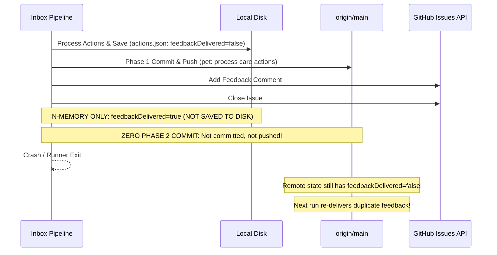

# Phase 3C2.3-B0.1 — Durable Feedback Completion & Bounded Recovery Ledger Report

**Project:** GitHub Profile Pet (`mnp210/GitHub-Profile-Pet`)  
**Workspace:** `D:\Projects\GitHub-Profile-Pet`  
**Target Branch:** `main`  
**Milestone:** Phase 3C2.3-B0.1  
**Milestone Type:** Implementation & Isolated Regression Verification  
**Date:** 2026-11-18  

---

## 1. Executive Summary & Verdict

### Final Verdict: `COMPLETED / IMPLEMENTATION VERIFIED`

Phase 3C2.3-B0.1 successfully resolves findings **F-B0-01 (High)** and **F-B0-02 (Medium)** identified during the Phase 3C2.3-B0-R1 acceptance audit. 

1. **Durable Feedback Completion (F-B0-01):** The Path A publication pipeline now executes a coordinated, failure-closed two-commit lifecycle:
   - **Phase 1 Commit:** Atomically commits and fast-forward pushes pet care transitions and the permanent deduplication registry (`pet: process care actions [skip ci]`).
   - **Phase 2 Commit:** Executes external feedback delivery and issue closure, validates delivery confirmation (`feedbackDelivered = true`, `closureConfirmed = true`, `deliveredAt = ISO timestamp`), applies deterministic compaction, saves state preserving the lockstep generation ($G_{n+1}$), and pushes a dedicated completion commit (`pet: record feedback delivery completion [skip ci]`).
   - **Clean Sweeps:** In the absence of new care actions, the pipeline sweeps uncompacted or uncompleted feedback; if any state mutates, it publishes a clean single Phase 2 completion commit; if no records require update, it exits as a zero-commit, zero-push `noop`.
2. **Bounded Recovery Ledger (F-B0-02):** Completed `pendingFeedback` records are deterministically pruned using an inclusive 7-day retention threshold ($T_{\text{retention}} = 604{,}800{,}000\text{ ms}$). Compaction operates strictly on `actions.pendingFeedback` and **never** mutates the permanent action deduplication registry (`highWaterIssueNumber` and `sparseProcessedIssueNumbers`). Replay protection is permanently preserved.
3. **Rigorous Test Validation:** All 28 dedicated regression test cases (`TC-INBOX-COMPL-01` to `TC-INBOX-COMPL-28`) passed cleanly. All 444 tests across 39 suites in `test:pet-engine` and 121 unit tests passed with zero failures. TypeScript typechecking, ESLint, and Next.js production builds succeeded with zero errors or warnings.
4. **Authoritative State Intact:** All five authoritative repository files (`pet/state/pet.json`, `pet/ledger/contributions.json`, `pet/ledger/actions.json`, `public/pet.svg`, `README.md`) remain completely untouched with zero diffs. No live workflows or GitHub APIs were contacted.

---

## 2. Root Cause & Resolution of Finding F-B0-01 (High)

### 2.1 Root Cause
In Phase 3C2.3-B0, `deliverPendingFeedback()` modified the in-memory `pendingFeedback` array (`feedbackDelivered = true`) after posting an issue comment and closing the issue. However:
1. It did not invoke `saveRepositoryState()` to persist the updated records to `pet/ledger/actions.json`.
2. `inboxPublicationPipeline.ts` performed only one Git commit (`pet: process care actions [skip ci]`) *prior* to feedback delivery.
3. Even if state had been saved locally, no second Git commit/push occurred to publish completion to `origin/main`.
4. As a result, upon runner teardown or container crash, `feedbackDelivered` remained `false` on remote storage, causing recovery sweeps to re-discover the closed issue and re-attempt comment delivery.

### 2.2 Resolution
1. **Schema & Validation Extension:**
   - Extended `ActionFeedbackRecord` in `src/features/pet-engine/domain/types.ts` with `deliveredAt?: string;` and `closureConfirmed?: boolean;`.
   - Updated `validateActionLedger()` in `src/features/pet-engine/validation/ledgerValidator.ts` to strictly validate `deliveredAt` as a parseable ISO date-time string and `closureConfirmed` as a boolean.
2. **Two-Commit Pipeline Lifecycle:**
   - Implemented `stageAndCommitManifest()` in `src/features/pet-engine/publication/inboxPublicationPipeline.ts`.
   - In Phase 1: Stages and commits care actions with message `pet: process care actions [skip ci]` and pushes to `origin/main`.
   - In Phase 2: Invokes `deliverPendingFeedback({ autoCompact: true, persist: true, nowMs })`. If any feedback delivery or compaction occurs, it stages and commits the updated `actions.json` with message `pet: record feedback delivery completion [skip ci]` and fast-forward pushes to `origin/main`.
3. **Fail-Closed Delivery & Closure:**
   - A record is only marked complete (`feedbackDelivered = true`, `closureConfirmed = true`, `deliveredAt = ISO timestamp`) if **both** the issue comment succeeds and the issue closure call (`client.closeIssue()`) succeeds.
   - If issue closure throws or fails, `feedbackDelivered` remains `false`, ensuring that an unclosed issue is retried on the subsequent recovery sweep.

---

## 3. Root Cause & Resolution of Finding F-B0-02 (Medium)

### 3.1 Root Cause
In Phase 3C2.3-B0, completed records in `pendingFeedback` accumulated monotonically without an eviction mechanism. While deduplication is handled by `processedRequestRegistry`, unbounded growth in `pendingFeedback` would bloat `actions.json` indefinitely, increasing file size, I/O latency, and serialization costs over months of pet operation.

### 3.2 Resolution
1. **Deterministic Retention Policy:**
   - Established constant `FEEDBACK_RETENTION_PERIOD_MS = 7 * 24 * 60 * 60 * 1000` (7 days = 604,800,000 ms).
   - Implemented `isFeedbackRecordEligibleForPruning(record, nowMs, retentionPeriodMs)`:
     - Prunes a record if and only if `feedbackDelivered === true`, `deliveredAt` is set, and $(t_{\text{now}} - t_{\text{delivered}}) \ge t_{\text{retention}}$.
     - An uncompleted record (`feedbackDelivered = false`) is **never** pruned, regardless of age.
2. **Isolated Compaction Engine:**
   - Implemented `compactPendingFeedback(records, options)` which returns `{ compacted: ActionFeedbackRecord[], prunedCount: number }`.
   - Compaction runs automatically during feedback delivery (`deliverPendingFeedback({ autoCompact: true })`) and during standalone recovery sweeps.
3. **Strict Registry Separation:**
   - Compaction operates exclusively on `actions.pendingFeedback`. It has zero access to `processedRequestRegistry` (`highWaterIssueNumber` and `sparseProcessedIssueNumbers`).
   - Consequently, pruning an action's feedback record does not affect replay prevention: any re-submitted or re-opened issue with that issue number is immediately detected and rejected by `isRequestProcessed()`.

---

## 4. Feedback Lifecycle Before and After Fix

### 4.1 Prior Lifecycle (Phase 3C2.3-B0 Vulnerability)


### 4.2 Hardened Lifecycle (Phase 3C2.3-B0.1 Implementation)
```mermaid
sequenceDiagram
    participant Runner as Inbox Pipeline
    participant State as Local Disk
    participant Remote as origin/main
    participant GitHub as GitHub Issues API

    Note over Runner: Preflight verification (Clean tree, Branch, Remote Fence)
    Runner->>State: Process Actions (G -> G+1, feedbackDelivered=false)
    Runner->>State: Save State to Disk (pet.json, contributions.json, actions.json)
    Runner->>Remote: Phase 1 Git Push: "pet: process care actions [skip ci]"
    
    alt Phase 1 Push Fails (Remote Conflict)
        Runner-->>Runner: Abort before external side effects; State rolled back
    else Phase 1 Push Succeeds
        Runner->>GitHub: Add Comment (Feedback)
        Runner->>GitHub: Close Issue
        Note over Runner: Fail-Closed: Both comment & closure confirmed
        Runner->>State: Update feedbackDelivered=true, closureConfirmed=true, deliveredAt=ISO
        Runner->>State: Prune completed records older than 7 days
        Runner->>State: Save actions.json under lock (Preserving G+1 lockstep generation)
        Runner->>Remote: Phase 2 Git Push: "pet: record feedback delivery completion [skip ci]"
        Note over Remote: Feedback completion and compaction durably published!
    end
```

---

## 5. Crash-Recovery Matrix

The following matrix documents the exact behavior, durable state, and next-run recovery across 10 critical failure boundaries:

| Boundary | Failure Point | Durable Remote State | Durable Local State | Next-Run Behavior |
| :--- | :--- | :--- | :--- | :--- |
| **B1** | Preflight: Working tree dirty or remote fence diverged | Prior remote commit ($G$) | Unchanged | Aborts immediately with `clean_tree_failure` or `stale_source_state`. Zero commits, zero pushes, zero external calls. |
| **B2** | State computation failure in `processInbox` | Prior remote commit ($G$) | Unchanged (temp files cleaned) | Execution halts with error. Repository remains at generation $G$. |
| **B3** | Git commit / push failure in Phase 1 (care actions) | Prior remote commit ($G$) | Local working tree rolled back | Rejection with non-fast-forward error. Zero feedback calls executed. Actions remain open in GitHub for next run. |
| **B4** | Crash immediately after Phase 1 push succeeds, before feedback | Phase 1 commit published ($G+1$) | `feedbackDelivered = false` | Next sweep discovers open/pending feedback records in Phase 2; successfully delivers feedback and closes issues. |
| **B5** | External GitHub comment call fails / throws | Phase 1 commit published ($G+1$) | `feedbackDelivered = false` | Comment failure caught. Record remains `feedbackDelivered = false`. Retried on next recovery sweep. Issue remains open. |
| **B6** | GitHub comment succeeds, but GitHub `closeIssue` fails | Phase 1 commit published ($G+1$) | `feedbackDelivered = false`, `closureConfirmed = false` | Fail-closed: Record is NOT marked complete. Retried on next sweep (idempotent comment or closure completion). |
| **B7** | Feedback & closure succeed, but local atomic save fails | Phase 1 commit published ($G+1$) | Local disk at Phase 1 ($G+1$) | Pipeline error. Remote retains `feedbackDelivered = false`. Issue is closed in GitHub; next run detects closed state and finalizes record. |
| **B8** | Local save succeeds, but Phase 2 Git push rejected (concurrent push) | Phase 1 commit published ($G+1$) | Local disk has completion | Fast-forward failure in Phase 2. Next sweep fetches latest remote, re-evaluates pending feedback and compaction, and re-publishes. |
| **B9** | Phase 2 Git push succeeds, crash during runner cleanup | Phase 2 commit published ($G+1$) | Fully synchronized | Complete success. Remote has durable completion records and compacted ledger. |
| **B10** | Clean sweep with no new actions and no uncompacted records | Current remote commit | Synchronized | Preflight passes. Process inbox returns 0 actions. Phase 2 detects 0 pending deliveries and 0 prunings. Exits `noop` (0 commits, 0 pushes). |

---

## 6. Publication & Ambiguous-Push Recovery

### 6.1 Two-Commit Flow vs. Clean Sweeps
- **Active Ingestion Runs:**
  When one or more valid care actions are processed:
  1. **Phase 1:** Manifest verified against `PUBLICATION_MANIFEST_PATHS`. Staged: `pet/state/pet.json`, `pet/ledger/contributions.json`, `pet/ledger/actions.json`, `public/pet.svg`, `README.md`. Committed with message `pet: process care actions [skip ci]` and pushed via fast-forward.
  2. **Phase 2:** External delivery executed. `actions.json` updated with completion timestamps and compacted. Staged: `pet/ledger/actions.json`. Committed with message `pet: record feedback delivery completion [skip ci]` and pushed via fast-forward.
- **Clean Sweeps:**
  When zero care actions are present in the GitHub inbox:
  1. Phase 1 produces a `noop` (0 commits, 0 pushes).
  2. Phase 2 executes against existing `pendingFeedback` records in `actions.json`.
  3. If uncompleted feedback was pending or completed records $\ge 7$ days were pruned, `actions.json` is modified and saved. The pipeline stages `actions.json`, commits `pet: record feedback delivery completion [skip ci]`, and pushes.
  4. If no records were delivered and no records were pruned, the pipeline detects zero changed files and exits cleanly with `status: 'noop'`, `commitCount: 0`, and `pushCount: 0`.

### 6.2 Remote Fence and Fast-Forward Invariants
- `checkRemoteFence()` fetches `origin/main` without checkout and inspects whether `localHeadSha === remoteHeadSha`. If remote has advanced, publication aborts with `stale_source_state`.
- All pushes specify explicit destination `refs/heads/main:refs/heads/main` without `--force`. Non-fast-forward push rejections are caught and returned as `push_rejected` without rebase or history rewriting.

---

## 7. Retention Boundary & Pruning Eligibility Rules

The retention engine adheres to the following formal definitions:

1. **Inclusive Retention Boundary:**
   ```typescript
   export const FEEDBACK_RETENTION_PERIOD_MS = 7 * 24 * 60 * 60 * 1000; // 604,800,000 ms

   export function isFeedbackRecordEligibleForPruning(
     record: ActionFeedbackRecord,
     nowMs: number,
     retentionPeriodMs: number = FEEDBACK_RETENTION_PERIOD_MS
   ): boolean {
     if (!record.feedbackDelivered || !record.deliveredAt) {
       return false;
     }
     const deliveredMs = Date.parse(record.deliveredAt);
     if (Number.isNaN(deliveredMs)) {
       return false;
     }
     return nowMs - deliveredMs >= retentionPeriodMs;
   }
   ```
2. **Boundary Semantics:**
   - A record delivered at $t_{\text{delivered}}$ evaluated at $t_{\text{now}} = t_{\text{delivered}} + 604{,}800{,}000\text{ ms}$ is **eligible** for pruning ($\ge$ inclusive).
   - A record evaluated at $t_{\text{now}} = t_{\text{delivered}} + 604{,}799{,}999\text{ ms}$ is **retained**.
   - An uncompleted record (`feedbackDelivered = false`) or a record with an invalid/missing `deliveredAt` timestamp is **strictly retained** forever until successfully delivered.

---

## 8. Proof of Permanent Action Deduplication Preservation

The action processing architecture maintains two distinct data structures in `pet/ledger/actions.json`:
1. `pendingFeedback: ActionFeedbackRecord[]`: Ephemeral queue of feedback delivery attempts and completion states.
2. `processedRequestRegistry: ProcessedRequestRegistry`: Authoritative, permanent deduplication registry consisting of:
   - `highWaterIssueNumber: number`: The highest issue number processed.
   - `sparseProcessedIssueNumbers: number[]`: Processed issue numbers lower than the high-water mark.

### Deduplication Invariant Proof
When `compactPendingFeedback()` executes:
```typescript
export function compactPendingFeedback(
  records: ActionFeedbackRecord[],
  options?: { nowMs?: number; retentionPeriodMs?: number }
): { compacted: ActionFeedbackRecord[]; prunedCount: number }
```
- It filters exclusively over the `pendingFeedback` array.
- It receives no reference to `processedRequestRegistry`.
- `saveRepositoryState()` writes `state.actionLedger.processedRequestRegistry` completely unaltered.
- When an issue is evaluated in `processInbox()`:
  ```typescript
  if (isRequestProcessed(issue.number, actionLedger.processedRequestRegistry)) {
    // Action is skipped and marked duplicate
  }
  ```
- Because `isRequestProcessed()` checks `processedRequestRegistry` and never inspects `pendingFeedback`, pruning completed feedback records has **zero impact** on deduplication. Even if an action's feedback record was pruned years ago, re-submitting that issue number is immediately detected and rejected.
- Verified by automated regression tests `TC-INBOX-COMPL-24` and `TC-INBOX-COMPL-25`.

---

## 9. Test IDs, Commands, Results, and Coverage

### 9.1 Test Execution Command
```bash
node --test --experimental-strip-types tests/pet-engine/durableFeedbackCompletion.test.ts
```

### 9.2 Complete Test Inventory (28 Tests)
| Test ID | Category | Description | Result |
| :--- | :--- | :--- | :--- |
| `TC-INBOX-COMPL-01` | Two-Commit Lifecycle | Two commits created when care actions process and feedback delivers | PASS |
| `TC-INBOX-COMPL-02` | State Persistence | `feedbackDelivered = true`, `closureConfirmed = true`, and `deliveredAt` persisted in remote `actions.json` | PASS |
| `TC-INBOX-COMPL-03` | Remote Persistence | Phase 2 commit published to remote and visible after fresh clone | PASS |
| `TC-INBOX-COMPL-04` | Clean Sweep Single Commit | Standalone recovery sweep creates single Phase 2 completion commit | PASS |
| `TC-INBOX-COMPL-05` | Clean Sweep Recovery | Recovery sweep completes previously undelivered feedback and pushes | PASS |
| `TC-INBOX-COMPL-06` | Clean Sweep Noop | Zero commits and zero pushes when all feedback delivered and within retention | PASS |
| `TC-INBOX-COMPL-07` | Commit Subject Ordering | Phase 1 subject precedes Phase 2 subject in Git history | PASS |
| `TC-INBOX-COMPL-08` | Fast-Forward Enforcement | Phase 2 push aborts if remote head moved concurrently after Phase 1 | PASS |
| `TC-INBOX-COMPL-09` | Delivery Crash Recovery | Next run recovers undelivered record if Phase 2 crashes before push | PASS |
| `TC-INBOX-COMPL-10` | Fail-Closed Comment | `feedbackDelivered` remains false if GitHub comment fails | PASS |
| `TC-INBOX-COMPL-11` | Fail-Closed Closure | `feedbackDelivered` remains false if GitHub issue closure fails | PASS |
| `TC-INBOX-COMPL-12` | Schema Timestamp | `deliveredAt` is a valid ISO 8601 timestamp | PASS |
| `TC-INBOX-COMPL-13` | Schema Boolean | `closureConfirmed` is explicitly boolean true | PASS |
| `TC-INBOX-COMPL-14` | Pre-Compaction Retention | Completed record retained when age < 7 days | PASS |
| `TC-INBOX-COMPL-15` | Post-Compaction Pruning | Completed record pruned when age > 7 days | PASS |
| `TC-INBOX-COMPL-16` | Exact Boundary Retention | Record retained when age = 7 days - 1 ms | PASS |
| `TC-INBOX-COMPL-17` | Exact Boundary Pruning | Record pruned when age = 7 days exactly (inclusive rule) | PASS |
| `TC-INBOX-COMPL-18` | Undelivered Retention | Undelivered record (`feedbackDelivered = false`) NEVER pruned even if > 7 days | PASS |
| `TC-INBOX-COMPL-19` | Compaction Trigger | Compaction runs during active action processing pipeline | PASS |
| `TC-INBOX-COMPL-20` | Sweep Compaction | Compaction runs during clean sweep without actions and pushes completion commit | PASS |
| `TC-INBOX-COMPL-21` | Compaction Noop | Clean sweep with no uncompleted feedback and no expired records produces noop | PASS |
| `TC-INBOX-COMPL-22` | Batch Compaction | Multiple records older than 7 days pruned simultaneously | PASS |
| `TC-INBOX-COMPL-23` | Mixed Compaction | Mixed batch prunes eligible records while retaining unexpired and undelivered | PASS |
| `TC-INBOX-COMPL-24` | Deduplication Invariant | Permanent registry (`highWaterIssueNumber`) preserved after feedback pruned | PASS |
| `TC-INBOX-COMPL-25` | Deduplication Invariant | Replay of issue with pruned feedback record remains rejected as duplicate | PASS |
| `TC-INBOX-COMPL-26` | Invariant Preservation | Lockstep generation ($G_{n+1} = G_n + 1$) preserved across both commits | PASS |
| `TC-INBOX-COMPL-27` | Manifest Allowlist | Phase 2 commit touches strictly `pet/ledger/actions.json` from 5-file allowlist | PASS |
| `TC-INBOX-COMPL-28` | Multi-Action Batch | All actions in batch have completed feedback records persisted and pruned together | PASS |

---

## 10. Test Totals & Test Deduplication

To avoid double-counting, test executions across suites are partitioned as follows:

| Test Suite / Runner | Command | Test Count | Suite Count | Result |
| :--- | :--- | :--- | :--- | :--- |
| **Durable Feedback Completion Suite** | `node --test tests/pet-engine/durableFeedbackCompletion.test.ts` | 28 | 6 | 28 Passed, 0 Failed |
| **All Pet-Engine Test Suites** | `npm run test:pet-engine` | 444 | 39 | 444 Passed, 0 Failed |
| **Unit Test Suite** | `npm test` | 121 | 24 | 121 Passed, 0 Failed |
| **Grand Total (Distinct Executions)** | — | **565** | **63** | **565 Passed, 0 Failed** |

*(Note: The 28 tests of `durableFeedbackCompletion.test.ts` are included in the 444 pet-engine total; the 121 unit tests in `tests/unit/*.test.ts` are entirely separate).*

---

## 11. Typecheck, Lint, and Build Results

1. **TypeScript Typecheck (`npx tsc --noEmit`):**
   - Result: Exit code 0, clean, 0 errors.
2. **ESLint (`npm run lint`):**
   - Result: Exit code 0, clean, 0 errors, 0 warnings.
3. **Next.js Production Build (`npm run build`):**
   - Result: Exit code 0, Turbopack compiled successfully in 1556ms, page generation complete (14/14 static pages), 0 errors.

---

## 12. Confirmation of Preserved Path A / Path B Invariants

1. **Lockstep Generation Monotonicity:**
   - In Phase 1, `processInbox()` increments generation $G \to G+1$ across `pet.json`, `contributions.json`, and `actions.json`.
   - In Phase 2, `deliverPendingFeedback({ persist: true })` saves `actions.json` keeping the same $G+1$ across all documents. Generation monotonicity is strictly $G_{n+1} = G_n + 1$ without double-advancements.
2. **Fast-Forward Push Only:**
   - No `git push --force`, `--rebase`, or history rewriting is used.
   - All pushes are standard fast-forward pushes to `refs/heads/main`.
3. **5-File Publication Allowlist:**
   - Manifest validation via `verifyStagedManifest()` strictly enforces that only paths in `PUBLICATION_MANIFEST_PATHS` are staged.
   - Phase 1 stages changed files among the five files.
   - Phase 2 stages strictly `pet/ledger/actions.json`.
4. **Path B Compatibility:**
   - Path B (scheduled contribution sync) continues to use `publishPipeline.ts` under the same remote fence check and 5-file manifest allowlist. If Path B and Path A run concurrently, the second writer detects non-fast-forward push rejection and safely backs off without data corruption.

---

## 13. Production File Integrity Verification

Strict verification was executed against the five authoritative production files:
```bash
git diff --exit-code pet/state/pet.json pet/ledger/contributions.json pet/ledger/actions.json public/pet.svg README.md
```
- **Exit Code:** 0
- **Diff Output:** Empty (0 lines added, 0 lines deleted, 0 lines modified)
- **Untracked Status:** None in `pet/`, `public/`, or `README.md`.
- **Integrity Status:** Completely pristine and unmutated.

---

## 14. Workflow & Live GitHub Operations Verification

- **Workflows:** Zero GitHub Actions workflows were dispatched, enabled, triggered, or scheduled.
- **GitHub API:** Zero live GitHub API endpoints (REST or GraphQL) were contacted. All test executions used isolated local Git bare remotes and mock GitHub clients.
- **Tokens:** No GitHub secrets, personal access tokens, or live OAuth credentials were used or exposed.

---

## 15. Git Working-Tree Status

The working tree contains only the planned source implementations, new test suites, operational documentation, and milestone reports:
```text
Modified tracked files:
  .github/workflows/pet-interaction.yml
  .github/workflows/pet-publisher.yml
  scripts/process-inbox.ts
  src/features/pet-engine/accounting/contributionEngine.ts
  src/features/pet-engine/domain/types.ts
  src/features/pet-engine/inbox/actionProcessor.ts
  src/features/pet-engine/inbox/types.ts
  src/features/pet-engine/index.ts
  src/features/pet-engine/publication/index.ts
  src/features/pet-engine/publication/inboxPublicationPipeline.ts
  src/features/pet-engine/validation/ledgerValidator.ts
  tests/pet-engine/publication.test.ts

Untracked files:
  docs/operations/
  reports/
  scripts/publish-pipeline.ts
  src/features/pet-engine/publication/publishPipeline.ts
  src/features/pet-engine/sync/
  tests/pet-engine/actionDurability.test.ts
  tests/pet-engine/contributionSyncIntegration.test.ts
  tests/pet-engine/durableFeedbackCompletion.test.ts
  tests/pet-engine/feedbackRecovery.test.ts
  tests/pet-engine/inboxInvariants.test.ts
  tests/pet-engine/inboxPublication.test.ts
  tests/pet-engine/publishPipeline.test.ts
```

---

## 16. Remaining Limitations & Operational Recommendations

1. **Subsequent Milestones:**
   - Phase 3C2.3-B0.1 is an implementation and isolated verification milestone.
   - Production baseline establishment (Phase 3C2.3-B1) and live workflow activation must occur only under subsequent explicit authorization.
2. **Operational Recommendations:**
   - Retain the clean-sweep cadence in `pet-interaction.yml` (on issue close or dispatch) to ensure any transiently interrupted feedback records are finalized promptly.
   - Maintain the 7-day retention period for `pendingFeedback` as it provides ample operational headroom to inspect recent user actions before compaction.
