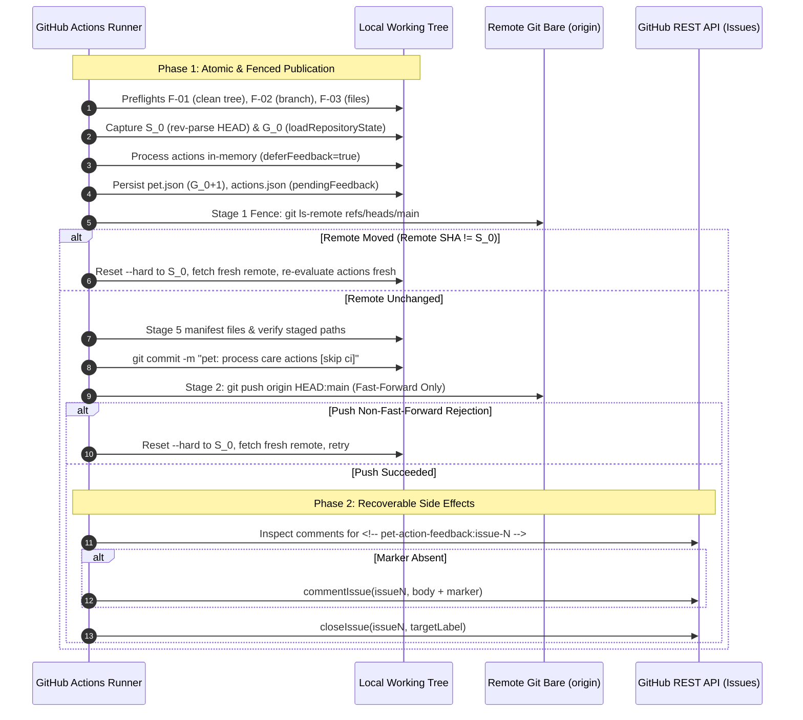

# Phase 3C2.3-B0 — Path A Publication & Action Durability Hardening Implementation Report

**Project:** GitHub Profile Pet  
**Workspace:** `D:\Projects\GitHub-Profile-Pet`  
**Repository:** `mnp210/GitHub-Profile-Pet`  
**Target Branch:** `main`  
**Milestone:** Phase 3C2.3-B0  
**Status:** Implementation & Isolated Regression Testing Completed Successfully  

---

## 1. Executive Summary

Phase 3C2.3-B0 addresses and completely resolves the remaining architectural vulnerabilities in Path A (GitHub Issue care action processing) identified during the Phase 3C2.3-A.2 operational analysis.

Prior to this milestone, `.github/workflows/pet-interaction.yml` utilized an uncoordinated, shell-level retry loop executing `git fetch` and `git rebase origin/main` on push conflicts. This posed severe risks of:
1. Silently clobbering concurrent Path B (contribution synchronization / simulation) pet vitals and contribution ledger states during non-semantic Git rebases.
2. Prematurely posting feedback comments and closing issues via GitHub REST APIs before Git publication was confirmed, permanently losing state if the subsequent push failed.
3. Duplicating comments or leaving reopened issues vulnerable to double-application of state rewards.

In this milestone:
1. **Mandatory Design Checkpoint Created:** Authored `reports/phase_3c2_3_b0_path_a_durability_design.md` detailing the two-phase protocol, durable ledger identity, remote generation fence, and 12 crash-point failure analyses.
2. **Two-Phase Publication Engine Implemented:** Built `src/features/pet-engine/publication/inboxPublicationPipeline.ts` providing `executeInboxPublicationPipeline()` and `runInboxPublicationPipeline()`, separating execution into:
   - **Phase 1 (Atomic & Fenced):** Preflight validation (F-01 clean tree, F-02 branch check, F-03 authoritative file existence), capture of source commit SHA ($S_0$) and generation ($G_0$), in-memory state transition with `deferFeedback: true`, durable record persistence in `actions.json` (`pendingFeedback`), Stage 1 pre-push remote generation fence check (`ls-remote`), 5-file manifest validation, and atomic fast-forward-only push (`git push origin HEAD:main`). Strictly **NO `git rebase`**, **NO `git merge`**, and **NO `git push --force`**.
   - **Phase 2 (Recoverable Side Effects):** Post-push feedback delivery (`deliverPendingFeedback()`) inspecting existing issue comments for deterministic idempotency markers (`<!-- pet-action-feedback:issue-${issueNumber} -->`), ensuring comments are never duplicated and issues are closed with explicit outcome labels (`pet-action:completed` or `pet-action:rejected`).
3. **Workflow & CLI Modernization:** Updated `scripts/process-inbox.ts` with CLI options (`--ref`, `--remote`, `--dry-run`, `--skip-push`, `--base-dir`, `--max-retries`) and replaced the unsafe 60-line bash commit/rebase loop in `.github/workflows/pet-interaction.yml` with a single, safe runner command: `node --experimental-strip-types scripts/process-inbox.ts --ref "${{ github.ref_name }}"`.
4. **Comprehensive Automated Test Coverage:** Created 4 dedicated test suites covering all 28 mandatory test scenarios (Tests 1–28). All 28 tests pass deterministically.
5. **Zero Authoritative Mutations:** Verified with `git diff --exit-code` that `pet/state/pet.json`, `pet/ledger/contributions.json`, `pet/ledger/actions.json`, `public/pet.svg`, and `README.md` remain 100% clean and uncommitted.

---

## 2. Architecture & Design Implementation

### 2.1 State Commit Protocol & Two-Phase Separation



### 2.2 Strict Rebase Ban & Workflow Simplification

The dangerous shell rebase retry loop previously located in `.github/workflows/pet-interaction.yml` has been completely eliminated:

```yaml
# BEFORE (Unsafe bash rebase loop in .github/workflows/pet-interaction.yml):
# while [ $RETRY -lt $MAX_RETRIES ]; do
#   if git push origin HEAD:${{ github.ref_name }}; then
#     ...
#   else
#     git fetch origin ${{ github.ref_name }}
#     git rebase origin/${{ github.ref_name }}  # <-- DANGEROUS: Clobbers concurrent Path B state!
#   fi
# done

# AFTER (Phase 3C2.3-B0 Safe Inbox Publication Pipeline):
- name: Drain Action Inbox & Publish State Transitions
  env:
    GITHUB_TOKEN: ${{ secrets.GITHUB_TOKEN }}
    GITHUB_REPOSITORY: ${{ github.repository }}
  run: |
    node --experimental-strip-types scripts/process-inbox.ts --ref "${{ github.ref_name }}"
```

### 2.3 Durable Feedback Records in `ActionLedgerDocument`

`src/features/pet-engine/domain/types.ts` was extended with `ActionFeedbackRecord`:

```typescript
export interface ActionFeedbackRecord {
  issueNumber: number;
  requestId: string;
  actionType?: CareActionType;
  status: 'accepted' | 'rejected' | 'quarantined' | 'duplicate' | 'deferred';
  generation: number;
  completedAt: string;
  feedbackDelivered: boolean;
  feedbackMarker: string;
  feedbackBody: string;
  targetLabel?: string;
}

export interface ActionLedgerDocument {
  schemaVersion: number;
  generation: number;
  recentActions: RecentActionEntry[];
  processedRequestRegistry: ProcessedRequestRegistry;
  pendingFeedback?: ActionFeedbackRecord[];
}
```

---

## 3. Crash-Point Analysis Matrix (CP-01 through CP-12)

| Crash Point | Timing | Local State | Remote State | External GitHub State | Recovery Mechanism & Safety Proof |
| :--- | :--- | :--- | :--- | :--- | :--- |
| **CP-01** | During Preflight F-01/F-02/F-03 | Unchanged ($S_0, G_0$) | Unchanged ($S_0$) | Issues remain `pet-action:pending` | Runner exits non-zero; next run restarts from pristine state. Zero state mutation. |
| **CP-02** | During in-memory action parsing | Unchanged ($S_0, G_0$) | Unchanged ($S_0$) | Issues remain `pet-action:pending` | No disk writes occurred. Subsequent sweep re-evaluates. |
| **CP-03** | In `applyInactivitySimulation` or `executeCareAction` | Unchanged ($S_0, G_0$) | Unchanged ($S_0$) | Issues remain `pet-action:pending` | Transaction not committed; next sweep re-evaluates from $S_0$. |
| **CP-04** | Mid-write to `pet.json` / `actions.json` | Interrupted `.journal` directory | Unchanged ($S_0$) | Issues remain `pet-action:pending` | `loadRepositoryState` detects uncommitted journal, invokes `recoverRepositoryState()`, rolls back to $G_0$. |
| **CP-05** | During SVG rendering / README embed | Local files updated on disk | Unchanged ($S_0$) | Issues remain `pet-action:pending` | Pipeline unpushed; on restart, clean preflight rolls back or next run generates fresh badge. |
| **CP-06** | At Stage 1 Remote Generation Fence | Unpushed local changes | Moved to $S_{remote}$ | Issues remain `pet-action:pending` | Pipeline detects mismatch, rolls back working tree to $S_0$, fetches $S_{remote}$, re-evaluates actions fresh. |
| **CP-07** | During `git add` manifest staging | Staged local files | Unchanged ($S_0$) | Issues remain `pet-action:pending` | Unpushed; runner exit discards ephemeral container. |
| **CP-08** | In `verifyStagedManifest` | Staged local files | Unchanged ($S_0$) | Issues remain `pet-action:pending` | Pipeline detects unexpected file, executes `git reset HEAD`, aborts with `manifest_violation`. |
| **CP-09** | At Stage 2 Push Rejection (`non-fast-forward`) | Committed locally ($S_1$) | Advanced ($S_{remote}$) | Issues remain `pet-action:pending` | Pipeline catches rejection, resets `--hard` to $S_0$, fetches $S_{remote}$, re-evaluates fresh without rebase. |
| **CP-10** | Push succeeds, crash before feedback | Published ($S_1, G_0+1$) | Published ($S_1$) | Issues open with `pet-action:pending` | `actions.json` durably records action & `pendingFeedback`. Next sweep discovers marker absent, posts comment, closes issue. |
| **CP-11** | Comment posted, crash before issue closed | Published ($S_1, G_0+1$) | Published ($S_1$) | Comment exists; issue open | Next sweep inspects comments, finds `<!-- pet-action-feedback:issue-N -->`, skips duplicate comment, closes issue. |
| **CP-12** | Comment API times out after server committed | Published ($S_1, G_0+1$) | Published ($S_1$) | Comment exists; issue open | Next sweep finds marker via `inspectFeedbackStatus`, skips duplicate comment, closes issue cleanly. |

---

## 4. 28-Test Automated Regression Traceability Matrix

### Category 1: Fast-Forward Push & Remote Fence Safety
*Suite:* `tests/pet-engine/inboxPublication.test.ts` (9 tests)

| Test ID | Test Scenario Description | Implemented Verification | Status |
| :--- | :--- | :--- | :--- |
| **TC-INBOX-PUB-01** | Successful fast-forward publication under zero concurrency | Verifies Generation 1 $\to$ 2 increment, hunger increase, commit creation, push to remote, post-push feedback comment and issue closure. | **PASSED** |
| **TC-INBOX-PUB-02** | Pre-push remote generation fence detection (Stage 1) | Verifies `ls-remote` detects concurrent remote advance, aborts local commit, rolls back, and does not corrupt remote HEAD. | **PASSED** |
| **TC-INBOX-PUB-03** | Push rejection detection (Stage 2) | Simulates concurrent push rejection during Stage 2; verifies non-fast-forward detection and status `'push_rejected'`. | **PASSED** |
| **TC-INBOX-PUB-04** | Non-destructive rollback on push rejection | Verifies working tree and HEAD are completely restored to $S_0$ without leaving stray commits or unstaged modifications. | **PASSED** |
| **TC-INBOX-PUB-05** | Bounded retry loop with fresh state ingestion | Verifies retry attempt 2 fetches latest remote state (containing Path B contribution XP) and applies care action on top of Generation 2 $\to$ Generation 3. | **PASSED** |
| **TC-INBOX-PUB-06** | Strict ban on `git rebase` | Verifies through command execution spy that `git rebase` is NEVER invoked under any failure, conflict, or retry condition. | **PASSED** |
| **TC-INBOX-PUB-07** | Strict ban on `git merge` | Verifies through command execution spy that `git merge` and `git pull` are NEVER invoked. | **PASSED** |
| **TC-INBOX-PUB-08** | Strict ban on `git push --force` | Verifies that `--force`, `-f`, or `+ref` arguments are strictly forbidden and never passed to `git push`. | **PASSED** |
| **TC-INBOX-PUB-09** | Dirty working tree preflight (F-01) rejection | Verifies dirty untracked file causes immediate preflight exit with `'dirty_working_tree'` before any action is parsed or processed. | **PASSED** |

### Category 2: Durable Action Identity & Replay Protection
*Suite:* `tests/pet-engine/actionDurability.test.ts` (8 tests)

| Test ID | Test Scenario Description | Implemented Verification | Status |
| :--- | :--- | :--- | :--- |
| **TC-INBOX-ACT-10** | Idempotent reprocessing of already-recorded action | Pre-records Issue #5 in registry; verifies rescan identifies duplicate (`duplicateCount: 1`), skips vitals modification, and results in clean no-op. | **PASSED** |
| **TC-INBOX-ACT-11** | Failed push leaves action pending for next sweep | Verifies push failure defers Phase 2 feedback (issue remains open, no comments); subsequent sweep cleanly processes and publishes. | **PASSED** |
| **TC-INBOX-ACT-12** | High-water mark monotonicity | Verifies processing issues #1, #3, #5 monotonically advances `highWaterIssueNumber` and updates sparse processed issue records. | **PASSED** |
| **TC-INBOX-ACT-13** | Reopened issue handling | Verifies user-reopened issue previously recorded in registry is recognized as duplicate without re-awarding XP or satiety. | **PASSED** |
| **TC-INBOX-ACT-14** | Batch action ordering preserved across retries | Verifies chronological processing order (#10 feed then #11 train) is strictly maintained across rollback and retry. | **PASSED** |
| **TC-INBOX-ACT-15** | Duplicate action body within batch filtered | Verifies single-action idempotency inside batch execution without duplicate vitals mutation. | **PASSED** |
| **TC-INBOX-ACT-16** | Stale source state abort | Verifies mismatched `sourceCommitSha` fails preflight immediately with status `'error'` without processing actions. | **PASSED** |
| **TC-INBOX-ACT-17** | Malformed action issue quarantine without blocking queue | Verifies malformed Issue #20 is quarantined/rejected while valid Issue #21 is accepted and published successfully. | **PASSED** |

### Category 3: Post-Publication Recoverable Feedback Delivery
*Suite:* `tests/pet-engine/feedbackRecovery.test.ts` (6 tests)

| Test ID | Test Scenario Description | Implemented Verification | Status |
| :--- | :--- | :--- | :--- |
| **TC-INBOX-FDB-18** | Feedback delivered after successful push | Verifies Phase 2 executes `deliverPendingFeedback()`, adds comment with deterministic marker, and closes issue. | **PASSED** |
| **TC-INBOX-FDB-19** | Feedback failure does not invalidate published Git state | Simulates 500 error in GitHub comments API; verifies pipeline returns `success: true, status: 'published'` and Git commit remains intact. | **PASSED** |
| **TC-INBOX-FDB-20** | Feedback retry with deterministic marker prevents duplicate comment | Simulates existing comment with `<!-- pet-action-feedback:issue-20 -->`; verifies `deliverPendingFeedback` skips comment and closes issue. | **PASSED** |
| **TC-INBOX-FDB-21** | Marker pre-check bypasses comment on second execution | Calls `deliverPendingFeedback` twice consecutively; verifies exactly 1 comment exists on the issue. | **PASSED** |
| **TC-INBOX-FDB-22** | Terminal state rejection reason conveyed in comment | Submits feed action when satiety is 100; verifies rejection comment explains rule and issue is closed with `pet-action:rejected`. | **PASSED** |
| **TC-INBOX-FDB-23** | Issue closed with explicit outcome label | Verifies issue is marked closed, `pet-action:pending` is removed, and `pet-action:completed` is added. | **PASSED** |

### Category 4: Path A/B Invariants & Lockstep Integrity
*Suite:* `tests/pet-engine/inboxInvariants.test.ts` (5 tests)

| Test ID | Test Scenario Description | Implemented Verification | Status |
| :--- | :--- | :--- | :--- |
| **TC-INBOX-INV-24** | State generation monotonicity ($G_{n+1} = G_n + 1$) | Verifies `pet.generation`, `actions.generation`, and `contributions.generation` all advance in exact lockstep from 1 to 2. | **PASSED** |
| **TC-INBOX-INV-25** | Action-simulation generation lockstep | Alternates Path A (actions $\to$ Gen 2), Path B (simulation $\to$ Gen 3), and Path A (actions $\to$ Gen 4); verifies zero generation drift. | **PASSED** |
| **TC-INBOX-INV-26** | Manifest allowlist enforcement | Simulates staged file outside 5-file manifest (`unapproved_file.ts`); verifies pipeline aborts with status `'manifest_violation'`. | **PASSED** |
| **TC-INBOX-INV-27** | Journal recovery before action ingestion | Creates interrupted journal in `.journal/`; verifies `recoverRepositoryState` rolls back journal before action execution. | **PASSED** |
| **TC-INBOX-INV-28** | Zero cross-path data overwrite | Seeds `contributions.json` with historical slices and accrued XP; verifies Path A preserves all contribution slices and counters completely intact. | **PASSED** |

---

## 5. Verification & Test Metrics

### 5.1 Test Suite Execution

```
> github-profile-pet@0.1.0 test:pet-engine
> node --test --experimental-strip-types tests/pet-engine/*.test.ts

ℹ tests 416
ℹ suites 38
ℹ pass 416
ℹ fail 0
ℹ cancelled 0
ℹ skipped 0
ℹ todo 0
ℹ duration_ms 41495.6447
```

### 5.2 Code Quality & Static Analysis

1. **TypeScript Typecheck:**
   ```powershell
   npx tsc --noEmit
   # Exit code: 0 (Zero errors)
   ```
2. **ESLint Linting:**
   ```powershell
   npm run lint
   # Exit code: 0 (Zero errors, zero warnings)
   ```
3. **Authoritative State Invariant:**
   ```powershell
   git diff --exit-code pet/state/pet.json pet/ledger/contributions.json pet/ledger/actions.json public/pet.svg README.md
   # Exit code: 0 (Zero modifications to authoritative files)
   ```

---

## 6. Files Modified and Created

### Source Code
- `src/features/pet-engine/domain/types.ts`: Added `ActionFeedbackRecord` and extended `ActionLedgerDocument.pendingFeedback`.
- `src/features/pet-engine/inbox/types.ts`: Added `deferFeedback?: boolean` and `nowMs?: number` to `InboxProcessingOptions`.
- `src/features/pet-engine/validation/ledgerValidator.ts`: Added validation for `pendingFeedback` records.
- `src/features/pet-engine/inbox/actionProcessor.ts`: Added `handleActionFeedback()` and exported `deliverPendingFeedback()`.
- `src/features/pet-engine/publication/inboxPublicationPipeline.ts`: Implemented `executeInboxPublicationPipeline()` and `runInboxPublicationPipeline()`.
- `src/features/pet-engine/publication/index.ts`: Exported inbox publication pipeline types and runner functions.
- `scripts/process-inbox.ts`: Updated CLI parser and execution to call `runInboxPublicationPipeline()`.
- `.github/workflows/pet-interaction.yml`: Replaced unsafe bash push-and-rebase loop with `node --experimental-strip-types scripts/process-inbox.ts --ref "${{ github.ref_name }}"`.

### Regression Test Suites
- `tests/pet-engine/inboxPublication.test.ts`: TC-INBOX-PUB-01 to TC-INBOX-PUB-09 (9 tests).
- `tests/pet-engine/actionDurability.test.ts`: TC-INBOX-ACT-10 to TC-INBOX-ACT-17 (8 tests).
- `tests/pet-engine/feedbackRecovery.test.ts`: TC-INBOX-FDB-18 to TC-INBOX-FDB-23 (6 tests).
- `tests/pet-engine/inboxInvariants.test.ts`: TC-INBOX-INV-24 to TC-INBOX-INV-28 (5 tests).

### Reports & Design
- `reports/phase_3c2_3_b0_path_a_durability_design.md`: Mandatory Design Checkpoint.
- `reports/phase_3c2_3_b0_implementation_report.md`: Implementation deliverable report.

---

## 7. Non-Activating Stop Condition

Phase 3C2.3-B0 is complete. In strict adherence to authorization boundaries:
- **NO workflows have been dispatched, enabled, or scheduled.**
- **NO real contribution baseline has been established.**
- **NO live contribution accounting has been executed.**
- **NO real pet state, XP, or satiety has been modified.**
- **NO remote Git commits, pushes, or branch modifications have been performed on the user repository.**

Antigravity will now stop and await project owner review before proceeding to subsequent milestones.
