# Phase 3C2.3-B0 — Path A Publication & Action Durability Design

**Project:** GitHub Profile Pet (`mnp210/GitHub-Profile-Pet`)  
**Workspace:** `D:\Projects\GitHub-Profile-Pet`  
**Milestone:** Phase 3C2.3-B0 (Design Checkpoint)  
**Target Branch:** `main`  
**Status:** Approved Design Document  

---

## 1. Executive Summary & Objective

Phase 3C2.3-B0 eliminates the unresolved Path A publication and action-durability risks identified in Phase 3C2.3-A.2.

Currently, Path A (`pet-interaction.yml` calling `scripts/process-inbox.ts` followed by a workflow bash script) processes GitHub Issue actions, mutates pet state on disk, delivers feedback comments and closes Issues via GitHub's REST API during the processing loop, and subsequently attempts publication using a shell-based `git push` with an automatic `git rebase` conflict retry loop.

This architecture introduces four critical vulnerabilities:
1. **Premature External Side Effects:** Feedback comments are posted and Issues are closed on GitHub *before* the application state commit has been successfully published to Git.
2. **Blind Rebase Application-State Clobbering:** `git rebase` replays an outdated state commit over a newer Path B (contribution synchronization) commit, which can clobber generation counters or state fields without semantic validation.
3. **Duplicate Action Execution Risk:** If Git publication fails after an Issue was closed, the local commit is discarded, but remote `actions.json` does not record the action. If the issue closure API call failed or the issue is reopened, the action can be processed a second time, awarding duplicate XP, energy, or satiety.
4. **Lack of Generation and Source SHA Binding:** Unlike Path B (`publishPipeline.ts`), Path A does not bind processing to a source commit SHA or state generation, and lacks a Stage 1 remote fence check.

This design establishes a publication and action-durability protocol that makes action processing **atomic, durable, idempotent, recoverable, and 100% compatible with Path B's generation-aware, fast-forward-only publication model**.

---

## 2. Current Path A Execution & Failure Boundaries

### 2.1 Current Execution Sequence
```mermaid
sequenceDiagram
    autonumber
    actor User as User / Issue
    participant Wf as pet-interaction.yml
    participant CLI as scripts/process-inbox.ts
    participant Engine as actionProcessor.ts
    participant Disk as Local State Repository
    participant API as GitHub REST API (Issues)
    participant Git as Remote Git (origin/main)

    User->>Wf: Issue opened / Scheduled sweep (47 * * * *)
    Wf->>Wf: actions/checkout@v4 (HEAD: S_0, Gen: G_0)
    Wf->>CLI: node scripts/process-inbox.ts
    CLI->>Engine: processInbox()
    Engine->>Disk: acquireLock() & loadRepositoryState()
    Engine->>API: listPendingIssues()
    loop For each pending issue
        Engine->>Engine: executeCareAction() (in-memory)
        Engine->>Disk: saveRepositoryState() (Gen: G_0 + 1)
        Engine->>API: deliverFeedbackWithConfirmation() (Comment posted!)
        Engine->>API: closeIssue() (Issue closed!)
    end
    Engine->>Disk: publishPetSvg() & releaseLock()
    CLI-->>Wf: process-inbox.ts exits 0
    Wf->>Wf: git diff --quiet pet/ public/pet.svg README.md
    Wf->>Wf: git add pet/ public/pet.svg README.md
    Wf->>Wf: git commit -m "pet: process care actions [skip ci]"
    loop Max 3 retries
        Wf->>Git: git push origin HEAD:main
        alt Push Succeeded
            Wf-->>User: Complete
        else Push Rejected (Remote moved by Path B)
            Wf->>Git: git fetch origin main
            Wf->>Wf: git rebase origin/main (BLIND REBASE!)
            alt Rebase Clean
                Note over Wf: Replays commit over Path B; may clobber Gen!
            else Rebase Conflict
                Wf->>Wf: git rebase --abort
                Wf-->>Wf: exit 1 (Failure!)
            end
        end
    end
```

### 2.2 Critical Failure Boundaries in Existing Model
| Boundary | Event | Consequence in Existing Code | Severity |
|---|---|---|---|
| **B-1** | Crash during REST API comment/closure | Issue remains open, feedback unconfirmed, state persisted locally but not yet published. | High |
| **B-2** | Push rejected, `git rebase` succeeds cleanly | Rebased commit overwrites Path B's generation $G_{\text{PathB}}$ with Path A's outdated generation, corrupting generation lockstep. | Critical |
| **B-3** | Push rejected, `git rebase` fails with conflict | `git rebase --abort` runs, runner exits 1. Local commit is destroyed. However, Issue was ALREADY commented on and closed on GitHub. Remote `main` has no record of the action! | Critical |
| **B-4** | Push fails after `closeIssue()` failed/timed out | Remote `main` has no record of issue. Issue remains open with `pet-action:pending`. Next run re-executes action and awards duplicate XP/satiety. | Critical |
| **B-5** | Unrelated local changes on runner | Shell script runs `git add` and could stage untracked files or fail on uncommitted changes. | Medium |

---

## 3. Durable Action Identity & Deduplication Mechanism

### 3.1 Stable Action Identity
Each action is uniquely anchored by:
1. **Issue Number:** `issueNumber: number` (strictly positive integer, unique per repository).
2. **Request ID:** `requestId: string` (`issue-${issueNumber}`).
3. **Action Type:** `actionType: CareActionType` (`feed` | `train` | `rest` | `pet`).
4. **Immutable Timestamp:** `eventTimestampMs: number` (`new Date(issue.created_at).getTime()`).
5. **Author Identity:** `authorId: number` and `authorLogin: string`.

### 3.2 Action Ledger Schema Extension: `ActionFeedbackRecord`
To ensure that action outcomes are recorded durably in Git *before* any external side effects occur, `ActionLedgerDocument` in `src/features/pet-engine/domain/types.ts` is extended with an optional `pendingFeedback` collection:

```typescript
export interface ActionFeedbackRecord {
  issueNumber: number;
  requestId: string;
  actionType?: CareActionType;
  status: ActionExecutionStatus; // 'accepted' | 'rejected' | 'quarantined' | 'duplicate'
  generation: number;            // generation in which state transition was committed
  completedAt: string;           // ISO 8601 timestamp
  feedbackDelivered: boolean;    // false until confirmed delivered on GitHub
  feedbackMarker: string;        // <!-- pet-action-feedback:issue-${issueNumber} -->
  feedbackBody: string;          // formatted markdown response comment
  targetLabel?: string;          // 'pet-action:completed' | 'pet-action:rejected' | etc.
}

export interface ActionLedgerDocument {
  schemaVersion: number;
  generation: number;
  recentActions: RecentActionEntry[];
  processedRequestRegistry: ProcessedRequestRegistry;
  pendingFeedback?: ActionFeedbackRecord[];
}
```

### 3.3 Deduplication Rules & Guarantees
1. **Double-Processing Immunity:**
   An action is recognized as processed if:
   $$\text{issueNumber} \le \text{highWaterIssueNumber} \quad \lor \quad \text{issueNumber} \in \text{sparseProcessedIssueNumbers}$$
   OR if an entry exists in `pendingFeedback` with matching `issueNumber`.
   Once either holds, the pet engine **never mutates pet vitals, never increments XP, and never advances level** for that issue number.
2. **Feedback Decoupling:**
   An issue that has been durably processed in state but whose feedback has `feedbackDelivered === false` is classified as **`action_completed_feedback_pending`**. It is queued strictly for feedback delivery/recovery without re-executing care transitions.
3. **Reopened Issue Protection:**
   If a user reopens a closed issue or re-attaches `pet-action:pending`, `isRequestProcessed()` evaluates to `true`. The engine routes it to duplicate handling, verifies existing bot feedback, and closes the issue with an explanatory note without mutating state.

---

## 4. Proposed State Commit & Publication Protocol

### 4.1 Separation into Distinct Phases
The revised Path A architecture strictly separates execution into two transactional phases:
- **Phase 1: Ingestion, State Transition & Git Publication (Atomic & Fenced)**
  - All disk mutations, generation increments, SVG renderings, manifest validations, and Git pushes happen here.
  - **Zero external GitHub REST API comments or closures occur in Phase 1.**
- **Phase 2: Post-Publication Feedback Delivery (Recoverable Side Effects)**
  - Only executes *after* the Git commit is confirmed published on remote `main`.
  - Delivers feedback comments and closes Issues with verified bot markers.
  - Failures in Phase 2 do not affect Git state and are recovered automatically in subsequent sweeps.

```mermaid
flowchart TD
    subgraph Phase1["Phase 1: State Ingestion & Publication (Atomic & Fenced)"]
        P1["1. Preflight Checks (F-01, F-02, F-03) & Capture S_0, G_0"] --> P2["2. Acquire Lock & Recover Journal"]
        P2 --> P3["3. Load Authoritative State & Scan Issues"]
        P3 --> P4["4. Evaluate Actions: Update Vitals, Registry & Record pendingFeedback"]
        P4 --> P5["5. Atomic Lockstep Persistence (saveRepositoryState to G_0 + 1)"]
        P5 --> P6["6. Render SVG Badge & Embed README Snippet"]
        P6 --> P7["7. Release Lock"]
        P7 --> P8{"8. Stage 1 Remote Fence Check (ls-remote === S_0?)"}
        P8 -- Remote Moved --> P8_FAIL["Reset to S_0, Discard Local State, Retry Fresh"]
        P8 -- Remote Matched --> P9["9. Stage Allowlist Manifest (5 Files Only) & Verify"]
        P9 --> P10["10. Commit: pet: process care actions [skip ci]"]
        P10 --> P11{"11. Fast-Forward Push (git push origin HEAD:main)"}
        P11 -- Push Rejected --> P11_FAIL["Reset to S_0, Discard Local Commit, Retry Fresh"]
        P11 -- Push Succeeded --> Phase2
    end

    subgraph Phase2["Phase 2: Post-Publication Feedback Delivery (Recoverable)"]
        F1["12. Query pendingFeedback (feedbackDelivered == false)"] --> F2{"13. Inspect Marker via REST API"}
        F2 -- Marker Present --> F4["Close Issue with Target Label"]
        F2 -- Marker Absent --> F3["Post Feedback Comment with Marker"]
        F3 --> F4
        F4 --> F5["Mark feedbackDelivered = true"]
        F5 --> F6["Complete"]
    end
```



### 4.2 Step-by-Step Publication Protocol
1. **Preflight Checks:**
   - **F-01:** `git status --porcelain --untracked-files=all` confirms 100% clean working tree.
   - **F-02:** `git branch --show-current` confirms attached branch matching destination (`main`).
   - **F-03:** `verifyRequiredAuthoritativeFiles()` validates all 4 authoritative files exist and are readable.
   - Capture source commit SHA ($S_0$) via `git rev-parse HEAD`.
   - Capture initial generation ($G_0$) from `pet/state/pet.json`.
2. **In-Memory Action Processing:**
   - Evaluates actions sequentially.
   - For accepted actions: applies inactivity simulation and care transitions, advances `processedRequestRegistry`, and constructs an `ActionFeedbackRecord` with `feedbackDelivered: false`.
   - For rejected/quarantined actions: records gap/processed in `processedRequestRegistry` and constructs rejection `ActionFeedbackRecord`.
3. **Atomic Persistence:**
   - If no actions were processed: exits cleanly as `noop` (0 commits, 0 pushes).
   - If actions were processed: advances generation $G_0 \rightarrow G_0 + 1$ simultaneously across `pet.json`, `contributions.json`, and `actions.json`.
   - Saves atomically using `saveRepositoryState()` with write-ahead journal.
   - Renders visual badge via `publishPetSvg()`.
4. **Stage 1 Pre-Push Remote Generation Fence:**
   - Executes `checkRemoteGenerationFence(sourceCommitSha, gitRemote, branch)`.
   - Queries `git ls-remote origin refs/heads/main` to verify the remote branch still points to $S_0$.
   - If remote has moved ($S_{\text{remote}} \neq S_0$):
     - **ABORT publication immediately.**
     - Execute `git checkout -- <manifest>` or `git reset --hard sourceCommitSha` to discard unpushed changes.
     - Because no external feedback was posted, zero side effects leaked to GitHub Issues.
     - Trigger bounded retry with fresh checkout/reload.
5. **Allowlist Manifest Staging & Verification:**
   - Inspects `git status --porcelain`.
   - Stages only modified files belonging to `PUBLICATION_MANIFEST_PATHS`:
     - `pet/state/pet.json`
     - `pet/ledger/actions.json`
     - `pet/ledger/contributions.json`
     - `public/pet.svg`
     - `README.md`
   - Validates staged files via `verifyStagedManifest()`. Rejects if unexpected files are staged.
6. **Commit & Fast-Forward Push:**
   - Commits with `[skip ci]` and standard bot identity.
   - Dispatches fast-forward push: `git push origin HEAD:${targetBranch}`.
   - Strictly NO `--force`, NO `--force-with-lease`, NO `+HEAD`, and NO `git rebase`!
   - If push is rejected (non-fast-forward):
     - Catches rejection, executes `git reset --hard sourceCommitSha`.
     - Triggers fresh state reload retry.
   - If push succeeds:
     - Proceed to Phase 2.

---

## 5. Proposed Issue Feedback Recovery Protocol

### 5.1 Post-Publication Side Effect Execution
Once the state commit has been successfully pushed to `origin/main`, the runtime processes all entries in `pendingFeedback` where `feedbackDelivered === false`:

```typescript
for (const entry of pendingFeedbackToDeliver) {
  // 1. Inspect existing comments with deterministic marker
  const inspection = await inspectFeedbackStatus({
    client,
    repository,
    issueNumber: entry.issueNumber,
    expectedMarker: entry.feedbackMarker,
    botLogin: options.botLogin,
    deadlineMs,
  });

  // 2. Deliver comment if absent
  if (inspection.status !== 'confirmed') {
    await client.commentIssue(repository, entry.issueNumber, entry.feedbackBody);
  }

  // 3. Close issue with explicit label
  await client.closeIssue(repository, entry.issueNumber, entry.targetLabel);

  // 4. Record delivery success
  entry.feedbackDelivered = true;
}
```

### 5.2 Feedback Failure Resilience & Eventual Recovery
If a network failure, GitHub 5xx, or secondary rate limit occurs during Phase 2:
1. The pet's vitals, XP, levels, and action history remain **100% safely persisted and published in Git**.
2. The entry in `actions.json` retains `feedbackDelivered: false`.
3. The next hourly recovery sweep (`pet-interaction.yml` at `:47`) or the next issue event discovers the undelivered feedback entry.
4. It inspects the issue, confirms whether the comment landed, posts it if missing, and closes the issue.
5. **At no point can the care action be executed a second time.**

---

## 6. Remote Movement, Generation Fencing & Cross-Path Concurrency

### 6.1 Compatibility Between Path A and Path B
Both Path A and Path B share the identical generation lockstep and publication protocol:
- Both require `expectedGeneration === G_{\text{source}}` during `saveRepositoryState()`.
- Both check Stage 1 remote fence via `git ls-remote` before staging.
- Both enforce fast-forward-only push with rollback to $S_0$ on rejection.
- Neither path uses `git rebase` or `git merge`.

### 6.2 Concurrent Execution Scenarios
| Scenario | Path A Action | Path B Action | Resolution |
|---|---|---|---|
| **Path B pushes while Path A is computing** | Path A checks out at $S_0, G_0$. Path A computes care action ($G_0+1$). | Path B checks out at $S_0, G_0$. Path B syncs contributions, fences, and pushes commit $S_B$ ($G_0+1$). | Path A's Stage 1 fence or `git push` fails because remote is now $S_B$. Path A rolls back to $S_0$, reloads from $S_B$ ($G_0+1$), applies care action to fresh vitals, and publishes $S_A$ ($G_0+2$). **Both updates preserved!** |
| **Path A pushes while Path B is computing** | Path A checks out at $S_0, G_0$. Path A fences and pushes commit $S_A$ ($G_0+1$). | Path B checks out at $S_0, G_0$. Path B calculates contributions ($G_0+1$). | Path B's Stage 1 fence or `git push` fails because remote is now $S_A$. Path B rolls back to $S_0$, reloads from $S_A$ ($G_0+1$), reconciles contributions against fresh state, and publishes $S_B$ ($G_0+2$). **Both updates preserved!** |
| **Simultaneous Scheduled Runs** | Triggers at minute 47. | Triggers at minute 47. | Both workflows share `concurrency: group: pet-runtime-${{ github.repository }}` with `cancel-in-progress: false`. GitHub Actions serializes them: one runs to completion; the second runs on the resulting HEAD commit. |

---

## 7. Crash-Point Analysis & Recovery Behavior

| Crash Point | System State at Crash | Recovery Mechanism | Duplicate Risk |
|---|---|---|:---:|
| **CP-1: Before state commit** | In-memory only; disk untouched. | Runner dies; next run scans same open issue and processes normally. | **Zero** |
| **CP-2: During persistence journal** | `.journal/` directory exists on disk. | `recoverRepositoryState()` automatically rolls forward committed metadata or rolls back preparing metadata before next run. | **Zero** |
| **CP-3: After local persistence, before Git push** | Disk has unpushed changes; Git working tree dirty. | Runner dies. Ephemeral runner disk is discarded. Next runner checks out fresh `origin/main` (which does not have the unpushed commit). Issue remains open and is processed cleanly from authoritative remote state. | **Zero** |
| **CP-4: Remote branch advances before push** | Remote HEAD advanced past $S_0$. | Stage 1 fence rejects publication. Local working tree reset to $S_0$. Fresh reload retry processes issue against updated remote state. | **Zero** |
| **CP-5: Non-fast-forward push rejection** | Race condition: remote pushed during stage/commit. | Git server rejects push. Local commit rolled back to $S_0$ via `git reset --hard`. Fresh reload retry processes issue against updated remote state. | **Zero** |
| **CP-6: Push succeeds, runner dies before confirmation** | State commit published on remote `main`. | Next run checks out remote `main`. Action is already present in `processedRequestRegistry` and `pendingFeedback`. Next run skips action execution and delivers feedback. | **Zero** |
| **CP-7: Publication succeeds, comment API fails** | State published; feedback comment failed. | `pendingFeedback` retains `feedbackDelivered: false`. Next recovery sweep inspects issue, detects missing comment, posts feedback, and closes issue. | **Zero** |
| **CP-8: Comment succeeds, close API fails** | State published; comment posted; issue open. | Next run inspects issue, finds deterministic marker via `inspectFeedbackStatus()`, skips duplicate comment, and calls `closeIssue()`. | **Zero** |
| **CP-9: Issue closed, completion record fails** | State published; issue closed; runner crashed. | Issue is closed on GitHub. `listPendingIssues` filters for open issues, so issue is not re-scanned. If inspected during gap analysis, `isRequestProcessed()` evaluates to true. | **Zero** |
| **CP-10: Repeated issue scanning** | Issue remains in queue across polling runs. | Deduplication registry immediately identifies issue number. Action is not re-executed. | **Zero** |
| **CP-11: Reopened processed issue** | User clicks "Reopen issue" on completed action. | Inbox scanner evaluates `isRequestProcessed(registry, issue.number) === true`. Classifies as duplicate, posts notice, and re-closes issue. | **Zero** |
| **CP-12: Multi-issue batch publication failure** | Multiple issues processed in one batch; push fails. | Entire batch is rolled back atomically. None of the issues receive comments or closure. All issues remain open and are reprocessed together on fresh state. | **Zero** |

---

## 8. Test Plan & Acceptance Criteria

To ensure comprehensive regression coverage, automated tests will be added across four core suites:

### Suite 1: Publication and Concurrency Tests (`tests/pet-engine/inboxPublication.test.ts`)
- **TC-INBOX-PUB-01:** Normal Path A fast-forward publication succeeds and updates remote ref.
- **TC-INBOX-PUB-02:** Remote advances before publication; stale publication is rejected by Stage 1 fence.
- **TC-INBOX-PUB-03:** Path A reloads fresh remote state and safely retries upon remote advance.
- **TC-INBOX-PUB-04:** Path A does not overwrite a newer Path B generation.
- **TC-INBOX-PUB-05:** Path B does not overwrite a newer Path A generation.
- **TC-INBOX-PUB-06:** Generation mismatch fails closed without state mutation.
- **TC-INBOX-PUB-07:** Retry exhaustion produces an explicit conflict result and preserves clean working tree.
- **TC-INBOX-PUB-08:** No rebase, merge, or force-push is invoked during state reconciliation or retry.
- **TC-INBOX-PUB-09:** An unrelated local dirty working tree is rejected by preflight F-01 and never destroyed.

### Suite 2: Action Idempotency and Durability Tests (`tests/pet-engine/actionDurability.test.ts`)
- **TC-DUR-01:** First processing of an Issue applies its action exactly once.
- **TC-DUR-02:** Repeated scanning of the same issue does not apply action transitions twice.
- **TC-DUR-03:** Failed Git publication does not cause duplicate XP, energy, or satiety awards.
- **TC-DUR-04:** Crash after local persistence is recovered safely without duplicate awards.
- **TC-DUR-05:** Crash after successful publication does not duplicate action processing.
- **TC-DUR-06:** Reopened processed Issue is recognized as duplicate and not reapplied.
- **TC-DUR-07:** Multiple Issues in a failed batch remain recoverable without partial state leaks.
- **TC-DUR-08:** Duplicate Issue events resolve to one durable action identity.

### Suite 3: Feedback Recovery Tests (`tests/pet-engine/feedbackRecovery.test.ts`)
- **TC-FDB-01:** Successful publication followed by feedback failure does not reapply the action.
- **TC-FDB-02:** Existing deterministic feedback marker is detected before posting to prevent duplicate comments.
- **TC-FDB-03:** Repeated feedback recovery sweeps do not create duplicate comments on GitHub issues.
- **TC-FDB-04:** Failed Issue closure is retried in subsequent sweeps without reapplying the action.
- **TC-FDB-05:** Feedback completion is reconciled after a process crash.
- **TC-FDB-06:** Processed Issues with outstanding feedback remain discoverable by recovery sweeps.

### Suite 4: Persistence and Invariants Tests (`tests/pet-engine/inboxInvariants.test.ts`)
- **TC-INV-01:** Journal recovery remains correct across interruptions.
- **TC-INV-02:** Pet, action, and contribution documents preserve generation consistency ($G_{\text{pet}} = G_{\text{contrib}} = G_{\text{actions}}$).
- **TC-INV-03:** Rejected care actions do not mutate pet state or award XP.
- **TC-INV-04:** Contribution ledger and accounting invariants remain completely untouched by Path A operations.
- **TC-INV-05:** Existing inbox deduplication and post-creation quarantine behavior remains intact.

---

## 9. Implementation Architecture Plan

1. **New Module:** `src/features/pet-engine/publication/inboxPublicationPipeline.ts`
   - Encapsulates preflights (F-01, F-02, F-03), Stage 1 fence, bounded reload retries, fast-forward push, and post-push feedback delivery.
2. **Refactored Engine:** `src/features/pet-engine/inbox/actionProcessor.ts`
   - Splits execution into in-memory processing + state persistence (Phase 1) and post-publication feedback delivery (Phase 2).
   - Adds `pendingFeedback` persistence to `ActionLedgerDocument`.
3. **Refactored CLI:** `scripts/process-inbox.ts`
   - Invokes `runInboxPublicationPipeline()`, supporting `--dry-run`, `--skip-push`, `--ref`, and isolated testing options.
4. **Updated Workflow:** `.github/workflows/pet-interaction.yml`
   - Replaces the 60-line shell push-and-rebase loop with a clean call to `scripts/process-inbox.ts`.

---

## 10. Conclusion & Next Steps

This design eliminates all identified Path A publication and durability risks while preserving all accepted invariants and staying 100% within the repository-native, zero-cost, serverless architecture.

Upon operator review of this design checkpoint, implementation and isolated regression testing will proceed. Production baseline establishment (Phase 3C2.3-B) remains strictly unauthorized.