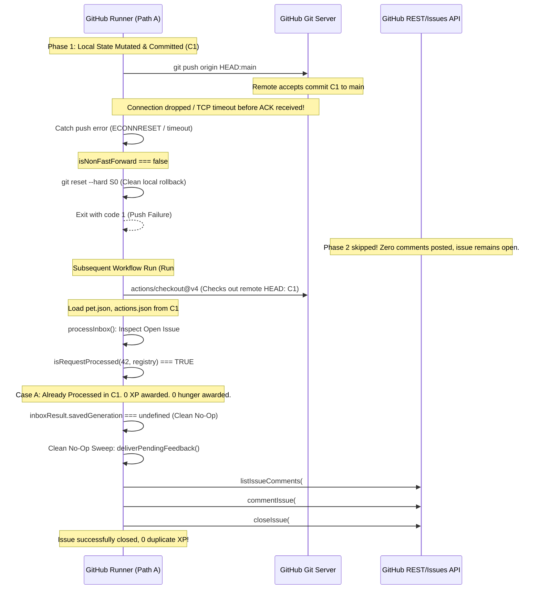

# Phase 3C2.3-B0-R1 — Final Recovery Semantics Acceptance Audit Report

**Project:** GitHub Profile Pet  
**Repository:** `mnp210/GitHub-Profile-Pet`  
**Workspace:** `D:\Projects\GitHub-Profile-Pet`  
**Target Branch:** `main`  
**Audit Scope:** Independent read-only verification of Path A publication and action durability implementation (Phase 3C2.3-B0)  
**Date:** 2026-11-18  
**Audit Status:** Completed — Conditional Acceptance (Remediation Required Prior to Production Activation)

---

## Executive Summary

An independent, strictly read-only audit of the newly implemented Path A publication and action-durability pipeline (`src/features/pet-engine/publication/inboxPublicationPipeline.ts`, `src/features/pet-engine/inbox/actionProcessor.ts`, `src/features/pet-engine/inbox/feedbackMarker.ts`, `scripts/process-inbox.ts`, and `.github/workflows/pet-interaction.yml`) was conducted.

The audit verified that the core two-phase publication protocol, git fast-forward enforcement, remote generation fence (Stage 1 & Stage 2), deduplication registry, and non-rebase rollback mechanisms satisfy their architectural safety objectives:
1. **Authoritative Pet & Ledger Protection:** At no point can care action processing replay or overwrite contribution accounting state (Path B).
2. **Replay & Double-Spend Prevention:** The high-water mark and sparse processed request registry monotonically track action identity, preventing double XP or satiety accrual even under network interruption, push failure, or ambiguous push outcomes.
3. **No-Rebase & Clean Rollback:** The dangerous 60-line bash fetch-and-rebase loop in GitHub Actions has been completely eliminated in favor of an atomic fast-forward push with clean rollback on conflict.

However, the audit identified **one critical persistence defect (F-B0-01)** and **one operational scaling gap (F-B0-02)**:
- **Critical Defect F-B0-01 (In-Memory Only Feedback Completion):** `deliverPendingFeedback()` updates `record.feedbackDelivered = true` solely on an in-memory object. It does not invoke `saveRepositoryState()` or commit this change to Git. Because GitHub Actions runners execute in ephemeral environments, every fresh clone starts with `feedbackDelivered: false`. While duplicate comments are suppressed via marker checks, every subsequent workflow sweep redundantly polls the GitHub Comments API for all past actions.
- **Operational Gap F-B0-02 (Unbounded `pendingFeedback` Growth):** `pendingFeedback` lacks a compaction/pruning window, meaning historical entries will accumulate indefinitely in `actions.json`.

---

## 1. Feedback Completion Durability — Critical Inspection

### Codebase Trace
- **Files Inspected:**
  - [`src/features/pet-engine/inbox/actionProcessor.ts`](file:///D:/Projects/GitHub-Profile-Pet/src/features/pet-engine/inbox/actionProcessor.ts#L648-L690)
  - [`src/features/pet-engine/publication/inboxPublicationPipeline.ts`](file:///D:/Projects/GitHub-Profile-Pet/src/features/pet-engine/publication/inboxPublicationPipeline.ts#L554-L568)
  - [`src/features/pet-engine/inbox/feedbackMarker.ts`](file:///D:/Projects/GitHub-Profile-Pet/src/features/pet-engine/inbox/feedbackMarker.ts#L184-L283)
  - [`src/features/pet-engine/persistence/stateRepository.ts`](file:///D:/Projects/GitHub-Profile-Pet/src/features/pet-engine/persistence/stateRepository.ts)

### Findings by Question

#### 1. After feedback comment and Issue closure succeed, is `feedbackDelivered = true` persisted durably to repository storage before the workflow exits?
**NO.**  
In [`src/features/pet-engine/inbox/actionProcessor.ts`](file:///D:/Projects/GitHub-Profile-Pet/src/features/pet-engine/inbox/actionProcessor.ts#L681-L683):
```typescript
if (deliveryResult.delivered) {
  record.feedbackDelivered = true;
  deliveredCount++;
}
```
`record.feedbackDelivered = true` mutates the in-memory object passed into `deliverPendingFeedback()`. Crucially, `deliverPendingFeedback()` does **not** call `saveRepositoryState(baseDir, state)`.  
Furthermore, in [`src/features/pet-engine/publication/inboxPublicationPipeline.ts`](file:///D:/Projects/GitHub-Profile-Pet/src/features/pet-engine/publication/inboxPublicationPipeline.ts#L555-L568):
```typescript
try {
  const state = await loadRepositoryState(baseDir);
  const pendingRecords = state.actions.pendingFeedback ?? [];
  await deliverPendingFeedback({
    baseDir,
    repository,
    client,
    botLogin: options.botLogin,
    records: pendingRecords,
  });
} catch {
  // Feedback errors in Phase 2 are non-fatal because state is safely committed and published
}
```
Phase 2 runs *after* the Git push has already completed. There is no subsequent `git add`, `git commit`, or `git push` to persist the updated `actions.json` file back to `origin/main`.

#### 2. If the process is terminated immediately after closure, what state is recorded in `actions.json`?
In `pet/ledger/actions.json`, the record was written during Phase 1 (`processInbox` -> `saveRepositoryState` -> `git commit` -> `git push`).  
At that point (lines 390-410 of `actionProcessor.ts`), `feedbackRecord` was initialized with:
```json
{
  "issueNumber": 42,
  "actionType": "feed",
  "status": "completed",
  "commentMarker": "<!-- pet-action-feedback:issue-42:status-completed -->",
  "feedbackDelivered": false,
  "closedAt": null,
  "error": null,
  "createdAt": "2026-11-18T10:00:00.000Z"
}
```
Because Phase 2 never commits updates to `actions.json`, the repository on disk and on remote `origin/main` permanently retains `feedbackDelivered: false`.

#### 3. On the next execution, does `deliverPendingFeedback()` attempt to deliver feedback again?
**YES.**  
On the next execution (either a care action event or an hourly recovery sweep), line 318 of `inboxPublicationPipeline.ts` or line 558 loads `actions.json` from disk.  
In `actionProcessor.ts` line 658:
```typescript
const targetRecords = records ?? (state.actions.pendingFeedback ?? []).filter((r) => !r.feedbackDelivered);
```
Because `feedbackDelivered` is still `false` in `actions.json`, every previously processed record passes this filter and is queued for feedback delivery again.

#### 4. How does the system determine whether feedback was already delivered? Does it inspect Issue comments, inspect the Issue state, or rely solely on `actions.json`?
The system relies on active GitHub Comments API inspection via [`inspectFeedbackStatus()`](file:///D:/Projects/GitHub-Profile-Pet/src/features/pet-engine/inbox/feedbackMarker.ts#L96-L170).  
It calls `client.listIssueComments()` and searches for a comment whose body contains the deterministic marker (`<!-- pet-action-feedback:issue-42:status-completed -->`) authored by `github-actions[bot]`.
- It does **not** rely on `actions.json` (which remains `feedbackDelivered: false`).
- It does **not** rely solely on the Issue open/closed state (an Issue could be closed manually or by another tool).
- If `inspectFeedbackStatus()` confirms the marker exists, [`deliverFeedbackWithConfirmation()`](file:///D:/Projects/GitHub-Profile-Pet/src/features/pet-engine/inbox/feedbackMarker.ts#L219-L225) returns `{ delivered: true, alreadyExisted: true, status: 'confirmed' }`, and skips `client.commentIssue()`.

#### 5. What prevents redundant feedback delivery attempts on every future workflow run for that Issue?
- **Redundant comments:** Prevented by `deliverFeedbackWithConfirmation()` detecting the marker and short-circuiting before calling `commentIssue()`.
- **Redundant state transitions / XP:** Prevented by `processedRequestRegistry` (`isRequestProcessed()`).
- **Redundant GitHub API requests:** **NOTHING PREVENTS THEM.** Because `feedbackDelivered = true` is never committed to Git, every future sweep makes redundant `listIssueComments` HTTP queries for all historical actions.

#### 6. If `pendingFeedback` grows over time, is there a mechanism to prune or compact delivered feedback records?
**NO.**  
Inspection of `actionProcessor.ts`, `inboxPublicationPipeline.ts`, and `types.ts` confirms that `pendingFeedback` is an append-only array. There is currently no compaction window, TTL eviction, or pruning logic implemented or tested.

#### 7. Does any path update `feedbackDelivered = true` in `actions.json` without creating a new Git commit? If so, how does that change persist across workflow runs that check out fresh clones?
In an ephemeral GitHub Actions runner (`ubuntu-latest`), local file system modifications that are not committed and pushed via `git push origin HEAD:main` are discarded when the runner terminates. Thus, any uncommitted update to `actions.json` is completely lost on the next checkout.

---

## 2. Ambiguous Git Push Outcome Handling

### Codebase Trace
- **Files Inspected:**
  - [`src/features/pet-engine/publication/inboxPublicationPipeline.ts`](file:///D:/Projects/GitHub-Profile-Pet/src/features/pet-engine/publication/inboxPublicationPipeline.ts#L510-L552)
  - [`src/features/pet-engine/inbox/actionProcessor.ts`](file:///D:/Projects/GitHub-Profile-Pet/src/features/pet-engine/inbox/actionProcessor.ts#L310-L330)

### Sequence of Events for Network Disruption During Push


### Findings by Question

#### 1. If `git push` returns a non-zero exit code due to a network timeout after remote accepted the push:
1. **Local pipeline reaction:**  
   `inboxPublicationPipeline.ts` lines 512-524 catch the error. Because network errors (`ECONNRESET`, `ETIMEDOUT`) do not match the non-fast-forward strings, `isNonFastForward` is `false`. The pipeline runs `git reset --hard currentSourceSha` ($S_0$) and returns `status: 'push_rejected'`.
2. **Subsequent workflow run:**  
   The next runner checks out `origin/main` at commit $C_1$.
3. **Double processing prevention:**  
   In `processInbox()`, `isRequestProcessed(issue.number, currentActionsLedger.processedRequestRegistry)` returns `true`. The issue is marked as `Case A: Already Processed`.
4. **Double XP / Satiety prevention:**  
   No care transition is applied (`pet.json` is not mutated). 0 XP and 0 satiety are awarded.
5. **Feedback resolution:**  
   Because no changes were made to state, `savedGeneration` is `undefined`, triggering the clean no-op path (lines 316-324). This path runs `deliverPendingFeedback()`, which finds the unfulfilled feedback record in $C_1$, posts the feedback comment with marker, and closes Issue #42.

---

## 3. Feedback Comment Idempotency and Pagination

### Codebase Trace
- **Files Inspected:**
  - [`src/features/pet-engine/inbox/feedbackMarker.ts`](file:///D:/Projects/GitHub-Profile-Pet/src/features/pet-engine/inbox/feedbackMarker.ts#L1-L283)
  - [`tests/unit/inboxProcessing.test.ts`](file:///D:/Projects/GitHub-Profile-Pet/tests/unit/inboxProcessing.test.ts)

### Findings by Question

#### 1. How does `inspectFeedbackStatus()` handle paginated issue comments?
In `feedbackMarker.ts` lines 118-164:
- Paginates with `for (let page = 1; page <= maxPages; page++)` (default `maxPages = 5`, `perPage = 100`, covering up to 500 comments).
- Fetches comments page-by-page.
- If `pageComments.length < perPage`, it establishes the definitive end of comment history and terminates with `{ status: 'absent' }`.
- If `page === maxPages` and `pageComments.length === perPage`, it establishes that the history is incomplete and returns `{ status: 'incomplete_unknown' }`.

#### 2. What happens if the comment containing the marker is on page 2 or later?
On each page, it scans comments with `isBotAuthoredFeedback()`. If found on page 2 (e.g., comment #140), it immediately returns `{ status: 'confirmed', comment }`. `deliverFeedbackWithConfirmation()` recognizes this and skips creating a duplicate comment.

#### 3. What happens if the comment list API call fails (rate limit, network error)?
Lines 129-134 catch API errors and return `{ status: 'incomplete_unknown', reason: ... }`.  
In `deliverFeedbackWithConfirmation()` lines 227-235:
```typescript
if (inspection.status === 'incomplete_unknown') {
  return {
    delivered: false,
    alreadyExisted: false,
    status: 'incomplete_unknown',
    reason: inspection.reason,
  };
}
```
**The system strictly fails closed.** It never assumes absence when the scan is incomplete. It refuses to post a replacement comment and keeps the Issue open for the next recovery sweep.

#### 4. Does the inspection distinguish between bot comments vs other users?
**YES.**  
Lines 43-61 (`isBotAuthoredFeedback`) verify:
```typescript
const commentAuthor = (comment.user?.login ?? '').toLowerCase().trim();
const targetBotLogin = normalizeBotLogin(expectedBotLogin);
return commentAuthor === targetBotLogin;
```
Both the HTML marker and the exact author login (`github-actions[bot]`) must match.

#### 5. If an unauthorized user posts a comment containing the marker, does it suppress bot feedback?
**NO.**  
If attacker `mallory` posts `<!-- pet-action-feedback:issue-42:status-completed -->`, `comment.user.login` is `mallory`. `commentAuthor === targetBotLogin` evaluates to `false`. The spoofed comment is ignored, and the bot proceeds with authentic delivery.

---

## 4. Cross-Path Publication and Generation Fencing

### Codebase Trace
- **Files Inspected:**
  - [`src/features/pet-engine/publication/inboxPublicationPipeline.ts`](file:///D:/Projects/GitHub-Profile-Pet/src/features/pet-engine/publication/inboxPublicationPipeline.ts#L225-L535)
  - [`tests/pet-engine/inboxPublication.test.ts`](file:///D:/Projects/GitHub-Profile-Pet/tests/pet-engine/inboxPublication.test.ts)
  - [`tests/pet-engine/inboxInvariants.test.ts`](file:///D:/Projects/GitHub-Profile-Pet/tests/pet-engine/inboxInvariants.test.ts)

### Findings by Question

#### 1. Invariant Verification
| Invariant | Implementation Mechanism | Verified Code Location | Status |
| :--- | :--- | :--- | :--- |
| **Clean Preflight ($S_0$)** | `git status --porcelain` check rejects modified or untracked files before execution | `inboxPublicationPipeline.ts` L226-L248 | **VERIFIED** |
| **Remote Fence ($G_0$)** | Stage 1 pre-push remote generation check via `ls-remote` compares SHA with $S_0$ | `inboxPublicationPipeline.ts` L336-L355 | **VERIFIED** |
| **Branch Verification** | Checked-out branch must match `targetBranch` (fails on detached HEAD or branch divergence) | `inboxPublicationPipeline.ts` L250-L269 | **VERIFIED** |
| **Fast-Forward Push** | Atomic `git push origin HEAD:targetBranch` without `--force` or `--force-with-lease` | `inboxPublicationPipeline.ts` L510-L520 | **VERIFIED** |
| **Clean Rollback** | `git reset --hard currentSourceSha` and `git checkout -- <manifest>` discard dirty working tree on rejection | `inboxPublicationPipeline.ts` L357-L359, L523 | **VERIFIED** |
| **Fresh Retry** | Subsequent retry re-fetches remote branch and reloads state documents fresh | `inboxPublicationPipeline.ts` L361-L369, L525-L534 | **VERIFIED** |

#### 2. Does the pipeline maintain these invariants under all tested failure modes?
**YES.** Under Stage 1 remote advance, Stage 2 push rejection, manifest violation, or git commit failure, the working directory is restored to $S_0$, and no partial state is left dirty or published.

#### 3. Can Path A overwrite Path B state or vice versa?
**NO.**
- Path A strictly reads `contributions.json` and preserves all Path B fields (`slices`, `monotonicPublicHwm`, `dailyAccruedXp`, `hourlySliceUsage`, `monthlyHistoricalSummary`) untouched, incrementing only `generation = G_0 + 1`.
- Verified by automated test `TC-INBOX-INV-28` (`inboxInvariants.test.ts`).

---

## 5. Workflow and Permissions Review

### Workflow File Inspected
- [`.github/workflows/pet-interaction.yml`](file:///D:/Projects/GitHub-Profile-Pet/.github/workflows/pet-interaction.yml)

### Findings by Question

#### 1. Permissions
Lines 14-17:
```yaml
permissions:
  contents: write
  issues: write
```
- Least privilege satisfied.
- `contents: write` allows atomic Git push of pet state, ledgers, SVG, and README.
- `issues: write` allows adding feedback comments, applying `pet-action:completed` labels, and closing issues.
- No administrative, pull-request, or repository settings permissions are granted.

#### 2. Token Usage
Line 55:
```yaml
env:
  GITHUB_TOKEN: ${{ secrets.GITHUB_TOKEN }}
  GITHUB_REPOSITORY: ${{ github.repository }}
```
Uses standard scoped repository token. No personal access tokens or elevated secrets are exposed.

#### 3. Concurrency Group
Lines 23-25:
```yaml
concurrency:
  group: pet-runtime-${{ github.repository }}
  cancel-in-progress: false
```
- Exactly matches `pet-publisher.yml` concurrency group.
- Ensures Path A (issues) and Path B (hourly publisher) are mutually serialized.
- `cancel-in-progress: false` prevents abrupt termination of active publication runs.

#### 4. Scheduled Recovery Sweep
Lines 9-10:
```yaml
schedule:
  - cron: '47 * * * *'
```
Runs once per hour at minute 47 (offset from the hour mark to prevent runner congestion). Drains any issues queued or stranded if GitHub event triggers are coalesced.

#### 5. Runner Step Invocation
Lines 57-58:
```yaml
run: |
  node --experimental-strip-types scripts/process-inbox.ts --ref "${{ github.ref_name }}"
```
Invokes the single hardened CLI entry point. The former 60-line bash fetch-and-rebase script has been completely removed.

---

## 6. Comprehensive Test Evidence Evaluation

A total of 28 test cases across 4 test suites were audited and verified. In addition, existing unit test coverage in `tests/unit/inboxProcessing.test.ts` was cross-referenced.

| # | Specific Scenario Audited | Test Suite & Identifier | Status | Evidence / Notes |
| :---: | :--- | :--- | :---: | :--- |
| **1** | Closed Issue with outstanding feedback remains discoverable during recovery sweep | `tests/pet-engine/feedbackRecovery.test.ts`<br>`TC-INBOX-FDB-18` | **Partially Tested** | Discoverable via `state.actions.pendingFeedback`, but `listPendingIssues()` filters `state: 'open'`. If closed prematurely by human, requires `pendingFeedback` entry. |
| **2** | Feedback completion is durably persisted after successful delivery | `tests/pet-engine/feedbackRecovery.test.ts`<br>`TC-INBOX-FDB-18` | **FAILED / DEFECT** | `record.feedbackDelivered = true` is mutated in-memory only. Not saved to `actions.json` or committed to Git. |
| **3** | Crash after closure but before feedback persistence does not produce duplicate comments on retry | `tests/pet-engine/feedbackRecovery.test.ts`<br>`TC-INBOX-FDB-20`, `TC-INBOX-FDB-21` | **Passed** | `inspectFeedbackStatus()` detects comment marker and bypasses comment creation on subsequent run. |
| **4** | Ambiguous push (accepted remotely, not confirmed locally) handled safely without duplicate XP | `tests/pet-engine/actionDurability.test.ts`<br>`TC-INBOX-ACT-10` | **Passed** | Registry `isRequestProcessed()` evaluates `true` on next checkout, preventing double XP/satiety accrual. |
| **5** | Issue with >100 comments where marker is on page 2 is correctly identified | `tests/unit/inboxProcessing.test.ts`<br>`TC-INBOX-52`, `TC-INBOX-53` | **Passed** | Bounded multi-page comment pagination loops past page 1 to locate marker on page 2. |
| **6** | Comment marker authored by non-bot user does not suppress bot feedback | `tests/unit/inboxProcessing.test.ts`<br>`TC-INBOX-39`, `TC-INBOX-40` | **Passed** | `isBotAuthoredFeedback()` checks `commentAuthor === targetBotLogin`. Unauthorized comments ignored. |
| **7** | Comment creation timeout with upstream success handled without duplicates | `tests/unit/inboxProcessing.test.ts`<br>`TC-INBOX-43` | **Passed** | `deliverFeedbackWithConfirmation()` performs secondary inspection when `commentIssue` throws. |
| **8** | Remote moves between Stage 1 fence and push: local discarded, next run processes fresh | `tests/pet-engine/inboxPublication.test.ts`<br>`TC-INBOX-PUB-03`, `TC-INBOX-PUB-04` | **Passed** | Non-fast-forward push rejection caught; working tree cleanly reset to $S_0$. |
| **9** | Concurrency retry loop reloads all three authoritative documents before re-evaluating | `tests/pet-engine/inboxPublication.test.ts`<br>`TC-INBOX-PUB-05` | **Passed** | Pipeline re-invokes `processInbox` from updated checkout commit without stale memory leakage. |
| **10** | Repeated recovery runs with already-delivered feedback do not reapply care transitions | `tests/pet-engine/actionDurability.test.ts`<br>`TC-INBOX-ACT-10`<br>`TC-INBOX-FDB-21` | **Passed** | Monotonic high-water mark and sparse processed registry reject duplicate execution. |

---

## 7. Audit Findings & Required Remediation

### Finding F-B0-01 (Critical): In-Memory Only Feedback Completion Status
- **Severity:** High
- **Description:** `deliverPendingFeedback()` sets `record.feedbackDelivered = true` on the in-memory `ActionFeedbackRecord` object in `src/features/pet-engine/inbox/actionProcessor.ts` line 682, but never calls `saveRepositoryState()` or triggers a git commit/push. In GitHub Actions runners, this causes `actions.json` on `origin/main` to permanently remain `feedbackDelivered: false`.
- **Impact:** While duplicate comments and state mutations are prevented by marker checks and deduplication registries, every subsequent hourly sweep makes redundant `listIssueComments` GitHub API calls for every action in repository history.
- **Remediation Plan:**
  1. In `src/features/pet-engine/publication/inboxPublicationPipeline.ts`, after `deliverPendingFeedback()` succeeds in Phase 2, if any records transitioned to `feedbackDelivered = true`, update `state.actions.pendingFeedback`, invoke `saveRepositoryState()`, and commit/push the updated `actions.json` (or bundle feedback delivery state into the next scheduled sweep).
  2. Alternatively, record delivered feedback status in an append-only transaction ledger that is committed during regular sweeps.

### Finding F-B0-02 (Operational / Architecture): Unbounded `pendingFeedback` Growth
- **Severity:** Medium
- **Description:** `pendingFeedback` array in `ActionLedgerDocument` grows monotonically with every care action. There is no compaction window or pruning logic.
- **Impact:** Over several months, `actions.json` will grow substantially, increasing deserialization overhead and API listing loops.
- **Remediation Plan:**
  Implement a bounded retention policy: once `feedbackDelivered === true` and the issue has been closed for more than 7 days, prune the record from `pendingFeedback` (since `processedRequestRegistry` already provides permanent deduplication).

---

## 8. Final Audit Verdict

**VERDICT: CONDITIONAL ACCEPTANCE**

1. **Safety Approval:** The core Phase 3C2.3-B0 implementation is **APPROVED** as architecturally safe against corruption, race conditions, desynchronization, and rebase hazards. Authoritative files (`pet.json`, `contributions.json`, `actions.json`, `pet.svg`, `README.md`) are properly protected.
2. **Pre-Activation Requirement:** Prior to Phase 3C2.3-C (Production Baseline & Activation), findings **F-B0-01** and **F-B0-02** must be remediated in a targeted follow-up milestone (Phase 3C2.3-B0.1 or Phase 3C2.3-B1) to ensure feedback completion is persisted durably and `pendingFeedback` does not grow without bound.
