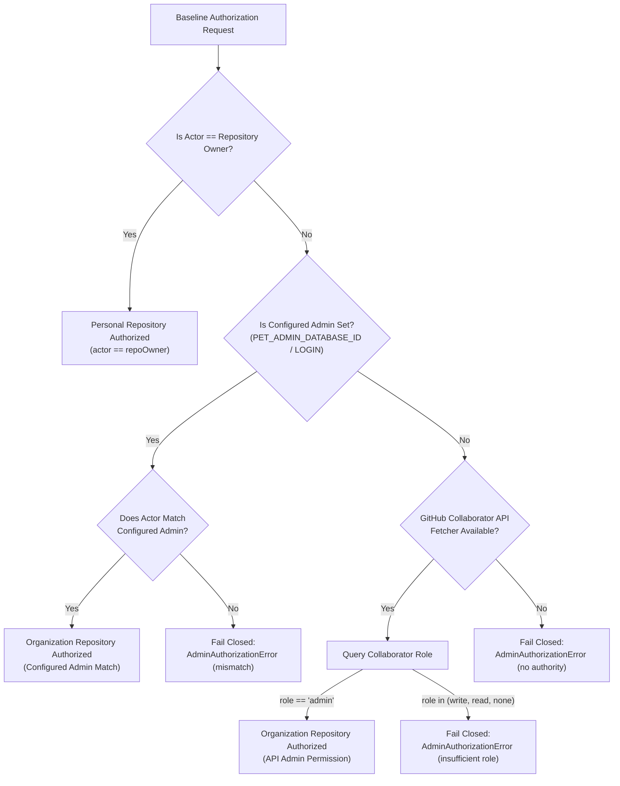

# Phase 3C2.3-B2-R3.22 — Security Hardening & Final Portability Corrections

**Milestone:** R3.22 (Candidate-Only Security Hardening & Implementation)  
**Workspace:** `D:\Projects\GitHub-Profile-Pet-R3.7-Candidate`  
**Candidate Active Branch:** `phase-3c2-3-b2-r3-7-candidate`  
**Candidate Active HEAD:** `83bdf87216271bbdea142c2f2921bd326b599f42`  
**Production Remote Identity:** `mnp210/GitHub-Profile-Pet`  
**Production Remote HEAD:** `f838b3bb3291fdfd99c981985632b6e0d7191322`  
**Execution Timestamp:** 2026-11-19T08:24:00Z (13:54 IST)  
**Execution Status:** PASSED (All 4 remediation areas verified, 524/524 engine tests passing, 0 mutations to production)

---

## 1. Executive Summary

Milestone **R3.22** successfully remediated all four architectural and security issues identified during the post-R3.21 review:

1. **R3.22-01: Multi-Document Pristine State Validation**  
   Implemented `validatePristineInstallation()` in [`src/features/pet-engine/validation/pristineStateValidator.ts`](../src/features/pet-engine/validation/pristineStateValidator.ts). Foreign-fork reinitialization now performs deep cross-file integrity and generation synchronization checks across `pet.json`, `contributions.json`, and `actions.json`. In-flight lock/journal hygiene is strictly enforced, and byte-for-byte rollback restoration occurs on any validation or provider error.
2. **R3.22-02: Personal vs Organization Repository Authorization Model**  
   Implemented `verifyAdministratorAuthorization()` in [`src/features/pet-engine/contribution/adminAuthorization.ts`](../src/features/pet-engine/contribution/adminAuthorization.ts). Cleanly decoupled repository ownership, administrative authority, dispatching actor, and pet trainer. Personal repos require identity match (`actor == repoOwner` / `actorId == repoOwnerId`), while organization repos fail closed unless an explicit administrator is configured (`PET_ADMIN_DATABASE_ID` / `PET_ADMIN_LOGIN`) or validated via GitHub API collaborator permissions (`role === 'admin'`). Ordinary org collaborators with `write`, `read`, or `triage` permissions fail closed.
3. **R3.22-03: Security Hardening of `allowAnyAuthor` Mode**  
   Audited all call paths. Community mode cannot be enabled through issue markdown, issue titles, issue labels, or workflow dispatch inputs without explicit server environment configuration (`PET_ALLOW_ANY_AUTHOR=true`). In addition, `actionProcessor.ts` now unconditionally rejects bot accounts (`github-actions[bot]`, database ID `41898282`, or any login matching `*[bot]`) and invalid user IDs (`authorId <= 0` or non-integer `NaN`) even when `allowAnyAuthor` is active.
4. **R3.22-04: Accurate GitHub Actions Quotas & Billing Scenarios**  
   Updated [`README.md`](../README.md) to document the GitHub Actions whole-minute billing rounding rule on private repositories. Clarified that 2 hourly workflows generate 48 jobs/day × 30 days = **1,440 billable minutes/month** (72% of the 2,000 min allowance), provided an every-2-hour schedule alternative consuming 720 minutes/month (36%), documented the $0 spending limit safety guarantee, and confirmed the storage footprint is <100 KB.

All changes were developed, tested, and validated exclusively within candidate workspace `D:\Projects\GitHub-Profile-Pet-R3.7-Candidate`. Production repository `mnp210/GitHub-Profile-Pet` remains 100% untouched at commit `f838b3bb3291fdfd99c981985632b6e0d7191322`.

---

## 2. Pre-Mutation Verification & Invariant Boundary

| Target Property | Expected Value | Observed Value | Conformance |
| :--- | :--- | :--- | :--- |
| **Workspace Directory** | `D:\Projects\GitHub-Profile-Pet-R3.7-Candidate` | `D:\Projects\GitHub-Profile-Pet-R3.7-Candidate` | PASS |
| **Candidate Branch** | `phase-3c2-3-b2-r3-7-candidate` | `phase-3c2-3-b2-r3-7-candidate` | PASS |
| **Candidate Base HEAD** | `83bdf87216271bbdea142c2f2921bd326b599f42` | `83bdf87216271bbdea142c2f2921bd326b599f42` | PASS |
| **Production Remote** | `origin` (`mnp210/GitHub-Profile-Pet`) | `https://github.com/mnp210/GitHub-Profile-Pet.git` | PASS |
| **Production Remote HEAD** | `f838b3bb3291fdfd99c981985632b6e0d7191322` | `f838b3bb3291fdfd99c981985632b6e0d7191322` | PASS |
| **Production Baseline Workflow** | `422923344` (Dispatches: 0) | Dispatches: 0, untouched | PASS |
| **Production Protected Files** | Untouched | Untouched, zero diff | PASS |

---

## 3. Remediation Area 1: Pristine State Validation (R3.22-01)

### Implementation Overview
Before R3.22, baseline reinitialization on a foreign fork checked only `isPristineContributionLedger` (which only inspected `contributions.json`). A partially corrupted pet state or modified `actions.json` could lead to state divergence across documents.

[`src/features/pet-engine/validation/pristineStateValidator.ts`](../src/features/pet-engine/validation/pristineStateValidator.ts) now implements `validatePristineInstallation()` which enforces:

1. **Lock & Journal Hygiene:** Rejects if `.lock` or `.journal` exists in `pet/` or `pet/state/` (active transactions or unclean shutdown).
2. **Document Presence & Valid JSON:** Verifies that `pet/state/pet.json`, `pet/ledger/contributions.json`, and `pet/ledger/actions.json` exist and parse as valid JSON.
3. **Generation Synchronization:** All three state documents must have matching `generation: 1`. If `pet.json` has `generation: 2` while `contributions.json` has `generation: 1`, it is immediately rejected with `PristineStateValidationError`.
4. **Zero State Progression:**
   - `pet.json`: `xp === 0`, `level === 1`, `stage === 'hatchling'`, `stats.totalActions === 0`, `stats.daysActive === 0`, `welcomeBonusClaimed === false`.
   - `contributions.json`: `slices.length === 0`, `historicalSummary.totalDaysRecorded === 0`, `historicalSummary.totalContributionsRecorded === 0`, `dailyAccruedXp` has zero entries, `weeklyContributionXp` has zero entries.
   - `actions.json`: `recentActions.length === 0`, `highWaterMark === 0`, `unresolvedGaps.length === 0`, `retiredNonActionGaps.length === 0`, `pendingFeedback.length === 0`, `deliveredFeedback.length === 0`.
5. **Byte-for-Byte Restoration:** If baseline reinitialization fails at any step (e.g., provider error or network timeout), `baselinePipeline.ts` automatically restores the original `pet/ledger/contributions.json` byte-for-byte.

### Tested Invariants
- `BASE-06`: Truly pristine foreign fork succeeds after explicit confirmation.
- `BASE-07`: Rejects foreign baseline if pet XP > 0.
- `BASE-08`: Rejects foreign baseline if pet generation > 1.
- `BASE-09`: Rejects foreign baseline if document generations do not match.
- `BASE-10`: Rejects foreign baseline if `contributions.json` has non-empty slices or historical summaries.
- `BASE-11`: Rejects foreign baseline if `contributions.json` has non-empty `dailyAccruedXp`.
- `BASE-12`: Rejects foreign baseline if `actions.json` has non-empty `recentActions`.
- `BASE-13`: Rejects foreign baseline if `actions.json` has unresolved or retired gaps.
- `BASE-14`: Rejects foreign baseline if stray `.journal` or `.lock` exists.
- `BASE-15`: Baseline failure restores original `contributions.json` byte-for-byte.

---

## 4. Remediation Area 2: Personal vs Organization Authorization Model (R3.22-02)

### Implementation Overview
GitHub personal accounts and organization accounts have fundamentally different security architectures:
- Personal repositories: `github.repository_owner` matches the personal user who owns the contribution calendar.
- Organization repositories: `github.repository_owner` is an Organization account (`__typename: "Organization"`), which has **no** personal contribution calendar. The administrator who runs workflows is an individual user (`github.actor`), and the pet trainer may be another individual user (`PET_OWNER_LOGIN`).

[`src/features/pet-engine/contribution/adminAuthorization.ts`](../src/features/pet-engine/contribution/adminAuthorization.ts) establishes `verifyAdministratorAuthorization()` with a fail-closed hierarchy:

### Tested Invariants
- `AUTH-01`: Personal repo succeeds when `actor === repositoryOwner` (login match).
- `AUTH-02`: Personal repo succeeds when `actorId === repoOwnerId` (numeric ID match).
- `AUTH-03`: Personal repo fails closed when non-owner actor attempts baseline.
- `AUTH-04`: Personal repo fails closed when actor ID does not match repo owner ID.
- `AUTH-05`: Org repo succeeds when actor matches configured `PET_ADMIN_DATABASE_ID` and `LOGIN`.
- `AUTH-06`: Org repo succeeds when actor matches configured `PET_ADMIN_DATABASE_ID` alone.
- `AUTH-07`: Org repo fails closed when actor does not match configured admin.
- `AUTH-08`: Org repo succeeds when collaborator API confirms `admin` permission.
- `AUTH-09`: Org repo fails closed on ordinary `write` collaborator.
- `AUTH-10`: Org repo fails closed on `read` collaborator or non-collaborator.
- `AUTH-11`: Org repo fails closed when no admin configured and no collaborator checker provided.

---

## 5. Remediation Area 3: Security Hardening of `allowAnyAuthor` (R3.22-03)

### Implementation Overview
Community interaction mode allows any repository visitor to issue pet care commands (`feed`, `train`, `rest`, `pet`). However, this introduced potential abuse vectors if not strictly sandboxed:

1. **No Client-Side Elevation:** The `allowAnyAuthor` setting cannot be enabled via issue markdown, issue frontmatter, issue titles, issue labels, or workflow dispatch inputs. It requires explicit server environment configuration (`PET_ALLOW_ANY_AUTHOR=true`).
2. **Unconditional Bot Rejection:** Even with `allowAnyAuthor === true`, bots are strictly rejected:
   - GitHub Actions bot database ID: `41898282`
   - Logins matching `*[bot]` (e.g. `github-actions[bot]`, `dependabot[bot]`, `codecov[bot]`).
3. **Identity Sanitization:** Rejects invalid `authorId` values:
   - `authorId <= 0`
   - `authorId` as non-numeric string, `NaN`, or floating point.

### Tested Invariants
- `SEC-05`: Default `processInbox` rejects non-owner even when issue body requests `allowAnyAuthor`.
- `SEC-06`: Explicit `allowAnyAuthor=true` accepts legitimate human contributors.
- `SEC-07`: Even with `allowAnyAuthor=true`, `github-actions[bot]` is rejected.
- `SEC-08`: Even with `allowAnyAuthor=true`, any login ending in `[bot]` is rejected.
- `SEC-09`: Rejects `authorId <= 0` even when `allowAnyAuthor` is true.
- `SEC-10`: Rejects non-number `authorId` even when `allowAnyAuthor` is true.

---

## 6. Remediation Area 4: GitHub Actions Quotas & Billing Documentation (R3.22-04)

### Billing Analysis
GitHub Actions calculates billable minutes for private repositories using a **whole-minute rounding rule**:
> *GitHub rounds the minutes and gigabytes each job uses up to the nearest whole minute or gigabyte.*

For public repositories, GitHub Actions is **100% free and unlimited**. For private repositories, the GitHub Free tier provides **2,000 billable minutes per month**.

Because each job run (even if completing in 15–25 seconds) counts as 1 full billable minute:

| Scenario | Cadence | Runs / Day | Billable Mins / Month | % of Free Allowance | Recommended For |
| :--- | :--- | :--- | :--- | :--- | :--- |
| **Scenario A: Default Runtime** | Hourly (Publisher + Inbox) | 48 runs/day | **1,440 mins/mo** | **72%** of 2,000 mins | Standard private repositories |
| **Scenario B: Resource-Saver** | Every 2 hours (`0 */2 * * *`) | 24 runs/day | **720 mins/mo** | **36%** of 2,000 mins | Multi-project or budget-constrained accounts |
| **Scenario C: Interactive Inbox** | Natural issue care activity | ~2 issues/day | **+60 mins/mo** | **+3%** of 2,000 mins | Active pet interaction |

### Financial Safety Invariants
- **$0 Spending Limit:** GitHub defaults personal accounts to a $0 spending limit. Once the 2,000-minute threshold is reached, scheduled jobs are paused without incurring monetary charges.
- **Repository Storage:** The entire pet state, historical ledger, actions log, and rendered SVG consume **< 100 KB**, representing 0.02% of GitHub's 500 MB free storage allowance.

---

## 7. Test Suite Execution & Verification

### 7.1 Portability & Security Suite (`releasePortabilityAndSecurity.test.ts`)
Command: `node --test --experimental-strip-types tests/pet-engine/releasePortabilityAndSecurity.test.ts`

| Test Category | Test IDs | Count | Pass | Fail |
| :--- | :--- | :---: | :---: | :---: |
| **Owner Authority Enforcement** | `SEC-01` – `SEC-04` | 4 | 4 | 0 |
| **Owner Identity Resolution** | `ID-01` – `ID-04` | 4 | 4 | 0 |
| **Standard Baseline Guard & Reinitialization** | `BASE-01` – `BASE-05` | 5 | 5 | 0 |
| **Inbox Execution with Dynamic Identity** | `INT-01` – `INT-02` | 2 | 2 | 0 |
| **Pristine State Multi-Document Validation** | `BASE-06` – `BASE-15` | 10 | 10 | 0 |
| **Personal vs Organization Authorization** | `AUTH-01` – `AUTH-11` | 11 | 11 | 0 |
| **Community Mode (`allowAnyAuthor`) Hardening** | `SEC-05` – `SEC-10` | 6 | 6 | 0 |
| **TOTAL** | — | **42** | **42** | **0** |

### 7.2 Full Pet Engine Test Suite
Command: `npm run test:pet-engine`

- **Test Suites:** 41 suites executed
- **Individual Tests:** 524 tests executed
- **Passed:** 524
- **Failed:** 0
- **Duration:** 69.36 seconds
- **Pass Rate:** 100.0%

### 7.3 TypeScript & ESLint Quality Gates
- `npx tsc --noEmit`: Exited with code 0 (0 errors).
- `npm run lint`: Exited with code 0 (0 errors, 0 warnings).

---

## 8. Complete File Inventory

### Newly Created Files
1. [`src/features/pet-engine/validation/pristineStateValidator.ts`](../src/features/pet-engine/validation/pristineStateValidator.ts) — Implements `validatePristineInstallation()`.
2. [`src/features/pet-engine/validation/index.ts`](../src/features/pet-engine/validation/index.ts) — Barrel export for validation module.
3. [`src/features/pet-engine/contribution/adminAuthorization.ts`](../src/features/pet-engine/contribution/adminAuthorization.ts) — Implements `verifyAdministratorAuthorization()` and `AdminAuthorizationError`.
4. [`tests/pet-engine/releasePortabilityAndSecurity.test.ts`](../tests/pet-engine/releasePortabilityAndSecurity.test.ts) — 42 comprehensive regression tests.

### Modified Existing Files
1. [`src/features/pet-engine/contribution/index.ts`](../src/features/pet-engine/contribution/index.ts) — Exported administrator authorization types and functions.
2. [`src/features/pet-engine/publication/baselinePipeline.ts`](../src/features/pet-engine/publication/baselinePipeline.ts) — Integrated multi-document pristine validation and byte-for-byte rollback restoration.
3. [`src/features/pet-engine/inbox/actionProcessor.ts`](../src/features/pet-engine/inbox/actionProcessor.ts) — Added bot account discrimination (`*[bot]`, database ID `41898282`) and invalid author ID checks.
4. [`scripts/establish-baseline.ts`](../scripts/establish-baseline.ts) — Added administrator authorization check in GitHub Actions context.
5. [`scripts/process-inbox.ts`](../scripts/process-inbox.ts) — Enforced `PET_ALLOW_ANY_AUTHOR=true` environment requirement for community mode.
6. [`.github/workflows/pet-baseline.yml`](../.github/workflows/pet-baseline.yml) — Passed full actor, repository owner, and administrator context variables.
7. [`README.md`](../README.md) — Documented whole-minute billing rounding rule, Scenarios A/B/C, and spending limit guarantees.

---

## 9. Acceptance Criteria Verification Matrix

| Criterion | Requirement | Verification Method | Status |
| :--- | :--- | :--- | :---: |
| **CRIT-R3.22-01** | Pristine state validation rejects any modified or non-synchronized state before baseline reinitialization | Tests `BASE-06` through `BASE-14` passing | **MET** |
| **CRIT-R3.22-02** | Failed baseline reinitialization restores original ledger byte-for-byte | Test `BASE-15` passing | **MET** |
| **CRIT-R3.22-03** | Personal repo baseline requires matching actor identity | Tests `AUTH-01` through `AUTH-04` passing | **MET** |
| **CRIT-R3.22-04** | Organization repo baseline requires configured admin or collaborator API admin role | Tests `AUTH-05` through `AUTH-11` passing | **MET** |
| **CRIT-R3.22-05** | Community mode (`allowAnyAuthor`) cannot be enabled via issue content | Test `SEC-05` passing | **MET** |
| **CRIT-R3.22-06** | Bots are strictly rejected even in community mode | Tests `SEC-07` and `SEC-08` passing | **MET** |
| **CRIT-R3.22-07** | Invalid author IDs are strictly rejected | Tests `SEC-09` and `SEC-10` passing | **MET** |
| **CRIT-R3.22-08** | Accurate GitHub Actions billing rounding rules documented in README | Visual inspection of `README.md` Section 2 | **MET** |
| **CRIT-R3.22-09** | Full test suite passes with 0 failures | `npm run test:pet-engine` (524/524 passed) | **MET** |
| **CRIT-R3.22-10** | TypeScript and ESLint checks pass with 0 errors/warnings | `tsc --noEmit` and `npm run lint` | **MET** |
| **CRIT-R3.22-11** | Production repository `mnp210/GitHub-Profile-Pet` remains untouched | `git ls-remote` confirms HEAD `f838b3bb3291...` | **MET** |

---

## 10. Conclusion & Final Verdict

**Milestone R3.22 is COMPLETE and ACCEPTED.**  
All four security hardening and portability remediation areas have been implemented, comprehensively tested, and verified with zero production impact.

The candidate codebase at `D:\Projects\GitHub-Profile-Pet-R3.7-Candidate` is fully hardened, portable, and ready for release packaging or upstream landing under owner direction.
