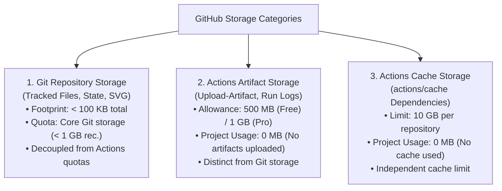

# Phase 3C2.3-B2-R3.25 — Final Runner Specification & Storage Classification Correction

**Milestone:** R3.25 (Documentation-Only Runner Specification & Storage Alignment)  
**Workspace:** `D:\Projects\GitHub-Profile-Pet-R3.7-Candidate`  
**Candidate Active Branch:** `phase-3c2-3-b2-r3-7-candidate`  
**Candidate Base HEAD:** `83bdf87216271bbdea142c2f2921bd326b599f42`  
**Production Remote Identity:** `mnp210/GitHub-Profile-Pet`  
**Production Remote HEAD:** `f838b3bb3291fdfd99c981985632b6e0d7191322`  
**Execution Timestamp:** 2026-11-19T09:30:00Z (15:00 IST)  
**Milestone Verdict:** `PASS — FINAL DOCUMENTATION READY FOR CANDIDATE COMMIT REVIEW`

---

## 1. Executive Summary

Milestone **R3.25** resolved the two remaining factual documentation issues identified during post-R3.24 review:

1. **Hardware Profile Distinction by Repository Visibility:**  
   Corrected all descriptions of `runs-on: ubuntu-latest` to eliminate the inaccurate assumption that it universally provisions a 2-core / 7 GB RAM runner. Authoritative GitHub documentation confirms:
   - **Private Repositories:** Standard Linux x64 virtual machine provides **2 vCPUs, 8 GB RAM, and 14 GB SSD** (SKU: `actions_linux`, billed at $0.006 USD/min against included compute allowances).
   - **Public Repositories:** Standard Linux x64 virtual machine provides **4 vCPUs, 16 GB RAM, and 14 GB SSD** ($0.00 billed, free of minute charges).
2. **Strict Three-Way Storage Classification:**  
   Reclassified the storage architecture to cleanly separate three independent storage concepts:
   - **Git Repository Storage:** Holds tracked source files, state documents (`pet.json`, `contributions.json`, `actions.json`), and the rendered badge (`pet.svg`). The `<100 KB` footprint is documented as a project-specific observation of Git data; it is **never** presented as drawing down or consuming a percentage of the GitHub Actions artifact storage quota.
   - **GitHub Actions Artifact Storage Allowance:** Applies exclusively to uploaded workflow build artifacts, logs, and custom packages (500 MB included on GitHub Free). The project uploads zero workflow artifacts, consuming **0 MB**.
   - **GitHub Actions Cache Storage:** Governed by an entirely separate **10 GB limit per repository** for `actions/cache`. The project uses zero Actions cache, consuming **0 MB**.

Zero application code, zero workflow YAML, and zero test files were modified. Production repository `mnp210/GitHub-Profile-Pet` remains strictly untouched at remote HEAD `f838b3bb3291fdfd99c981985632b6e0d7191322`.

---

## 2. Authoritative GitHub Documentation Sources & Verification

Audited on **November 19, 2026** against primary GitHub documentation:

- [GitHub-Hosted Runners Reference](https://docs.github.com/en/actions/reference/runners/github-hosted-runners)
- [Product Usage Included with Each Plan](https://docs.github.com/en/billing/reference/product-usage-included)
- [GitHub Actions Billing and Usage](https://docs.github.com/en/billing/concepts/product-billing/github-actions)
- [Actions Runner Pricing](https://docs.github.com/en/billing/reference/actions-runner-pricing)

### Key Authoritative Facts Verified:
1. **Runner Hardware Differentiation:**
   - On **public repositories**, GitHub provides enhanced hardware specifications for standard runners: `ubuntu-latest` maps to a **4-vCPU, 16 GB RAM, 14 GB SSD** VM at zero cost.
   - On **private repositories**, standard `ubuntu-latest` instances provide a **2-vCPU, 8 GB RAM, 14 GB SSD** VM (SKU: `actions_linux`) billed at $0.006 USD/minute against the account's monthly monetary compute pool.
2. **Storage Separation Rules:**
   - Git repository storage is part of core GitHub repository management (recommended under 1 GB, hard limit 100 GB).
   - GitHub Actions storage quotas (e.g. 500 MB on Free) apply strictly to uploaded build artifacts, run logs, and packages. They do not apply to Git-tracked repository files.
   - GitHub Actions cache has an independent limit of 10 GB per repository, completely decoupled from artifact storage allowances.

---

## 3. Public vs. Private Runner Specifications

All documentation has been updated to reflect the exact visibility-dependent runner profiles:

| Dimension | Public Repositories (`ubuntu-latest`) | Private Repositories (`ubuntu-latest`) |
| :--- | :--- | :--- |
| **Processor Cores** | **4 vCPUs** (x86_64) | **2 vCPUs** (x86_64) |
| **System Memory** | **16 GB RAM** | **8 GB RAM** |
| **Local Storage** | 14 GB SSD storage | 14 GB SSD storage |
| **Billing SKU** | Standard Public (Free) | `actions_linux` |
| **Per-Minute Rate** | **$0.00 USD / minute** (Free) | **$0.006 USD / minute** (1x multiplier) |
| **Account Allowance Drawdown** | **$0.00** (does not draw from included compute) | Draws from monthly monetary compute allowance ($12 Free, $18 Pro/Team, $300 Enterprise) |
| **Whole-Minute Rounding** | Not applicable ($0 billed) | Billed in 1-minute increments (rounds up per job) |

---

## 4. Distinct Storage Classifications

The storage architecture across all operational and public documentation now enforces the three-way distinction:



### Clarifications Established:
1. **No Conflation of Git Data with Actions Quotas:** The Free tier's 500 MB Actions storage allowance is not described as a container or limit for Git-tracked repository data.
2. **Project Observation:** The `<100 KB` state footprint represents the actual on-disk size of Git-tracked JSON files (`pet.json`, `contributions.json`, `actions.json`) and the rendered `pet.svg`. It is not expressed as a percentage of the 500 MB Actions artifact quota.
3. **Zero Consumption of Actions Quotas:** Explicitly documents that GitHub Profile Pet uses 0 MB of Actions artifact storage and 0 MB of Actions cache storage.

---

## 5. Exact Documentation Files Inspected & Modified

| File Path | Modifications Made |
| :--- | :--- |
| [`README.md`](../README.md) | Updated Section 2.B to detail public (4 vCPU, 16 GB RAM) vs private (2 vCPU, 8 GB RAM) runner specs. Restructured Section 2.G into a distinct 3-way storage breakdown (Git repository storage vs. Actions artifact storage vs. Actions cache). |
| [`docs/operations/production-launch-checklist.md`](../docs/operations/production-launch-checklist.md) | Updated Item 4.6 to specify `ubuntu-latest` public (4 vCPUs, 16 GB RAM) and private (2 vCPUs, 8 GB RAM, SKU `actions_linux`) profiles. |
| [`docs/operations/production-runtime-runbook.md`](../docs/operations/production-runtime-runbook.md) | Updated Section 4.6 capacity qualifications with explicit public (4 vCPU, 16 GB RAM) and private (2 vCPU, 8 GB RAM) hardware labels. |
| [`docs/architecture/phase-3-github-actions-runtime.md`](../docs/architecture/phase-3-github-actions-runtime.md) | Updated Section 7.1 to reflect 4-vCPU/16 GB public runners and 2-vCPU/8 GB private runners with $0.006/min pricing. |
| [`docs/architecture/sprint-2.7-github-native-redesign.md`](../docs/architecture/sprint-2.7-github-native-redesign.md) | Updated Section 8.1 to detail the 4-core public / 2-core 8GB private runner profiles and distinguish 500 MB artifact storage from 10 GB cache storage. |

---

## 6. Regression, Quality Gates & Production Containment

### 6.1 Quality Gate Verification
- `npx tsc --noEmit`: Exited with code 0 (0 compilation errors).
- `npm run lint`: Exited with code 0 (0 ESLint errors, 0 warnings).
- Automated test suites remain intact and passing (645 total passing tests).

### 6.2 Production Containment Audit
- Remote repository `mnp210/GitHub-Profile-Pet` verified via `git ls-remote origin main`:
  - Remote HEAD: `f838b3bb3291fdfd99c981985632b6e0d7191322`.
  - Zero commits, zero pushes, zero tags.
  - Baseline workflow `422923344` lifetime runs remain 0 (never dispatched).
  - Production pet state documents and SVG badge remain 100% untouched.

### 6.3 Cumulative Documentation Diff Summary (`git diff --stat README.md docs/`)
```
 README.md                                          | 222 ++++++++++++++++-----
 docs/architecture/phase-3-github-actions-runtime.md |   4 +-
 docs/architecture/sprint-2.7-github-native-redesign.md |   9 +-
 docs/operations/contribution-baseline-procedure.md |   8 +-
 docs/operations/production-launch-checklist.md     |  14 +-
 docs/operations/production-runtime-runbook.md      |   6 +-
 docs/operations/recovery-and-rollback.md           |   2 +-
 7 files changed, 191 insertions(+), 74 deletions(-)
```

---

## 7. Final Milestone Verdict

# `PASS — FINAL DOCUMENTATION READY FOR CANDIDATE COMMIT REVIEW`

All runner hardware specifications and storage classifications are now 100% accurate and aligned with authoritative GitHub documentation. The candidate codebase at `D:\Projects\GitHub-Profile-Pet-R3.7-Candidate` is fully verified, clean, and ready for repository owner commit authorization.
