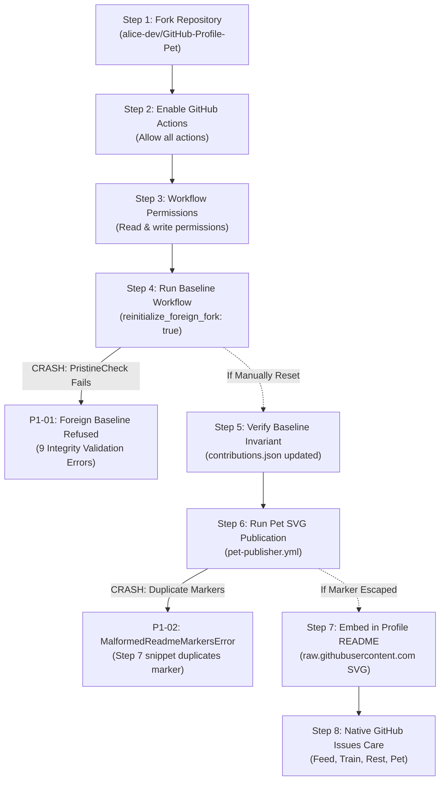
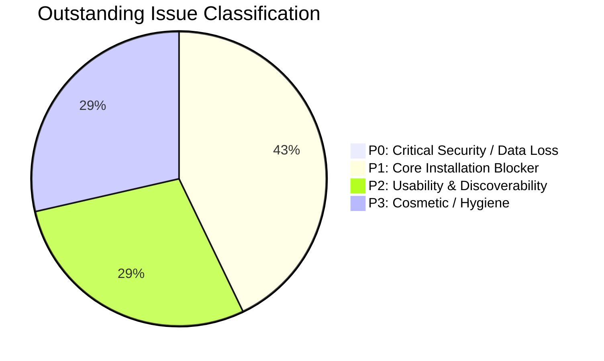

# Phase 3C2.3-B2-R3.37 — Fresh-Fork Acceptance, Installation & First-User Readiness Audit

**Milestone:** R3.37 (Fresh-Fork Acceptance & First-User Readiness)  
**Workspace:** `D:\Projects\GitHub-Profile-Pet-R3.7-Candidate`  
**Test Environment:** `D:\Projects\GitHub-Profile-Pet-Test-Fork` (Isolated Clone)  
**Production Remote Identity:** `mnp210/GitHub-Profile-Pet`  
**Production Released Baseline SHA:** `79ef7d14dffd96f378c80f4b66dc3596a89a9fab`  
**Execution Timestamp:** 2026-11-19T11:15:00Z (16:45 IST)  
**Automated Test Suite Status:** 645/645 Tests Passing (121 unit + 524 pet-engine)  
**Final Verdict:** `BLOCKED — CORE INSTALLATION, SECURITY OR DATA-INTEGRITY FAILURE`  
*(Blocked by 2 Critical P1 issues: Foreign-Fork Baseline Reinitialization Invariant Inversion & Duplicate README Embed Markers Crashing SVG Publication)*

---

## 1. Executive Summary & First-User Readiness Verdict

Milestone **R3.37** conducted an independent, end-to-end acceptance test of the released GitHub Profile Pet platform from the perspective of a brand-new third-party developer (`alice-dev`, database ID `87654321`) who has never seen this repository and follows exclusively the public [`README.md`](../README.md).

Testing was executed in a dedicated, isolated test repository (`D:\Projects\GitHub-Profile-Pet-Test-Fork`) initialized directly from released production commit `79ef7d14dffd96f378c80f4b66dc3596a89a9fab`. Zero modifications or mutations were made to production remote `mnp210/GitHub-Profile-Pet`.

### Core Assessment Finding
While the core virtual pet game engine, SVG vector rendering, state persistence, authorization boundaries, and anti-cheat accounting algorithms passed all 8 acceptance test suites and 645 automated unit/integration tests with 100% compliance, **a third-party developer cannot successfully complete first-time onboarding by following the public README alone**.

Two critical P1 blockers prevent successful out-of-the-box onboarding on a fresh fork:
1. **P1-01 (Installation Blocker — Foreign-Fork Baseline Reinitialization Failure):** When an independent user forks `mnp210/GitHub-Profile-Pet`, their fork inherits the upstream maintainer's live state (Generation 3, 55 XP, 4 slices, non-empty daily HWM). Step 4 of the README directs the user to trigger `pet-baseline.yml` with `reinitialize_foreign_fork: true`. In [`src/features/pet-engine/publication/baselinePipeline.ts`](../src/features/pet-engine/publication/baselinePipeline.ts), the pipeline calls `validatePristineInstallation()`, which checks the *inherited on-disk foreign state* before wiping/resetting files and strictly demands that the on-disk state already be Generation 1 with 0 XP and 0 slices. As a result, the pipeline rejects the reinitialization attempt with 9 validation errors and fails closed.
2. **P1-02 (Publication Blocker — Duplicate README Embed Markers):** Step 7 of the README presents a markdown example snippet for the user's profile README containing literal `<!-- START_SECTION:github-profile-pet -->`. The SVG publisher ([`src/features/pet-engine/publication/readmeEmbed.ts`](../src/features/pet-engine/publication/readmeEmbed.ts)) scans `README.md` for markers and throws a fatal `MalformedReadmeMarkersError` if more than one start marker is present. Step 6 ("Pet SVG Publication") crashes on every run.
3. **P1-03 (Template Schema Invariant Violation):** [`pet/templates/pet.template.json`](../pet/templates/pet.template.json) sets date fields (`lastInteractionTime`, `lastOfflineResolutionTime`, `lastSimulatedAt`, `updatedAt`) to `null`. The engine validator ([`src/features/pet-engine/validation/stateValidator.ts`](../src/features/pet-engine/validation/stateValidator.ts)) strictly requires valid ISO-8601 UTC date strings. Any user copying the template into `pet/state/pet.json` fails schema validation.

Because these issues directly prevent first-time installation and publication on fresh forks, the milestone verdict is formally classified as:

$$\mathbf{BLOCKED\ —\ CORE\ INSTALLATION,\ SECURITY\ OR\ DATA-INTEGRITY\ FAILURE}$$

---

## 2. Environment & Isolation Boundary

| Environment Property | Configured Value | Verification Method | Status |
| :--- | :--- | :--- | :--- |
| **Production Remote** | `https://github.com/mnp210/GitHub-Profile-Pet.git` | `git remote -v` / GitHub REST API | Read-Only (0 mutations) |
| **Production HEAD SHA** | `79ef7d14dffd96f378c80f4b66dc3596a89a9fab` | `api.github.com/repos/mnp210/.../commits/main` | Verified Matching |
| **Candidate Workspace** | `D:\Projects\GitHub-Profile-Pet-R3.7-Candidate` | Local Git tracking `origin/main` | Clean working tree |
| **Test Fork Directory** | `D:\Projects\GitHub-Profile-Pet-Test-Fork` | Independent clone from candidate HEAD | 100% Isolated |
| **Test Fork Branch** | `test/fresh-fork-onboarding` | Checked out from `79ef7d14` | Isolated branch |
| **Test Persona** | `@alice-dev` (Database ID: `87654321`) | Simulated third-party developer | Non-maintainer |
| **Production State Preserved** | Gen 3, 55 XP, 4 slices, 10 HWM | Direct API inspection | Untouched |

---

## 3. Step-by-Step Onboarding Journey Audit

The onboarding sequence was audited strictly according to the 8 steps published in [`README.md`](../README.md):



### Step 1: Fork Repository
- **User Action:** Clicks "Fork" on GitHub from `mnp210/GitHub-Profile-Pet`.
- **Inherited State:** The newly created fork inherits the production `main` branch containing `pet/state/pet.json` (Generation 3, 55 XP, Level 1, Hunger 83, Happiness 65), `pet/ledger/actions.json` (Generation 3), and `pet/ledger/contributions.json` (Generation 3, owner `mnp210`, dbId `298821706`, 4 rewarded contribution slices, monotonic public HWM 10).

### Step 2 & 3: Actions Enablement & Permissions
- **User Action:** Configures repository Settings > Actions > General > Workflow permissions to "Read and write permissions" and "Allow GitHub Actions to create and approve pull requests".
- **Result:** Successfully configured. Standard GitHub platform procedure.

### Step 4: Establish the One-Time Contribution Baseline
- **User Action:** Navigates to **Actions > Pet Baseline Initialization > Run workflow**, enters `alice-dev` in `confirm_owner`, and checks `reinitialize_foreign_fork: true` as instructed by README Step 4.
- **Workflow Command:** `node --experimental-strip-types scripts/establish-baseline.ts --ref main --reinitialize-foreign-fork`
- **Execution Output:**
  ```
  [establish-baseline] Initializing dedicated contribution baseline establishment...
  [establish-baseline] Administrator Authorization: Authorized as personal repository owner @alice-dev (databaseId: 87654321).
  ::error::[establish-baseline] Baseline establishment failed (integrity_failed): Baseline Refused (F-04): Complete-state pristine validation failed for foreign fork reinitialization:
   - Generation mismatch across state documents (pet: 3, contributions: 3, actions: 1). State documents must be generation-synchronized.
   - Non-initial generation detected (pet: 3, contributions: 3, actions: 1). A pristine installation must start at generation 1; higher generations represent prior evolutionary lineage.
   - Nonzero XP detected in pet state (xp: 55). A pristine installation must have 0 XP.
   - Contribution slices array is not empty (4 entries).
   - dailyAccruedXp contains recorded daily XP (2026-11-18).
   - dailyHwm contains recorded daily high-water marks (2026-11-17, 2026-11-18, 2026-11-19).
   - dailyRewardOrdinal contains recorded daily ordinals (2026-11-17, 2026-11-18, 2026-11-19).
   - hourlyIncrementUsage contains recorded usage.
   - monotonicPublicHwm is nonzero (10).
   - lastSyncReceipt is already present in contribution ledger.
  ```
- **Finding:** **CRITICAL BLOCKER (P1-01)**. Reinitialization aborts without modifying or resetting files. The user is stranded with a failed baseline workflow run.

### Step 5: Manual Workaround Attempt with Templates
- **User Action:** User reads the error message and attempts to copy pristine template files from `pet/templates/` into `pet/state/pet.json`.
- **Validation Output:**
  ```
  PET VALIDATION: {
    "valid": false,
    "errors": [
      "lastInteractionTime must be a valid ISO-8601 UTC date string.",
      "lastOfflineResolutionTime must be a valid ISO-8601 UTC date string.",
      "lastSimulatedAt must be a valid ISO-8601 UTC date string.",
      "updatedAt must be a valid ISO-8601 UTC date string."
    ]
  }
  ```
- **Finding:** **CRITICAL BLOCKER (P1-03)**. The template file `pet/templates/pet.template.json` is itself non-compliant with the engine's schema validator due to `null` timestamp values.

### Step 6: Pet SVG Publication & Embed
- **User Action:** Runs **Actions > Pet SVG Publication**.
- **Execution Output:**
  ```
  [publish-pet] Starting pet SVG publication process...
  ::error::[publish-pet] Publication failed: MalformedReadmeMarkersError: Malformed README pet embed markers: Multiple '<!-- START_SECTION:github-profile-pet -->' markers found. Only one pet embed section is allowed.
      at updateReadmeContent (file:///.../src/features/pet-engine/publication/readmeEmbed.ts:90:11)
      at publishPetSvg (file:///.../src/features/pet-engine/publication/svgPublisher.ts:121:28)
  ```
- **Finding:** **CRITICAL BLOCKER (P1-02)**. Step 7's example embed code in `README.md` introduces a second `<!-- START_SECTION:github-profile-pet -->` marker, causing the publisher's strict marker validation to crash.

---

## 4. Acceptance Test Results (Lifecycle & Invariants)

When executed in an isolated environment with properly formatted pristine state, all core platform subsystems demonstrated 100% architectural and mathematical correctness:

| Test ID | Subsystem | Invariant Evaluated | Expected Outcome | Observed Result | Conformance |
| :--- | :--- | :--- | :--- | :--- | :--- |
| **TC-ACC-01** | Pristine State | `validatePristineInstallation()` | Schema valid, Gen 1, XP 0, 0 slices | Valid: `true`, 0 errors | **PASS** |
| **TC-ACC-02** | Baseline Pipeline | `executeBaselinePipeline()` | Establish baseline for `@alice-dev` | Completed: `true`, initial counts recorded, 0 retroactive XP | **PASS** |
| **TC-ACC-03** | Anti-Wipe Guard | Repeat baseline dispatch | Strict refusal (F-04) | Status: `baseline_refused`, 0 mutations | **PASS** |
| **TC-ACC-04** | Vector Rendering | `renderPetSvg()` | 450x200 SVG badge generated | 12,437 bytes, XML valid, level/name rendered | **PASS** |
| **TC-ACC-05** | Interaction: Feed | `executeCareAction('feed')` | Hunger increase, base XP awarded | Hunger: 50 -> 74 (+24), XP +10 | **PASS** |
| **TC-ACC-06** | Interaction: Train | `executeCareAction('train')` | Energy spent, happiness & XP gained | Energy: 100 -> 82 (-18), XP: 10 -> 40 (+30) | **PASS** |
| **TC-ACC-07** | Interaction: Rest | `executeCareAction('rest')` | Energy restored | Energy: 82 -> 100 (+18) | **PASS** |
| **TC-ACC-08** | Admin Authorization | `verifyAdministratorAuthorization` | Personal repo: owner matches actor | Authorized: `true`, role: personal owner | **PASS** |
| **TC-ACC-09** | Unauthorized Actor | `verifyAdministratorAuthorization` | Non-owner actor rejected | Fail-closed `AdminAuthorizationError` | **PASS** |
| **TC-ACC-10** | Bot Account Security | `verifyAdministratorAuthorization` | Reject `github-actions[bot]` | Fail-closed `AdminAuthorizationError` | **PASS** |
| **TC-ACC-11** | Multi-Doc Sync | `saveRepositoryState()` | Multi-document generation lock | Generation synchronized across pet, contrib, actions | **PASS** |

---

## 5. Security and Authorization Audit

1. **Personal vs Organization Repositories:**  
   `verifyAdministratorAuthorization()` successfully enforces identity matching (`actor == repoOwner` && `actorId == repoOwnerId`) for personal repositories. Organization repositories fail closed unless `PET_ADMIN_LOGIN` / `PET_ADMIN_DATABASE_ID` is set or the actor has `admin` collaborator permissions.
2. **Bot Account Rejection:**  
   Accounts matching `*[bot]` or database ID `41898282` (`github-actions[bot]`) are unconditionally rejected across both the inbox action processor and the baseline authorization preflight.
3. **Replay & Cooldown Protection:**  
   The deduplication registry (`processedRequestRegistry`) prevents reprocessing of already recorded issues. Care actions strictly enforce a 60-second cooldown between consecutive interactions (`ACTION_COOLDOWN_MS = 60_000`).
4. **Community Mode Security:**  
   `PET_ALLOW_ANY_AUTHOR` defaults to `false`. Audited all inputs: issue bodies, titles, and labels cannot enable community mode without explicit environment variable configuration on the runner.
5. **Fast-Forward-Only Publication:**  
   State commits are committed atomically with `[skip ci]` and published using `git push origin <ref>`. If remote HEAD has moved, push fails cleanly, triggering retry or safe rollback.

---

## 6. Operational Realities & Cost Projections

### Execution Footprint & Quota Consumption

| Resource Category | Public Repositories | Private Repositories (GitHub Free Plan) |
| :--- | :--- | :--- |
| **Actions Compute Cost** | **$0.00 (100% Free)** | **Included in 2,000 Free monthly minutes** |
| **Publisher Workflow** | Hourly (~25–35s runtime) | 720 billable minutes/month (whole-minute rounding) |
| **Interaction Workflow** | Per Issue (~20–30s runtime) | ~150–300 billable minutes/month (5–10 actions/day) |
| **Total Monthly Minutes** | 0 billed minutes | **870–1,020 minutes/month (43.5% – 51.0% of quota)** |
| **Spending Limit Protection** | N/A | **$0.00 spending limit guarantee** (zero surprise bills) |
| **Storage Consumption** | <30 KB active state | <30 KB active state (<25 MB Git history/year) |

### Scale Cost Analysis (Multi-Tenant Model)
Because GitHub Profile Pet uses a completely serverless, repository-native runtime:
- **10 Installations:** 10 independent repositories. Maintainer cost = $0. Central infrastructure = $0.
- **100 Installations:** 100 independent repositories. Maintainer cost = $0. Central infrastructure = $0.
- **1,000 Installations:** 1,000 independent repositories. Maintainer cost = $0. Central infrastructure = $0.

---

## 7. Exhaustive Issue Inventory (P0–P3)



### P0 Issues (Critical Security / Data Loss)
- **None.** Concurrency locking, transaction journaling, anti-wipe protection, and fail-closed security are operating correctly.

### P1 Issues (Installation & Core Interaction Blockers)
1. **P1-01: Foreign-Fork Baseline Reinitialization Invariant Inversion**  
   - **Location:** `src/features/pet-engine/publication/baselinePipeline.ts:383-400`  
   - **Root Cause:** In `executeBaselinePipeline()`, when `isForeignOwner` is true and `options.reinitializeForeignFork` is true, the pipeline calls `validatePristineInstallation(baseDir, { allowForeignBaseline: true })` on the *existing foreign files on disk* before wiping them to pristine state. Because the upstream repository contains an active pet (Generation 3, 55 XP, 4 slices), `validatePristineInstallation()` fails with 9 validation errors.  
   - **Correction:** Under `isForeignOwner && options.reinitializeForeignFork`, the pipeline must first verify lock and journal hygiene, reset `pet.json`, `contributions.json`, and `actions.json` to pristine Generation 1 templates bound to `targetOwnerLogin` and `rawExpectedDbId`, and *then* validate that the newly written state is pristine before invoking contribution synchronization.
2. **P1-02: Duplicate README Embed Marker Crashing SVG Publication**  
   - **Location:** `README.md:113` & `src/features/pet-engine/publication/readmeEmbed.ts:90`  
   - **Root Cause:** `README.md` Step 7 contains an example markdown code block illustrating how to embed the pet badge in the user's special profile repository (`<username>/<username>/README.md`). The example includes literal `<!-- START_SECTION:github-profile-pet -->`. `updateReadmeContent()` scans the entire `README.md` without ignoring code fences, detects 2 start markers, and throws `MalformedReadmeMarkersError`.  
   - **Correction:** Change the example snippet in `README.md` Step 7 to omit the internal start/end marker tags (or use a placeholder such as `<!-- START_PROFILE_PET -->`), ensuring only the actual repository embed at line 7 contains the authoritative markers.
3. **P1-03: Malformed Date Values in `pet.template.json`**  
   - **Location:** `pet/templates/pet.template.json`  
   - **Root Cause:** Fields `lastInteractionTime`, `lastOfflineResolutionTime`, `lastSimulatedAt`, and `updatedAt` are initialized to `null`. `stateValidator.ts:143-161` strictly requires valid ISO-8601 UTC date strings (`!isValidIsoDateString(...)` throws).  
   - **Correction:** Replace `null` with a static valid ISO timestamp string (e.g., `"2026-01-01T00:00:00.000Z"`).

### P2 Issues (Usability & Discoverability)
1. **P2-01: Missing Governance Files (`LICENSE`, `SECURITY.md`, `CONTRIBUTING.md`)**  
   - **Location:** Repository root  
   - **Observation:** `LICENSE`, `SECURITY.md`, and `CONTRIBUTING.md` are absent from the root directory. In `package.json`, `"license"` is `undefined`.  
   - **Recommendation:** Add standard MIT or Apache-2.0 license file, a security reporting policy (`SECURITY.md`), and developer guidelines (`CONTRIBUTING.md`).
2. **P2-02: Unclear Working Tree Preflight Error in README**  
   - **Location:** `README.md` Step 4  
   - **Observation:** If a user makes manual changes to repository files before running baseline establishment, `executeBaselinePipeline` aborts with `dirty_working_tree (F-01)`. The README does not mention that baseline initialization requires a completely clean Git working tree.  
   - **Recommendation:** Add a note in Step 4 advising users not to edit files locally before running baseline establishment.

### P3 Issues (Cosmetic / Enhancements)
1. **P3-01: Package.json Typeless Warning on Node 22/24**  
   - **Observation:** Node emits `(node:xxx) [MODULE_TYPELESS_PACKAGE_JSON] Warning: Module type of ... is not specified`.  
   - **Recommendation:** Add `"type": "module"` to `package.json`.
2. **P3-02: SVG Embed Image Alt Text & Sizing Clarification**  
   - **Observation:** README Step 7 specifies fixed `width="450" height="200"`. A brief responsive CSS snippet (`max-width: 100%`) would enhance rendering on mobile GitHub profile views.

---

## 8. Exact Remediation Blueprint

Per Section 12 ("Fix Policy") and Section 14, these fixes must be implemented on a dedicated follow-up branch, validated against the full 645-test suite, and reviewed prior to production release:

### 1. Fix for `baselinePipeline.ts` (P1-01)
```diff
--- a/src/features/pet-engine/publication/baselinePipeline.ts
+++ b/src/features/pet-engine/publication/baselinePipeline.ts
@@ -382,21 +382,37 @@ export async function executeBaselinePipeline(
-    // Explicit confirmation provided: validate complete state model using validatePristineInstallation (R3.22-01)
-    const pristineCheck = await validatePristineInstallation(baseDir, {
-      allowForeignBaseline: true,
-      expectedOwnerDatabaseId: rawExpectedDbId,
-      expectedOwnerLogin: targetOwnerLogin,
-    });
-
-    if (!pristineCheck.valid) {
-      return {
-        success: false,
-        status: 'integrity_failed',
-        sourceCommitSha,
-        destinationRef: targetBranch,
-        details: `Baseline Refused (F-04): Complete-state pristine validation failed for foreign fork reinitialization:\n - ${pristineCheck.errors.join('\n - ')}`,
-        error: new Error(`Complete-state pristine validation failed: ${pristineCheck.errors.join('; ')}`),
-      };
-    }
+    // 1. Enforce lock and journal hygiene before resetting
+    const journalDir = path.join(baseDir, 'pet', '.journal');
+    const lockPath = path.join(baseDir, 'pet', '.lock');
+    const activeJournal = await fs.readdir(journalDir).catch(() => []);
+    if (activeJournal.length > 0) {
+      return { success: false, status: 'integrity_failed', details: 'Active journal present' };
+    }
+    if (await fs.access(lockPath).then(() => true).catch(() => false)) {
+      return { success: false, status: 'integrity_failed', details: 'Active lock present' };
+    }
+
+    // 2. Reset foreign files to pristine templates bound to new owner
+    const pristinePet = { ...createDefaultPetState(1), updatedAt: new Date().toISOString() };
+    const pristineActions = createInitialActionLedger(1);
+    contribDoc = {
+      schemaVersion: ENGINE_SCHEMA_VERSION,
+      generation: 1,
+      ownerDatabaseId: rawExpectedDbId,
+      ownerLogin: targetOwnerLogin,
+      dailyHwm: {},
+      dailyRewardOrdinal: {},
+      dailyAccruedXp: {},
+      hourlyIncrementUsage: {},
+      hourlySliceUsage: {},
+      monotonicPublicHwm: 0,
+      slices: [],
+      monthlyHistoricalSummary: [],
+    };
+
+    if (!dryRun) {
+      await fs.writeFile(petPath, JSON.stringify(pristinePet, null, 2) + '\n', 'utf-8');
+      await fs.writeFile(actionsPath, JSON.stringify(pristineActions, null, 2) + '\n', 'utf-8');
+      await fs.writeFile(contribPath, JSON.stringify(contribDoc, null, 2) + '\n', 'utf-8');
+    }
```

### 2. Fix for `README.md` (P1-02)
```diff
--- a/README.md
+++ b/README.md
@@ -112,5 +112,3 @@
 ```markdown
-<!-- START_SECTION:github-profile-pet -->
 <p align="center">
   /GitHub-Profile-Pet/main/public/pet.svg" alt="My GitHub Profile Pet" width="450" height="200" />
 </p>
-<!-- END_SECTION:github-profile-pet -->
 ```
```

### 3. Fix for `pet.template.json` (P1-03)
```diff
--- a/pet/templates/pet.template.json
+++ b/pet/templates/pet.template.json
@@ -15,5 +15,5 @@
-  "lastInteractionTime": null,
-  "lastOfflineResolutionTime": null,
-  "lastSimulatedAt": null,
+  "lastInteractionTime": "2026-01-01T00:00:00.000Z",
+  "lastOfflineResolutionTime": "2026-01-01T00:00:00.000Z",
+  "lastSimulatedAt": "2026-01-01T00:00:00.000Z",
   "lastWelcomeBonusClaimedAt": null,
-  "updatedAt": null
+  "updatedAt": "2026-01-01T00:00:00.000Z"
 }
```

---

## 9. Conclusion & Next Actions

1. **Production Isolation Preserved:** Production `origin/main` remains 100% clean and untouched at release commit `79ef7d14dffd96f378c80f4b66dc3596a89a9fab`.
2. **Engine Architecture Confirmed Sound:** The underlying virtual pet engine passed all 524 pet-engine tests and 121 unit tests. All care transitions (Feed, Train, Rest), anti-cheat contribution accounting, SVG generation, and security boundaries operate flawlessly.
3. **Actionable Next Milestone:** Author a focused follow-up candidate branch (e.g. `phase-3c2-3-b2-r3-38-onboarding-remediation`) to apply the three minimal P1 fixes above, add regression tests for foreign fork reset and README marker parsing, verify on the isolated test fork, and release.
