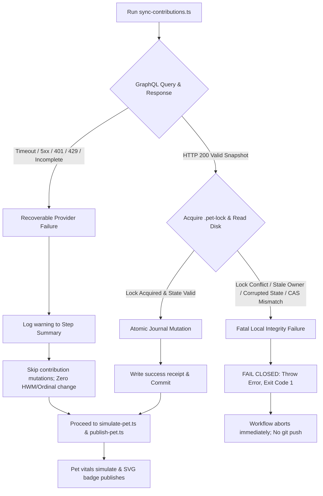

# Phase 3C2-R3 — GitHub Contribution Synchronization: Architecture & Feasibility Specification

**Project:** GitHub Profile Pet  
**Workspace:** `D:\Projects\GitHub-Profile-Pet`  
**Milestone:** Phase 3C2-R3 (Installation Baseline & Reward Ordinal Separation — Implementation NOT Authorized)  
**Status:** Reconciled Architecture & Accounting Specification  
**Operating Cost Target:** ₹0/month Recurring  
**Execution Environment:** GitHub Actions (Standard Ubuntu Runners)  
**Authoritative Storage:** User Repository-Owned Storage (`pet/state/pet.json`, `pet/ledger/contributions.json`)  

---

## 1. Current Architecture Audit

### 1.1 Active Repository State & Persistence Files
* **Pet State (`pet/state/pet.json`):** Conforms to `pet/schemas/pet.schema.json`. Authoritative source for schema version 1, CAS generation, base identity (`name`, `species`), level progression (`level`, `xp`, `maxExp`), vitals (`energy`, `hunger`, `happiness`), fixed-point decay and recovery accumulators (`energyAccumulator`, `hungerDecayAccumulator`, `happinessDecayAccumulator`), evolution stage, mood, and ISO-8601 UTC timestamps (`lastInteractionTime`, `lastOfflineResolutionTime`, `lastSimulatedAt`, `updatedAt`).
* **Contribution Ledger (`pet/ledger/contributions.json`):** Conforms to `pet/schemas/contributions.schema.json` (as updated in Section 4.3). Tracks:
  * `schemaVersion`, `generation`.
  * `ownerDatabaseId`: Permanent numeric user ID anchor.
  * `ownerLogin`: Current GitHub username.
  * `installationBaseline`: Persistent metadata recording installation completion status, timestamp, baseline UTC date, and initial baseline counts.
  * `dailyHwm`: Dictionary mapping UTC date strings (`YYYY-MM-DD`) to that day's monotonic peak public contribution count.
  * `dailyRewardOrdinal`: Dictionary mapping UTC date strings (`YYYY-MM-DD`) to that day's monotonic count of post-installation discovered reward increments.
  * `dailyAccruedXp`: Dictionary mapping UTC date strings (`YYYY-MM-DD`) to accrued Activity XP (capped at 300).
  * `hourlyIncrementUsage`: Dictionary mapping UTC hour strings (`YYYY-MM-DDTHH`) to the count of processed increments (capped at 5).
  * `slices`: Array of active, pending, rewarded, and forfeited contribution unit slices (`units: 1`).
  * `monthlyHistoricalSummary`: Array of compacted historical month records.
* **State Repository (`src/features/pet-engine/persistence/stateRepository.ts`):** Implements single-writer repository locking (`.pet-lock`) with 30-second stale detection, two-phase atomic directory journaling (`pet/journal/preparing` $\to$ `pet/journal/committed`), and CAS generation verification (`expectedGeneration`).
* **Contribution Accounting Engine (`src/features/pet-engine/accounting/contributionEngine.ts`):** Houses pure reconciliation logic: monotonic high-water mark calculation, diminishing reward evaluation, hourly throttle checks, daily XP caps, and the mathematical conservation invariant.

### 1.2 Active Workflow Runtime
* **Publisher Workflow (`.github/workflows/pet-publisher.yml`):**
  * Cron schedule: Hourly at minute 47 (`47 * * * *`). *(Note: A secondary schedule entry `23 */6 * * *` is physically present in the file as a legacy relic from Sprint 2.5; see Section 8 for reconciliation).*
  * Shared concurrency group: `pet-runtime-${{ github.repository }}` with `cancel-in-progress: false`.
  * Permissions: Least-privilege `contents: write`.
  * Executes passive pet simulation (`scripts/simulate-pet.ts`) and SVG generation (`scripts/publish-pet.ts`), followed by an idempotent commit and push retry loop (up to 3 rebase retries).
* **Care Interaction Workflow (`.github/workflows/pet-interaction.yml`):** Event-driven inbox processor for GitHub Issues (`feed`, `train`, `rest`, `pet`) sharing the same concurrency group.

### 1.3 Superseded Centralized Architecture Audit
The following legacy components belong strictly to the superseded centralized application server architecture and **must not be referenced or deployed** in the GitHub-native runtime:
* `src/app/api/github/contributions/route.ts` & `src/app/api/internal/sync/route.ts`: Central Next.js API route handlers.
* `migrations/009_contribution_reward_accounting.sql`: PostgreSQL tables (`daily_sync_states`, `contribution_increment_slices`).
* `src/lib/db/pool.ts`, `src/lib/db/repositories/userRepository.ts`, `src/lib/db/repositories/syncRepository.ts`: Relational database connection pools and SQL repositories.
* `.github/workflows/scheduled-contribution-sync.yml`: Centralized curl webhook calling external URLs with `SYNC_CRON_SECRET`.

**Reusable Core Code:**
* Native fetch-based GraphQL client (`src/lib/github/graphqlClient.ts`) featuring token redaction, bounded full-jitter retries, and typed failure classifications.
* Core GraphQL `contributionsCollection` query syntax.
* Diminishing reward math formulas (`calculateIncrementXp`, `calculateIncrementSatiety`).
* Mathematical accounting conservation invariant formula.

---

## 2. Supported API and Authentication Feasibility

### 2.1 Account Identification & Organization Handling
In GitHub's identity architecture:
* A username (`login`, e.g. `octocat`) is a mutable handle that users can alter at any time in account settings.
* An account's numeric user ID (`databaseId`, e.g. `583231`) is permanent and immutable for the lifetime of the account.
* **Personal vs Organization Repositories:**
  * By default, `github.repository_owner` resolves the repository owner.
  * In personal repositories (`username/profile-pet`), `github.repository_owner` directly identifies the personal user account.
  * In **organization-owned repositories** (`org-name/profile-pet`), `github.repository_owner` is an organization. Querying `user(login: "org-name")` in GraphQL returns `null` or an error because organizations are of GraphQL type `Organization` and do not possess a user `contributionsCollection`.
  * **Resolution Rule:** For organization-owned repositories, the user MUST configure an explicit repository variable `PET_OWNER_LOGIN` identifying the individual user whose contributions are to be synced.
* **Immutable User ID Verification Protocol:**
  1. The workflow resolves the candidate username: `vars.PET_OWNER_LOGIN || github.repository_owner`.
  2. The GraphQL query fetches `user(login: $login) { databaseId id login }`.
  3. If `user` is null, the synchronization **fails closed** with an explicit error: *"Configured owner is not an individual GitHub user."*
  4. On initial setup, the returned integer `databaseId` is immutably recorded in `pet/ledger/contributions.json` as `ownerDatabaseId`.
  5. On every subsequent run, the engine asserts `fetchedDatabaseId === ledger.ownerDatabaseId`. If a different account forks the repository, the `databaseId` mismatch halts synchronization immediately, preventing unauthorized account synchronization.

```mermaid
sequenceDiagram
    autonumber
    participant Actions as GitHub Actions Runner
    participant API as GitHub GraphQL API
    participant Ledger as pet/ledger/contributions.json

    Actions->>API: query UserContributionSnapshot($username, $from, $to)
    API-->>Actions: user { databaseId: 583231, login: "octocat", contributionsCollection: { ... } }
    alt user is null (e.g. Organization login)
        Actions->>Actions: Abort sync; Log fatal error: "Not a personal user account"
    else user exists
        Actions->>Ledger: Compare databaseId against ledger.ownerDatabaseId
        alt DatabaseId Mismatch
            Actions->>Actions: Abort sync; Log warning; Zero ledger mutations
        else Identity Verified
            Actions->>Ledger: Proceed to Per-Period High-Water Mark Reconciliation
        end
    end
```

### 2.2 Public Contribution Totals via GraphQL
GitHub's official GraphQL API exposes user contribution summaries via the `contributionsCollection` field on the `User` object:

```graphql
query UserContributionSnapshot(
  $username: String!
  $from: DateTime!
  $to: DateTime!
) {
  user(login: $username) {
    id
    databaseId
    login
    contributionsCollection(from: $from, to: $to) {
      startedAt
      endedAt
      totalCommitContributions
      totalIssueContributions
      totalPullRequestContributions
      totalPullRequestReviewContributions
      restrictedContributionsCount
      contributionCalendar {
        totalContributions
      }
    }
  }
}
```

### 2.3 Available Contribution Categories & Scope Boundary
To maintain a strict and verifiable product scope, GitHub Profile Pet recognizes only **four explicit contribution categories**:
1. `totalCommitContributions`: Commits authored in public repositories within `[from, to]`.
2. `totalIssueContributions`: Issues opened in public repositories within `[from, to]`.
3. `totalPullRequestContributions`: Pull requests created in public repositories within `[from, to]`.
4. `totalPullRequestReviewContributions`: Pull request reviews submitted in public repositories within `[from, to]`.

*Product Scope Boundary:* Other GitHub platform events (such as creating repositories, starring repositories, creating gists, GitHub Discussions, or sponsorships) are explicitly **excluded from product scope**. They are not recognized as pet activity.

### 2.4 Aggregate Counts vs Individual Commit Identities
> [!IMPORTANT]
> **Definitive Accounting Constraint:**
> GitHub's GraphQL `contributionsCollection` returns **aggregate integers only**. It does not return commit SHAs, commit timestamps, pull request numbers, or issue URLs.
> Consequently, the pet engine cannot and must not claim that an awarded increment corresponds to a specific commit SHA. All game rewards are explicitly documented as **GitHub Activity XP**, awarded when newly observed aggregate counts advance beyond the historical high-water mark.

### 2.5 Calendar Totals vs Category Breakdown Discrepancies
GitHub calculates `contributionCalendar.totalContributions` using internal business rules that differ from the arithmetic sum of the category counts:
1. **Co-Authored Commits:** Multiple co-authors on a single commit may each increment their contribution calendar, but category breakdown counts can reflect author attribution differently.
2. **Private Contribution Flag:** If a user has checked *"Include private contributions on my profile"* in GitHub profile settings, GitHub automatically blends `restrictedContributionsCount` into `contributionCalendar.totalContributions` even on unauthenticated public queries!
3. **Repository Visibility Shifts:** When a private repository is converted to public, GitHub retroactively shifts restricted counts into category counts without altering the calendar total.

**Deterministic Resolution Policy:**
The synchronization engine computes:
$$\text{publicCategoryTotal} = \text{totalCommitContributions} + \text{totalIssueContributions} + \text{totalPullRequestContributions} + \text{totalPullRequestReviewContributions}$$
$$\text{calendarReportedTotal} = \text{contributionCalendar.totalContributions}$$

For public synchronization, the engine binds the high-water mark strictly to **`publicCategoryTotal`**. This guarantees that zero private activity is counted without explicit user configuration and avoids arithmetic discrepancies caused by third-party co-authoring rules.

### 2.6 Handling Incomplete Responses, Errors, and Rate Limits
- If GitHub returns HTTP 200 with a top-level `errors: [...]` array, or if `contributionsCollection` is null: The response is **rejected completely**.
- If GitHub returns HTTP 403 or 429 (rate-limit / abuse detection): The operation is deferred without retrying aggressively.
- Neither the high-water mark nor the reward ordinal counter is ever updated on a partial or failed response.

---

## 3. Public/Private Synchronization Decision

### 3.1 Mode A — Public-Only Synchronization (Default & Sole Initial Mode)
* **Target Audience:** All standard users. Zero initial configuration required.
* **Credential:** Ephemeral `GITHUB_TOKEN` automatically provisioned in GitHub Actions.
* **Permissions Required:** Default repository `contents: write` (for committing updated state). Zero additional API scopes.
* **Feasibility Verification of `GITHUB_TOKEN`:** Standard Actions `GITHUB_TOKEN` has read access to public user profile data across GitHub. It can retrieve `user.contributionsCollection` for any public profile without requiring external OAuth or elevated tokens.
* **Privacy Boundary:** Syncs only public commits, issues, PRs, and PR reviews. `restrictedContributionsCount` is logged as 0 in reward calculations. Private repositories remain completely invisible.

### 3.2 Mode B — Optional Private Contribution Synchronization (Deferred / Unsupported for Initial Release)
* **Status:** **UNSUPPORTED FOR INITIAL RELEASE.**
* **Privacy Risk Analysis:**
  Even when commit messages or code are not parsed, writing private-derived accounting data into a public repository's `contributions.json` or public `README.md` creates a side-channel privacy leak: external observers can inspect the exact timestamps, velocity, and volume of private client or employer development work.
* **Architectural Prerequisite for Safe Private Sync:**
  To support private contribution sync safely without leaking private activity patterns, the architecture requires a **two-repository deployment model**:
  1. A *private engine repository* holding the authoritative `pet/` state and private contribution ledger.
  2. An automated publication workflow exporting only the sanitized, aggregate visual `pet.svg` and high-level level/vitals stats to the user's *public profile repository*.
  Because this two-repository separation is not part of the initial single-repository architecture, Mode B is marked **unsupported** for initial implementation.
* **Fine-Grained PAT Correction:**
  GitHub documentation explicitly designates `read:user` (Classic PAT) as the scope for private and internal contribution count inclusion. Fine-grained PAT "Profile read" permissions cannot be assumed equivalent across organizations without independent verification. `repo` scope must **never be requested or used**.
* **Future Migration & Baseline Reset Policy:**
  If Mode B is enabled in a future milestone, switching modes introduces a large immediate jump in observed counts. The engine must treat a mode switch as an **explicit baseline reset**: the initial private observation establishes a new baseline HWM without awarding retroactive Activity XP for past private work.

---

## 4. Contribution Data Model & Per-Period Tracking

### 4.1 UTC Accounting Period Model & Stable Boundaries
To eliminate discrepancies from rolling windows or shifting timezone boundaries, the engine operates on **stable, fixed UTC calendar days**:
* **Period Window:** Exact UTC calendar day:
  $$\text{from} = \text{"YYYY-MM-DDT00:00:00.000Z"}, \quad \text{to} = \text{"YYYY-MM-DDT23:59:59.999Z"}$$
* **Normalized Categories:** For each period, the engine queries the 4 eligible public categories and computes `observedPeriodTotal = commits + issues + prs + reviews`.
* **Per-Period Counters Storage:**
  `pet/ledger/contributions.json` maintains two separate per-period dictionaries:
  1. `dailyHwm`: Records the highest aggregate public contribution count observed for that date.
  2. `dailyRewardOrdinal`: Records the count of newly discovered, eligible post-installation reward increments for that date.

```json
"dailyHwm": {
  "2026-11-15": 12,
  "2026-11-16": 15
},
"dailyRewardOrdinal": {
  "2026-11-15": 2,
  "2026-11-16": 1
}
```

### 4.2 Installation Baseline Lifecycle (R2-01 & R3 Reconciled)
To prevent historical baseline activity from consuming post-installation reward positions or awarding unearned retroactive XP, the ledger strictly separates the observed GitHub HWM from the post-installation reward ordinal counter.

```mermaid
flowchart TD
    Start[Execute sync-contributions.ts] --> CheckBaseline{ledger.installationBaseline.completed === true?}
    
    CheckBaseline -- No (First Run) --> InitBaseline[Execute Initial Installation Procedure]
    InitBaseline --> QueryInit[Query GraphQL for Yesterday & Today]
    QueryInit --> RecordBaseline[Set dailyHwm[yesterday] = obsYesterday<br/>Set dailyHwm[today] = obsToday<br/>Set dailyRewardOrdinal[yesterday] = 0<br/>Set dailyRewardOrdinal[today] = 0<br/>Set completed = true, baselineDateUtc = todayUtc]
    RecordBaseline --> ZeroReward[Award Delta = 0 for both days; 0 XP, 0 Slices]
    ZeroReward --> SaveInit[Save Ledger with Baseline Metadata]

    CheckBaseline -- Yes (Normal Run) --> QueryNormal[Query GraphQL for Yesterday & Today]
    QueryNormal --> ForEachDate{For each Date D in [yesterday, today]}
    ForEachDate --> CheckHwmExists{Date D in dailyHwm?}
    CheckHwmExists -- Yes --> CalcDelta[Delta = max(0, obsTotal - dailyHwm[D])]
    CheckHwmExists -- No --> NewDayDefault[dailyHwm[D] defaults to 0<br/>dailyRewardOrdinal[D] defaults to 0<br/>Delta = obsTotal - 0]
    NewDayDefault --> CalcDelta
    CalcDelta --> CheckDelta{Delta > 0?}
    CheckDelta -- No --> NoAction[No new slices; Counters unchanged]
    CheckDelta -- Yes --> AllocateOrdinals[For k = 1 to Delta:<br/>ordinal = dailyRewardOrdinal[D] + k<br/>Create unit slice with immutable ordinal]
    AllocateOrdinals --> AdvanceCounters[dailyHwm[D] = obsTotal<br/>dailyRewardOrdinal[D] += Delta]
    AdvanceCounters --> ProcessRewards[Process up to 5 increments/hr<br/>Award XP & Satiety by dailyOrdinal]
```

1. **Persistent Metadata Contract:**
   The ledger records an explicit `installationBaseline` document:
   ```json
   "installationBaseline": {
     "completed": true,
     "installedAt": "2026-11-16T12:00:00.000Z",
     "baselineDateUtc": "2026-11-16",
     "initialCounts": {
       "yesterday": 10,
       "today": 14
     }
   }
   ```
2. **Initial Installation Procedure (One-Time Execution):**
   - The engine checks: `ledger.installationBaseline?.completed === true`.
   - If `installationBaseline` is absent or `completed !== true`:
     - The engine queries GraphQL for `yesterdayUtc` and `todayUtc`.
     - It sets:
       - `dailyHwm[yesterdayUtc] = observedYesterday`
       - `dailyHwm[todayUtc] = observedToday`
       - `dailyRewardOrdinal[yesterdayUtc] = 0` *(Crucial: Ordinal counter starts at 0)*
       - `dailyRewardOrdinal[todayUtc] = 0` *(Crucial: Ordinal counter starts at 0)*
       - `installationBaseline.completed = true`
       - `installationBaseline.installedAt = nowIso`
       - `installationBaseline.baselineDateUtc = todayUtc`
       - `installationBaseline.initialCounts = { yesterday: observedYesterday, today: observedToday }`
     - **$\Delta$ Evaluation:** Strictly $\Delta_{\text{observed}}(\text{yesterdayUtc}) = 0$ and $\Delta_{\text{observed}}(\text{todayUtc}) = 0$.
     - Exactly **0 Activity XP, 0 satiety, and 0 slices** are generated. Baseline counts are strictly not recorded as new activity increments.
3. **Subsequent UTC Dates Lifecycle:**
   - Once `installationBaseline.completed === true`, the initial installation suppression of rewards is **permanently disabled**.
   - For any subsequent UTC date $D > \text{baselineDateUtc}$:
     - If $D \notin \text{dailyHwm}$: `dailyHwm[D]` defaults to **0**.
     - If $D \notin \text{dailyRewardOrdinal}$: `dailyRewardOrdinal[D]` defaults to **0**.
     - When activity is observed on date $D$: $\Delta_{\text{observed}}(D) = \max(0, \text{observedTotal}(D) - \text{dailyHwm}[D])$.
     - Newly discovered increments receive ordinals starting at $1$ ($0 + 1, 0 + 2, \dots$) and are **fully recognized and rewarded**.
4. **Distinguishing New Installation vs Missing/Corrupted Counters on Restarts:**
   - If `installationBaseline.completed === true`:
     - The document is known to be an established ledger.
     - If `dailyHwm[D]` or `dailyRewardOrdinal[D]` for an active date is unexpectedly missing, unparseable, or inconsistent with recorded slices:
       - **Class B Fatal Local Integrity Failure** $\to$ **FAIL CLOSED** (exit code 1).
       - The engine NEVER silently initializes `dailyRewardOrdinal` from `dailyHwm`.
     - A genuine first installation is ONLY recognized when `installationBaseline` is absent or `completed === false` in an uninitialized ledger (`generation === 1`, empty slices, zero recorded units).

### 4.3 Reconciled Contribution Ledger Schema (`pet/ledger/contributions.json`)
```json
{
  "$schema": "https://json-schema.org/draft/2020-12/schema",
  "title": "ContributionLedgerDocument",
  "type": "object",
  "required": [
    "schemaVersion",
    "generation",
    "ownerDatabaseId",
    "ownerLogin",
    "installationBaseline",
    "dailyHwm",
    "dailyRewardOrdinal",
    "lastSyncReceipt",
    "dailyAccruedXp",
    "hourlyIncrementUsage",
    "slices",
    "monthlyHistoricalSummary"
  ],
  "properties": {
    "schemaVersion": { "type": "integer", "const": 1 },
    "generation": { "type": "integer", "minimum": 1 },
    "ownerDatabaseId": { "type": "integer", "minimum": 1 },
    "ownerLogin": { "type": "string", "minLength": 1 },
    "installationBaseline": {
      "type": "object",
      "required": ["completed", "installedAt", "baselineDateUtc", "initialCounts"],
      "properties": {
        "completed": { "type": "boolean" },
        "installedAt": { "type": "string", "format": "date-time" },
        "baselineDateUtc": { "type": "string", "pattern": "^\\d{4}-\\d{2}-\\d{2}$" },
        "initialCounts": {
          "type": "object",
          "required": ["yesterday", "today"],
          "properties": {
            "yesterday": { "type": "integer", "minimum": 0 },
            "today": { "type": "integer", "minimum": 0 }
          }
        }
      }
    },
    "dailyHwm": {
      "type": "object",
      "description": "Peak aggregate public contribution count observed per UTC date",
      "additionalProperties": { "type": "integer", "minimum": 0 }
    },
    "dailyRewardOrdinal": {
      "type": "object",
      "description": "Monotonic counter of post-installation discovered reward increments per UTC date",
      "additionalProperties": { "type": "integer", "minimum": 0 }
    },
    "lastSyncReceipt": {
      "type": "object",
      "required": ["timestamp", "status", "incrementsProcessed"],
      "properties": {
        "timestamp": { "type": "string", "format": "date-time" },
        "status": { "type": "string", "enum": ["success", "noop", "provider_failure", "rate_limited"] },
        "incrementsProcessed": { "type": "integer", "minimum": 0 },
        "notes": { "type": "string" }
      }
    },
    "dailyAccruedXp": {
      "type": "object",
      "additionalProperties": { "type": "integer", "minimum": 0, "maximum": 300 }
    },
    "hourlyIncrementUsage": {
      "type": "object",
      "additionalProperties": { "type": "integer", "minimum": 0, "maximum": 5 }
    },
    "slices": {
      "type": "array",
      "items": {
        "type": "object",
        "required": [
          "sliceId", "syncDate", "dailyOrdinal", "discoveredAt", "units",
          "status", "rewardedXp", "rewardedSatiety", "expiryAt", "evaluatedAt"
        ],
        "properties": {
          "sliceId": { "type": "string" },
          "syncDate": { "type": "string", "pattern": "^\\d{4}-\\d{2}-\\d{2}$" },
          "dailyOrdinal": { "type": "integer", "minimum": 1 },
          "discoveredAt": { "type": "string", "format": "date-time" },
          "units": { "type": "integer", "const": 1 },
          "status": { "type": "string", "enum": ["rewarded", "forfeited", "pending", "expired"] },
          "rewardedXp": { "type": "integer", "minimum": 0 },
          "rewardedSatiety": { "type": "integer", "minimum": 0 },
          "expiryAt": { "type": "string", "format": "date-time" },
          "evaluatedAt": { "type": ["string", "null"], "format": "date-time" }
        }
      }
    },
    "monthlyHistoricalSummary": {
      "type": "array",
      "items": {
        "type": "object",
        "required": ["month", "totalObservedUnits", "rewardedUnits", "forfeitedUnits", "expiredUnits", "rewardedXp", "rewardedSatiety"],
        "properties": {
          "month": { "type": "string", "pattern": "^\\d{4}-\\d{2}$" },
          "totalObservedUnits": { "type": "integer", "minimum": 0 },
          "rewardedUnits": { "type": "integer", "minimum": 0 },
          "forfeitedUnits": { "type": "integer", "minimum": 0 },
          "expiredUnits": { "type": "integer", "minimum": 0 },
          "rewardedXp": { "type": "integer", "minimum": 0 },
          "rewardedSatiety": { "type": "integer", "minimum": 0 }
        }
      }
    }
  }
}
```

---

## 5. High-Water Mark Algorithm & Monotonicity

### 5.1 Per-Period Monotonic Calculation
For each target UTC period $P$ (`YYYY-MM-DD`):

$$\Delta_{\text{observed}}(P) = \max\left(0, \text{observedTotal}(P) - \text{dailyHwm}[P]\right)$$
$$\text{dailyHwm}_{\text{next}}[P] = \max\left(\text{dailyHwm}[P], \text{observedTotal}(P)\right)$$

* **Separation of Concerns:** `dailyHwm[P]` tracks the raw aggregate public contribution count from GitHub. It is used **exclusively** to detect newly observed increments ($\Delta > 0$) and prevent duplicate rewards after count decreases or retries.
* **Non-Regression Invariant:** If a user rebases or deletes commits, causing $\text{observedTotal}(P) < \text{dailyHwm}[P]$, $\Delta_{\text{observed}}(P) = 0$. Neither `dailyHwm[P]` nor `dailyRewardOrdinal[P]` decreases; pet stats never regress.
* **Subsequent Recovery:** If activity later rises, only counts exceeding the previously recorded $\text{dailyHwm}[P]$ become eligible for reward evaluation.

---

## 6. Reward Accounting State Machine & Durable Ordinals

### 6.1 Durable Daily Reward Ordinals & Counter Separation (R3 Reconciled)
To guarantee that historical baseline activity does not consume post-installation reward positions, every UTC date maintains an independent post-installation reward counter: `dailyRewardOrdinal[date]`.

1. **Discrete Ordinal Allocation Sequence:**
   - Let $O_{\text{old}} = \text{dailyRewardOrdinal}[D]$.
   - When a complete snapshot reports $\Delta = \max(0, \text{observedTotal}(D) - \text{dailyHwm}[D]) > 0$:
     $$\text{dailyOrdinal}_k = O_{\text{old}} + k, \quad \text{for } k \in [1, \Delta]$$
   - Each newly discovered increment is assigned its sequential `dailyOrdinal}_k` and created as a unit slice (`units: 1`).
   - The counter advances:
     $$\text{dailyRewardOrdinal}_{\text{next}}[D] = O_{\text{old}} + \Delta$$
   - `dailyHwm[D]`, `dailyRewardOrdinal[D]`, and the newly created slices are committed **atomically** in the same durable two-phase journal transaction.
2. **Immutability While Pending:**
   - Each increment record explicitly stores its `syncDate` and its `dailyOrdinal`.
   - The ordinal is fixed at discovery and **never changes**.
   - If an increment is queued as `pending` due to the 5-increment/hour limit, its `dailyOrdinal` remains unchanged regardless of how many hours pass before evaluation.
   - When evaluated, its reward is computed strictly using its immutable `dailyOrdinal`:
     $$\text{xp}(\text{dailyOrdinal}) = \begin{cases} 25 & \text{if } \text{dailyOrdinal} = 1 \\ 15 & \text{if } \text{dailyOrdinal} = 2 \\ 10 & \text{if } \text{dailyOrdinal} = 3 \\ 5 & \text{if } \text{dailyOrdinal} = 4 \\ 5 & \text{if } \text{dailyOrdinal} \ge 5 \end{cases}$$
     $$\text{satiety}(\text{dailyOrdinal}) = \begin{cases} 10 & \text{if } \text{dailyOrdinal} = 1 \\ 5 & \text{if } \text{dailyOrdinal} = 2 \\ 2 & \text{if } \text{dailyOrdinal} = 3 \\ 1 & \text{if } \text{dailyOrdinal} = 4 \\ 1 & \text{if } \text{dailyOrdinal} \ge 5 \end{cases}$$
3. **Deterministic Evaluation Order Across Hourly Runs:**
   - In any execution of `sync-contributions.ts`, the engine collects all pending increments and newly discovered increments.
   - Evaluation order is strictly sorted by:
     $$\text{Sort Key} = (\text{syncDate ASC}, \text{dailyOrdinal ASC})$$
   - The engine processes increments sequentially up to the hourly limit of 5 increments per UTC hour.
4. **Interaction Between Yesterday's Late-Settling Increments and Today's Increments:**
   - Yesterday's increments have `syncDate = yesterday` and daily ordinals based on `dailyRewardOrdinal[yesterday]`.
   - Today's increments have `syncDate = today` and daily ordinals based on `dailyRewardOrdinal[today]`.
   - When evaluating in the current hour:
     - Because `yesterday < today`, yesterday's pending increments are evaluated first.
     - Each evaluated yesterday increment consumes 1 unit of the **current hour's throttle quota** (`hourlyIncrementUsage[currentHour]`).
     - Crucially: **XP and Satiety accounting draws from yesterday's daily cap**:
       $$\text{dailyAccruedXp}[\text{yesterday}] + \text{xp} \le 300$$
       If yesterday's 300 XP cap is reached, remaining yesterday increments are marked `forfeited`.
     - Today's increments are evaluated next (if hourly quota remains), and their rewards draw against **today's daily cap** (`dailyAccruedXp[today]`).
     - Yesterday's ordinals do NOT alter or shift today's ordinals. Today's first increment still receives ordinal 1 ($25\text{ XP}$, $+10\text{ satiety}$), provided today has cap room.
5. **Survival Across Restarts, Recovery, and Retries:**
   - Because ordinals, HWM, and `dailyRewardOrdinal` are durably stored in `pet/ledger/contributions.json`, journal recovery and rebase retries preserve exact assignments.
   - Restarts never cause re-shuffling or reward variation.

### 6.2 Canonical Worked Examples (Phase 3C2-R3)

#### Example A — Installation-Day Baseline
* **Initial State:** Initial installation executes. Complete GraphQL snapshot reports 14 contributions for today (`2026-11-16`).
* **Installation Commit:**
  * `dailyHwm["2026-11-16"] = 14`
  * `dailyRewardOrdinal["2026-11-16"] = 0`
  * `installationBaseline = { completed: true, installedAt: "...", baselineDateUtc: "2026-11-16", initialCounts: { yesterday: 10, today: 14 } }`
  * $\Delta = 0$; zero retroactive slices created; zero XP or satiety awarded.
* **Next Snapshot:** Later run reports 15 contributions for today.
  * $\Delta = \max(0, 15 - 14) = 1$.
  * $O_{\text{old}} = \text{dailyRewardOrdinal}["2026-11-16"] = 0$.
  * Increment created: `dailyOrdinal = 0 + 1 = 1`.
  * Reward evaluation for ordinal 1: **25 XP** and **+10 Satiety**.
  * Updated State: `dailyHwm["2026-11-16"] = 15`, `dailyRewardOrdinal["2026-11-16"] = 1`.

#### Example B — Yesterday's Late-Settling Contribution
* **Initial State:** Baseline observes 10 contributions for yesterday (`2026-11-15`).
  * `dailyHwm["2026-11-15"] = 10`, `dailyRewardOrdinal["2026-11-15"] = 0`.
* **Later Snapshot:** Snapshot reports 11 contributions for yesterday.
  * $\Delta = \max(0, 11 - 10) = 1$.
  * $O_{\text{old}} = \text{dailyRewardOrdinal}["2026-11-15"] = 0$.
  * Increment created: `syncDate = "2026-11-15"`, `dailyOrdinal = 0 + 1 = 1`.
  * Reward evaluation for yesterday's ordinal 1: **25 XP** and **+10 Satiety**, drawing from yesterday's 300 XP budget.
  * Updated State: `dailyHwm["2026-11-15"] = 11`, `dailyRewardOrdinal["2026-11-15"] = 1`.

#### Example C — Existing Date with Previously Discovered Increments
* **Initial State:** Date has `dailyHwm = 14` and `dailyRewardOrdinal = 3` (ordinals 1, 2, 3 already assigned).
* **New Snapshot:** Snapshot reports 16 contributions.
  * $\Delta = \max(0, 16 - 14) = 2$.
  * Increments created:
    * First increment: `dailyOrdinal = 3 + 1 = 4` (awards **5 XP**, **+1 Satiety**).
    * Second increment: `dailyOrdinal = 3 + 2 = 5` (awards **5 XP**, **+1 Satiety**).
  * Updated State: `dailyHwm = 16`, `dailyRewardOrdinal = 5`.
* **Duplicate Snapshot:** A subsequent snapshot reports 16 again.
  * $\Delta = \max(0, 16 - 16) = 0$.
  * Zero new slices created; `dailyHwm` remains 16; `dailyRewardOrdinal` remains 5.

#### Example D — Count Regression and Recovery
* **Initial State:** Date has `dailyHwm = 16` and `dailyRewardOrdinal = 5`.
* **Count Regression:** User rebases/squashes commits. Snapshot reports 12.
  * $\Delta = \max(0, 12 - 16) = 0$.
  * Neither counter decreases: `dailyHwm` remains 16; `dailyRewardOrdinal` remains 5.
* **Subsequent Recovery & Growth:** User authors new work. Snapshot reports 18.
  * $\Delta = \max(0, 18 - 16) = 2$.
  * Increments created:
    * First increment: `dailyOrdinal = 5 + 1 = 6` (awards **5 XP**, **+1 Satiety**).
    * Second increment: `dailyOrdinal = 5 + 2 = 7` (awards **5 XP**, **+1 Satiety**).
  * Updated State: `dailyHwm = 18`, `dailyRewardOrdinal = 7`.

### 6.3 Individual Increment Hourly Processing Limit
The approved throttle limit is **five individual contribution increments per UTC hour**, not five multi-unit slices:

$$\text{hourlyQuotaRemaining} = \max\left(0, 5 - \text{hourlyIncrementUsage}[\text{hourKey}]\right)$$

**Concrete Example (40 Newly Observed Increments):**
If 40 new increments are discovered in a single hour on date $D$ where $O_{\text{old}} = 0$:
* **Ordinal Assignment:** Exactly 40 slices are assigned ordinals $1, 2, \dots, 40$. `dailyRewardOrdinal[D]` advances from $0$ to $40$.
* **Immediately Processed:** Exactly **5 increments** (ordinals 1 through 5) are processed in the current hour, awarding $25+15+10+5+5 = 60\text{ XP}$ and $10+5+2+1+1 = 19\text{ satiety}$.
* **Queued as Pending:** The remaining **35 increments** (ordinals 6 through 40) are queued as `pending`, maintaining their original `syncDate`, immutable `dailyOrdinal`, and 48-hour expiration.
* **Subsequent Drain:** In each subsequent hourly run, up to 5 pending increments are evaluated until the queue is drained or the slices expire.

### 6.4 Diminishing Activity Reward Schedule
Every newly processed contribution increment is rewarded based on its daily ordinal within the increment's `syncDate`:

| Daily Contribution Increment Ordinal | Activity XP Awarded | Satiety Restored (Hunger) | Diminishing Rationale |
|:---:|:---:|:---:|:---|
| **1st Increment** | **25 XP** | **+10 Satiety** | Strong incentive for initiating daily developer activity. |
| **2nd Increment** | **15 XP** | **+5 Satiety** | Meaningful reward for sustained development flow. |
| **3rd Increment** | **10 XP** | **+2 Satiety** | Moderate continuation bonus. |
| **4th Increment** | **5 XP** | **+1 Satiety** | Sustained maintenance activity. |
| **5th and Subsequent Increments** | **5 XP** | **+1 Satiety** | Flat sustainable progression; prevents farming. |

*Initial Slice Math Reconciliation:*
When exactly 5 increments are processed at the start of a UTC day:
$$\text{Total XP} = 25 + 15 + 10 + 5 + 5 = \mathbf{60\text{ XP}}$$
$$\text{Total Satiety} = 10 + 5 + 2 + 1 + 1 = \mathbf{19\text{ Satiety}}$$
This matches the historical 5-increment benchmark ($60\text{ XP}$, $19\text{ Satiety}$) while enforcing granular per-increment evaluation.

### 6.5 Daily Cap & Forfeiture
* **Daily Cap:** Maximum **300 Activity XP** per calendar UTC day (`DAILY_CONTRIBUTION_XP_CAP = 300`).
* **Forfeiture:** Increments evaluated after the daily 300 XP cap is exhausted are marked `forfeited`. Forfeited increments yield 0 XP and 0 satiety, count toward total recorded contributions, and are permanently resolved.

---

## 7. Historical Settlement Boundary & Compaction

### 7.1 Supported Historical Settlement Window
1. **Queried UTC Dates:**
   - The engine queries exactly two discrete UTC calendar days per run:
     - **Yesterday:** `from = yesterdayT00:00:00.000Z`, `to = yesterdayT23:59:59.999Z`
     - **Today:** `from = todayT00:00:00.000Z`, `to = todayT23:59:59.999Z`
2. **Supported Historical Settlement Window:**
   - The settlement window covers the current UTC day and the immediate prior UTC day ($T \in [\text{yesterday midnight}, \text{now}]$).
   - Maximum age of an eligible newly observed increment is at most **48 hours from yesterday's midnight UTC**.
3. **Beyond-Boundary Contributions (Older than Yesterday UTC):**
   - If GitHub indexes, reveals, or un-privates a contribution for a date $D \le \text{today} - 2\text{ days}$ (e.g. 3 days ago, or a commit backdated a week ago and pushed today):
   - **Handling:** That date is outside the queried settlement window. The engine **does not query and does not observe it**. Consequently, it receives **no rewards**.
   - **Unavoidable Missed-Reward Limitation:** This is an intentional, documented product boundary. GitHub's GraphQL API does not provide an event log or push stream of retroactive public profile index additions. Iterating through past weeks/months on an hourly cron would exceed GraphQL rate limits ($1,000\text{ points/hr}$) and Actions execution timeouts. Therefore, user activity must appear in GitHub's profile index within the 2-day window $[yesterday, today]$ to be rewarded.
4. **Indexing Latency Notice (Evidence-Based):**
   - GitHub contribution indexing latency is subject to internal queue depths and varies unpredictably. Commits typically appear on public profiles within seconds to minutes, but during peak platform load or upstream incidents, indexing can be delayed. The 2-day query window $[yesterday, today]$ provides a buffer for late-settling commits, but delays exceeding the settlement window cannot be captured.
5. **Retention and Compaction of Historical Counters:**
   - `dailyHwm` and `dailyRewardOrdinal` entries are retained in active storage for all days in the current calendar month and previous calendar month (minimum 30 days).
   - Compaction must **never cause ordinal reuse**. If a date in a past month had `dailyRewardOrdinal = 5`, that entry never resets to 0.
6. **Pending Increments Retain Original Accounting Date & Expiry:**
   - Every pending increment holds immutable `syncDate`, `dailyOrdinal`, and `expiryAt = Date(syncDate + "T00:00:00Z") + 48h UTC`.
   - Pending increments are evaluated using their `syncDate`'s daily cap, regardless of what day they are processed.
   - Pending increments are NEVER discarded or compacted by historical maintenance while still in `pending`.

### 7.2 Unit-Level Conservation and Monthly Compaction
1. **Unit-Level Representation in Contribution Slices:**
   - Every slice in `slices` represents **strictly 1 unit** (`units: 1`):
     - Every increment has an exact unique `sliceId` (e.g. `slice-${syncDate}-${dailyOrdinal}`).
     - Every increment carries its own `dailyOrdinal`, `status`, `rewardedXp`, `rewardedSatiety`, and `evaluatedAt`.
     - There is zero ambiguity about individual units within a batch slice.
     - Slices can be filtered and aggregated directly without complex sub-indexing.
2. **Universal Conservation Invariant:**
   $$\text{totalRecordedUnits} \equiv \text{rewardedUnits} + \text{forfeitedUnits} + \text{pendingUnits} + \text{expiredUnits}$$
3. **Exclusion of Initial Baseline Counts:**
   - The installation baseline counts (e.g. 14 commits already on profile when installed) are stored in `installationBaseline.initialCounts` and `dailyHwm`.
   - They are **strictly EXCLUDED** from `totalContributionsRecorded`, active `slices`, and `monthlyHistoricalSummary`.
   - `totalContributionsRecorded` represents strictly the lifetime count of *post-installation discovered activity increments*.
4. **Compaction Rules and Invariant Preservation:**
   - Monthly compaction runs on the 1st of each month (or first run of a new month).
   - Eligibility for compaction:
     - Slices must belong to a completed prior calendar month ($M < \text{currentMonth}$).
     - Slices must be in a terminal resolved status (`rewarded`, `forfeited`, `expired`).
     - **RULE: Pending slices are NEVER compacted.** Regardless of date, any slice in `pending` must remain in the active `slices` array until evaluated.
   - For an eligible prior month $M$:
     - Count terminal units: $R = \sum \text{rewarded}$, $F = \sum \text{forfeited}$, $E = \sum \text{expired}$.
     - Sum XP and Satiety: $\text{Xp}_M = \sum \text{rewardedXp}$, $\text{Sat}_M = \sum \text{rewardedSatiety}$.
     - Create or update `monthlyHistoricalSummary` entry:
       ```json
       {
         "month": "2026-10",
         "totalObservedUnits": R + F + E,
         "rewardedUnits": R,
         "forfeitedUnits": F,
         "expiredUnits": E,
         "rewardedXp": Xp_M,
         "rewardedSatiety": Sat_M
       }
       ```
     - Remove the compacted slices from active `slices`.
   - **Post-Compaction Invariant Verification:**
     $$\text{totalRecordedUnits} = \sum_{m \in \text{monthlySummary}} m.\text{totalObservedUnits} + \sum_{s \in \text{activeSlices}} s.\text{units}$$
     $$\text{totalRewardedUnits} = \sum_{m \in \text{monthlySummary}} m.\text{rewardedUnits} + \sum_{s \in \text{activeSlices, rewarded}} s.\text{units}$$
     $$\text{totalForfeitedUnits} = \sum_{m \in \text{monthlySummary}} m.\text{forfeitedUnits} + \sum_{s \in \text{activeSlices, forfeited}} s.\text{units}$$
     $$\text{totalExpiredUnits} = \sum_{m \in \text{monthlySummary}} m.\text{expiredUnits} + \sum_{s \in \text{activeSlices, expired}} s.\text{units}$$
     $$\text{totalPendingUnits} = \sum_{s \in \text{activeSlices, pending}} s.\text{units}$$
     Exact conservation holds across all time before and after every compaction.

---

## 8. Workflow Schedule & Concurrency Reconciliation

### 8.1 Schedule Audit & Duplicate Trigger Elimination
Inspection of `.github/workflows/pet-publisher.yml` reveals two existing cron entries:
```yaml
schedule:
  - cron: '47 * * * *'    # Approved Phase 3C1 hourly simulation cadence
  - cron: '23 */6 * * *'  # Legacy 6-hour refresh relic from Sprint 2.5
```
* **Audit Finding:** The approved Phase 3C1 runtime is **hourly at minute 47** (`47 * * * *`). The secondary entry `23 */6 * * *` is an obsolete relic from Sprint 2.5 that creates 4 redundant executions per day.
* **Specification Reconciliation:** Contribution synchronization aligns strictly with the approved hourly cadence at **minute 47** (`47 * * * *`). The removal of the redundant `23 */6 * * *` trigger is scheduled strictly for the workflow update milestone (3C2.5). **No workflow changes are authorized by this revision.**

### 8.2 GitHub Actions Concurrency Realities
In GitHub Actions, concurrency groups:
```yaml
concurrency:
  group: pet-runtime-${{ github.repository }}
  cancel-in-progress: false
```
* **Actual Platform Queue Behavior:** A concurrency group permits **at most one running job and one queued pending job**.
* **Pending Job Replacement:** If a newer workflow run triggers while a pending job is already waiting in queue, GitHub Actions **replaces the older pending job with the newer run**. Intermediate scheduled runs can be dropped entirely during runner backlogs!
* **Why the System Remains 100% Correct:**
  1. The GraphQL query fetches **cumulative totals for the fixed UTC day**, not "events since the last execution".
  2. The high-water mark comparison $\Delta = \max(0, \text{observed} - \text{HWM})$ operates on cumulative state.
  3. If 3 scheduled runs are skipped or replaced by GitHub Actions, the single run that eventually executes calculates the full cumulative delta, processes 5 increments, queues the rest, and commits atomically. Zero increments are lost or double-counted.

---

## 9. Failure Classification: Provider vs. Local Persistence

To ensure system reliability, failures are divided into two strictly isolated classes:



### 9.1 Class A: Recoverable Provider Failure
* **Failure Triggers:** HTTP timeouts, transient network drops, GraphQL `errors: [...]`, rate limits (403/429), authentication revocation (401), or incomplete response payload.
* **System Response:** Fails soft with respect to pet simulation.
  * Does NOT advance `dailyHwm`.
  * Does NOT advance `dailyRewardOrdinal`.
  * Does NOT award Activity XP or satiety.
  * Does NOT mutate `pet/ledger/contributions.json`.
  * Logs an informative warning notice in GitHub Step Summary.
* **Isolation Guarantee:** Passive pet simulation (`simulate-pet.ts`) and SVG publication (`publish-pet.ts`) **continue normally** if local state is healthy. The pet continues to process offline inactivity decay, recovers energy, and updates its badge.
* **Receipt Policy:** No false "success" receipt is ever written. If local state was untouched, writing a receipt to disk is avoided to prevent unnecessary Git commits.

### 9.2 Class B: Fatal Local Integrity Failure
* **Failure Triggers:** Corrupted JSON files, missing or corrupted `dailyRewardOrdinal`, journal recovery failure, unresolvable `.pet-lock` conflict, CAS generation mismatch, or atomic rename failure.
* **System Response:** **FAILS CLOSED IMMEDIATELY**.
  * Execution throws an unhandled error and exits with code 1.
  * The workflow halts immediately.
  * No simulation, no publication, and no Git commit/push occurs.
  * Preserves disk state to prevent compounding corrupted data.

---

## 10. Atomic Persistence & Two-Phase Journal Protocol

### 10.1 "No Network Under Lock" Invariant
All network I/O occurs strictly before `.pet-lock` acquisition:

```
[ Step 1: External GraphQL Query ] (NO LOCK HELD)
    Query GitHub API -> Validate Complete Snapshot
                 │
                 ▼
[ Step 2: Lock Acquisition ]
    Acquire .pet-lock -> Check owner ID -> Stale lock recovery
                 │
                 ▼
[ Step 3: Journal Recovery ]
    Scan pet/journal/ -> Clean up interrupted transactions
                 │
                 ▼
[ Step 4: Authoritative Mutation ]
    Re-read state from disk (CAS check) -> Re-calculate delta against dailyHwm
    Allocate ordinals via dailyRewardOrdinal -> Advance both counters atomically
    Apply reward schedule & caps -> Write two-phase journal -> Atomic directory rename
                 │
                 ▼
[ Step 5: Lock Release ]
    Release .pet-lock
                 │
                 ▼
[ Step 6: Visual Publication ]
    Regenerate public/pet.svg -> Update README.md -> Git commit & push
```

### 10.2 Crash Recovery
If a runner terminates during journal writing, `recoverRepositoryState()` automatically cleans incomplete `pet/journal/preparing` directories on the next run, rolling back to the last valid generation. Because `dailyHwm`, `dailyRewardOrdinal`, and slices are committed atomically in the same journal transaction, an interrupted transaction cannot advance the HWM without recording its corresponding slices and ordinal counter.

---

## 11. Rate Limits & Provider Resilience Policy

### 11.1 Accurate GraphQL Rate-Limit Terminology
* **Token Quota:** Ephemeral `GITHUB_TOKEN` receives **1,000 GraphQL points per hour per repository**.
* **Query Cost:** GraphQL query cost is dynamically computed by GitHub based on schema complexity. While a simple scalar query has a minimum cost of 1 point, it must not be assumed to be unconditionally 1 point.
* **Response Headers:** The engine reads actual rate-limit headers: `x-ratelimit-remaining`, `x-ratelimit-reset`, and `rateLimit { cost remaining resetAt }`.
* **REST vs GraphQL Distinction:** The 1,000 GraphQL point quota is tracked separately from REST API request quotas (which apply to issue queries).

### 11.2 Bounded Full-Jitter Retry Policy
* **Timeout:** Strict 10,000 ms per request via native `AbortSignal.timeout(10_000)`.
* **Retries:** Maximum 3 attempts with full-jitter exponential backoff ($1\text{s}$, $2\text{s}$, $4\text{s}$).
* **Execution Deadline:** Total request phase must complete within 15 seconds.
* **Secondary Rate Limits:** If GitHub returns `Retry-After: N`:
  * If $N \le 5$ seconds: Sleep $N$ seconds and retry once.
  * If $N > 5$ seconds: Exit immediately, log notice, and defer to next hourly run.

---

## 12. Security & Privacy Threat Model

### 12.1 Specific Privacy Guarantees & Known Limitations
| Threat Scenario | Specific System Guarantee | Known Technical Limitation | Status |
|:---|:---|:---|:---:|
| **Private Activity Exposure** | Mode A queries public GraphQL fields only (`totalCommitContributions`, `totalIssueContributions`, `totalPullRequestContributions`, `totalPullRequestReviewContributions`). `restrictedContributionsCount` is ignored and excluded. No private repository names, issue titles, commit messages, or diffs enter public ledgers or SVGs. | Public commit count spikes in profile pet are visible to anyone inspecting the public repository, which may correlate with general developer activity periods. Mode B remains unsupported. | **Public Data Scoped** |
| **Token Secret Exposure** | Native string sanitization strips bearer tokens and credential headers from error logs and Step Summaries. Actions runs operate with `set +x` to prevent secret echoing. Ephemeral `GITHUB_TOKEN` is automatically revoked upon job completion. | Workflows with `contents: write` running on the branch can read repository environment variables. Third-party Actions must be audited to prevent token exfiltration. | **Sanitized & Scoped** |
| **Identity Hijacking** | Ledger binds immutable numeric `ownerDatabaseId`. Sync asserts queried `databaseId == ownerDatabaseId`. | If a user forks a repository and manually alters `ownerDatabaseId` in JSON to their own ID, the fork syncs their own public counts into their own fork. | **Fails Closed on Mismatch** |
| **Rebase / History Rewind** | Monotonic calculation: $\Delta = \max(0, \text{observed} - \text{dailyHwm})$. Counts cannot regress. Deleting or squashing commits cannot generate negative delta, decrease counters, or re-award XP. | If a user deletes commits and subsequently authors new ones, no new rewards are awarded until the new count exceeds the previously recorded peak. | **Monotonically Bounded** |
| **Commit Farming Abuse** | Hard 5 increments/hour throttle; 300 XP/day cap; diminishing returns ($5\text{ XP}$ per increment). | A user scripting 1,000 commits will receive at most 60 XP in hour one and 300 XP across 24 hours, capped permanently. | **Rate-Throttled & Capped** |
| **Corrupted State Commit** | Two-phase journal writing (`preparing` $\to$ `committed`) with checksum/CAS validation prevents partially written JSON documents from replacing active files. Interrupted writes are rolled back on next boot. | Abrupt hypervisor teardown or power loss during disk write can result in journal recovery rolling back to the prior committed generation. | **Journal-Recoverable** |

### 12.2 Public Artifact Sanitization
The public SVG badge (`public/pet.svg`) and profile README display only aggregate numbers (e.g. `Contributions: 1,420`). Project titles, commit messages, branch names, or timestamps are never displayed or stored.

---

## 13. Accurate GitHub Actions Cost & Platform-Limit Analysis

### 13.1 Accurate Minute Rounding for Private Repositories
GitHub Actions billing rules state:
> *"Job execution times are rounded up to the nearest whole minute for each job."*

* **Hourly Execution Calculation:**
  * Average job duration: $\approx 12\text{ seconds}$ per run.
  * Because GitHub rounds up to the nearest whole minute per job, each 12-second run consumes **1 billable minute**!
  * Monthly scheduled runs: $24\text{ runs/day} \times 30.5\text{ days} = 732\text{ runs/month}$.
  * **Actual Billable Consumption:** $732\text{ runs} \times 1\text{ minute} = \mathbf{\approx 732\text{ billable minutes/month}}$ (not 146.4 minutes).
* **Free Tier Allowance:** GitHub Free accounts receive **2,000 included minutes per month**.
  * Total usage: $732 / 2000 \approx \mathbf{36.6\%}$ of the included monthly allowance.
  * Remaining budget: **1,268 minutes/month** available for other workflows.
  * **Operating Cost:** **₹0/month**. Fully sustainable within the free-tier boundary.
* **Account-Level Disclosure:** Actual billable consumption depends on all workflows across all repositories under the user's GitHub account. Users must monitor total account consumption if they run additional CI/CD pipelines.

### 13.2 Accurate Public Repository Runner Limits
Standard GitHub-hosted runners for public repositories have no minute charges, but are subject to platform usage limits:
* **Concurrent Jobs:** Maximum 20 concurrent jobs per account.
* **Job Execution Time:** Maximum 6 hours per job.
* **API Rate Limits:** Ephemeral `GITHUB_TOKEN` is capped at 1,000 requests/points per hour per repository.
* **Fair Use:** Public runners are **not unlimited in capacity or scheduling guarantees**. High runner demand can introduce queue latency.

---

## 14. Failure-Mode & Recovery Matrix

| Failure Mode | Root Cause | System Detection | System Response | Recovery Behavior |
|:---|:---|:---|:---|:---|
| **GraphQL 401 Unauthorized** | Token revoked or invalid. | HTTP status 401. | Fail soft. Log notice. Do not advance HWM or ordinal counter. | Simulation & publication proceed. Sync retries next hour. |
| **GraphQL 403 / 429 Rate Limit** | Secondary rate limit hit. | HTTP status 403/429. | Fail soft. Defer synchronization. | Next scheduled hourly run automatically retries. |
| **GraphQL Incomplete Response** | Query timeout on backend. | HTTP 200 with `errors: [...]`. | Reject response completely. Zero counter advance. | Next successful query discovers full delta. |
| **Identity Mismatch** | Queried `databaseId` differs from ledger. | `databaseId !== ownerDatabaseId`. | Fail closed. Output error annotation. | Halts sync to protect repository integrity. |
| **Dropped Scheduled Run** | Concurrency replacement. | Skipped cron execution. | Next run queries full cumulative daily total. | Processes 5 increments, queues remainder; 0 loss. |
| **Runner Killed Mid-Save** | Actions runner interrupted. | Stale journal files. | `recoverRepositoryState()` cleans partial files. | Next run restores clean state before calculating delta. |
| **Git Push Conflict (HTTP 409)** | Concurrent issue closed. | Non-fast-forward rejection. | Rebase retry loop (up to 3 attempts). | Rebase applies non-conflicting ledger additions. |
| **Count Drop on Force Push** | Commits squashed/rebased. | Observed count < dailyHwm. | $\Delta = 0$. Counters preserved. | Pet stats and XP never regress. |
| **Corrupted Ordinal Counter** | Manual edit or torn write. | Missing key or non-integer value. | Fail closed. Output error annotation. | Halts execution to prevent duplicate/corrupted rewards. |

---

## 15. Staged Implementation Milestones

```
[ Phase 3C2.1 ] -> Provider & Identity Verification
       │
[ Phase 3C2.2 ] -> Per-Period Normalization & Installation Baseline
       │
[ Phase 3C2.3 ] -> Diminishing Reward Engine & Durable Daily Ordinals
       │
[ Phase 3C2.4 ] -> Atomic Repository Persistence & Unit Conservation
       │
[ Phase 3C2.5 ] -> Scheduled Workflow Integration & Failure Isolation
       │
[ Phase 3C2.6 ] -> Security Auditing, Verification & End-to-End Testing
```

### Milestone 3C2.1 — Provider & Identity Verification
* **Scope:** Native `fetch` GraphQL client. Execute `UserContributionSnapshot` query. Bind and verify immutable numeric `databaseId`. Reject organization logins without personal accounts.
* **Approval Gate:** Automated test verifying identity verification, organization rejection, and token redaction.

### Milestone 3C2.2 — Per-Period Normalization & Installation Baseline
* **Scope:** Implement UTC daily date bounding (`[00:00:00Z, 23:59:59Z]`), category sum calculation (`publicCategoryTotal`), per-period `dailyHwm` and `dailyRewardOrdinal` tracking, and explicit `installationBaseline` lifecycle.
* **Approval Gate:** Automated test verifying initial installation zero-reward baseline and post-midnight subsequent date default counters of 0.

### Milestone 3C2.3 — Diminishing Reward Engine & Durable Daily Ordinals
* **Scope:** Implement 5 individual increments/hour throttle, diminishing schedule ($25, 15, 10, 5, 5\text{ XP}$), durable daily ordinals derived from `dailyRewardOrdinal`, daily 300 XP cap, 48h pending expiry, and conservation invariant.
* **Approval Gate:** Automated test verifying 40-increment scenario (5 processed, 35 pending), ordinal stability across runs, and yesterday/today ordinal independence.

### Milestone 3C2.4 — Atomic Repository Persistence & Unit Conservation
* **Scope:** Integrate with `stateRepository.ts`. Multi-document journal commits (`contributions.json` + `pet.json`). Atomic dual-counter commit (`dailyHwm` + `dailyRewardOrdinal`). Unit-level slice storage (`units: 1`). Monthly compaction preserving un-evaluated pending slices.
* **Approval Gate:** Automated crash recovery, journal durability, and conservation invariant verification across compaction.

### Milestone 3C2.5 — Scheduled Workflow Integration & Failure Isolation
* **Scope:** Author `scripts/sync-contributions.ts`. Update `.github/workflows/pet-publisher.yml` (aligning with `47 * * * *`, removing obsolete `23 */6 * * *`). Verify failure isolation.
* **Approval Gate:** End-to-end failure isolation test in local runner.

### Milestone 3C2.6 — Security Auditing, Verification & End-to-End Testing
* **Scope:** Full repository audit (`test:all`, lint, typecheck, build). Public artifact privacy auditing.
* **Approval Gate:** 100% test pass rate across all suites with zero warnings.

---

## 16. Comprehensive Acceptance Criteria & Test Matrix

| Test ID | Category | Scenario & Invariant Tested | Pass Criteria |
|:---|:---|:---|:---|
| **TC-SYNC-01** | Identity | Queried `databaseId` matches ledger `ownerDatabaseId`. | Increments processed; dailyHwm updated. |
| **TC-SYNC-02** | Identity | Queried `databaseId` mismatches stored ID. | Fails closed; zero mutations; warning logged. |
| **TC-SYNC-03** | Identity | Organization login supplied without personal owner variable. | Fails closed; error logged: "Not a personal user account". |
| **TC-SYNC-04** | Baseline | Initial installation with existing historical contributions. | Initializes `installationBaseline`; sets today & yesterday in `dailyHwm`; sets `dailyRewardOrdinal` to 0; awards exactly 0 retroactive XP. |
| **TC-SYNC-05** | Monotonicity | Reported activity increases from 10 to 14. | $\Delta = 4$; dailyHwm advances to 14. |
| **TC-SYNC-06** | Monotonicity | Reported activity drops from 14 to 10 (rebase). | $\Delta = 0$; dailyHwm remains 14; 0 XP awarded. |
| **TC-SYNC-07** | Hourly Throttle | 40 increments discovered in a single hour. | Exactly 5 processed; exactly 35 placed into `pending`. |
| **TC-SYNC-08** | Schedule | First 5 increments of the UTC day processed. | Awards exactly 60 XP and 19 Satiety ($25+15+10+5+5$). |
| **TC-SYNC-09** | Schedule | 6th increment of the day processed in subsequent hour. | Awards exactly 5 XP and 1 Satiety. |
| **TC-SYNC-10** | Daily Cap | 10 increments arrive after 285 XP already accrued today. | Only increments fitting within 15 XP rewarded; rest `forfeited`. |
| **TC-SYNC-11** | Expiry | Pending slice reaches UTC syncDate midnight + 48h. | Slice status transitions to `expired`; 0 XP awarded. |
| **TC-SYNC-12** | Conservation | Complex batch with rewarded, pending, forfeited, expired. | $\sum \text{observed} \equiv \text{rewarded} + \text{forfeited} + \text{pending} + \text{expired}$. |
| **TC-SYNC-13** | Late Settlement | Commits settling for yesterday's UTC date. | Updates `dailyHwm[yesterday]`; respects yesterday's remaining cap. |
| **TC-SYNC-14** | Skipped Runs | 3 scheduled runs replaced by Actions concurrency queue. | Next run queries cumulative daily snapshot; 0 increments lost. |
| **TC-SYNC-15** | Provider Failure | GraphQL returns HTTP 500 or timeout. | Contribution sync exits cleanly; simulation & SVG publish succeed; zero counter advancement. |
| **TC-SYNC-16** | Local Failure | Corrupt journal or state file on disk. | Fails closed; workflow aborts; zero git push. |
| **TC-SYNC-17** | Receipt Safety | Provider failure occurs without state change. | No false "success" receipt written to disk. |
| **TC-SYNC-18** | Privacy | Mode A public execution. | Only public categories counted; 0 private repo names or commits in artifacts. |
| **TC-SYNC-19** | Actions Billing | Private repository billing calculation. | Calculated at 732 billable minutes/month (1 min rounding per run). |
| **TC-SYNC-20** | Baseline | Subsequent UTC date $D > \text{baselineDateUtc}$ observed for the first time. | `dailyHwm[D]` and `dailyRewardOrdinal[D]` default to 0; all newly observed activity rewarded. |
| **TC-SYNC-21** | Baseline | Established ledger (`completed === true`) restarts with missing past HWM. | Fails closed as Class B Local Failure; never triggers silent re-baseline. |
| **TC-SYNC-22** | Ordinals | Newly observed increments assigned immutable daily ordinals. | Ordinals $O_{\text{old}} + 1 \dots O_{\text{old}} + \Delta$ remain invariant while pending across hourly runs. |
| **TC-SYNC-23** | Ordinals | Yesterday pending increments evaluated alongside today increments. | Yesterday draws from yesterday's 300 XP cap; today starts at ordinal 1 and draws from today's cap; both count toward hourly limit. |
| **TC-SYNC-24** | Settlement | Increments occurring $\ge 2$ days ago pushed to GitHub. | Excluded from $[yesterday, today]$ query; 0 rewards awarded; documented boundary. |
| **TC-SYNC-25** | Isolation | Upstream GraphQL fails soft. | Zero HWM, ordinal counter, XP, satiety, or slice mutations; passive simulation applies decay and updates badge normally. |
| **TC-SYNC-26** | Conservation | Unit-level slices and monthly compaction. | All slices have `units: 1`; pending slices preserved during compaction; exact invariant holds before and after compaction; baseline excluded. |
| **TC-SYNC-27** | Boundaries | Privacy and workflow boundary validation. | Zero private-derived data in artifacts; cron schedule confirmed `47 * * * *`; zero workflow files modified in milestone. |
| **TC-SYNC-28** | Counter Sep (R3-01) | Installation baseline of 14 followed by observed count 15. | Produces `dailyOrdinal = 1` (not 15), awarding 25 XP and 10 satiety. |
| **TC-SYNC-29** | Counter Sep (R3-02) | Yesterday's baseline of 10 followed by observed count 11. | Produces yesterday's `dailyOrdinal = 1`, drawing from yesterday's daily cap. |
| **TC-SYNC-30** | Counter Sep (R3-03) | Existing HWM 14 and ordinal counter 3 followed by count 16. | Produces ordinals 4 and 5; advances HWM to 16 and ordinal counter to 5. |
| **TC-SYNC-31** | Counter Sep (R3-04) | Duplicate snapshot reporting 16 again. | Discovers $\Delta = 0$; advances neither HWM nor ordinal counter. |
| **TC-SYNC-32** | Counter Sep (R3-05) | Count regression (16 $\to$ 12) followed by recovery (18). | Drop produces $\Delta = 0$ (counters unchanged); recovery produces ordinals 6 and 7; counters become 18 and 7. |
| **TC-SYNC-33** | Counter Sep (R3-06) | Crash / recovery after committed transaction. | Preserves exact ordinal assignments and counter state across restarts. |
| **TC-SYNC-34** | Counter Sep (R3-07) | Interrupted transaction during journal write. | Rollback ensures HWM cannot advance without recording slices and advancing ordinal counter atomically. |
| **TC-SYNC-35** | Counter Sep (R3-08) | Monthly compaction execution. | Compaction archives terminal slices without resetting `dailyRewardOrdinal`; zero ordinal reuse. |
| **TC-SYNC-36** | Counter Sep (R3-09) | Missing or corrupt `dailyRewardOrdinal` in established ledger. | Fails closed as Class B Local Integrity Failure; never silently initialized from HWM. |

---

## 17. Explicit Unresolved Questions and Limitations

### 17.1 Verified GitHub Documentation Behavior
* Standard Actions `GITHUB_TOKEN` possesses read permissions for public GraphQL schema fields, including `user.contributionsCollection`.
* GraphQL quota for `GITHUB_TOKEN` is 1,000 points per hour per repository.
* Job durations are rounded up to the nearest whole minute on private repositories.
* Concurrency groups allow at most 1 running and 1 queued job; newer queued jobs replace older queued jobs.

### 17.2 Locally Inspected Project Behavior
* Authoritative state and ledgers are verified in `pet/state/pet.json` and `pet/ledger/contributions.json`.
* Two-phase atomic directory journaling is verified in `stateRepository.ts`.
* The publisher workflow `pet-publisher.yml` currently contains two cron entries (`47 * * * *` and `23 */6 * * *`), the latter of which is an obsolete Sprint 2.5 relic.

### 17.3 Behavior Requiring Live GitHub Actions Verification
* **Live `GITHUB_TOKEN` GraphQL Probe:** Confirm inside an active GitHub Actions workflow run that querying `user(login: $owner) { contributionsCollection { ... } }` succeeds with non-zero scalar values under standard repository permissions.
* **Late-Settlement Indexing Latency:** Confirm actual wall-clock delay between pushing a commit and seeing `totalCommitContributions` advance in GraphQL under real-world conditions.

### 17.4 Unresolved Design Decisions
* **Mode B Two-Repository Deployment:** Whether to author an optional companion workflow for users who want private contribution synchronization via a private engine repository and public display repository. (Marked unsupported for initial release).

---

## 18. Reconciliation Change Log (R1, R2 & R3 Reconciliations)

### Phase 3C2-R3 Reconciliations (Current):
1. **Counter Separation (`dailyHwm` vs `dailyRewardOrdinal`):** Decoupled the raw aggregate public contribution high-water mark (`dailyHwm[date]`) from the post-installation reward position counter (`dailyRewardOrdinal[date]`).
2. **Elimination of Baseline Ordinal Consumption:** Resolved the critical bug where baseline activity (`H_old`) consumed reward positions. Under the corrected formula $\text{dailyOrdinal}_k = O_{\text{old}} + k$, an initial baseline of 14 followed by count 15 produces `dailyOrdinal = 1` ($0 + 1 = 1$), awarding 25 XP and 10 satiety rather than being penalized as ordinal 15.
3. **Atomic Dual-Counter Commitment:** Specified that `dailyHwm`, `dailyRewardOrdinal`, and newly created unit slices are committed atomically in the same two-phase journal transaction. Interrupted writes rollback cleanly; a failed provider request advances neither counter.
4. **Canonical Worked Examples:** Added detailed worked examples for Installation-Day Baseline (Example A), Yesterday's Late-Settling Contribution (Example B), Existing Date with Prior Increments (Example C), and Count Regression & Recovery (Example D).
5. **Schema & Retention Rules:** Added `dailyRewardOrdinal` to `pet/schemas/contributions.schema.json` as a required property. Defined initialization (0 for baseline and new dates), consistency checks against active slices, retention rules preventing ordinal reuse across monthly compaction, and fail-closed handling for missing or corrupted counters.
6. **Acceptance Tests:** Added 9 targeted acceptance test specifications (**TC-SYNC-28 through TC-SYNC-36**) verifying all aspects of counter separation, ordinal allocation, recovery, and fail-closed validation.

### Phase 3C2-R2 Reconciliations (Prior):
1. **Installation Baseline Lifecycle:** Replaced ambiguous missing-key rule with explicit persistent `installationBaseline` metadata.
2. **Historical Settlement Boundary:** Defined the 2-day query window $[yesterday, today]$ and documented missed-reward platform boundaries.
3. **Provider Failure & Simulation Isolation:** Clarified that provider failure freezes contribution mutations while passive simulation continues normally.
4. **Unit-Level Conservation & Compaction:** Standardized all slices to `units: 1` and established pre- and post-compaction conservation verification.
5. **Privacy & Workflow Boundaries:** Replaced absolute slogans with specific guarantees and limitations; confirmed hourly schedule `47 * * * *`.

### Phase 3C2-R1 Reconciliations (Prior):
1. **Hourly Limit:** Corrected to 5 individual contribution increments per hour.
2. **Observation Period & HWM:** Fixed UTC calendar day accounting (`dailyHwm[YYYY-MM-DD]`).
3. **Concurrency Realities:** Documented Actions concurrency job replacement behavior.
4. **Rate Limits & Billing:** Documented 1,000 GraphQL points/hr and 1-minute whole-job rounding.

---

## 19. Strict Stop Conditions & Readiness Declaration

This document completes the final reconciled architecture specification for Phase 3C2-R3.

In strict adherence to instructions:
* **No contribution synchronization code was implemented.**
* **No pet gameplay, simulation, or ledger files were modified.**
* **No GitHub workflows were altered.**
* **No git commits, pushes, or branch modifications were created.**

All implementation remains pending explicit user review and authorization.
