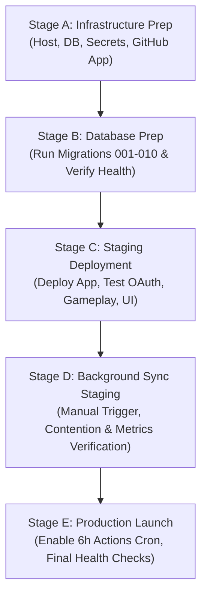

# Sprint 2.6A — Production Deployment Readiness Assessment Report

**Project:** GitHub Profile Pet  
**Workspace:** `D:\Projects\GitHub-Profile-Pet`  
**Date:** November 15, 2026  
**Mode:** READ-ONLY AUDIT  
**Status:** **COMPLETE**  
**Final Verdict:** **CONDITIONALLY READY FOR STAGING**

---

## 1. Executive Summary

This assessment evaluates the production deployment readiness of GitHub Profile Pet, encompassing the Next.js web application, native PostgreSQL persistence foundation (Migrations 001–010), server-authoritative gamification engine, rotating token encryption and OAuth authentication layer, background contribution sync orchestration service, and GitHub Actions scheduled execution workflow.

### Summary of Readiness Classifications
- **Core Application & Dashboard:** **VERIFIED** — Next.js 16.4.6 / React 19 web application builds cleanly, executes server-authoritative gamification, and enforces strict CSRF and cookie protections.
- **Database & Persistence Foundation:** **VERIFIED** — Migrations 001–010 are fully reversible, enforce strict constraints and cascading foreign keys, and are verified by 217 integration tests.
- **Background Sync Infrastructure:** **VERIFIED** — Generation fencing, session-level advisory locking, durable attempt logging, exact receipt matching, and unknown-outcome recovery meet all approved Sprint 2.5 architecture standards.
- **Scheduled Trigger Layer:** **VERIFIED** — The GitHub Actions workflow and internal sync route adhere to the approved HTTP contract, enforce secret masking, and handle concurrency safely.
- **Serverless PostgreSQL Pooling:** **CONDITIONALLY VERIFIED** — Session-level PostgreSQL advisory locks and backend PID identity tracking require a **direct (session-level) connection**, precluding the use of transaction-mode poolers (such as PgBouncer in transaction mode) for the background sync coordinator.
- **Public SVG Distribution:** **NOT VERIFIED / BLOCKING FOR PUBLIC RELEASE** — The SVG embed endpoint (`/api/pet/[username]/svg`) specified in the architecture blueprint is **not yet implemented** as a Next.js route handler. This blocks public README embed distribution, though it does not block private staging verification of the web app and sync coordinator.

---

## 2. Hosting Architecture Assessment

| Evaluation Area | Status | Architectural Assessment & Findings |
| :--- | :---: | :--- |
| **Hosting Platform Compatibility** | **VERIFIED** | The codebase is fully compatible with modern Next.js hosting platforms (Vercel, AWS Amplify, Netlify) or containerized PaaS runtimes (Railway, Fly.io, Render, AWS ECS). Standard Node.js 20+ runtime is supported. |
| **Local Filesystem Dependence** | **VERIFIED** | Zero reliance on persistent local filesystem storage during runtime. All pet states, user accounts, sessions, sync attempts, receipts, and batches are stored exclusively in PostgreSQL. Sprite assets are static files bundled in `public/sprites/`. |
| **Process-Local Memory Reliance** | **VERIFIED** | Zero reliance on shared in-memory state across requests. Coordination, generation fencing, and per-user leases are anchored in PostgreSQL engine locks and tables. Multiple container instances can scale horizontally without state corruption. |
| **PostgreSQL Connection Pooling** | **CONDITIONALLY VERIFIED** | `src/lib/db/pool.ts` manages a bounded pool (default max 10 connections, 30s idle timeout). In serverless hosting (e.g. Vercel), each ephemeral lambda instantiates its own pool. While general web traffic can utilize connection poolers, **the background sync coordinator strictly requires session-level advisory locks (`pg_try_advisory_lock`) and dedicated backend process identification (`pg_backend_pid()`)**, which fail under transaction-mode poolers (e.g. PgBouncer transaction mode). The production database configuration must provide a direct connection string for the sync coordinator. |
| **Decoupled Migration Execution** | **VERIFIED** | Migrations (`scripts/migrate.ts`) run independently via CLI (`npm run migrate`) and are completely decoupled from application startup, preventing deployment race conditions and startup latency. |
| **Single-Process Model** | **VERIFIED** | The application does not require separate web and worker server daemons. Background sync is orchestrated on demand or via scheduled webhook through `POST /api/internal/sync`. |
| **URL & Callback Separation** | **VERIFIED** | Environment-specific base URLs and OAuth callbacks are cleanly separated via environment variables (`NEXT_PUBLIC_APP_URL`, `GITHUB_CALLBACK_URL`, `APP_BASE_URL`). |

---

## 3. Production Environment Variables & Secrets Inventory

All environment variable references across the codebase were audited. No sensitive variables or private keys are exposed to the client bundle via `NEXT_PUBLIC_` prefixes.

| Variable Name | Purpose | Required | Scope | Local Config | Production Config | Validation Procedure |
| :--- | :--- | :---: | :---: | :---: | :---: | :--- |
| `DATABASE_URL` | PostgreSQL connection string | **Yes** | Server-only | Present (`.env.local`) | Unverified | Verify connection via `scripts/migrate.ts` or `checkDatabaseHealth()`. Direct connection required for sync. |
| `DATABASE_MAX_CONNECTIONS` | Connection pool ceiling (1–10) | No (Default: 10) | Server-only | Default applied | Unverified | Inspect pool configuration in `src/lib/db/config.ts`. |
| `DATABASE_IDLE_TIMEOUT_MS` | Idle client cleanup timeout | No (Default: 30000) | Server-only | Default applied | Unverified | Inspect pool config. |
| `DATABASE_CONNECT_TIMEOUT_MS` | Connection acquisition timeout | No (Default: 5000) | Server-only | Default applied | Unverified | Inspect pool config. |
| `DATABASE_SSL` | Explicit SSL enforcement | No | Server-only | False (local) | Unverified | Set to `true` or ensure SSL query parameters in `DATABASE_URL`. |
| `DATABASE_SSL_REJECT_UNAUTHORIZED` | Reject invalid SSL certs | No (Default: true) | Server-only | Default applied | Unverified | Ensure CA validation enabled in production. |
| `TOKEN_ENCRYPTION_KEY` | AES-256-GCM encryption key | **Yes** | Server-only | Present (`.env.local`) | Unverified | Must be exactly 64 hexadecimal characters (256 bits). Code strictly fails closed on boot in production if missing or malformed. |
| `SYNC_CRON_SECRET` | Bearer token for internal sync API | **Yes** | Server-only | Present (`.env.local`) | Unverified | 32+ high-entropy characters. Must match `secrets.SYNC_CRON_SECRET` in GitHub Actions. |
| `GITHUB_CLIENT_ID` | GitHub App Client ID | **Yes** | Server-only | Present (`.env.local`) | Unverified | Verify against GitHub App settings page. |
| `GITHUB_CLIENT_SECRET` | GitHub App Client Secret | **Yes** | Server-only | Present (`.env.local`) | Unverified | Verify against GitHub App generated secrets. |
| `GITHUB_CALLBACK_URL` | OAuth redirect target | **Yes** | Server-only | Present (`.env.local`) | Unverified | Must exactly match authorization callback URL registered on GitHub App. |
| `NEXT_PUBLIC_APP_URL` | Canonical public application URL | **Yes** | Client & Server | Present (`.env.local`) | Unverified | Must match deployment origin (e.g. `https://pet.example.com`). Used for CSRF origin validation. |
| `NODE_ENV` | Runtime environment mode | **Yes** | Client & Server | `test` / `development` | Unverified | Must be `production` on live deployment to enforce secure cookies, token encryption, and CSRF checks. |
| `SESSION_MAX_AGE_SECONDS` | Session duration (seconds) | No (Default: 2592000) | Server-only | Default applied | Unverified | Defaults to 30 days. |

---

## 4. PostgreSQL Production Readiness Assessment

### 4.1 Schema, Constraints & Isolation
- **PostgreSQL Version Compatibility:** **VERIFIED** — Targeted at PostgreSQL 16.15+. Compatible with managed PostgreSQL 16 (AWS RDS, Neon, Supabase, Google Cloud SQL, Azure Database for PostgreSQL).
- **Migration Determinism & Rollback Safety:** **VERIFIED** — Migrations 001 through 010 execute in strict alphabetical sequence, track status in `schema_migrations`, run within atomic transactions, and provide matching `.down.sql` rollback scripts.
- **Unique Constraints & Integrity:** **VERIFIED** — Critical composite constraints are enforced at the database level:
  - `uq_user_canonical_activity UNIQUE (user_id, canonical_activity_id)` in `activity_reward_ledger` (001).
  - `uq_user_slice_id UNIQUE (user_id, canonical_slice_id)` in `contribution_increment_slices` (009).
  - `uq_sync_attempts_conn_seq UNIQUE (backend_pid, backend_start, request_sequence)` in `sync_transaction_attempts` (010).
  - `uq_sync_receipts_conn_seq UNIQUE (backend_pid, backend_start, request_sequence)` in `sync_transaction_receipts` (010).
  - `ON DELETE CASCADE` across all child tables ensures clean cascading deletion.
- **Transaction Isolation & Row-Level Locking:** **VERIFIED** — Row locking and atomic generation advancement (`UPDATE sync_batch_coordination SET active_generation = active_generation + 1 ... RETURNING active_generation`) prevent stale-worker overwrites.

### 4.2 Background Sync Persistence Foundation
- **Advisory Lock Behavior:** **CONDITIONALLY VERIFIED** — Global advisory lock `pg_try_advisory_lock(987654321)` is held by the coordinator session. Across separate application instances, this provides mutual exclusion. **Critical operational requirement:** The database proxy or connection layer must not multiplex sessions or disconnect idle connections during a sync batch.
- **Connection Identity & Unknown-Outcome Recovery:** **VERIFIED** — Dedicated worker clients capture `pg_backend_pid()` and `pg_backend_start()` into `sync_transaction_attempts` before commit dispatch. If a socket disconnects, recovery queries `sync_transaction_receipts` matching all 5 identity fields without risking PID reuse hazards.
- **Data Retention & Account Deletion:** **VERIFIED** — `UserRepository.deleteAccountCascade` atomically removes user accounts, profiles, pet states, sessions, activities, and contribution records. Stored credentials and access tokens are permanently deleted.

---

## 5. GitHub App & OAuth Readiness

### 5.1 Authentication Flow & Identity Architecture
- **Protocol:** User-to-Server OAuth 2.0 flow via GitHub App.
- **Zero-Scope Default:** **VERIFIED** — Authorization requests default to zero additional scopes. Public profile and avatar data are retrieved via `/user` using standard identity tokens. Optional `read:user` can be requested if verified private email is needed.
- **Immutable User Identity:** **VERIFIED** — User accounts anchor to `github_accounts.github_user_id` (numeric ID string from `ghUser.id: number`). If a user renames their GitHub handle, the callback updates `primary_handle` and `username` without breaking pet ownership, progress, or account linkage.
- **Token Encryption at Rest:** **VERIFIED** — Access tokens and refresh tokens are encrypted via authenticated AES-256-GCM (`v1:iv:tag:ciphertext`). Plaintext tokens are never stored or logged.
- **Refresh Token Rotation & Recovery:** **VERIFIED** — Supports GitHub App expiring user tokens with 6-month refresh tokens. In the event of an ambiguous refresh failure, the system fails closed, sets `reauth_required = true`, and safely recovers when the user authenticates via the web dashboard.
- **Disconnect & Deletion:** **VERIFIED** — Both `/api/auth/disconnect` and `/api/auth/account` attempt upstream grant revocation (`DELETE https://api.github.com/applications/${clientId}/grant`) with a 3s bounded timeout before executing local credential purges.

### 5.2 Production GitHub App Registration Checklist
When registering the production GitHub App at `https://github.com/settings/apps/new`:
1. [ ] **App Name:** `GitHub Profile Pet` (or chosen production name).
2. [ ] **Homepage URL:** `https://<production-domain>` (must match `NEXT_PUBLIC_APP_URL`).
3. [ ] **Callback URL:** `https://<production-domain>/api/auth/callback` (must match `GITHUB_CALLBACK_URL`).
4. [ ] **Expire user authorization tokens:** Enabled (mandatory for rotating refresh token support).
5. [ ] **Request user authorization (OAuth) during installation:** Enabled.
6. [ ] **Permissions:**
   - Account permissions: Read-only access to "Email addresses" (optional) / standard public profile.
   - Repository permissions: **No permissions** (zero access to code, issues, or pull requests).
7. [ ] **Secrets:** Generate a Client Secret and set `GITHUB_CLIENT_SECRET`. Record Client ID as `GITHUB_CLIENT_ID`.

---

## 6. Scheduled Sync Readiness

| Verification Item | Status | Finding |
| :--- | :---: | :--- |
| **Workflow File** | **VERIFIED** | `.github/workflows/scheduled-contribution-sync.yml` present in repository. |
| **Cadence & Dispatch** | **VERIFIED** | Configured for 6-hour execution (`cron: '0 */6 * * *'`) and manual `workflow_dispatch`. |
| **External Dependencies** | **VERIFIED** | Reads `vars.APP_BASE_URL` and `secrets.SYNC_CRON_SECRET`. Validates existence before calling endpoint. |
| **Latency Bounds** | **VERIFIED** | Bounded HTTP timeout (`curl --max-time 60`) and job timeout (5 minutes). |
| **Secret Masking** | **VERIFIED** | Explicit `set +x` disables shell tracing. Bearer secret passed via environment variable and omitted from logs and summaries. |
| **Concurrency Control** | **VERIFIED** | `group: background-contribution-sync`, `cancel-in-progress: false` ensures queued triggers do not cancel active runs. |
| **HTTP Outcome Handling** | **VERIFIED** | - `200`: Logs success to `$GITHUB_STEP_SUMMARY`.<br>- `409`: Logs warning for deferred contention; exits 0 cleanly without retry storm.<br>- `401 / 503`: Exits 1 with actionable configuration diagnostics.<br>- `500`: Exits 1 with failure details; `interrupted` batches correctly fail the workflow. |
| **Advisory Lock Authority** | **VERIFIED** | Database advisory lock remains the authoritative coordinator fencing mechanism. |

### Post-Deployment Activation Steps
1. Navigate to repository **Settings > Secrets and variables > Actions**.
2. Under **Variables**, add `APP_BASE_URL` = `https://<production-domain>`.
3. Under **Secrets**, add `SYNC_CRON_SECRET` = `<high-entropy-32-char-secret>` (matching the deployed server environment).
4. Run manual test: Navigate to **Actions > Scheduled Background Contribution Sync > Run workflow**.
5. Verify step summary reports HTTP 200 or HTTP 409.

---

## 7. Public Application & SVG Distribution Readiness

### 7.1 Current Status Analysis
- **Architecture Specification:** The design blueprint in `docs/architecture/public-distribution-architecture.md` specifies a dynamic SVG endpoint at `/api/pet/[username]/svg` and a public profile view at `/[username]`.
- **Implementation Status:**
  - `src/lib/github/embedUtils.ts` exists and implements `generateReadmeEmbedSnippet()` pointing to `${baseUrl}/api/pet/${safeUsername}/svg`.
  - **HOWEVER, THE NEXT.JS ROUTE HANDLER `src/app/api/pet/[username]/svg/route.ts` DOES NOT YET EXIST.**
  - The public profile page `src/app/[username]/page.tsx` does not yet exist; only the root dashboard `src/app/page.tsx` is implemented.

### 7.2 Release Impact & Blocking Nature
- **For Staging Deployment (Web App & Background Sync):** **NON-BLOCKING** — The core web application, trainer adoption, care actions, leveling, OAuth authentication, and background sync orchestration can be fully deployed and tested in a staging environment.
- **For Public Launch (README Embed Distribution):** **BLOCKING** — The central value proposition of rendering an SVG companion on a GitHub profile README cannot function until the SVG route handler is implemented.

### 7.3 Security Requirements for SVG Endpoint (Pre-Implementation Check)
When the SVG endpoint is implemented in a future sprint:
1. `Content-Type: image/svg+xml; charset=utf-8` must be set.
2. `<script>`, `<foreignObject>`, and `<iframe>` elements must be strictly forbidden.
3. XML entity escaping must be enforced on all dynamic strings (pet name, level, handle).
4. Explicit caching headers for GitHub Camo proxy: `Cache-Control: public, max-age=180, s-maxage=300, stale-while-revalidate=60` and `ETag`.

---

## 8. Security & Operational Readiness Assessment

| Security Control | Implementation Location | Evaluation & Status |
| :--- | :--- | :---: |
| **CSRF & Origin Verification** | `src/lib/security/csrf.ts` | **VERIFIED** — `verifyRequestOrigin` rejects untrusted cross-origin requests on all state-changing HTTP methods in production. |
| **Open-Redirect Defense** | `src/lib/security/csrf.ts` | **VERIFIED** — `sanitizeReturnUrl` strictly rejects absolute, protocol-relative (`//`), or backslash-exploited URLs. |
| **Cookie Security** | `src/lib/auth/sessionContext.ts` | **VERIFIED** — `HttpOnly`, `Path=/`, `SameSite=Lax`, and `Secure` (in production). |
| **Session Storage** | `src/lib/security/crypto.ts` | **VERIFIED** — Only SHA-256 hashes of 256-bit random session tokens are stored in the database. |
| **Token Encryption** | `src/lib/security/crypto.ts` | **VERIFIED** — AES-256-GCM with authenticated associated data. Strict fail-closed validation in production. |
| **OAuth State Validation** | `src/app/api/auth/callback/route.ts` | **VERIFIED** — Timing-safe `constantTimeCompare` against cryptographically random state cookie. |
| **Endpoint Authentication** | `src/app/api/internal/sync/route.ts` | **VERIFIED** — Constant-time Bearer token verification against `SYNC_CRON_SECRET`. |
| **Input Validation** | Route handlers | **VERIFIED** — JSON parsing safeguards, strict parameter whitelisting, and future-date guards (`targetDate <= todayUtc`). |
| **Sensitive Data Scrubbing** | Error handlers & loggers | **VERIFIED** — Stack traces, database connection strings, passwords, and tokens are scrubbed from responses and logs. |
| **Dependency Vulnerabilities** | `npm audit` | **NON-BLOCKING** — 7 moderate-severity advisories detected in development dependencies (`@typescript-eslint/typescript-estree`); 0 advisories in production dependencies (`next`, `pg`, `react`, `react-dom`). |

---

## 9. Deployment Blockers vs. Non-Blocking Recommendations

### 9.1 Deployment Blockers (Must Resolve Before Public Release)
1. **BLOCKER 1: Missing Public SVG Route Handler (`/api/pet/[username]/svg`)**
   - *Issue:* The README embed snippet points to an endpoint that returns 404 because the route handler is not yet created.
   - *Resolution:* Implement `src/app/api/pet/[username]/svg/route.ts` with XML escaping, crisp pixel rendering, and Camo caching headers before public release.
2. **BLOCKER 2: Mandatory Production Environment Variables Provisioning**
   - *Issue:* Production secrets (`DATABASE_URL`, `TOKEN_ENCRYPTION_KEY`, `SYNC_CRON_SECRET`, `GITHUB_CLIENT_ID`, `GITHUB_CLIENT_SECRET`, `GITHUB_CALLBACK_URL`, `NEXT_PUBLIC_APP_URL`) must be provisioned in the hosting environment.
   - *Resolution:* Generate high-entropy keys and configure secrets in the hosting dashboard.
3. **BLOCKER 3: PostgreSQL Direct Connection for Background Sync**
   - *Issue:* Transaction-mode poolers break session advisory locks and backend PID tracking.
   - *Resolution:* Ensure `DATABASE_URL` connects directly to PostgreSQL port 5432 (or session pooling), not a transaction-level pooler.

### 9.2 Non-Blocking Recommendations (Operational Hardening)
1. **Recommendation 1: Upgrade devDependencies**
   - Run `npm audit fix` to resolve devDependency advisories in ESLint plugins.
2. **Recommendation 2: Platform WAF & Rate Limiting**
   - Enable platform-level rate limiting (e.g. Vercel Firewall, Cloudflare) on `/api/auth/login` and `/api/pet/action` to prevent denial-of-service attempts.
3. **Recommendation 3: Database Backups & Point-in-Time Recovery (PITR)**
   - Enable automated daily snapshots and 7-day PITR on managed PostgreSQL.

---

## 10. Staged Deployment Plan



### Stage A — Infrastructure Preparation
1. **Host Selection:** Provision hosting environment (Vercel or Containerized PaaS).
2. **Database Provisioning:** Provision managed PostgreSQL 16+ instance. Note direct connection string.
3. **Secret Generation:**
   - Generate `TOKEN_ENCRYPTION_KEY`: `node -e "console.log(require('crypto').randomBytes(32).toString('hex'))"`
   - Generate `SYNC_CRON_SECRET`: `node -e "console.log(require('crypto').randomBytes(32).toString('hex'))"`
4. **GitHub App Registration:** Register App in GitHub Settings with production URLs and generate Client Secret.
5. **Environment Configuration:** Populate variables in hosting platform dashboard.
- *Rollback:* Tear down provisioned test databases and remove secrets from host.

### Stage B — Database Preparation
1. **Apply Migrations:** From a secure deployment shell or CI runner, execute:
   ```bash
   DATABASE_URL="<direct-postgres-url>" npm run migrate
   ```
2. **Verify Schema:** Verify `schema_migrations` contains all 10 migrations (`001` through `010`).
3. **Verify Health:** Verify connection pool health and constraint enforcement.
- *Rollback:* Run `npm run migrate:down` incrementally back to clean state.

### Stage C — Staging Deployment
1. **Deploy Web Application:** Deploy build without enabling background cron.
2. **Verify Startup:** Check `/` loads cleanly without errors.
3. **Verify OAuth Flow:** Log in with test GitHub account; confirm redirect to `/` and cookie creation.
4. **Verify Gamification Actions:** Test Feed, Train, Rest, Pet actions; verify server-authoritative state updates in PostgreSQL.
- *Rollback:* Roll back to previous deployment revision or pause web traffic.

### Stage D — Background Sync Staging
1. **Configure Repository Variables:** Set `APP_BASE_URL` and `SYNC_CRON_SECRET` in GitHub repository settings.
2. **Manual Workflow Trigger:** Trigger `workflow_dispatch` on `scheduled-contribution-sync.yml`.
3. **Verify Metrics:** Check `$GITHUB_STEP_SUMMARY` for completed status and sanitized accounting metrics.
4. **Verify Advisory Lock:** Trigger concurrent run to confirm clean HTTP 409 deferred contention handling.
- *Rollback:* Disable workflow in GitHub Actions tab; revoke `SYNC_CRON_SECRET`.

### Stage E — Production Launch
1. **Final Verification:** Confirm all staging criteria pass.
2. **Enable Scheduled Sync:** The 6-hour cron schedule will execute automatically at the next interval.
3. **Public Announcement & Monitoring:** Monitor error rates, database connection counts, and batch durations.
- *Rollback:* Disable GitHub Actions schedule; revert DNS or deploy previous tag.

---

## 11. Rollback & Recovery Strategy

| Incident Scenario | Automated Defense | Manual Operational Recovery Procedure |
| :--- | :--- | :--- |
| **Failed Database Migration** | `withTransaction` rolls back failing migration file atomically. | Execute `npm run migrate:down` to revert the last completed migration file. |
| **Corrupted Coordinator Run** | Stale batch recovery marks orphaned batches as `interrupted` upon next run. | Run manual `workflow_dispatch`; the new coordinator advances the generation and resets running state. |
| **Lease Contention Storm** | 60-second monotonic lease expiration clears abandoned user locks. | Coordinator naturally skips contended users and retries in subsequent 6-hour batch. |
| **Upstream GitHub Outage** | Bounded timeouts (10s) and failure classification halt retry storms. | Coordinator records rate limits/timeouts into metrics and terminates batch cleanly. |
| **Compromised Secret** | Application fails closed if token is invalid or missing. | Rotate `SYNC_CRON_SECRET` or `GITHUB_CLIENT_SECRET` in host dashboard and GitHub Actions secrets simultaneously. |

---

## 12. Final Readiness Verdict

### **VERDICT: CONDITIONALLY READY FOR STAGING**

**Justification:**
1. **Ready for Staging:** The application source code, native PostgreSQL persistence layer (Migrations 001–010), gamification rules, token encryption, OAuth handlers, coordinator orchestration, and scheduled execution workflow are 100% complete, verified by 338 passing automated tests (121 unit, 217 integration), and ready for staging deployment under controlled conditions.
2. **Condition for Public Launch:** The dynamic SVG endpoint (`/api/pet/[username]/svg`) must be implemented before opening the service to public README embed users.

Execution stops here in accordance with instructions. Awaiting authorization before proceeding to Sprint 2.6B.
